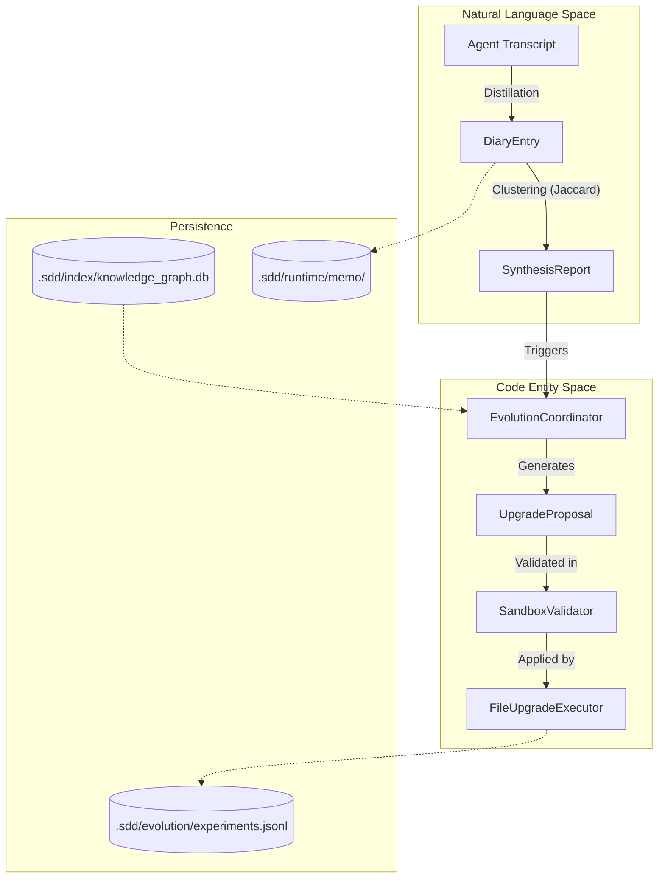
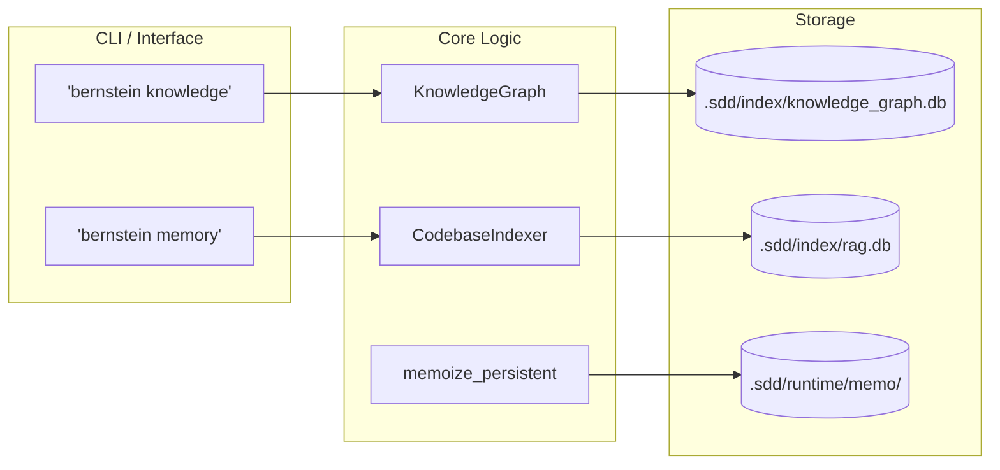

<!-- source: DeepWiki mcp.deepwiki.com · repo sipyourdrink-ltd/bernstein · page 9 Knowledge, Memory, and Self-Evolution · fetched 2026-10-26 -->

# Knowledge, Memory, and Self-Evolution

Relevant source files

The following files were used as context for generating this wiki page:

- [docs/concepts/fingerprint-memoization.md](docs/concepts/fingerprint-memoization.md)
- [src/bernstein/core/knowledge/knowledge_graph.py](src/bernstein/core/knowledge/knowledge_graph.py)
- [src/bernstein/core/knowledge/rag.py](src/bernstein/core/knowledge/rag.py)
- [src/bernstein/core/persistence/fingerprint.py](src/bernstein/core/persistence/fingerprint.py)
- [tests/unit/test_fingerprint.py](tests/unit/test_fingerprint.py)
- [tests/unit/test_knowledge_graph.py](tests/unit/test_knowledge_graph.py)
- [tests/unit/test_rag_memo_invalidation.py](tests/unit/test_rag_memo_invalidation.py)
- [tests/unit/test_sonar_final_style_hygiene.py](tests/unit/test_sonar_final_style_hygiene.py)

Bernstein is designed as a learning system that improves its performance over time. This is achieved through a dual-layered approach: a **Memory Layer** that captures and retrieves cross-task insights, and an **Evolution Loop** that uses those insights to autonomously propose and validate system-level upgrades.

The system bridges the gap between transient agent executions and long-term project intelligence by distilling transcripts into structured knowledge and converting performance metrics into actionable code or configuration changes.

## System Architecture Overview

The interaction between the knowledge and evolution subsystems is depicted below:

**Knowledge to Evolution Flow**

Sources: [src/bernstein/core/knowledge/knowledge_graph.py:1-25](), [src/bernstein/core/persistence/fingerprint.py:23-28](), [src/bernstein/core/knowledge/rag.py:80-99]()

---

## 9.1 Knowledge Base and Memory Layer
The Memory Layer provides agents with persistent context across different tasks and orchestration runs. It consists of three primary components:

1.  **Codebase Knowledge Graph**: A SQLite-backed graph for impact analysis and symbol resolution [src/bernstein/core/knowledge/knowledge_graph.py:1-20](). It uses AST parsing to build a semantic graph of files, functions, and classes [src/bernstein/core/knowledge/knowledge_graph.py:186-200]().
2.  **Fingerprint Memoization**: A content-addressed store that prevents expensive recomputes (like RAG embeddings or graph extraction) by hashing both the input and the function body [src/bernstein/core/persistence/fingerprint.py:1-15]().
3.  **Codebase RAG (BM25)**: A lightweight retrieval system using SQLite FTS5 to index project files by function and class, allowing agents to find relevant code without exhaustive searching [src/bernstein/core/knowledge/rag.py:1-10]().

**Memory and Indexing Entity Mapping**

Sources: [src/bernstein/core/knowledge/knowledge_graph.py:177-205](), [src/bernstein/core/knowledge/rag.py:173-215](), [src/bernstein/core/persistence/fingerprint.py:23-28]()

For details, see [Knowledge Base and Memory Layer](#9.1).

---

## 9.2 Self-Evolution Loop
The Self-Evolution system implements an "autoresearch" pattern: it continuously monitors system metrics, generates `UpgradeProposal` objects, and validates them in isolated sandboxes.

### Key Components:
*   **Evolution System**: A pipeline consisting of a "Visionary" to propose changes, an "Analyst" to review them, and a "Production Gate" to ensure safety.
*   **Risk Tiers**: Changes are categorized (L0–L3) to determine the required level of verification and human oversight.
*   **Fingerprint Dependency Tracking**: The evolution loop relies on the `fingerprint` module to ensure that when evolution logic changes, existing cached results are invalidated via `depends_on` module hashing [src/bernstein/core/persistence/fingerprint.py:64-88]().
*   **Evolution Circuit Breaker**: Halts the loop if the `UpgradeProposal` failure rate exceeds safety thresholds or if an "oscillation" (repeatedly applying and reverting the same change) is detected.

| Component | File Path | Role |
| :--- | :--- | :--- |
| `KnowledgeGraph` | `src/bernstein/core/knowledge/knowledge_graph.py` | Provides impact analysis for proposed changes. |
| `CodebaseIndexer` | `src/bernstein/core/knowledge/rag.py` | Indexes the codebase for context retrieval. |
| `MemoStore` | `src/bernstein/core/persistence/fingerprint.py` | Manages content-addressed cache for evolution experiments. |
| `memoize_persistent` | `src/bernstein/core/persistence/fingerprint.py` | Decorator to cache expensive evolution validation steps. |

Sources: [src/bernstein/core/persistence/fingerprint.py:107-134](), [src/bernstein/core/knowledge/rag.py:200-215](), [src/bernstein/core/knowledge/knowledge_graph.py:109-119]()

For details, see [Self-Evolution Loop](#9.2).

---
**Sources:**
- [src/bernstein/core/knowledge/knowledge_graph.py:1-220]()
- [src/bernstein/core/knowledge/rag.py:1-220]()
- [src/bernstein/core/persistence/fingerprint.py:1-200]()
- [docs/concepts/fingerprint-memoization.md:1-149]()
- [tests/unit/test_knowledge_graph.py:51-94]()

---

