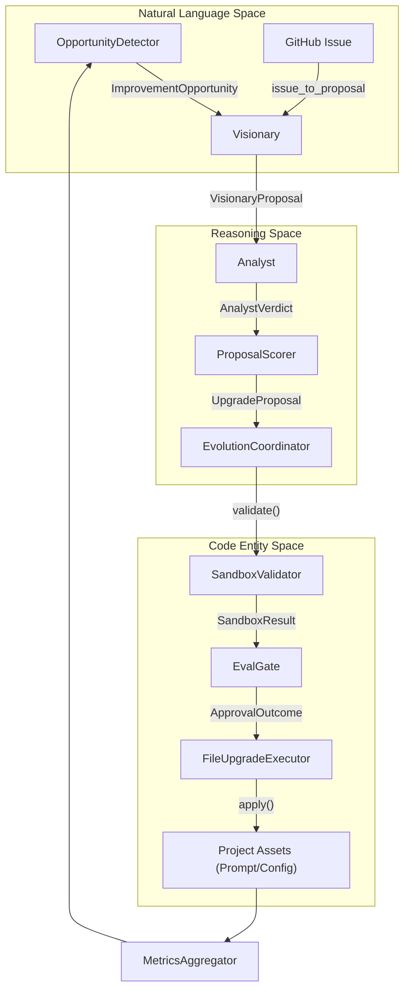
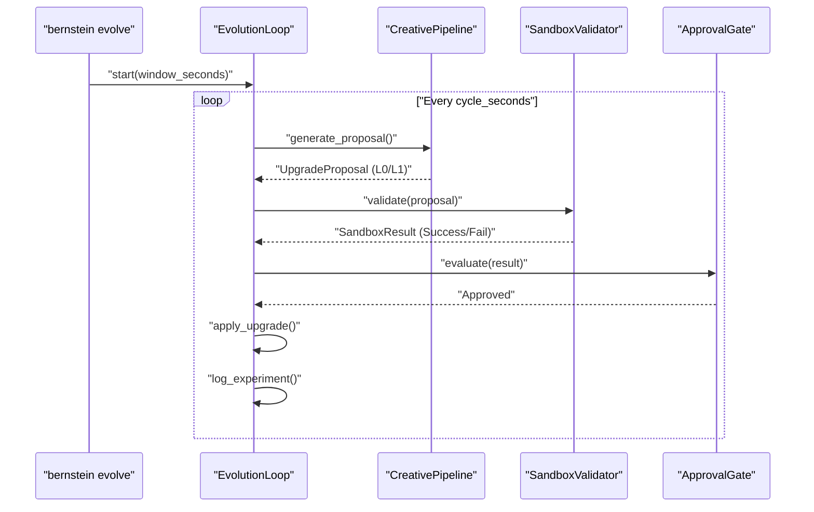

<!-- source: DeepWiki mcp.deepwiki.com · repo sipyourdrink-ltd/bernstein · page 9.2 Self-Evolution Loop · fetched 2026-10-26 -->

# Self-Evolution Loop

Relevant source files

The following files were used as context for generating this wiki page:

- [.github/workflows/ci-macos-nightly.yml](.github/workflows/ci-macos-nightly.yml)
- [.github/workflows/docs-observability-snapshot.yml](.github/workflows/docs-observability-snapshot.yml)
- [.github/workflows/mutation-fixed.yml](.github/workflows/mutation-fixed.yml)
- [.github/workflows/pr-observability-summary.yml](.github/workflows/pr-observability-summary.yml)
- [docs/observability/snapshots/.gitkeep](docs/observability/snapshots/.gitkeep)
- [docs/observability/unified-doctor.md](docs/observability/unified-doctor.md)
- [scripts/observability/build_pr_summary.py](scripts/observability/build_pr_summary.py)
- [scripts/observability/gate.py](scripts/observability/gate.py)
- [scripts/observability/render_trends.py](scripts/observability/render_trends.py)
- [src/bernstein/benchmark/swe_bench.py](src/bernstein/benchmark/swe_bench.py)
- [src/bernstein/bridges/openclaw_gateway.py](src/bernstein/bridges/openclaw_gateway.py)
- [src/bernstein/cli/commands/analyze_cmd.py](src/bernstein/cli/commands/analyze_cmd.py)
- [src/bernstein/cli/commands/doctor/__init__.py](src/bernstein/cli/commands/doctor/__init__.py)
- [src/bernstein/cli/commands/doctor/_render.py](src/bernstein/cli/commands/doctor/_render.py)
- [src/bernstein/cli/commands/doctor/backends.py](src/bernstein/cli/commands/doctor/backends.py)
- [src/bernstein/cli/commands/doctor/code_scanning.py](src/bernstein/cli/commands/doctor/code_scanning.py)
- [src/bernstein/cli/commands/doctor/observe.py](src/bernstein/cli/commands/doctor/observe.py)
- [src/bernstein/cli/commands/quickstart_cmd.py](src/bernstein/cli/commands/quickstart_cmd.py)
- [src/bernstein/cli/dashboard_actions.py](src/bernstein/cli/dashboard_actions.py)
- [src/bernstein/cli/run_confirm.py](src/bernstein/cli/run_confirm.py)
- [src/bernstein/cli/status.py](src/bernstein/cli/status.py)
- [src/bernstein/core/agents/claude_agent_card.py](src/bernstein/core/agents/claude_agent_card.py)
- [src/bernstein/core/agents/claude_message_normalizer.py](src/bernstein/core/agents/claude_message_normalizer.py)
- [src/bernstein/core/orchestration/run_report.py](src/bernstein/core/orchestration/run_report.py)
- [src/bernstein/core/persistence/file_health.py](src/bernstein/core/persistence/file_health.py)
- [src/bernstein/core/security/command_policy.py](src/bernstein/core/security/command_policy.py)
- [src/bernstein/core/security/policy_engine.py](src/bernstein/core/security/policy_engine.py)
- [src/bernstein/core/security/rule_enforcer.py](src/bernstein/core/security/rule_enforcer.py)
- [src/bernstein/eval/scenario_runner.py](src/bernstein/eval/scenario_runner.py)
- [src/bernstein/evolution/detector.py](src/bernstein/evolution/detector.py)
- [src/bernstein/evolution/observability_signals.py](src/bernstein/evolution/observability_signals.py)
- [src/bernstein/plugins/hookspecs.py](src/bernstein/plugins/hookspecs.py)
- [src/bernstein/plugins/manager.py](src/bernstein/plugins/manager.py)
- [tests/unit/cli/doctor/test_observe.py](tests/unit/cli/doctor/test_observe.py)
- [tests/unit/observability/test_gate.py](tests/unit/observability/test_gate.py)
- [tests/unit/test_hook_exit_codes.py](tests/unit/test_hook_exit_codes.py)
- [tests/unit/test_metrics.py](tests/unit/test_metrics.py)
- [tests/unit/test_observability_signals.py](tests/unit/test_observability_signals.py)
- [tests/unit/test_repo_analyzer.py](tests/unit/test_repo_analyzer.py)
- [tests/unit/test_sonar_s3358_nested_ternary.py](tests/unit/test_sonar_s3358_nested_ternary.py)

The Self-Evolution Loop implements the **autoresearch pattern**: a continuous cycle of experimentation where the system proposes, validates, and applies upgrades to its own configuration, prompts, and logic [src/bernstein/evolution/loop.py:1-14](). It targets a high-velocity improvement cadence using a creative pipeline that bridges natural language opportunities to executable code changes [src/bernstein/evolution/loop.py:101-103]().

## System Architecture

The evolution system is managed by the `EvolutionLoop` (and its coordinator logic), which orchestrates several specialized components to move from metric analysis to production deployment [src/bernstein/evolution/cycle_runner.py:82-145]().

### Evolution Pipeline Components
| Component | Responsibility | Code Entity |
| :--- | :--- | :--- |
| **Aggregator** | Collects performance metrics and API usage patterns | `MetricsAggregator` [src/bernstein/evolution/aggregator.py]() |
| **Detector** | Identifies feature gaps and improvement opportunities | `OpportunityDetector` [src/bernstein/evolution/detector.py]() |
| **Creative Pipeline** | Generates and refines technical proposals | `CreativePipeline` [src/bernstein/evolution/creative.py]() |
| **Sandbox** | Validates changes in an isolated environment | `SandboxValidator` [src/bernstein/evolution/sandbox.py]() |
| **Governor** | Manages risk tiers and adaptive weights | `AdaptiveGovernor` [src/bernstein/evolution/governance.py]() |
| **Circuit Breaker** | Halts evolution if error rates spike | `CircuitBreaker` [src/bernstein/evolution/circuit.py]() |

### Creative Pipeline: Visionary → Analyst → Gate
The "Creative Pipeline" is the core of the evolution logic. It uses a multi-stage approach to ensure high-quality upgrades:
1.  **Visionary**: Generates a `VisionaryProposal` based on detected opportunities or GitHub issues [src/bernstein/evolution/creative.py:49-58]().
2.  **Analyst**: Critiques the proposal, providing an `AnalystVerdict` on feasibility and risk [src/bernstein/evolution/creative.py:46-57]().
3.  **Production Gate**: Final validation via `EvalGate` or `ApprovalGate` before application [src/bernstein/evolution/gate.py:57-66]().

The system also integrates with the plugin system via `on_evolve_proposal` hooks, allowing external auditors to receive verdicts on proposed changes [src/bernstein/plugins/hookspecs.py:195-202]().

**Sources:** [src/bernstein/evolution/loop.py:8-14](), [src/bernstein/evolution/cycle_runner.py:128-165](), [src/bernstein/evolution/creative.py:45-60](), [src/bernstein/plugins/hookspecs.py:195-202]()

## Risk Tiers (L0–L3)

Bernstein categorizes evolution proposals into four risk tiers. The automation level is determined by these tiers [src/bernstein/evolution/loop.py:104-107]().

| Tier | Name | Description | Automation |
| :--- | :--- | :--- | :--- |
| **L0** | **CONFIG** | Low-risk configuration tweaks (e.g., timeouts, retry counts). | Fully Automated |
| **L1** | **TEMPLATE** | Prompt template refinements and skill injections. | Fully Automated |
| **L2** | **LOGIC** | Changes to core orchestration or agent logic. | Human-in-the-loop |
| **L3** | **PROTOCOL** | Changes to A2A or MCP protocols, or security guardrails. | Human-in-the-loop |

**Sources:** [src/bernstein/evolution/loop.py:11-14](), [src/bernstein/evolution/types.py:83-87](), [src/bernstein/evolution/cycle_runner.py:89-91]()

## Implementation Flow

The following diagram illustrates the transition from a natural language "Opportunity" to a "Code Upgrade" within the `EvolutionLoop`.

### Evolution Data Flow

**Sources:** [src/bernstein/evolution/loop.py:47-87](), [src/bernstein/evolution/cycle_runner.py:128-158](), [src/bernstein/evolution/creative.py:45-60]()

## Key Classes and Functions

### `EvolutionCoordinator`
While the `EvolutionLoop` handles the timing and session management [src/bernstein/evolution/loop.py:97-132](), the coordination logic manages the scoring and selection of proposals.

### `UpgradeProposal` Scoring
Proposals are scored by the `ProposalScorer` [src/bernstein/evolution/cycle_runner.py:139]() using weights provided by the `AdaptiveGovernor` [src/bernstein/evolution/governance.py:68-72]().
*   **Oscillation Guard**: Prevents the system from repeatedly flipping a configuration value back and forth by tracking recent `ExperimentResult` entries in `.sdd/evolution/experiments.jsonl` [src/bernstein/evolution/loop.py:171]().
*   **Risk Scoring**: The `RiskScorer` evaluates the `ProposalRiskScore` to determine if an L1 proposal should be escalated to L2 based on the complexity of the diff [src/bernstein/evolution/risk.py:78-79]().

### Safety Mechanisms
1.  **Evolution Circuit Breaker**: The `CircuitBreaker` monitors the `experiments.jsonl` log. If the failure rate of applied upgrades exceeds a threshold, it trips and prevents further automated cycles [src/bernstein/evolution/circuit.py:44-53]().
2.  **Sandbox Isolation**: All evolution experiments run inside a `SandboxValidator`, ensuring that a failing proposal cannot corrupt the primary worktree or leak credentials [src/bernstein/evolution/sandbox.py:70-79]().
3.  **Policy Engine Integration**: Evolution proposals that modify logic or protocols are passed through the `PolicyEngine` to check for `DecisionType.DENY` or `DecisionType.IMMUNE` violations [src/bernstein/core/security/policy_engine.py:32-40](), [src/bernstein/core/security/policy_engine.py:217-223]().

**Sources:** [src/bernstein/evolution/loop.py:143-158](), [src/bernstein/evolution/cycle_runner.py:139-144](), [src/bernstein/evolution/governance.py:182-184](), [src/bernstein/core/security/policy_engine.py:32-40]()

## Execution: `bernstein evolve`

The evolution loop is triggered via the CLI. This command initializes the `EvolutionLoop` and begins the time-boxed window [src/bernstein/evolution/loop.py:113]().

### Command Sequence

**Sources:** [src/bernstein/evolution/loop.py:98-120](), [src/bernstein/evolution/cycle_runner.py:83-105]()

### Persistence and State
Evolution state is stored in the `.sdd/evolution/` directory:
*   `experiments.jsonl`: Audit log of every attempt, including diffs and metrics [src/bernstein/evolution/loop.py:171]().
*   `deferred.jsonl`: L2 and L3 proposals awaiting manual review [src/bernstein/evolution/loop.py:172]().
*   `governance.json`: Current weights and risk thresholds managed by the `AdaptiveGovernor` [src/bernstein/evolution/governance.py:182]().

**Sources:** [src/bernstein/evolution/loop.py:155-158](), [src/bernstein/evolution/cycle_runner.py:155-158]()

---

