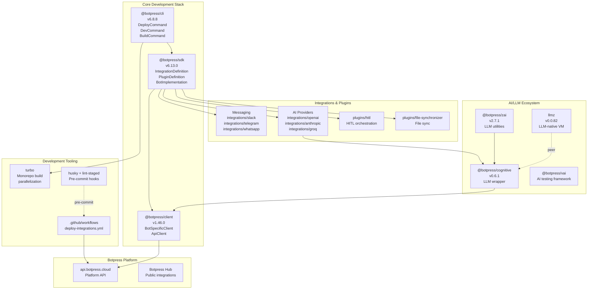
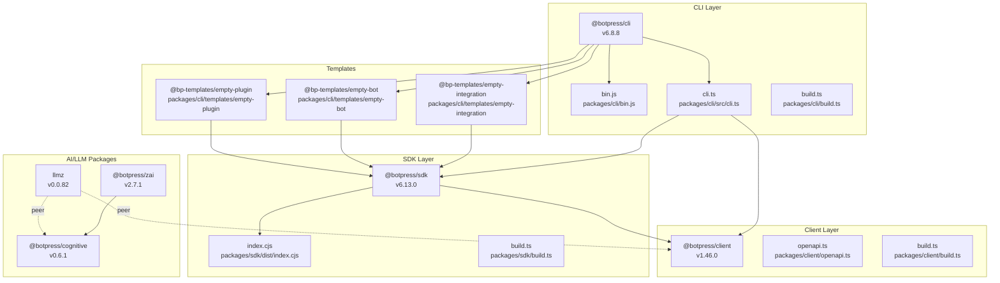

<!-- source: DeepWiki mcp.deepwiki.com · repo botpress/botpress · page 1 Overview · fetched 2026-10-26 -->

# Overview

Relevant source files

The following files were used as context for generating this wiki page:

- [.github/ISSUE_TEMPLATE/config.yml](.github/ISSUE_TEMPLATE/config.yml)
- [.github/ISSUE_TEMPLATE/issue.yml](.github/ISSUE_TEMPLATE/issue.yml)
- [.github/actions/deploy-interfaces/action.yml](.github/actions/deploy-interfaces/action.yml)
- [.github/actions/deploy-plugins/action.yml](.github/actions/deploy-plugins/action.yml)
- [.github/scripts/interface-exists.sh](.github/scripts/interface-exists.sh)
- [.github/scripts/plugin-exists.sh](.github/scripts/plugin-exists.sh)
- [.gitignore](.gitignore)
- [LICENSE](LICENSE)
- [integrations/shopify-admin/definitions/actions.ts](integrations/shopify-admin/definitions/actions.ts)
- [integrations/shopify-admin/definitions/events.ts](integrations/shopify-admin/definitions/events.ts)
- [integrations/shopify-admin/definitions/index.ts](integrations/shopify-admin/definitions/index.ts)
- [integrations/shopify-admin/definitions/schemas.ts](integrations/shopify-admin/definitions/schemas.ts)
- [integrations/shopify-admin/definitions/states.ts](integrations/shopify-admin/definitions/states.ts)
- [integrations/shopify-admin/hub.md](integrations/shopify-admin/hub.md)
- [integrations/shopify-admin/icon.svg](integrations/shopify-admin/icon.svg)
- [package.json](package.json)
- [packages/cli/package.json](packages/cli/package.json)
- [packages/cli/templates/empty-bot/package.json](packages/cli/templates/empty-bot/package.json)
- [packages/cli/templates/empty-integration/package.json](packages/cli/templates/empty-integration/package.json)
- [packages/cli/templates/empty-plugin/package.json](packages/cli/templates/empty-plugin/package.json)
- [packages/cli/templates/hello-world/package.json](packages/cli/templates/hello-world/package.json)
- [packages/cli/templates/webhook-message/package.json](packages/cli/templates/webhook-message/package.json)
- [packages/client/package.json](packages/client/package.json)
- [packages/cognitive/package.json](packages/cognitive/package.json)
- [packages/llmz/package.json](packages/llmz/package.json)
- [packages/sdk/package.json](packages/sdk/package.json)
- [packages/vai/package.json](packages/vai/package.json)
- [packages/zai/package.json](packages/zai/package.json)
- [pnpm-lock.yaml](pnpm-lock.yaml)
- [readme.md](readme.md)
- [tsconfig.json](tsconfig.json)

This document provides a comprehensive overview of the Botpress repository structure, architecture, and core systems. Botpress is a conversational AI platform built as a monorepo containing core packages, 50+ integrations, plugins, and development tools for building AI-powered bots and assistants.

This overview covers the monorepo structure, core packages, integration framework, and development workflows. For detailed information about specific components, see [Architecture](#1.1) for system design details, [Core Packages](#2) for foundational libraries, [Integration Framework](#4) for external service connections, and [CLI & Development Tools](#3) for the development experience.

## Repository Structure

The Botpress repository is organized as a pnpm workspace monorepo with five main categories:

| Category | Path | Count | Description |
|----------|------|-------|-------------|
| **Core Packages** | `packages/` | ~12 | Foundational libraries: CLI, SDK, Client, AI/LLM packages |
| **Integrations** | `integrations/` | 50+ | External service connectors across messaging, AI, CRM, storage |
| **Interfaces** | `interfaces/` | ~8 | Standardized contracts: `hitl`, `llm`, `crud`, `speech-to-text` |
| **Plugins** | `plugins/` | ~5 | Extensible functionality: HITL orchestration, knowledge, synchronizer |
| **Bots** | `bots/` | ~8 | Example implementations: hello-world, bugbuster, hit-looper |

Sources: [pnpm-lock.yaml:1-11](), [package.json:1-32]()

**High-Level System Architecture**

Sources: [packages/cli/package.json:2-31](), [packages/sdk/package.json:2-23](), [packages/client/package.json:2-27](), [packages/zai/package.json:2-35](), [packages/llmz/package.json:2-78](), [pnpm-lock.yaml:14-112]()

## Core Architecture Components

The system is built around a three-tier dependency stack: CLI → SDK → Client, with parallel AI/LLM infrastructure. For details, see [Architecture](#1.1).

**Core Package Dependencies and Code Entities**

Sources: [packages/cli/package.json:1-77](), [packages/sdk/package.json:1-45](), [packages/client/package.json:1-45](), [packages/zai/package.json:1-67](), [packages/llmz/package.json:1-100](), [packages/cli/templates/empty-integration/package.json:1-16]()

### SDK (`@botpress/sdk`)

The SDK provides the core framework for building bots and integrations. It defines the structure for `IntegrationDefinition`, `PluginImplementation`, and the runtime handler system used by the Botpress Cloud. For details, see [SDK](#2.1).

### CLI (`@botpress/cli`)

The CLI (`bp`) manages the project lifecycle, including scaffolding from templates (found in `packages/cli/templates/`), building projects using `esbuild`, and deploying to the Botpress Cloud. For details, see [CLI](#2.2).

### Client (`@botpress/client`)

The client library provides a TypeScript-first wrapper around the Botpress Platform API. It handles communication for managing conversations, users, and messages. For details, see [Client](#2.3).

Sources: [packages/cli/package.json:22-24](), [packages/sdk/package.json:5-7](), [packages/client/package.json:5-7]()

## Integration Framework

The integration system provides 50+ connectors across messaging platforms (Slack, WhatsApp), AI providers (OpenAI, Anthropic), and productivity tools (Notion, GitHub).

- **Messaging Integrations**: Handle webhooks and message routing for platforms like Slack and Telegram.
- **LLM Integrations**: Standardize AI provider interactions via the `generateContent` action.
- **Support & CRM**: Connect Botpress to tools like Zendesk and HubSpot, often implementing Human-in-the-Loop (HITL) interfaces.

For details, see [Integration Framework](#4).

Sources: [pnpm-lock.yaml:128-140](), [pnpm-lock.yaml:159-162]()

## Plugin System

Plugins extend bot functionality through handler composition and hook interception. The system allows adding features like knowledge base synchronization or personality modifiers to any bot.

- **HITL Plugin**: Manages human-agent handoffs.
- **File Synchronizer**: Syncs external files to the Botpress Knowledge Base.

For details, see [Plugin System](#5).

Sources: [pnpm-lock.yaml:203-205](), [packages/cli/templates/empty-plugin/package.json:1-16]()

## Development Workflow

The development workflow is managed via `pnpm` and `turbo`.

| Command | Script | Purpose |
|---------|--------|---------|
| `pnpm build` | `turbo run build` | Build all packages and integrations |
| `pnpm check` | `pnpm check:lint && pnpm check:type` | Run quality checks (oxlint, eslint, tsc) |
| `pnpm fix` | `pnpm fix:lint && pnpm fix:format` | Auto-fix linting and formatting issues |
| `pnpm test` | `turbo test` | Run vitest across the monorepo |

For details, see [Development & Deployment](#6).

Sources: [package.json:4-23](), [packages/cli/package.json:5-15]()

---

