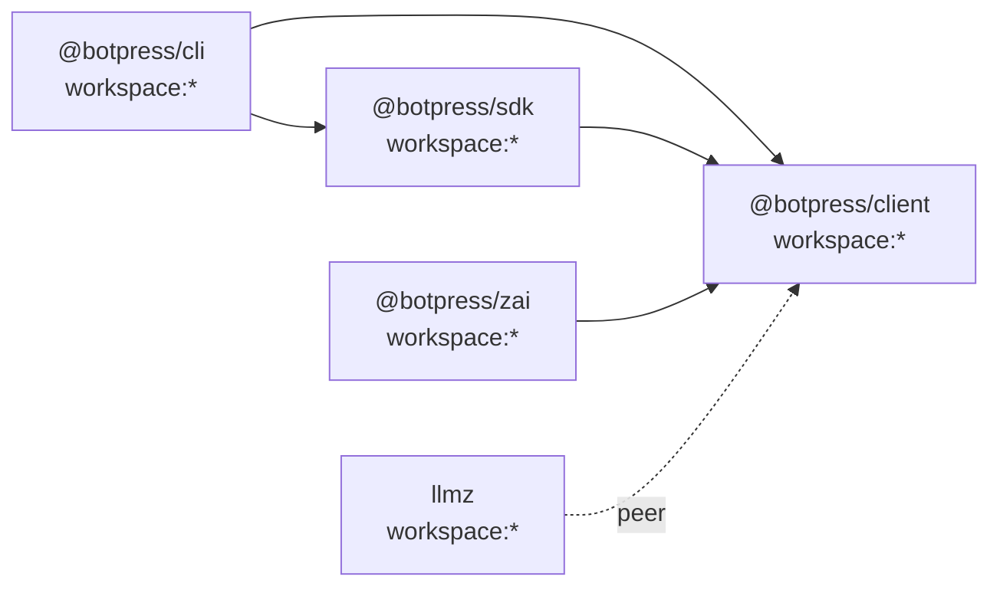

<!-- source: DeepWiki mcp.deepwiki.com · repo botpress/botpress · page 1.2 Monorepo Structure · fetched 2026-10-26 -->

# Monorepo Structure

<details>
<summary>Relevant source files</summary>

The following files were used as context for generating this wiki page:

- [.oxlintrc.json](.oxlintrc.json)
- [eslint.config.mjs](eslint.config.mjs)
- [integrations/calcom/src/actions/bookEvent.ts](integrations/calcom/src/actions/bookEvent.ts)
- [integrations/calcom/src/actions/getEventTypes.ts](integrations/calcom/src/actions/getEventTypes.ts)
- [integrations/linear/definitions/actions.ts](integrations/linear/definitions/actions.ts)
- [integrations/linear/src/actions/find-target.ts](integrations/linear/src/actions/find-target.ts)
- [integrations/linear/src/actions/get-issue.ts](integrations/linear/src/actions/get-issue.ts)
- [integrations/linear/src/actions/get-user.ts](integrations/linear/src/actions/get-user.ts)
- [integrations/linear/src/index.ts](integrations/linear/src/index.ts)
- [package.json](package.json)
- [packages/cli/package.json](packages/cli/package.json)
- [packages/cli/src/typings.ts](packages/cli/src/typings.ts)
- [packages/cli/templates/empty-bot/package.json](packages/cli/templates/empty-bot/package.json)
- [packages/cli/templates/empty-integration/package.json](packages/cli/templates/empty-integration/package.json)
- [packages/cli/templates/empty-plugin/package.json](packages/cli/templates/empty-plugin/package.json)
- [packages/cli/templates/hello-world/package.json](packages/cli/templates/hello-world/package.json)
- [packages/cli/templates/webhook-message/package.json](packages/cli/templates/webhook-message/package.json)
- [packages/client/package.json](packages/client/package.json)
- [packages/cognitive/package.json](packages/cognitive/package.json)
- [packages/llmz/package.json](packages/llmz/package.json)
- [packages/sdk/package.json](packages/sdk/package.json)
- [packages/vai/package.json](packages/vai/package.json)
- [packages/zai/package.json](packages/zai/package.json)
- [pnpm-lock.yaml](pnpm-lock.yaml)
- [tsconfig.json](tsconfig.json)

</details>


This document details the organization of the Botpress monorepo, including workspace structure, package categories, dependency management with pnpm, and versioning strategies. The monorepo contains core development packages, 50+ integrations, plugins, example bots, and interface definitions, all managed as a unified codebase.

For information about the high-level architecture and how these components interact, see section 1.1. For build system details, see section 3.2.

## Workspace Organization

The Botpress repository is organized as a pnpm workspace with distinct package categories, each serving a specific purpose in the platform ecosystem.

### Directory Structure

```
botpress/
├── packages/          # Core platform packages
│   ├── cli/          # @botpress/cli - Build and deployment tooling
│   ├── sdk/          # @botpress/sdk - Bot and integration API
│   ├── client/       # @botpress/client - Platform API client
│   ├── common/       # Shared utilities across packages
│   ├── cognitive/    # @botpress/cognitive - LLM wrapper
│   ├── zai/          # @botpress/zai - LLM utilities
│   ├── llmz/         # llmz - LLM-native VM
│   └── vai/          # @botpress/vai - AI testing framework
│
├── integrations/     # 50+ external service integrations
│   ├── openai/       # @botpresshub/openai
│   ├── slack/        # @botpresshub/slack
│   ├── linear/       # @botpresshub/linear
│   └── ...
│
├── plugins/          # Bot functionality extensions
│   ├── hitl/         # @botpresshub/hitl-plugin
│   ├── file-sync/    # @botpresshub/file-synchronizer
│   └── ...
│
├── interfaces/       # Interface contracts
│   ├── hitl/         # @botpresshub/hitl - HITL interface
│   ├── llm/          # @botpresshub/llm - LLM interface
│   └── ...
│
└── bots/            # Example bot implementations
    ├── hello-world/  # Basic bot example
    ├── bugbuster/    # GitHub/Linear issue triage bot
    └── echo/         # Simple echo bot
```

**Sources:** [pnpm-lock.yaml:12-232](), [package.json:1-73]()

### Directory Structure Diagram

```mermaid
graph TB
    ROOT["botpress/"]
    
    subgraph "Core Packages"
        PACKAGES["packages/"]
        CLI["cli/<br/>@botpress/cli<br/>v6.8.8"]
        SDK["sdk/<br/>@botpress/sdk<br/>v6.13.0"]
        CLIENT["client/<br/>@botpress/client<br/>v1.46.0"]
        COG["cognitive/<br/>@botpress/cognitive<br/>v0.6.1"]
        ZAI["zai/<br/>@botpress/zai<br/>v2.7.1"]
        LLMZ["llmz/<br/>llmz<br/>v0.0.82"]
    end
    
    subgraph "Integrations"
        INTEGRATIONS["integrations/"]
        INT_AI["AI Providers<br/>openai, anthropic,<br/>groq, mistral"]
        INT_MSG["Messaging<br/>slack, telegram,<br/>whatsapp"]
        INT_PROD["Productivity<br/>linear, notion,<br/>github"]
    end
    
    subgraph "Plugins"
        PLUGINS["plugins/"]
        PLUG_HITL["hitl/<br/>@botpresshub/hitl-plugin"]
        PLUG_FILE["file-synchronizer/<br/>@botpresshub/file-synchronizer"]
    end
    
    subgraph "Bots"
        BOTS["bots/"]
        BOT_HELLO["hello-world/"]
        BOT_BUG["bugbuster/"]
        BOT_CLOG["clog/"]
    end
    
    ROOT --> PACKAGES
    ROOT --> INTEGRATIONS
    ROOT --> PLUGINS
    ROOT --> BOTS
    
    PACKAGES --> CLI
    PACKAGES --> SDK
    PACKAGES --> CLIENT
    PACKAGES --> COG
    PACKAGES --> ZAI
    PACKAGES --> LLMZ
    
    INTEGRATIONS --> INT_AI
    INTEGRATIONS --> INT_MSG
    INTEGRATIONS --> INT_PROD
    
    PLUGINS --> PLUG_HITL
    PLUGINS --> PLUG_FILE
    
    BOTS --> BOT_HELLO
    BOTS --> BOT_BUG
    BOTS --> BOT_CLOG
```



**Sources:** [pnpm-lock.yaml:113-232](), [packages/cli/package.json:2-3](), [packages/sdk/package.json:2-3](), [packages/client/package.json:2-3]()

## Package Manager Configuration

The monorepo uses pnpm as its package manager with specific configuration for workspace management and dependency patching.

### pnpm Workspace Settings

The `pnpm-lock.yaml` and `package.json` define the workspace configuration:

| Setting | Value | Purpose |
|---------|-------|---------|
| `lockfileVersion` | `'9.0'` | Lock file format version [pnpm-lock.yaml:1]() |
| `autoInstallPeers` | `true` | Automatically install peer dependencies [pnpm-lock.yaml:4]() |
| `packageManager` | `pnpm@10.29.3` | Enforced pnpm version [package.json:67]() |

### Patched Dependencies

The monorepo applies custom patches to upstream dependencies to fix issues or add required functionality [pnpm-lock.yaml:7-10]():

```yaml
patchedDependencies:
  source-map-js@1.2.1:
    hash: 0354139cbc5dbd66e1bc59167ff8e42d3a9a2169038a35f1b7b1b4b843e08a6c
    path: patches/source-map-js@1.2.1.patch
```

This patch is referenced in the root configuration [package.json:68-72]().

**Sources:** [pnpm-lock.yaml:1-11](), [package.json:67-72]()

## Dependency Management

### Workspace Protocol

Internal dependencies use the `workspace:*` protocol to link packages within the monorepo. This ensures packages always use the local version during development rather than pulling from a registry.

#### Core Package Dependencies

The core dependency chain is established in the package manifests:



**Sources:** [packages/cli/package.json:27-31](), [packages/sdk/package.json:22-23](), [packages/llmz/package.json:73-74]()

#### Example: CLI Package Dependencies

[packages/cli/package.json:27-31]() shows how the CLI depends on the SDK and Client:

```json
"dependencies": {
  "@botpress/client": "1.46.0",
  "@botpress/sdk": "6.13.0",
  // ...
}
```

In the root lockfile, these resolve to workspace links [pnpm-lock.yaml:25-30]():

```yaml
'@botpress/client':
  specifier: workspace:*
  version: link:packages/client
'@botpress/sdk':
  specifier: workspace:*
  version: link:packages/sdk
```

### Template Package Dependencies

CLI templates define the dependencies for newly scaffolded projects. Unlike core packages, these often use fixed versions to ensure stability for end-users [packages/cli/templates/empty-integration/package.json:8-11]():

| Template | Dependencies | Purpose |
|----------|-------------|---------|
| `empty-integration` | `@botpress/client`, `@botpress/sdk` | Integration scaffold [packages/cli/templates/empty-integration/package.json:8-11]() |
| `empty-bot` | `@botpress/client`, `@botpress/sdk` | Bot scaffold [packages/cli/templates/empty-bot/package.json:7-10]() |
| `empty-plugin` | `@botpress/sdk` | Plugin scaffold [packages/cli/templates/empty-plugin/package.json:8-10]() |
| `webhook-message` | `@botpress/client`, `@botpress/sdk`, `axios` | Webhook example [packages/cli/templates/webhook-message/package.json:8-12]() |

### Peer Dependencies

Several packages use peer dependencies to manage shared state or heavy requirements like `esbuild` or `zui`.

#### SDK Peer Dependencies

The SDK requires `@bpinternal/zui` and optionally `esbuild` for bundling [packages/sdk/package.json:32-40]():

```json
"peerDependencies": {
  "@bpinternal/zui": "^2.3.0",
  "esbuild": "^0.16.12"
},
"peerDependenciesMeta": {
  "esbuild": {
    "optional": true
  }
}
```

#### LLM Package Peer Dependencies

`llmz` (the LLM-native VM) has strict peer requirements to ensure compatibility with the platform's AI wrapper and schema system [packages/llmz/package.json:73-78]():

```json
"peerDependencies": {
  "@botpress/client": "1.46.0",
  "@botpress/cognitive": "0.6.1",
  "@bpinternal/thicktoken": "^2.0.0",
  "@bpinternal/zui": "^2.3.0"
}
```

**Sources:** [packages/sdk/package.json:32-40](), [packages/llmz/package.json:73-97](), [packages/zai/package.json:58-61]()

## Package Categories

### Core Packages

Core packages provide the foundation for the Botpress ecosystem.

| Package | Version | Role |
|---------|---------|------|
| `@botpress/cli` | 6.8.8 | Project lifecycle management (init, build, deploy) [packages/cli/package.json:2-3]() |
| `@botpress/sdk` | 6.13.0 | Type-safe APIs for bots and integrations [packages/sdk/package.json:2-3]() |
| `@botpress/client` | 1.46.0 | Axios-based client for Botpress Cloud API [packages/client/package.json:2-3]() |
| `@botpress/cognitive`| 0.6.1 | Abstracted LLM interaction layer [packages/cognitive/package.json:2-4]() |
| `@botpress/zai` | 2.7.1 | AI utility library built on Zui [packages/zai/package.json:2-4]() |
| `llmz` | 0.0.82 | LLM-native Typescript VM [packages/llmz/package.json:2-5]() |

### Integrations and Plugins

Integrations and plugins are organized as sub-workspaces. They consume core packages as dependencies.

#### Integration Structure Example

The `bugbuster` bot demonstrates how a bot package consumes multiple integrations and core packages [pnpm-lock.yaml:113-143]():

```yaml
bots/bugbuster:
  dependencies:
    '@botpress/client': workspace:*
    '@botpress/sdk': workspace:*
  devDependencies:
    '@botpress/cli': workspace:*
    '@botpresshub/github': workspace:*
    '@botpresshub/linear': workspace:*
    '@botpresshub/slack': workspace:*
```

## Root Scripts and Quality Control

The root `package.json` orchestrates the entire monorepo using `turbo` for task execution and several tools for code quality.

### Task Orchestration

| Command | Action | Implementation |
|---------|--------|----------------|
| `pnpm build` | Build all workspace packages | `turbo run build` [package.json:5]() |
| `pnpm test` | Run tests across monorepo | `turbo test` [package.json:7]() |
| `pnpm check` | Comprehensive quality check | `sherif`, `depsynky`, `format`, `lint`, `type` [package.json:22]() |
| `pnpm fix` | Auto-fix quality issues | `sherif`, `depsynky`, `oxlint`, `format`, `eslint` [package.json:23]() |

### Code Quality Tools

The monorepo employs a multi-layered linting strategy:
1. **Sherif:** Checks for version mismatches across the workspace [package.json:10]().
2. **DepSynky:** Ensures internal workspace dependency consistency [package.json:9]().
3. **Oxlint:** High-performance linting for quick feedback [package.json:13]().
4. **ESLint:** Deep structural and stylistic linting [package.json:12]().
5. **Prettier:** Enforces consistent code formatting [package.json:11]().

**Sources:** [package.json:1-24](), [pnpm-lock.yaml:12-112]()

---

