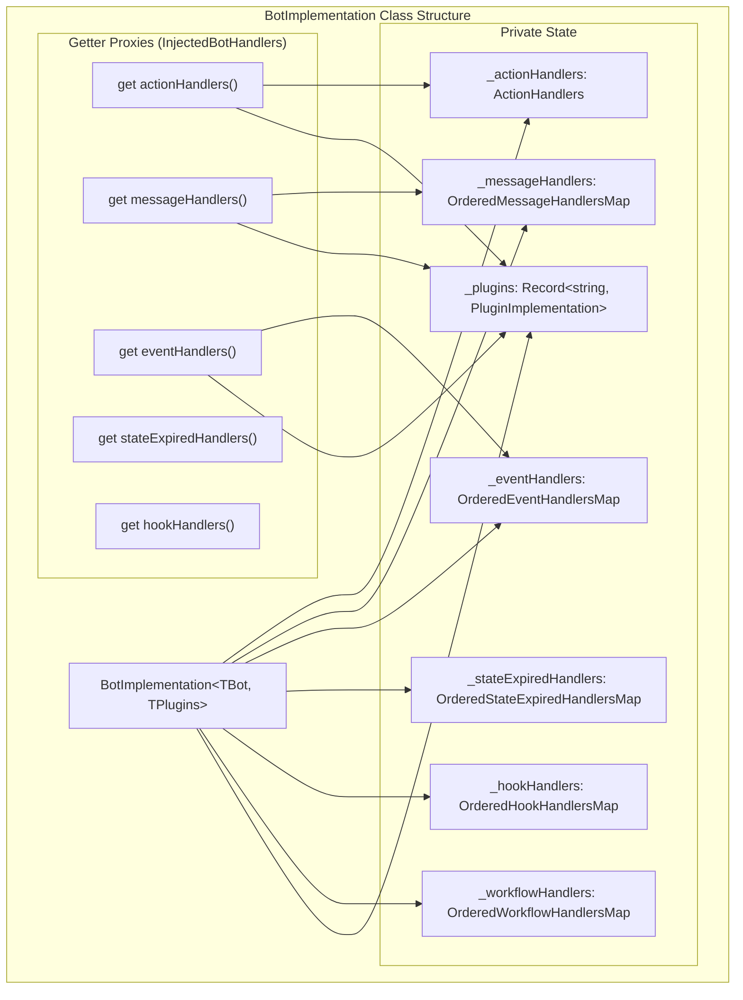
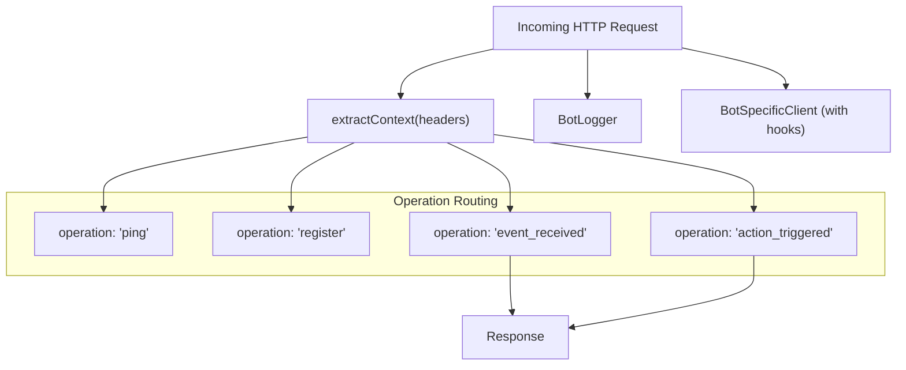
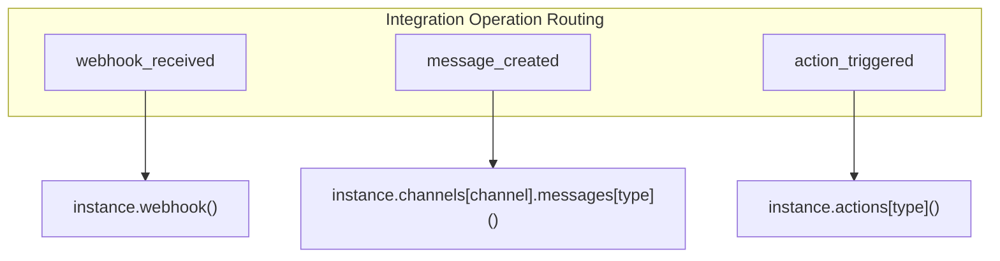

<!-- source: DeepWiki mcp.deepwiki.com · repo botpress/botpress · page 2.1 SDK · fetched 2026-10-26 -->

# SDK

Relevant source files

The following files were used as context for generating this wiki page:

- [packages/sdk/src/base-logger.test.ts](packages/sdk/src/base-logger.test.ts)
- [packages/sdk/src/base-logger.ts](packages/sdk/src/base-logger.ts)
- [packages/sdk/src/bot/client/index.ts](packages/sdk/src/bot/client/index.ts)
- [packages/sdk/src/bot/client/types.test.ts](packages/sdk/src/bot/client/types.test.ts)
- [packages/sdk/src/bot/client/types.ts](packages/sdk/src/bot/client/types.ts)
- [packages/sdk/src/bot/definition.ts](packages/sdk/src/bot/definition.ts)
- [packages/sdk/src/bot/implementation.ts](packages/sdk/src/bot/implementation.ts)
- [packages/sdk/src/bot/server/index.ts](packages/sdk/src/bot/server/index.ts)
- [packages/sdk/src/bot/server/types.test.ts](packages/sdk/src/bot/server/types.test.ts)
- [packages/sdk/src/bot/server/types.ts](packages/sdk/src/bot/server/types.ts)
- [packages/sdk/src/integration/client/index.ts](packages/sdk/src/integration/client/index.ts)
- [packages/sdk/src/integration/client/sub-types.ts](packages/sdk/src/integration/client/sub-types.ts)
- [packages/sdk/src/integration/client/types.ts](packages/sdk/src/integration/client/types.ts)
- [packages/sdk/src/integration/definition/index.ts](packages/sdk/src/integration/definition/index.ts)
- [packages/sdk/src/integration/implementation.ts](packages/sdk/src/integration/implementation.ts)
- [packages/sdk/src/integration/server/index.ts](packages/sdk/src/integration/server/index.ts)
- [packages/sdk/src/integration/server/integration-logger.ts](packages/sdk/src/integration/server/integration-logger.ts)
- [packages/sdk/src/integration/server/types.ts](packages/sdk/src/integration/server/types.ts)
- [packages/sdk/src/interface/definition.ts](packages/sdk/src/interface/definition.ts)
- [packages/sdk/src/plugin/definition.ts](packages/sdk/src/plugin/definition.ts)
- [packages/sdk/src/plugin/implementation.ts](packages/sdk/src/plugin/implementation.ts)
- [packages/sdk/src/plugin/server/types.ts](packages/sdk/src/plugin/server/types.ts)

## Purpose and Scope

The `@botpress/sdk` package provides the core API for building bots, integrations, and plugins in the Botpress platform. It defines the handler system, type definitions, runtime server architecture, and client wrappers that enable event-driven bot development with strong TypeScript support.

This page covers the SDK's implementation classes, handler system, runtime server, and type system. For CLI usage and project management, see [CLI](#2.2). For the underlying platform API client, see [Client](#2.3). For integration development patterns, see [Integration Framework](#4). For plugin architecture, see [Plugin System](#5).

**Sources:** [packages/sdk/src/bot/implementation.ts:1-32](), [packages/sdk/src/integration/server/index.ts:1-20]()

---

## Main Exports

```mermaid
graph TB
    SDK["@botpress/sdk"]
    
    subgraph "Bot Development"
        BOT_DEF["BotDefinition"]
        BOT_IMPL["BotImplementation (Bot)"]
        BOT_CLIENT["BotSpecificClient"]
    end
    
    subgraph "Integration Development"
        INT_DEF["IntegrationDefinition"]
        INT_IMPL["IntegrationImplementation (Integration)"]
        INT_CLIENT["IntegrationSpecificClient"]
    end
    
    subgraph "Plugin Development"
        PLUG_DEF["PluginDefinition"]
        PLUG_IMPL["PluginImplementation (Plugin)"]
    end
    
    subgraph "Common Utilities"
        SERVE["serve()"]
        ZUI["zui"]
        BOT_HANDLER["botHandler()"]
        INT_HANDLER["integrationHandler()"]
    end
    
    SDK --> BOT_DEF
    SDK --> BOT_IMPL
    SDK --> BOT_CLIENT
    SDK --> INT_DEF
    SDK --> INT_IMPL
    SDK --> INT_CLIENT
    SDK --> PLUG_DEF
    SDK --> PLUG_IMPL
    SDK --> SERVE
    SDK --> ZUI
    SDK --> BOT_HANDLER
    SDK --> INT_HANDLER
```

**Diagram: SDK Main Export Structure**

The SDK exports aliased types for consistency. `BotImplementation` is typically used as the base for bot logic [packages/sdk/src/bot/implementation.ts:43-45](), while `IntegrationImplementation` serves the same role for integrations.

---

## BotImplementation Class

The `BotImplementation` class is the primary class for building bot logic. It provides an event-driven handler registration system and composes handlers from both the bot itself and any installed plugins.

**Diagram: BotImplementation Internal Structure**

### Constructor and Properties

The `BotImplementation` constructor accepts `BotImplementationProps<TBot, TPlugins>` [packages/sdk/src/bot/implementation.ts:35-41]():

- `actions`: Action handlers not provided by plugins [packages/sdk/src/bot/implementation.ts:37-37]().
- `plugins`: Map of plugin alias to `PluginImplementation` instances [packages/sdk/src/bot/implementation.ts:38-40]().

### Handler Maps

The class maintains internal handler maps, each storing handlers with registration order [packages/sdk/src/bot/implementation.ts:47-67]():

| Map | Purpose |
|-----|---------|
| `_actionHandlers` | Action implementations [packages/sdk/src/bot/implementation.ts:47-47]() |
| `_messageHandlers` | Message type handlers with order [packages/sdk/src/bot/implementation.ts:48-48]() |
| `_eventHandlers` | Event type handlers with order [packages/sdk/src/bot/implementation.ts:49-49]() |
| `_hookHandlers` | Before/after hooks (e.g., `before_incoming_message`) [packages/sdk/src/bot/implementation.ts:51-62]() |
| `_workflowHandlers` | Workflow lifecycle handlers (started, continued, timed_out) [packages/sdk/src/bot/implementation.ts:63-67]() |

### Handler Composition with Plugins

The getter proxies compose handlers from both the bot and plugins. For example, the `messageHandlers` getter retrieves handlers from all plugins and merges them with the bot's own specific and global handlers, sorting them by their registration order [packages/sdk/src/bot/implementation.ts:111-136]().

### Action Handler Resolution

Action handlers support plugin prefixing using `PLUGIN_PREFIX_SEPARATOR` (`#`) [packages/sdk/src/bot/implementation.ts:3-3](). If an action is not found on the bot, the proxy attempts to split the name to find the corresponding plugin and its action handler [packages/sdk/src/bot/implementation.ts:83-109]().

---

## Bot Runtime Server

The `botHandler` function creates an HTTP request handler that routes incoming requests to appropriate handlers based on the operation type [packages/sdk/src/bot/server/index.ts:15-128]().

**Diagram: botHandler Request Flow**

### Context Extraction

The `extractContext()` function parses HTTP headers to create a `BotContext` [packages/sdk/src/bot/server/index.ts:18-18](). This context identifies the `botId`, the `operation` (e.g., `event_received`), and the specific `type` of the payload [packages/sdk/src/bot/server/types.ts:11-18]().

### BotSpecificClient Hook Wrapping

The runtime creates a `BotSpecificClient` that wraps the vanilla client with before/after hooks for operations like `createMessage` and `callAction` [packages/sdk/src/bot/server/index.ts:25-94](). This allows hooks registered via `on.beforeOutgoingMessage` to intercept and modify outgoing data [packages/sdk/src/bot/server/index.ts:28-38]().

### Operation Handlers

- **`onRegister`**: Calls the bot's `registerHandler` if defined [packages/sdk/src/bot/server/index.ts:134-141]().
- **`onEventReceived`**: Routes events based on type. If the type is `message_created`, it executes `before_incoming_message` hooks, then the specific message handlers, and finally `after_incoming_message` hooks [packages/sdk/src/bot/server/index.ts:166-206]().
- **`onActionTriggered`**: Parses the action input and type, executes before hooks, runs the action handler, and executes after hooks [packages/sdk/src/bot/server/index.ts:260-311]().

---

## Integration Runtime Server

Similar to bots, integrations use `integrationHandler` to process incoming requests from the Botpress platform [packages/sdk/src/integration/server/index.ts:94-125]().

**Diagram: Integration Operation Routing**

### Integration Operation Handlers

- **`onWebhook`**: Directly calls the `webhook` handler defined in the integration implementation [packages/sdk/src/integration/server/index.ts:129-132]().
- **`onMessageCreated`**: Finds the appropriate channel and message type handler. It provides an `ack` function to update the message tags upon successful processing [packages/sdk/src/integration/server/index.ts:166-190]().
- **`onActionTriggered`**: Executes the requested action and returns the output along with any metadata collected during execution [packages/sdk/src/integration/server/index.ts:192-212]().

**Sources:** [packages/sdk/src/integration/server/index.ts:70-92]()

---

## PluginImplementation Class

The `PluginImplementation` class enables reusable logic that can be injected into bots. It implements `BotHandlers` [packages/sdk/src/plugin/implementation.ts:57-57]().

### Injected Tools

Plugins receive a set of "tools" in their handlers, which are proxies to platform resources prefixed or scoped to the plugin's context [packages/sdk/src/plugin/implementation.ts:102-125]():

| Tool | Purpose |
|------|---------|
| `actions` | `ActionProxy` for calling actions of integration/interface dependencies [packages/sdk/src/plugin/implementation.ts:104-104]() |
| `states` | `StateProxy` for querying and mutating plugin-defined states [packages/sdk/src/plugin/implementation.ts:105-105]() |
| `workflows` | `WorkflowProxy` for interacting with bot workflows [packages/sdk/src/plugin/implementation.ts:106-106]() |
| `users` | `UserFinder` for scoped user management [packages/sdk/src/plugin/implementation.ts:108-108]() |

### Interface Resolution

Plugins can handle events defined by interfaces. The `eventHandlers` getter uses `_eventResolvesTo` to determine if a received event (e.g., from a specific integration) matches an interface event the plugin is listening to [packages/sdk/src/plugin/implementation.ts:188-214]().

---

## Client Wrappers

### BotSpecificClient

The `BotSpecificClient` wraps the standard `@botpress/client` to provide a typed interface matching the bot's definition [packages/sdk/src/bot/client/index.ts:10-10](). It supports a hook system for intercepting API calls [packages/sdk/src/bot/client/index.ts:13-13]().

### IntegrationSpecificClient

The `IntegrationSpecificClient` provides a similar typed wrapper for integrations, ensuring that calls to `createMessage` or `getConversation` use the types defined in the integration's schema [packages/sdk/src/integration/client/index.ts:10-11]().

**Sources:** [packages/sdk/src/bot/client/index.ts:1-123](), [packages/sdk/src/integration/client/index.ts:1-93]()

---

## Type System and Definitions

The SDK uses `BotDefinition` and `IntegrationDefinition` to define the structure of the project, including configuration, states, events, and actions.

- **BotDefinition**: Defines bot-level entities like `states`, `events`, and `workflows` [packages/sdk/src/bot/definition.ts:213-219]().
- **IntegrationDefinition**: Defines integration-specific components like `channels` (with message types) and `entities` [packages/sdk/src/integration/definition/index.ts:178-188]().
- **PluginDefinition**: Defines plugin metadata and its own `states`, `actions`, and `events` [packages/sdk/src/plugin/definition.ts:168-179]().

These definitions are powered by **Zui**, a Zod-based schema system that includes UI metadata [packages/sdk/src/bot/definition.ts:12-12]().

**Sources:** [packages/sdk/src/bot/definition.ts:1-212](), [packages/sdk/src/integration/definition/index.ts:1-177](), [packages/sdk/src/plugin/definition.ts:1-167]()

---

