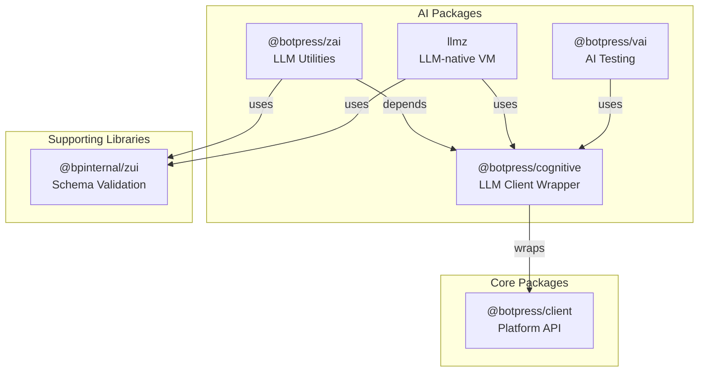
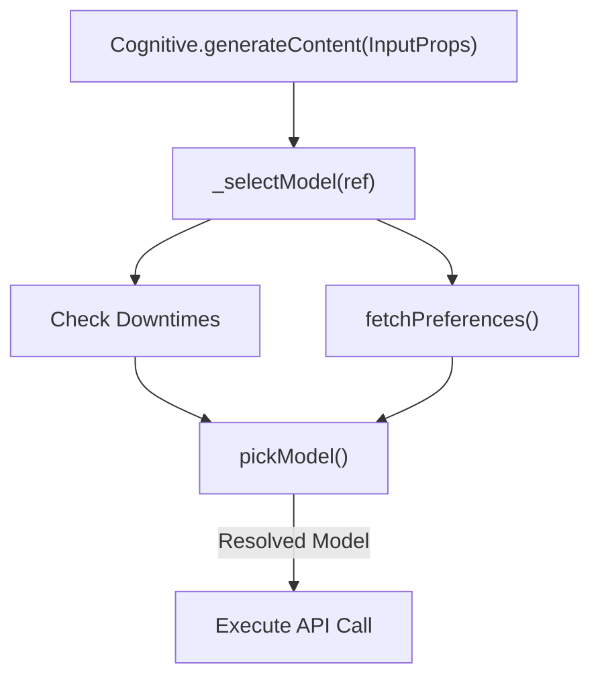
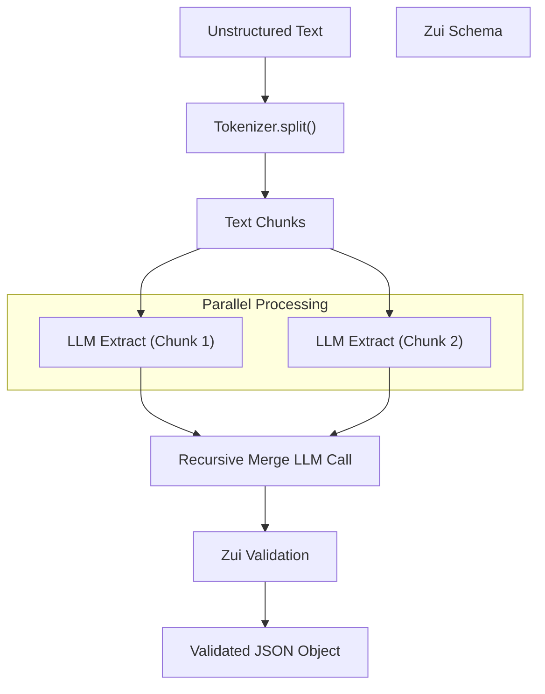
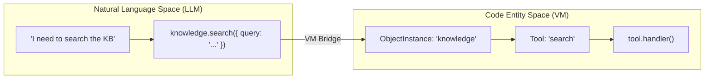

<!-- source: DeepWiki mcp.deepwiki.com · repo botpress/botpress · page 2.4 AI/LLM Packages · fetched 2026-10-26 -->

# AI/LLM Packages

Relevant source files

The following files were used as context for generating this wiki page:

- [.github/actions/docker-build/action.yml](.github/actions/docker-build/action.yml)
- [.github/scripts/integration-implements-sandbox.sh](.github/scripts/integration-implements-sandbox.sh)
- [.github/workflows/deploy-chat-production.yml](.github/workflows/deploy-chat-production.yml)
- [.github/workflows/deploy-chat-staging.yml](.github/workflows/deploy-chat-staging.yml)
- [.github/workflows/docker-chat.yml](.github/workflows/docker-chat.yml)
- [.github/workflows/run-cognitive-tests.yml](.github/workflows/run-cognitive-tests.yml)
- [.github/workflows/run-vai-tests.yml](.github/workflows/run-vai-tests.yml)
- [.github/workflows/run-zai-tests.yml](.github/workflows/run-zai-tests.yml)
- [packages/cognitive/e2e/client.test.ts](packages/cognitive/e2e/client.test.ts)
- [packages/cognitive/e2e/cognitive-beta.test.ts](packages/cognitive/e2e/cognitive-beta.test.ts)
- [packages/cognitive/e2e/models.test.ts](packages/cognitive/e2e/models.test.ts)
- [packages/cognitive/refresh-models.ts](packages/cognitive/refresh-models.ts)
- [packages/cognitive/src/client.ts](packages/cognitive/src/client.ts)
- [packages/cognitive/src/cognitive-v2/adapter.test.ts](packages/cognitive/src/cognitive-v2/adapter.test.ts)
- [packages/cognitive/src/cognitive-v2/adapter.ts](packages/cognitive/src/cognitive-v2/adapter.ts)
- [packages/cognitive/src/cognitive-v2/index.ts](packages/cognitive/src/cognitive-v2/index.ts)
- [packages/cognitive/src/cognitive-v2/models.ts](packages/cognitive/src/cognitive-v2/models.ts)
- [packages/cognitive/src/cognitive-v2/types.ts](packages/cognitive/src/cognitive-v2/types.ts)
- [packages/cognitive/src/errors.ts](packages/cognitive/src/errors.ts)
- [packages/cognitive/src/index.ts](packages/cognitive/src/index.ts)
- [packages/cognitive/src/models.ts](packages/cognitive/src/models.ts)
- [packages/cognitive/src/schemas.gen.ts](packages/cognitive/src/schemas.gen.ts)
- [packages/cognitive/src/types.ts](packages/cognitive/src/types.ts)
- [packages/cognitive/tsconfig.json](packages/cognitive/tsconfig.json)
- [packages/llmz/DOCS.md](packages/llmz/DOCS.md)
- [packages/llmz/examples/21_chat_tool_components/README.md](packages/llmz/examples/21_chat_tool_components/README.md)
- [packages/llmz/examples/21_chat_tool_components/demo.svg](packages/llmz/examples/21_chat_tool_components/demo.svg)
- [packages/llmz/examples/21_chat_tool_components/index.ts](packages/llmz/examples/21_chat_tool_components/index.ts)
- [packages/llmz/examples/record-demo.sh](packages/llmz/examples/record-demo.sh)
- [packages/llmz/src/component.ts](packages/llmz/src/component.ts)
- [packages/llmz/src/context.ts](packages/llmz/src/context.ts)
- [packages/llmz/src/errors.ts](packages/llmz/src/errors.ts)
- [packages/llmz/src/index.ts](packages/llmz/src/index.ts)
- [packages/llmz/src/llmz.test.ts](packages/llmz/src/llmz.test.ts)
- [packages/llmz/src/llmz.ts](packages/llmz/src/llmz.ts)
- [packages/llmz/src/quickjs-variant.ts](packages/llmz/src/quickjs-variant.ts)
- [packages/llmz/src/tool.ts](packages/llmz/src/tool.ts)
- [packages/llmz/src/vm/drivers/node.ts](packages/llmz/src/vm/drivers/node.ts)
- [packages/llmz/src/vm/drivers/quickjs.ts](packages/llmz/src/vm/drivers/quickjs.ts)
- [packages/llmz/src/vm/errors.ts](packages/llmz/src/vm/errors.ts)
- [packages/llmz/src/vm/index.ts](packages/llmz/src/vm/index.ts)
- [packages/llmz/src/vm/instrument.ts](packages/llmz/src/vm/instrument.ts)
- [packages/llmz/src/vm/types.ts](packages/llmz/src/vm/types.ts)
- [packages/zai/CLAUDE.md](packages/zai/CLAUDE.md)
- [packages/zai/README.md](packages/zai/README.md)
- [packages/zai/e2e/data/cache.jsonl](packages/zai/e2e/data/cache.jsonl)
- [packages/zai/e2e/extract.test.ts](packages/zai/e2e/extract.test.ts)
- [packages/zai/e2e/group.test.ts](packages/zai/e2e/group.test.ts)
- [packages/zai/e2e/json-utils.test.ts](packages/zai/e2e/json-utils.test.ts)
- [packages/zai/e2e/micropatch.test.ts](packages/zai/e2e/micropatch.test.ts)
- [packages/zai/e2e/patch.test.ts](packages/zai/e2e/patch.test.ts)
- [packages/zai/e2e/rate.test.ts](packages/zai/e2e/rate.test.ts)
- [packages/zai/e2e/sort.test.ts](packages/zai/e2e/sort.test.ts)
- [packages/zai/src/context.ts](packages/zai/src/context.ts)
- [packages/zai/src/index.ts](packages/zai/src/index.ts)
- [packages/zai/src/json-utils.ts](packages/zai/src/json-utils.ts)
- [packages/zai/src/micropatch.ts](packages/zai/src/micropatch.ts)
- [packages/zai/src/operations/answer.ts](packages/zai/src/operations/answer.ts)
- [packages/zai/src/operations/check.ts](packages/zai/src/operations/check.ts)
- [packages/zai/src/operations/errors.ts](packages/zai/src/operations/errors.ts)
- [packages/zai/src/operations/extract.ts](packages/zai/src/operations/extract.ts)
- [packages/zai/src/operations/filter.ts](packages/zai/src/operations/filter.ts)
- [packages/zai/src/operations/group.ts](packages/zai/src/operations/group.ts)
- [packages/zai/src/operations/label.ts](packages/zai/src/operations/label.ts)
- [packages/zai/src/operations/patch.ts](packages/zai/src/operations/patch.ts)
- [packages/zai/src/operations/rate.ts](packages/zai/src/operations/rate.ts)
- [packages/zai/src/operations/rewrite.ts](packages/zai/src/operations/rewrite.ts)
- [packages/zai/src/operations/sort.ts](packages/zai/src/operations/sort.ts)
- [packages/zai/src/operations/summarize.ts](packages/zai/src/operations/summarize.ts)
- [packages/zai/src/operations/text.ts](packages/zai/src/operations/text.ts)
- [packages/zai/src/response.ts](packages/zai/src/response.ts)
- [packages/zai/src/zai.ts](packages/zai/src/zai.ts)
- [services.json](services.json)

The AI/LLM packages provide a layered architecture for interacting with Large Language Models in the Botpress ecosystem. This document covers the core AI packages (`@botpress/cognitive`, `@botpress/zai`, `llmz`, and `@botpress/vai`) that form the foundation for AI-native features and provider integrations.

---

## Package Architecture

The AI ecosystem is organized into specialized layers, ranging from low-level API wrappers to high-level utility frameworks and sandboxed execution environments.

### Package Dependency Structure

**Sources:** [packages/cognitive/src/client.ts:1-21](), [packages/zai/src/zai.ts:1-13](), [packages/llmz/src/llmz.ts:1-10]()

---

## @botpress/cognitive

The `@botpress/cognitive` package is the foundational LLM client wrapper. It provides a consistent interface for calling language models through the Botpress Cloud API (v2) and legacy integration paths.

### Core Components

- **`Cognitive` Class**: The main entry point that handles model selection, preference management, and interceptors [packages/cognitive/src/client.ts:23-56]().
- **`CognitiveBeta` Class**: A specialized client for the v2 Cognitive API, supporting text generation, audio transcription (STT), text-to-speech (TTS), and image generation [packages/cognitive/src/cognitive-v2/index.ts:82-132]().
- **Model Registry**: A comprehensive list of supported models, their capabilities (vision, search, etc.), and pricing [packages/cognitive/src/cognitive-v2/models.ts:3-184]().

### Model Selection Logic

The `Cognitive` client supports "virtual" model references like `auto`, `best`, and `fast`. It resolves these by querying the model provider and applying user preferences [packages/cognitive/src/client.ts:143-166]().

**Sources:** [packages/cognitive/src/client.ts:143-166](), [packages/cognitive/src/models.ts:11-19]()

---

## @botpress/zai

The `@botpress/zai` package (Zui AI) provides high-level operations for structured data processing using LLMs and Zui schemas.

### Key Operations

| Function | Description | File |
|----------|-------------|------|
| `extract` | Parses unstructured text into a Zui-validated object or array [packages/zai/src/operations/extract.ts:46-56](). | [packages/zai/src/operations/extract.ts:122-127]() |
| `patch` | Applies partial updates to an object based on natural language instructions. | [packages/zai/src/operations/patch.ts:1-20]() |
| `summarize` | Condenses long text while preserving key information. | [packages/zai/src/operations/summarize.ts:1-15]() |
| `classify` | Assigns labels to text based on a predefined set of categories. | [packages/zai/src/operations/label.ts:1-10]() |

### Data Flow: Structured Extraction

The `extract` operation handles large inputs by chunking the text and recursively merging the results [packages/zai/src/operations/extract.ts:164-189]().

**Sources:** [packages/zai/src/operations/extract.ts:122-200]()

---

## llmz

`llmz` is an LLM-native TypeScript Virtual Machine. It allows an LLM to generate and execute TypeScript code in a sandboxed environment to perform complex reasoning or tool orchestration.

### VM Execution Lifecycle

The VM executes code in "iterations." In each iteration, the LLM observes the state, generates code, and the VM executes it [packages/llmz/src/llmz.ts:17-31]().

1. **Context Initialization**: Sets up `instructions`, `objects` (tools), and `chat` history [packages/llmz/src/llmz.ts:164-200]().
2. **Iteration Start**: Calls `onIterationStart` hooks [packages/llmz/src/llmz.ts:83-88]().
3. **Code Generation**: The LLM generates a TypeScript block.
4. **Execution**: The `runAsyncFunction` utility executes the code in a `QuickJS` isolate [packages/llmz/src/llmz.ts:45](), [packages/llmz/src/vm/drivers/quickjs.ts:1-50]().
5. **Observation**: Side effects (tool calls, state changes) are captured as `Trace` events [packages/llmz/src/llmz.ts:74]().

### Tool & Object Mapping

The VM bridges the "Natural Language Space" to "Code Entity Space" by exposing JavaScript objects to the LLM via `ObjectInstance` [packages/llmz/src/llmz.ts:34]().

**Sources:** [packages/llmz/src/llmz.ts:184-205](), [packages/llmz/src/tool.ts:1-20]()

---

## @botpress/vai

The `@botpress/vai` package is an AI testing framework designed to validate bot behavior using LLM-powered assertions. It is typically used within Vitest environments to verify that bot responses meet qualitative criteria.

### Implementation Details

- **JSON Repair**: Uses `jsonrepair` and `json5` to handle non-standard JSON output from testing models [packages/zai/src/operations/extract.ts:4-5]().
- **Integration with Cognitive**: Leverages `@botpress/cognitive` to perform the underlying evaluations.

**Sources:** [packages/zai/src/operations/extract.ts:4-5](), [packages/cognitive/src/client.ts:23-50]()

---

## Refreshing Model Metadata

The ecosystem relies on up-to-date model information (pricing, context limits). This is maintained via a `refresh-models.ts` script that syncs the local registry with the Botpress Cloud production API.

### Sync Workflow

1. Fetches models from `https://api.botpress.cloud/v2/cognitive/models` [packages/cognitive/refresh-models.ts:22-33]().
2. Filters by lifecycle (removes `deprecated`, `discontinued`) [packages/cognitive/refresh-models.ts:63-65]().
3. Generates TypeScript unions for `Models` and `SttModels` in `types.ts` [packages/cognitive/refresh-models.ts:75-107]().
4. Updates `models.ts` with full metadata objects [packages/cognitive/refresh-models.ts:47-52]().

**Sources:** [packages/cognitive/refresh-models.ts:1-114]()

---

