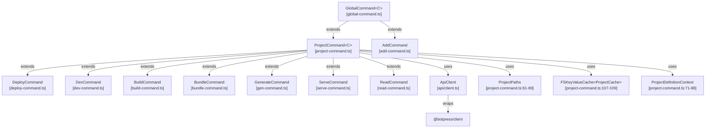
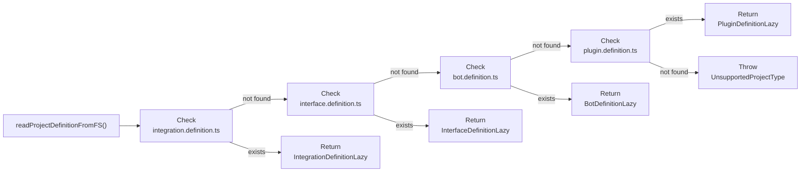
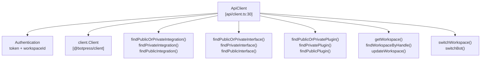
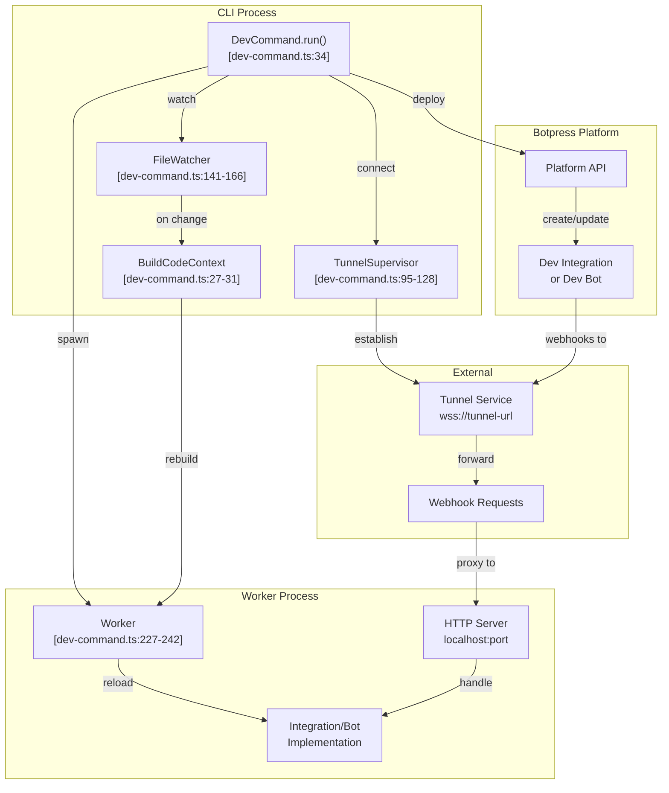
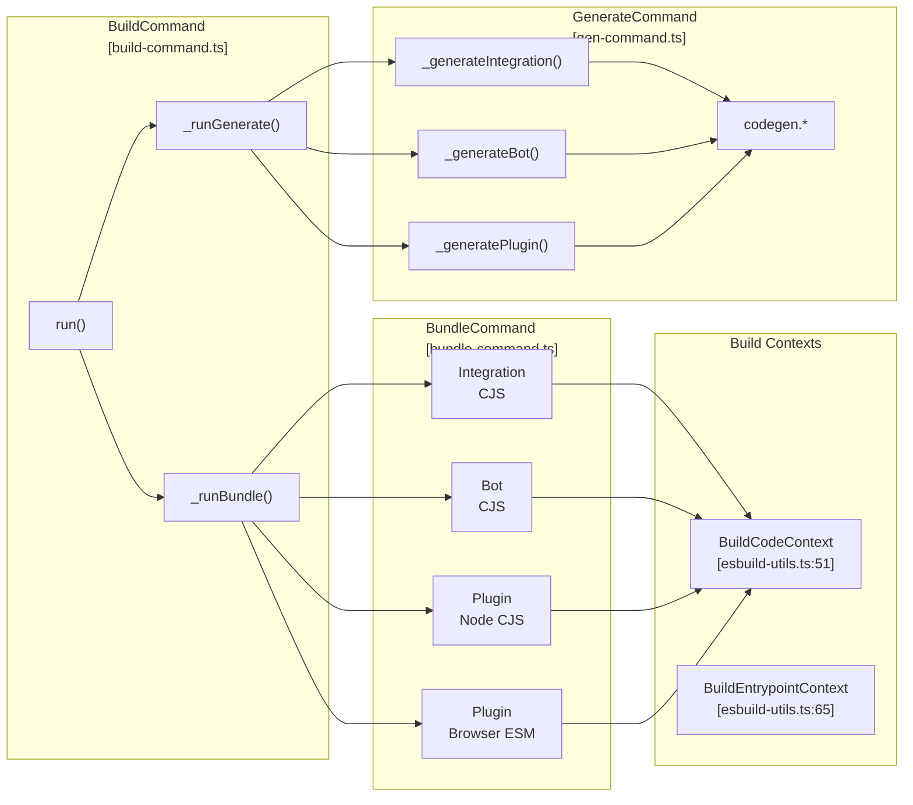
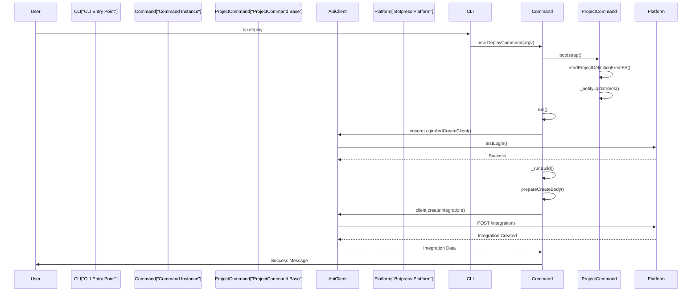
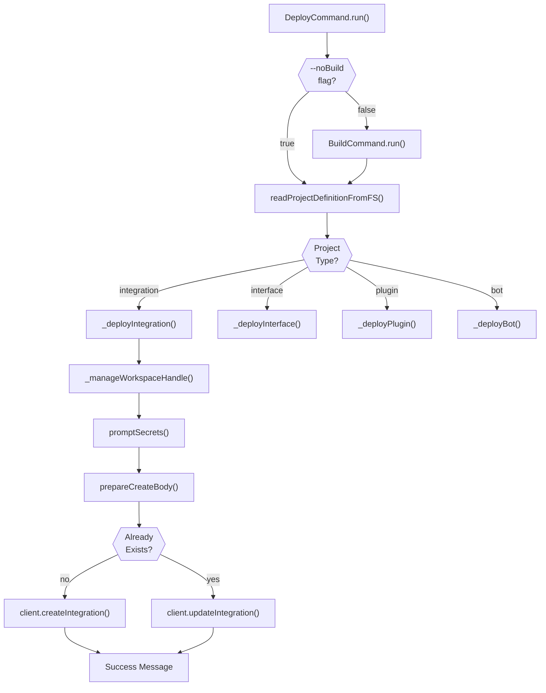
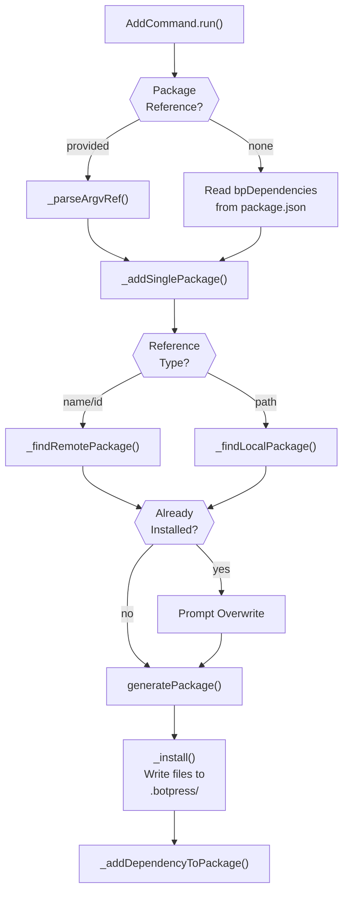
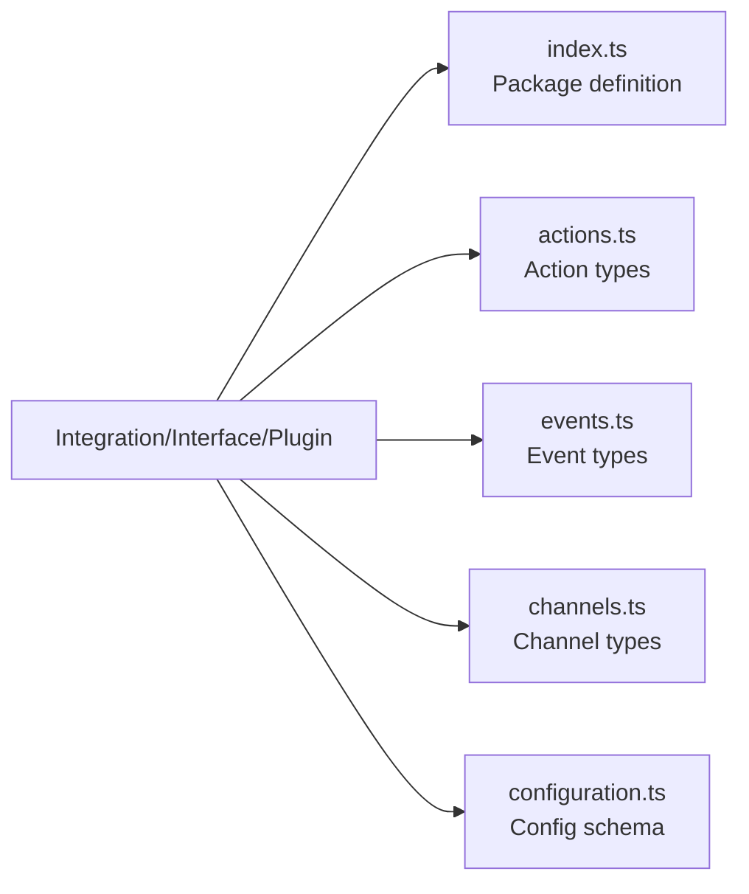

<!-- source: DeepWiki mcp.deepwiki.com · repo botpress/botpress · page 3 CLI & Development Tools · fetched 2026-10-26 -->

# CLI & Development Tools

<details>
<summary>Relevant source files</summary>

The following files were used as context for generating this wiki page:

- [package.json](package.json)
- [packages/cli/e2e/defaults.ts](packages/cli/e2e/defaults.ts)
- [packages/cli/package.json](packages/cli/package.json)
- [packages/cli/src/api/client.ts](packages/cli/src/api/client.ts)
- [packages/cli/src/api/types.ts](packages/cli/src/api/types.ts)
- [packages/cli/src/command-implementations/bot-commands.ts](packages/cli/src/command-implementations/bot-commands.ts)
- [packages/cli/src/command-implementations/build-command.ts](packages/cli/src/command-implementations/build-command.ts)
- [packages/cli/src/command-implementations/bundle-command.ts](packages/cli/src/command-implementations/bundle-command.ts)
- [packages/cli/src/command-implementations/deploy-command.ts](packages/cli/src/command-implementations/deploy-command.ts)
- [packages/cli/src/command-implementations/dev-command.ts](packages/cli/src/command-implementations/dev-command.ts)
- [packages/cli/src/command-implementations/integration-commands.ts](packages/cli/src/command-implementations/integration-commands.ts)
- [packages/cli/src/command-implementations/interface-commands.ts](packages/cli/src/command-implementations/interface-commands.ts)
- [packages/cli/src/command-implementations/plugin-commands.ts](packages/cli/src/command-implementations/plugin-commands.ts)
- [packages/cli/src/command-implementations/project-command.ts](packages/cli/src/command-implementations/project-command.ts)
- [packages/cli/src/command-implementations/serve-command.ts](packages/cli/src/command-implementations/serve-command.ts)
- [packages/cli/src/config.test.ts](packages/cli/src/config.test.ts)
- [packages/cli/src/config.ts](packages/cli/src/config.ts)
- [packages/cli/src/utils/esbuild-utils.test.ts](packages/cli/src/utils/esbuild-utils.test.ts)
- [packages/cli/src/utils/esbuild-utils.ts](packages/cli/src/utils/esbuild-utils.ts)
- [packages/cli/templates/empty-bot/package.json](packages/cli/templates/empty-bot/package.json)
- [packages/cli/templates/empty-integration/package.json](packages/cli/templates/empty-integration/package.json)
- [packages/cli/templates/empty-plugin/package.json](packages/cli/templates/empty-plugin/package.json)
- [packages/cli/templates/hello-world/package.json](packages/cli/templates/hello-world/package.json)
- [packages/cli/templates/webhook-message/package.json](packages/cli/templates/webhook-message/package.json)
- [packages/client/package.json](packages/client/package.json)
- [packages/cognitive/package.json](packages/cognitive/package.json)
- [packages/llmz/package.json](packages/llmz/package.json)
- [packages/sdk/package.json](packages/sdk/package.json)
- [packages/vai/package.json](packages/vai/package.json)
- [packages/zai/package.json](packages/zai/package.json)
- [pnpm-lock.yaml](pnpm-lock.yaml)

</details>


## Purpose and Scope

This document provides a comprehensive overview of the Botpress CLI and development tooling ecosystem. It covers the command-line interface architecture, development workflows, build system, and tooling for building, testing, and deploying Botpress projects (integrations, interfaces, bots, and plugins).

For detailed documentation of individual CLI commands and their options, see [CLI Commands](#3.1). For in-depth information about the build system configuration and compilation strategies, see [Build System](#3.2).

## CLI Architecture

The Botpress CLI is organized around a hierarchical command structure with shared base classes that provide common functionality for authentication, project detection, and API communication.

### Command Class Hierarchy



**Sources:** [packages/cli/src/command-implementations/project-command.ts:90-622](), [packages/cli/src/command-implementations/global-command.ts](), [packages/cli/src/api/client.ts:30-309]()

### Base Command Classes

| Class | Purpose | Key Features |
|-------|---------|--------------|
| `GlobalCommand<C>` | Base for all CLI commands | Logger, prompt, API client factory, package.json reading |
| `ProjectCommand<C>` | Base for project-specific commands | Project type detection, definition parsing, dependency resolution, secrets management |

**Sources:** [packages/cli/src/command-implementations/global-command.ts](), [packages/cli/src/command-implementations/project-command.ts:90-126]()

### Project Detection and Definition Loading

The CLI automatically detects project type by checking for definition files in the working directory:



**Sources:** [packages/cli/src/command-implementations/project-command.ts:111-171]()

### API Client and Authentication

The `ApiClient` class wraps `@botpress/client` and provides convenient methods for interacting with the Botpress Platform API:



**Sources:** [packages/cli/src/api/client.ts:30-309]()

## Development Workflow

The `bp dev` command provides a complete local development environment with hot reload, tunneling, and automatic deployment.

### Development Server Architecture



**Sources:** [packages/cli/src/command-implementations/dev-command.ts:24-425]()

### Hot Reload Process

The development server watches for file changes and automatically rebuilds and reloads the implementation:

1. **File Watcher** monitors TypeScript files (excluding output directory) [packages/cli/src/command-implementations/dev-command.ts:141-166]()
2. **Debouncing** prevents rapid rebuilds (500ms debounce) [packages/cli/src/command-implementations/dev-command.ts:21,164]()
3. **Build Pipeline** runs when TypeScript files change [packages/cli/src/command-implementations/dev-command.ts:156,186]()
4. **Worker Reload** restarts the worker process with new code [packages/cli/src/command-implementations/dev-command.ts:160,194]()
5. **Definition Sync** deploys updated definitions to platform [packages/cli/src/command-implementations/dev-command.ts:193,353-356]()

**Sources:** [packages/cli/src/command-implementations/dev-command.ts:141-195]()

### Tunnel Configuration

The development server uses a tunnel to expose the local server to the internet:

| Configuration | Default | Purpose |
|---------------|---------|---------|
| `--tunnelUrl` | Required | WebSocket tunnel service URL |
| `--tunnelId` | Generated/Cached | Unique tunnel identifier (UUID) |
| `--port` | 8075 (bot) / 8076 (integration) | Local HTTP server port |

**Sources:** [packages/cli/src/command-implementations/dev-command.ts:18-19,61-92]()

## Build System

The build system orchestrates TypeScript compilation, code generation, and bundling using Turbo, esbuild, and custom code generators.

### Build Pipeline Overview



**Sources:** [packages/cli/src/command-implementations/build-command.ts:8-36](), [packages/cli/src/command-implementations/gen-command.ts:12-101](), [packages/cli/src/command-implementations/bundle-command.ts:8-73]()

### esbuild Build Contexts

The CLI uses two types of build contexts for incremental compilation:

| Context | Purpose | Input | Output | Use Case |
|---------|---------|-------|--------|----------|
| `BuildCodeContext` | Bundle inline code | Code string | File on disk | Final bundling (implementations) |
| `BuildEntrypointContext` | Bundle entry file | File path | In-memory | Definition parsing (no write) |

**Sources:** [packages/cli/src/utils/esbuild-utils.ts:31-77]()

### Build Options

Default esbuild configuration used across all builds:

```typescript
{
  bundle: true,
  sourcemap: false,
  logLevel: 'silent',
  platform: 'node',
  target: 'es2020',
  legalComments: 'none',
  logOverride: { 'equals-negative-zero': 'silent' },
  keepNames: true,
  minify: false
}
```

**Sources:** [packages/cli/src/utils/esbuild-utils.ts:19-29]()

## CLI Commands Reference

### Command Summary

| Command | Purpose | Project Types | Key Class |
|---------|---------|---------------|-----------|
| `bp init` | Scaffold new project | All | `InitCommand` |
| `bp dev` | Local development server | Integration, Bot, Plugin | `DevCommand` |
| `bp build` | Generate types and bundle | Integration, Bot, Plugin | `BuildCommand` |
| `bp deploy` | Deploy to platform | All | `DeployCommand` |
| `bp add` | Install package | N/A (adds to any project) | `AddCommand` |
| `bp bundle` | Bundle implementation | Integration, Bot, Plugin | `BundleCommand` |
| `bp generate` | Generate typings | Integration, Bot, Plugin | `GenerateCommand` |
| `bp serve` | Serve bundle locally | Integration, Bot, Plugin | `ServeCommand` |
| `bp read` | Output parsed definition | All | `ReadCommand` |

For detailed command documentation, see [CLI Commands](#3.1).

**Sources:** [packages/cli/src/command-implementations/]()

### Command Execution Flow



**Sources:** [packages/cli/src/command-implementations/deploy-command.ts:15-647](), [packages/cli/src/command-implementations/project-command.ts:98-101]()

## Deployment Workflow

The `bp deploy` command handles the complete deployment pipeline for all project types.

### Deployment Process



**Sources:** [packages/cli/src/command-implementations/deploy-command.ts:15-647]()

### Visibility Modes

Integrations and plugins support different visibility modes:

| Visibility | Integrations | Interfaces | Plugins | Description |
|------------|--------------|------------|---------|-------------|
| `public` | ✅ | ✅ | ✅ | Available in public hub |
| `private` | ✅ | ✅ | ✅ | Only in workspace |
| `unlisted` | ✅ | ❌ | ❌ | Public but not searchable |

**Sources:** [packages/cli/src/command-implementations/deploy-command.ts:48-59,183-187,270-274]()

### Workspace Handle Management

For integrations, the CLI manages workspace handles to ensure proper namespacing:

1. **Parse Name** - Extract handle and name from integration name (e.g., `handle/name`) [packages/cli/src/command-implementations/deploy-command.ts:633-646]()
2. **Check Local Handle** - Compare with current workspace handle [packages/cli/src/command-implementations/deploy-command.ts:542-568]()
3. **Claim Handle** - If needed, claim the handle for the workspace [packages/cli/src/command-implementations/deploy-command.ts:584-626]()
4. **Update Name** - Prepend handle to integration name if missing [packages/cli/src/command-implementations/deploy-command.ts:572-581]()

**Sources:** [packages/cli/src/command-implementations/deploy-command.ts:522-646]()

## Package Management

The `bp add` command installs integrations, interfaces, and plugins into a project by generating type-safe wrapper code.

### Package Installation Flow



**Sources:** [packages/cli/src/command-implementations/add-command.ts:36-374]()

### Package Reference Formats

The CLI supports multiple package reference formats:

| Format | Example | Type | Purpose |
|--------|---------|------|---------|
| Name + Version | `@botpress/slack@1.0.0` | Remote | Install specific version |
| Name + Latest | `@botpress/slack@latest` | Remote | Install latest major |
| ID | `integration:01HXXX` | Remote | Install by ID |
| Path | `../my-integration` | Local | Install from local project |

**Sources:** [packages/cli/src/command-implementations/add-command.ts:71-96](), [packages/cli/src/package-ref.ts]()

### Code Generation for Packages

When installing a package, the CLI generates TypeScript wrapper code in `.botpress/<package-name>/`:



**Sources:** [packages/cli/src/command-implementations/add-command.ts:139-152](), [packages/cli/src/code-generation/]()

### Version Handling for Latest Tag

When installing with `@latest`, the CLI automatically expands it to a version range covering the latest major version:

```typescript
// Input: integration:slack@latest
// Latest version: 2.5.3
// Generated: ">=2.0.0 <3.0.0"
```

**Sources:** [packages/cli/src/command-implementations/add-command.ts:123-137]()

## Code Quality Tools

The repository uses multiple code quality tools orchestrated through pnpm scripts in the root `package.json`.

### Quality Check Scripts

| Script | Tools | Purpose |
|--------|-------|---------|
| `pnpm check:bplint` | bplint | Custom linting rules [package.json:8]() |
| `pnpm check:dep` | depsynky | Dependency consistency [package.json:9]() |
| `pnpm check:sherif` | sherif | Monorepo dependency policy [package.json:10]() |
| `pnpm check:format` | prettier | Code formatting [package.json:11]() |
| `pnpm check:oxlint` | oxlint | Fast Rust-based linting [package.json:13]() |
| `pnpm check:eslint` | eslint | JavaScript/TypeScript linting [package.json:12]() |
| `pnpm check:type` | turbo + tsc | TypeScript type checking [package.json:15]() |

**Sources:** [package.json:8-15]()

### Pre-commit Hooks

Lint-staged runs quality checks on staged files before each commit:

```typescript
{
  "**/*.{js,mjs,cjs,jsx,ts,mts,cts,tsx}": [
    "oxlint -c .oxlintrc.json --fix --fix-suggestions",
    "prettier --write"
  ],
  "**/*.{json,yaml,yml,md}": "prettier --write",
  "**/*.test.ts": "vitest --run"
}
```

**Sources:** [package.json:25-32]()

## Turbo Monorepo Orchestration

The repository uses Turborepo for parallelized task execution across packages.

### Common Turbo Tasks

| Task | Purpose | Dependencies |
|------|---------|--------------|
| `generate` | Generate TypeScript types | None |
| `build` | Build packages | `generate` |
| `test` | Run tests | `build` |
| `check:type` | Type checking | `generate` |
| `check:bplint` | Custom linting | None |

**Sources:** [package.json:5](), [turbo.json]()

### Build Execution

The root `build` script orchestrates type generation and compilation:

```bash
turbo run build
```

**Sources:** [package.json:5]()

---

