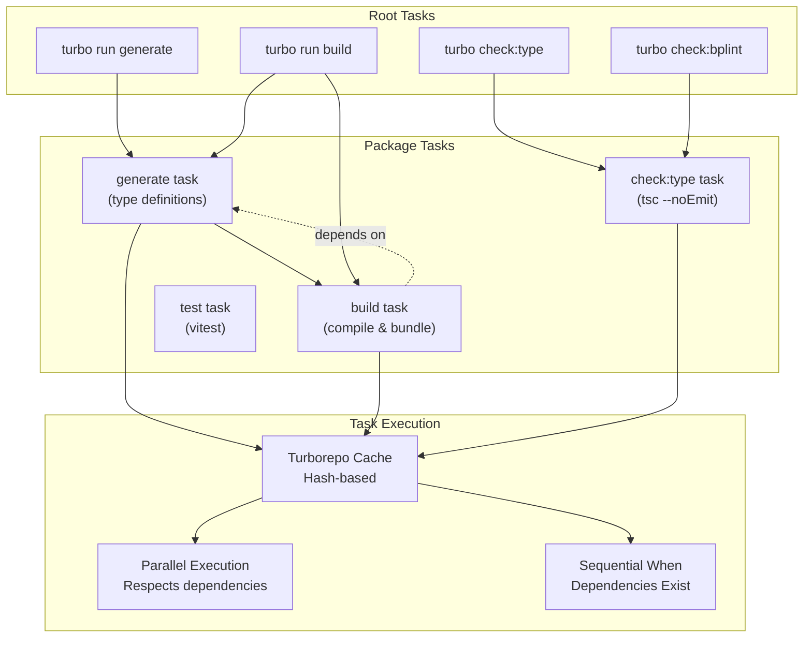
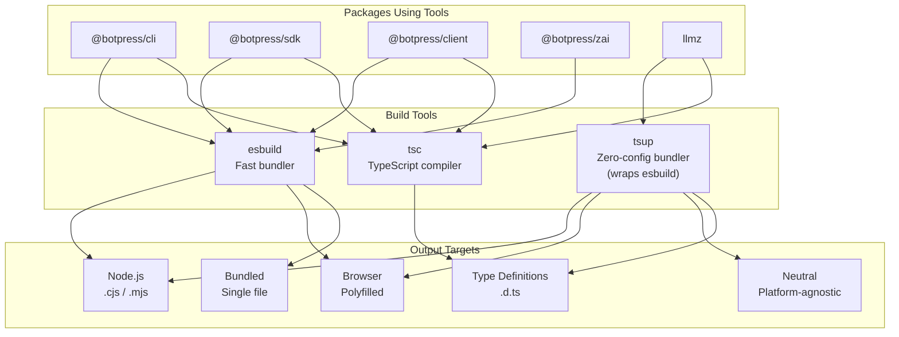
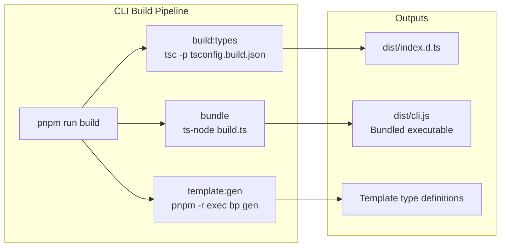
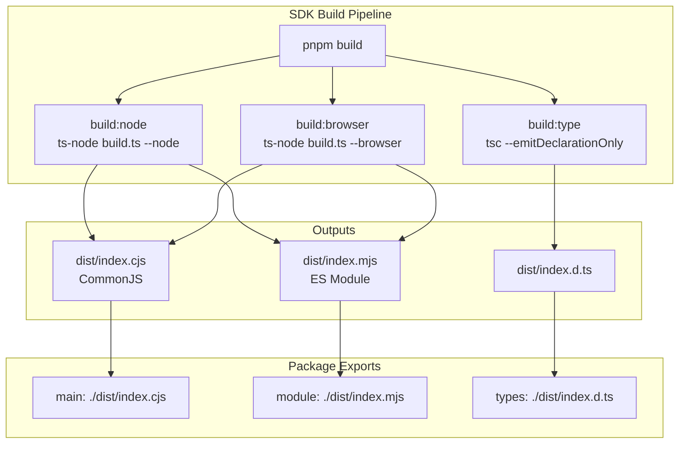
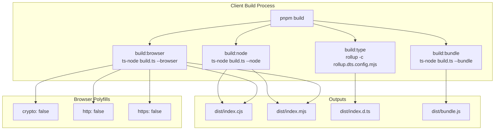
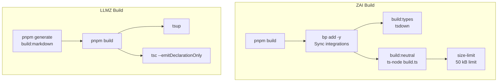
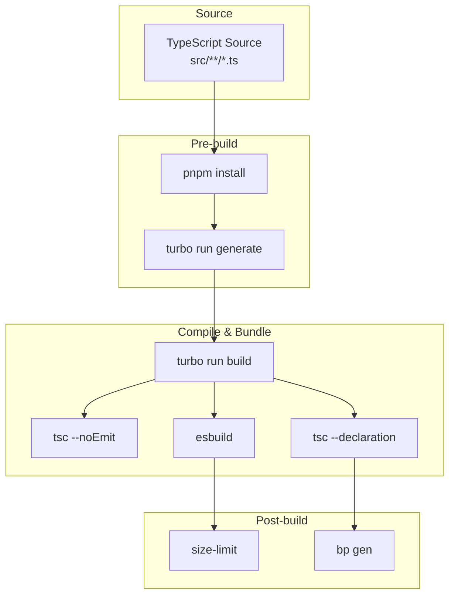

<!-- source: DeepWiki mcp.deepwiki.com · repo botpress/botpress · page 3.2 Build System · fetched 2026-10-26 -->

# Build System

Relevant source files

The following files were used as context for generating this wiki page:

- [.github/actions/deploy-integrations/action.yml](.github/actions/deploy-integrations/action.yml)
- [.github/actions/setup/action.yml](.github/actions/setup/action.yml)
- [.github/workflows/check-integration-versions.yml](.github/workflows/check-integration-versions.yml)
- [.github/workflows/deploy-bots.yml](.github/workflows/deploy-bots.yml)
- [.github/workflows/deploy-integrations-production.yml](.github/workflows/deploy-integrations-production.yml)
- [.github/workflows/deploy-integrations-staging.yml](.github/workflows/deploy-integrations-staging.yml)
- [.github/workflows/prod-master-version-verification.yml](.github/workflows/prod-master-version-verification.yml)
- [.github/workflows/publish-packages.yml](.github/workflows/publish-packages.yml)
- [.github/workflows/run-chat-tests.yml](.github/workflows/run-chat-tests.yml)
- [.github/workflows/run-checks.yml](.github/workflows/run-checks.yml)
- [.github/workflows/run-cli-tests.yml](.github/workflows/run-cli-tests.yml)
- [.github/workflows/run-client-tests.yml](.github/workflows/run-client-tests.yml)
- [.tool-versions](.tool-versions)
- [CODEOWNERS](CODEOWNERS)
- [integrations/groq/hub.md](integrations/groq/hub.md)
- [integrations/openai/hub.md](integrations/openai/hub.md)
- [package.json](package.json)
- [packages/cli/package.json](packages/cli/package.json)
- [packages/cli/src/code-generation/bot-implementation/bot-plugins/index.ts](packages/cli/src/code-generation/bot-implementation/bot-plugins/index.ts)
- [packages/cli/src/code-generation/bot-implementation/bot-plugins/plugin-module.ts](packages/cli/src/code-generation/bot-implementation/bot-plugins/plugin-module.ts)
- [packages/cli/src/code-generation/bot-implementation/bot-typings/index.ts](packages/cli/src/code-generation/bot-implementation/bot-typings/index.ts)
- [packages/cli/src/code-generation/module.ts](packages/cli/src/code-generation/module.ts)
- [packages/cli/src/code-generation/plugin-implementation/plugin-typings/index.ts](packages/cli/src/code-generation/plugin-implementation/plugin-typings/index.ts)
- [packages/cli/src/code-generation/strings.ts](packages/cli/src/code-generation/strings.ts)
- [packages/cli/src/command-implementations/gen-command.ts](packages/cli/src/command-implementations/gen-command.ts)
- [packages/cli/src/sdk/index.ts](packages/cli/src/sdk/index.ts)
- [packages/cli/src/sdk/validate-bot.test.ts](packages/cli/src/sdk/validate-bot.test.ts)
- [packages/cli/src/sdk/validate-bot.ts](packages/cli/src/sdk/validate-bot.ts)
- [packages/cli/templates/empty-bot/package.json](packages/cli/templates/empty-bot/package.json)
- [packages/cli/templates/empty-integration/package.json](packages/cli/templates/empty-integration/package.json)
- [packages/cli/templates/empty-plugin/package.json](packages/cli/templates/empty-plugin/package.json)
- [packages/cli/templates/hello-world/package.json](packages/cli/templates/hello-world/package.json)
- [packages/cli/templates/webhook-message/package.json](packages/cli/templates/webhook-message/package.json)
- [packages/client/package.json](packages/client/package.json)
- [packages/cognitive/package.json](packages/cognitive/package.json)
- [packages/llmz/package.json](packages/llmz/package.json)
- [packages/sdk/package.json](packages/sdk/package.json)
- [packages/sdk/src/package.ts](packages/sdk/src/package.ts)
- [packages/sdk/src/utils/type-utils.test.ts](packages/sdk/src/utils/type-utils.test.ts)
- [packages/sdk/src/utils/type-utils.ts](packages/sdk/src/utils/type-utils.ts)
- [packages/vai/package.json](packages/vai/package.json)
- [packages/zai/package.json](packages/zai/package.json)
- [pnpm-lock.yaml](pnpm-lock.yaml)
- [tsconfig.json](tsconfig.json)
- [turbo.json](turbo.json)

The Build System orchestrates compilation, bundling, and type generation across the Botpress monorepo. It uses Turborepo for task orchestration and parallelization, esbuild/tsup for efficient bundling, and TypeScript for type checking and declaration file generation. The system supports multi-target compilation (Node.js, browser, neutral) and manages dependencies between 50+ packages.

For information about the CLI commands that trigger builds, see [CLI Commands](#3.1). For information about the monorepo structure, see [Monorepo Structure](#1.2).

## Turborepo Orchestration

Turborepo (`turbo`) coordinates build tasks across the monorepo, enabling parallel execution and intelligent caching based on task dependencies.

### Task Pipeline

**Sources:** [package.json:5-15](), [turbo.json]() (implied by scripts)

The `turbo run build` command executes the `build` script in all packages, respecting workspace dependencies. The `generate` task must complete before `build` tasks can start, as build processes often depend on generated type definitions.

### Execution Strategy

| Strategy | When Used | Example |
|----------|-----------|---------|
| Parallel | Independent packages | Building multiple integrations simultaneously |
| Sequential | Dependency chain | `@botpress/sdk` must build before packages that import it |
| Cached | Unchanged inputs | Skipping rebuild if source files haven't changed |

**Sources:** [package.json:5-7]()

## Build Tools and Targets

The monorepo uses different build tools optimized for specific output targets.

**Sources:** [packages/cli/package.json:6-11](), [packages/sdk/package.json:11-16](), [packages/client/package.json:17-23](), [packages/zai/package.json:15-19](), [packages/llmz/package.json:18-21]()

### Tool Selection Criteria

| Tool | Use Case | Advantages |
|------|----------|------------|
| `esbuild` | Direct bundling, custom build scripts | Maximum speed, full control |
| `tsup` | Standard library packaging | Zero-config, multiple formats, DTS bundling |
| `tsc` | Type checking and `.d.ts` generation | Official TypeScript support, precise types |

**Sources:** [packages/cli/package.json:48](), [packages/sdk/package.json:29](), [packages/llmz/package.json:70]()

## Package Build Patterns

### CLI Package Build Strategy

The CLI package uses a custom build script with esbuild for maximum bundle optimization.

**Sources:** [packages/cli/package.json:6-12]()

Key aspects:
- **Custom bundler**: `ts-node -T build.ts` uses esbuild directly [packages/cli/package.json:10]().
- **Template generation**: Runs `bp gen` on all template packages after build [packages/cli/package.json:12]().
- **Type compilation**: Separate step using `tsc` with `tsconfig.build.json` [packages/cli/package.json:11]().

### SDK Package Build Strategy

The SDK builds for multiple environments: Node.js and browser.

**Sources:** [packages/sdk/package.json:5-16]()

The SDK generates dual formats (CJS and MJS) for both Node.js and browser environments. The build process uses `esbuild-plugin-polyfill-node` for browser compatibility [packages/sdk/package.json:30]().

### Client Package Build Strategy

The Client builds for three targets: Node.js, browser, and a bundled version.

**Sources:** [packages/client/package.json:12-23]()

The Client package explicitly disables Node.js-specific modules for browser targets in its `package.json` [packages/client/package.json:12-16]().

### AI Package Build Strategies

AI packages (zai, llmz) follow patterns involving specialized generation steps and size limits.

**Sources:** [packages/zai/package.json:17-18](), [packages/llmz/package.json:19-20]()

Key characteristics:
- **Size monitoring**: ZAI enforces a 50 kB bundle limit using `size-limit` [packages/zai/package.json:25-30]().
- **Integration Sync**: ZAI runs `bp add -y` before building to ensure dependencies are available [packages/zai/package.json:17]().
- **Markdown Compilation**: LLMZ includes a `build:markdown` step using a custom loader [packages/llmz/package.json:27]().

## TypeScript Compilation

TypeScript compilation occurs in two modes: type checking and declaration file generation.

| Script | Purpose | Output | Tool |
|--------|---------|--------|------|
| `check:type` | Validate TypeScript types | None (`--noEmit`) | `tsc` |
| `build:type` | Generate `.d.ts` files | Type declarations | `tsc` or `rollup` |

**Sources:** [packages/cli/package.json:9-11](), [packages/sdk/package.json:12-13](), [packages/client/package.json:18-19]()

## Root-Level Build Scripts

The root `package.json` provides monorepo-wide build and validation commands.

### Quality Check Commands

| Command | Purpose | Tool |
|---------|---------|------|
| `check:sherif` | Validate dependency consistency | `sherif` |
| `check:dep` | Verify version alignment | `depsynky` |
| `check:format` | Check code formatting | `prettier` |
| `check:lint` | Run all linters | `bplint`, `oxlint`, `eslint` |
| `check:type` | Type check all packages | `turbo` |

**Sources:** [package.json:8-15]()

### Fix Commands

The `fix` script provides an automated pipeline to resolve issues found by the check commands. It runs `sherif --fix`, `depsynky sync`, `oxlint --fix`, `prettier --write`, and `eslint --fix` in sequence [package.json:23]().

## Build Pipeline Flow

The complete build pipeline from source to deployable artifacts.

**Sources:** [package.json:5-23](), [packages/cli/package.json:6-12]()

## Multi-Target Compilation

| Package | Targets | Formats |
|---------|---------|---------|
| `@botpress/cli` | Node.js | Bundled `.js` [packages/cli/package.json:8]() |
| `@botpress/sdk` | Node, Browser | `.cjs`, `.mjs` [packages/sdk/package.json:5-6]() |
| `@botpress/client` | Node, Browser | `.cjs`, `.mjs`, `bundle.js` [packages/client/package.json:5-6,22]() |
| `llmz` | ESM, CJS | `.js`, `.cjs` [packages/llmz/package.json:9-14]() |

**Sources:** [packages/cli/package.json:8](), [packages/sdk/package.json:5-6](), [packages/client/package.json:5-6](), [packages/llmz/package.json:9-14]()

---

