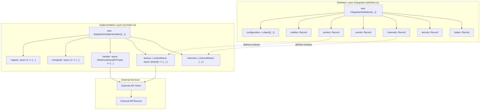
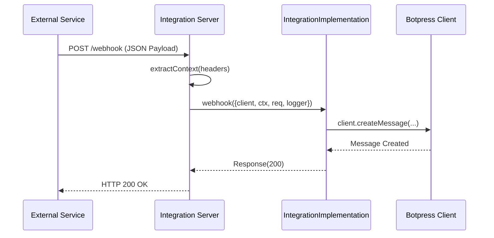

<!-- source: DeepWiki mcp.deepwiki.com · repo botpress/botpress · page 4 Integration Framework · fetched 2026-10-26 -->

# Integration Framework

Relevant source files

The following files were used as context for generating this wiki page:

- [interfaces/creatable/interface.definition.ts](interfaces/creatable/interface.definition.ts)
- [interfaces/deletable/interface.definition.ts](interfaces/deletable/interface.definition.ts)
- [interfaces/files-readonly/interface.definition.ts](interfaces/files-readonly/interface.definition.ts)
- [interfaces/listable/interface.definition.ts](interfaces/listable/interface.definition.ts)
- [interfaces/readable/interface.definition.ts](interfaces/readable/interface.definition.ts)
- [interfaces/speech-to-text/interface.definition.ts](interfaces/speech-to-text/interface.definition.ts)
- [interfaces/text-to-image/interface.definition.ts](interfaces/text-to-image/interface.definition.ts)
- [interfaces/typing-indicator/interface.definition.ts](interfaces/typing-indicator/interface.definition.ts)
- [interfaces/typing-indicator/package.json](interfaces/typing-indicator/package.json)
- [interfaces/typing-indicator/tsconfig.json](interfaces/typing-indicator/tsconfig.json)
- [interfaces/updatable/interface.definition.ts](interfaces/updatable/interface.definition.ts)
- [packages/sdk/src/bot/definition.ts](packages/sdk/src/bot/definition.ts)
- [packages/sdk/src/integration/definition/index.ts](packages/sdk/src/integration/definition/index.ts)
- [packages/sdk/src/integration/implementation.ts](packages/sdk/src/integration/implementation.ts)
- [packages/sdk/src/integration/server/index.ts](packages/sdk/src/integration/server/index.ts)
- [packages/sdk/src/integration/server/types.ts](packages/sdk/src/integration/server/types.ts)
- [packages/sdk/src/interface/definition.ts](packages/sdk/src/interface/definition.ts)
- [packages/sdk/src/plugin/definition.ts](packages/sdk/src/plugin/definition.ts)

The Integration Framework is the core system that enables Botpress bots to communicate with external services and APIs. It provides a standardized way to define, implement, and manage integrations with third-party services including language models, messaging platforms, and productivity tools.

The framework consists of two main components: `IntegrationDefinition` for specifying integration structure and capabilities, and `IntegrationImplementation` for implementing the actual functionality. All integrations are built using the `@botpress/sdk` [packages/sdk/src/integration/definition/index.ts:178-188]() and can extend reusable interfaces for common functionality.

## Architecture Overview

The framework enforces a strict separation between the contract (definition) and the execution (implementation).

### Integration Two-Layer Architecture

Sources: [packages/sdk/src/integration/definition/index.ts:178-212](), [packages/sdk/src/integration/implementation.ts:36-65]()

## Core Concepts

### Integration Definition
The `IntegrationDefinition` class is used to describe the integration's capabilities, metadata, and the schemas for all data exchanged with Botpress [packages/sdk/src/integration/definition/index.ts:178-188](). It defines:
*   **Configuration**: The settings required to enable the integration [packages/sdk/src/integration/definition/index.ts:53-56]().
*   **Actions**: Remote procedures the bot can call [packages/sdk/src/integration/definition/index.ts:60-62]().
*   **Channels**: Messaging pathways (e.g., "SMS", "Chat") [packages/sdk/src/integration/definition/index.ts:64-66]().
*   **Events**: Asynchronous notifications emitted by the integration [packages/sdk/src/integration/definition/index.ts:58-58]().
*   **States**: Persistent data storage scoped to users, conversations, or the integration itself [packages/sdk/src/integration/definition/index.ts:68-70]().

For details, see [Integration Definition](#4.1).

### Integration Implementation
The `IntegrationImplementation` class contains the logic to fulfill the definition [packages/sdk/src/integration/implementation.ts:36-65](). It handles:
*   **Lifecycle Hooks**: `register` and `unregister` methods for setup and cleanup [packages/sdk/src/integration/implementation.ts:39-40]().
*   **Webhook Handling**: The `handler` (or `webhook`) method processes incoming HTTP requests from external services [packages/sdk/src/integration/implementation.ts:43-43]().
*   **Action Execution**: Functions that map definition actions to external API calls [packages/sdk/src/integration/implementation.ts:37-37]().

### Runtime Communication
When an operation is triggered (like a webhook or an action), the SDK uses `integrationHandler` to route the request to the correct internal method [packages/sdk/src/integration/server/index.ts:94-125]().

Sources: [packages/sdk/src/integration/server/index.ts:70-92](), [packages/sdk/src/integration/server/index.ts:129-132]()

## Specialized Integrations

The framework is used to implement several categories of integrations, each with specific patterns.

### LLM Integrations
These integrations connect AI providers (OpenAI, Anthropic, etc.) to the Botpress AI engine. They primarily implement the `generateContent` action and handle message transformation between Botpress and provider-specific formats [packages/sdk/src/interface/definition.ts:131-147]().
For details, see [LLM Integrations](#4.2).

### Messaging Integrations
Integrations for platforms like WhatsApp, Slack, and Telegram. They focus on `ChannelDefinitions`, webhook signature validation, and media processing [packages/sdk/src/integration/definition/types.ts:44-53]().
For details, see [Messaging Integrations](#4.3).

### Support & CRM Integrations
Focus on Human-in-the-Loop (HITL) workflows, syncing tickets, and managing agent assignments in platforms like Zendesk or Salesforce.
For details, see [Support & CRM Integrations](#4.4).

### Productivity & Data Integrations
Connect tools like Notion, Google Sheets, and GitHub. These often utilize OAuth flows and implement "CRUD" actions (Create, Read, Update, Delete) through standardized interfaces like `creatable` or `listable` [interfaces/listable/interface.definition.ts:7-45]().
For details, see [Productivity & Data Integrations](#4.5).

## Interface System
Integrations can implement one or more **Interfaces**. An `InterfaceDefinition` provides a reusable contract (actions, entities, events) that multiple integrations can fulfill [packages/sdk/src/interface/definition.ts:81-104](). For example, both OpenAI and Anthropic implement the `llm` interface.

**Example Interfaces:**
*   `typing-indicator`: Actions to start/stop typing animations [interfaces/typing-indicator/interface.definition.ts:3-60]().
*   `text-to-image`: Actions like `generateImage` [interfaces/text-to-image/interface.definition.ts:4-42]().
*   `listable`: A standard `list` action for data-heavy services [interfaces/listable/interface.definition.ts:7-45]().

Sources: [packages/sdk/src/interface/definition.ts:1-79](), [interfaces/readable/interface.definition.ts:6-28]()

---

