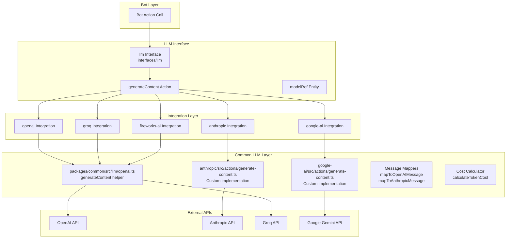
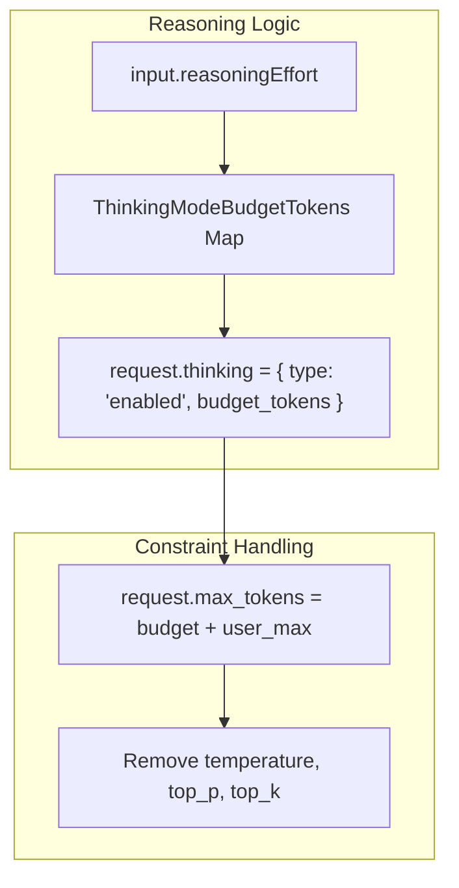

<!-- source: DeepWiki mcp.deepwiki.com · repo botpress/botpress · page 4.2 LLM Integrations · fetched 2026-10-26 -->

# LLM Integrations

<details>
<summary>Relevant source files</summary>

The following files were used as context for generating this wiki page:

- [integrations/anthropic/integration.definition.ts](integrations/anthropic/integration.definition.ts)
- [integrations/anthropic/package.json](integrations/anthropic/package.json)
- [integrations/anthropic/src/actions/generate-content.ts](integrations/anthropic/src/actions/generate-content.ts)
- [integrations/anthropic/src/index.ts](integrations/anthropic/src/index.ts)
- [integrations/anthropic/src/schemas.ts](integrations/anthropic/src/schemas.ts)
- [integrations/asana/integration.definition.ts](integrations/asana/integration.definition.ts)
- [integrations/cerebras/integration.definition.ts](integrations/cerebras/integration.definition.ts)
- [integrations/cerebras/package.json](integrations/cerebras/package.json)
- [integrations/cerebras/src/index.ts](integrations/cerebras/src/index.ts)
- [integrations/cerebras/src/schemas.ts](integrations/cerebras/src/schemas.ts)
- [integrations/dalle/hub.md](integrations/dalle/hub.md)
- [integrations/dalle/icon.svg](integrations/dalle/icon.svg)
- [integrations/dalle/integration.definition.ts](integrations/dalle/integration.definition.ts)
- [integrations/dalle/src/client.ts](integrations/dalle/src/client.ts)
- [integrations/dalle/src/index.ts](integrations/dalle/src/index.ts)
- [integrations/dalle/src/schemas.ts](integrations/dalle/src/schemas.ts)
- [integrations/dalle/src/types.ts](integrations/dalle/src/types.ts)
- [integrations/dalle/tsconfig.json](integrations/dalle/tsconfig.json)
- [integrations/fireworks-ai/integration.definition.ts](integrations/fireworks-ai/integration.definition.ts)
- [integrations/fireworks-ai/package.json](integrations/fireworks-ai/package.json)
- [integrations/fireworks-ai/src/index.ts](integrations/fireworks-ai/src/index.ts)
- [integrations/fireworks-ai/src/schemas.ts](integrations/fireworks-ai/src/schemas.ts)
- [integrations/google-ai/integration.definition.ts](integrations/google-ai/integration.definition.ts)
- [integrations/google-ai/package.json](integrations/google-ai/package.json)
- [integrations/google-ai/src/actions/generate-content.ts](integrations/google-ai/src/actions/generate-content.ts)
- [integrations/google-ai/src/index.ts](integrations/google-ai/src/index.ts)
- [integrations/google-ai/src/schemas.ts](integrations/google-ai/src/schemas.ts)
- [integrations/groq/integration.definition.ts](integrations/groq/integration.definition.ts)
- [integrations/groq/package.json](integrations/groq/package.json)
- [integrations/groq/src/index.ts](integrations/groq/src/index.ts)
- [integrations/groq/src/schemas.ts](integrations/groq/src/schemas.ts)
- [integrations/make/hub.md](integrations/make/hub.md)
- [integrations/make/icon.svg](integrations/make/icon.svg)
- [integrations/make/integration.definition.ts](integrations/make/integration.definition.ts)
- [integrations/make/src/index.ts](integrations/make/src/index.ts)
- [integrations/make/tsconfig.json](integrations/make/tsconfig.json)
- [integrations/openai/integration.definition.ts](integrations/openai/integration.definition.ts)
- [integrations/openai/package.json](integrations/openai/package.json)
- [integrations/openai/src/index.ts](integrations/openai/src/index.ts)
- [integrations/openai/src/schemas.ts](integrations/openai/src/schemas.ts)
- [integrations/trello/integration.definition.ts](integrations/trello/integration.definition.ts)
- [interfaces/llm/interface.definition.ts](interfaces/llm/interface.definition.ts)
- [interfaces/llm/package.json](interfaces/llm/package.json)
- [interfaces/llm/tsconfig.json](interfaces/llm/tsconfig.json)
- [interfaces/speech-to-text/package.json](interfaces/speech-to-text/package.json)
- [packages/common/package.json](packages/common/package.json)
- [packages/common/src/llm/openai.ts](packages/common/src/llm/openai.ts)
- [packages/common/src/llm/schemas.ts](packages/common/src/llm/schemas.ts)

</details>


LLM integrations provide standardized access to AI provider APIs for language model operations. These integrations expose a unified `generateContent` action that handles message transformation, model selection, cost tracking, and provider-specific features like reasoning modes and vision inputs. The system supports multiple providers including OpenAI, Anthropic, Groq, Fireworks AI, Cerebras, Google AI, and Mistral.

## Architecture Overview

The architecture bridges the high-level `llm` interface with specific provider SDKs. Most providers (Groq, Fireworks, Cerebras, Mistral) utilize an OpenAI-compatible implementation provided in `packages/common`, while Anthropic and Google AI use custom implementations to handle unique features like "Extended Thinking" or specific content part structures.



**Sources:** [integrations/openai/integration.definition.ts:15-106](), [integrations/anthropic/integration.definition.ts:5-30](), [packages/common/src/llm/openai.ts:39-53](), [integrations/google-ai/src/actions/generate-content.ts:18-35]()

## Integration Definition Pattern

All LLM integrations follow a consistent definition pattern by extending the `llm` interface module. The integration definition specifies entities for model referencing and secrets for API authentication.

| Element | Purpose | Code Entity |
|---------|---------|-------------|
| `modelRef` | Reference to a specific language model | `entities.modelRef` |
| `secrets` | Provider API key storage | `secrets.OPENAI_API_KEY` etc. |
| `generateContent` | Primary action for text/tool generation | `actions.generateContent` |
| `listLanguageModels` | Action to retrieve model capabilities | `actions.listLanguageModels` |

Each integration extends the `llm` interface using the SDK's `.extend()` method:

```typescript
// Example from OpenAI
export default new IntegrationDefinition({
  name: 'openai',
  // ... configuration
  secrets: {
    OPENAI_API_KEY: { description: 'OpenAI API key' },
  },
}).extend(llm, ({ entities: { modelRef } }) => ({ entities: { modelRef } }))
```

**Sources:** [integrations/openai/integration.definition.ts:15-107](), [integrations/anthropic/integration.definition.ts:5-30](), [integrations/groq/integration.definition.ts:6-35](), [integrations/google-ai/integration.definition.ts:5-28]()

## Common LLM Layer & OpenAI Compatibility

The `packages/common/src/llm/openai.ts` module provides a reusable `generateContent` function used by providers that follow the OpenAI API specification (OpenAI, Groq, Fireworks, Cerebras).

### Input Processing and Validation
The common helper performs several checks before sending the request:
- **Model Validation**: Ensures the requested `modelId` exists in the integration's model registry [packages/common/src/llm/openai.ts:54-62]().
- **Max Tokens Capping**: If `input.maxTokens` exceeds the model's physical limit, it is capped and a warning is logged [packages/common/src/llm/openai.ts:88-99]().
- **System Prompt Handling**: Automatically prepends the system prompt as a `system` role message [packages/common/src/llm/openai.ts:79-84]().

### Request Customization
Integrations can inject logic via `overrideRequest` and `overrideResponse` callbacks:
- **Groq**: Uses `overrideRequest` to handle `gpt-oss` reasoning efforts and strip incompatible parameters like `stop` sequences or `temperature` [integrations/groq/src/index.ts:104-116]().
- **Cerebras**: Uses `overrideRequest` to append `/no_think` to user prompts when reasoning is disabled for Qwen models [integrations/cerebras/src/index.ts:103-129]().

**Sources:** [packages/common/src/llm/openai.ts:39-183](), [integrations/groq/src/index.ts:95-121]()

## Anthropic Extended Thinking

Anthropic's integration requires a specialized implementation to handle "Extended Thinking" (reasoning mode).



### Key Thinking Configurations:
- **Budget Mapping**: Maps `low`, `medium`, `high` to specific token budgets (e.g., `high` = 16,384 tokens) [integrations/anthropic/src/index.ts:15-23]().
- **Token Calculation**: Anthropic requires `max_tokens` to include the thinking budget. The implementation adds the budget to the user-provided `maxTokens` [integrations/anthropic/src/actions/generate-content.ts:132]().
- **Model Replacements**: Maps internal "reasoning" model IDs to standard Anthropic IDs with reasoning enabled [integrations/anthropic/src/index.ts:25-30]().

**Sources:** [integrations/anthropic/src/actions/generate-content.ts:121-138](), [integrations/anthropic/src/index.ts:15-23]()

## Model Registry and Cost Tracking

Every LLM integration maintains a `languageModels` record containing `ModelDetails`. This metadata is used for both the `listLanguageModels` action and internal cost calculation.

### Cost Calculation Logic
Costs are calculated per 1 million tokens and returned in the `usage` object.

```typescript
// packages/common/src/llm/openai.ts
function calculateTokenCost(costPer1MTokens: number, tokenCount: number) {
  return (costPer1MTokens / 1_000_000) * tokenCount
}
```

The total cost is the sum of `inputCost` and `outputCost` [packages/common/src/llm/openai.ts:157-159](). This value is passed to `metadata.setCost()` to track billing within the Botpress platform [integrations/groq/src/index.ts:119]().

### Example Model Registry (OpenAI)
| Model ID | Input Cost ($/1M) | Output Cost ($/1M) | Context Window |
|----------|-------------------|--------------------|----------------|
| `gpt-5.4-2026-03-05` | 2.5 | 15 | 1,047,576 |
| `gpt-4o-mini` | 0.15 | 0.6 | 128,000 |
| `o3-2025-04-16` | 10 | 40 | 200,000 |

**Sources:** [integrations/openai/src/index.ts:23-150](), [packages/common/src/llm/openai.ts:154-187](), [integrations/anthropic/src/actions/generate-content.ts:174-177]()

## Message and Content Transformation

The integrations transform Botpress `Message` types into provider-specific payloads.

### OpenAI Mapping (`mapToOpenAIMessage`)
- **Multipart**: Converts Botpress multipart content (text/image) into OpenAI's `ChatCompletionContentPart` array [packages/common/src/llm/openai.ts:228-262]().
- **Tool Results**: Maps `tool_result` role to OpenAI's `tool` role using the `toolResultCallId` [packages/common/src/llm/openai.ts:194-203]().

### Anthropic Mapping (`mapToAnthropicMessage`)
- **Image Handling**: Fetches image URLs and converts them to base64 blocks required by Anthropic's API [integrations/anthropic/src/actions/generate-content.ts:256-285]().
- **Tool Use**: Maps assistant tool calls to `tool_use` content blocks [integrations/anthropic/src/actions/generate-content.ts:233-250]().

**Sources:** [packages/common/src/llm/openai.ts:189-226](), [integrations/anthropic/src/actions/generate-content.ts:202-231]()

## Provider-Specific Handling

### Reasoning Effort Validation
Providers have different constraints on reasoning:
- **OpenAI**: Validates reasoning effort for `o1`, `o3`, and `gpt-5` models, removing temperature and stop sequences when active [packages/common/src/llm/openai.ts:444-460]().
- **GPT-OSS (Groq/Fireworks)**: Does not allow `none` for reasoning effort; it must be `low`, `medium`, or `high` [packages/common/src/llm/openai.ts:412-422]().

### Speech and Image Generation (OpenAI)
The OpenAI integration includes specialized actions:
- **`generateSpeech`**: Uses `openai.audio.speech.create`. It supports multiple voices (`alloy`, `echo`, etc.) and formats (`mp3`, `opus`) [integrations/openai/integration.definition.ts:54-100]().
- **`transcribeAudio`**: Implements the `speech-to-text` interface, using OpenAI's Whisper models [integrations/openai/src/index.ts:436-456]().

**Sources:** [integrations/openai/src/index.ts:368-434](), [integrations/groq/src/index.ts:122-135](), [packages/common/src/llm/openai.ts:412-460]()

---

