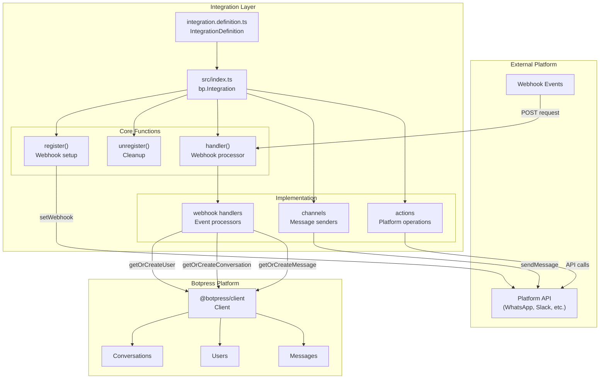
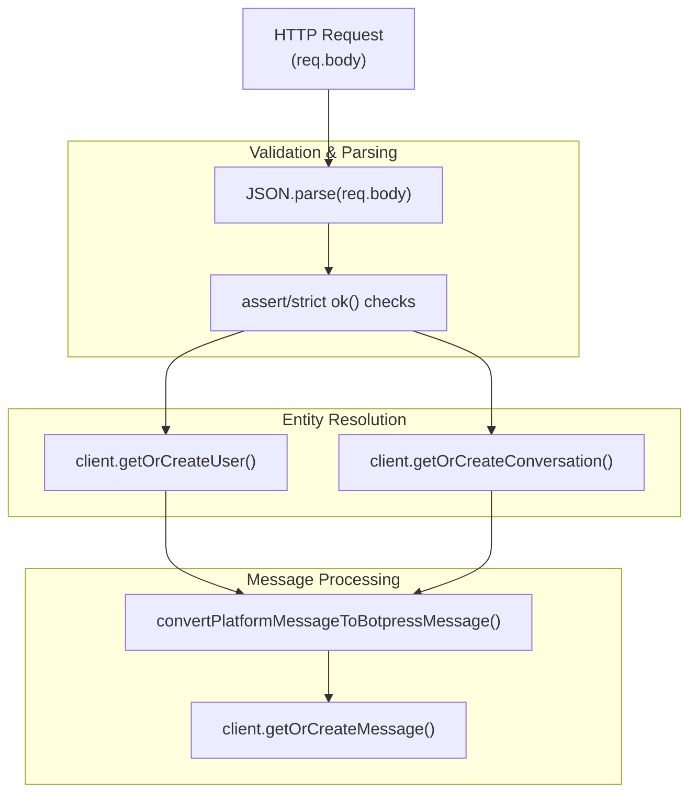

<!-- source: DeepWiki mcp.deepwiki.com · repo botpress/botpress · page 4.3 Messaging Integrations · fetched 2026-10-26 -->

# Messaging Integrations

Relevant source files

The following files were used as context for generating this wiki page:

- [integrations/dropbox/integration.definition.ts](integrations/dropbox/integration.definition.ts)
- [integrations/dropbox/src/webhook-events/oauth/wizard.ts](integrations/dropbox/src/webhook-events/oauth/wizard.ts)
- [integrations/instagram/definitions/channel.ts](integrations/instagram/definitions/channel.ts)
- [integrations/instagram/hub.md](integrations/instagram/hub.md)
- [integrations/instagram/integration.definition.ts](integrations/instagram/integration.definition.ts)
- [integrations/instagram/linkTemplate.vrl](integrations/instagram/linkTemplate.vrl)
- [integrations/instagram/src/actions/proactive-conversation.ts](integrations/instagram/src/actions/proactive-conversation.ts)
- [integrations/instagram/src/channels/channel.ts](integrations/instagram/src/channels/channel.ts)
- [integrations/instagram/src/channels/comment-replies.ts](integrations/instagram/src/channels/comment-replies.ts)
- [integrations/instagram/src/channels/index.ts](integrations/instagram/src/channels/index.ts)
- [integrations/instagram/src/index.ts](integrations/instagram/src/index.ts)
- [integrations/instagram/src/misc/client.ts](integrations/instagram/src/misc/client.ts)
- [integrations/instagram/src/misc/types.ts](integrations/instagram/src/misc/types.ts)
- [integrations/instagram/src/misc/utils.ts](integrations/instagram/src/misc/utils.ts)
- [integrations/instagram/src/webhook/handler.ts](integrations/instagram/src/webhook/handler.ts)
- [integrations/instagram/src/webhook/handlers/comments.ts](integrations/instagram/src/webhook/handlers/comments.ts)
- [integrations/instagram/src/webhook/handlers/messages.ts](integrations/instagram/src/webhook/handlers/messages.ts)
- [integrations/instagram/src/webhook/handlers/sandbox.ts](integrations/instagram/src/webhook/handlers/sandbox.ts)
- [integrations/instagram/tsconfig.json](integrations/instagram/tsconfig.json)
- [integrations/line/hub.md](integrations/line/hub.md)
- [integrations/line/integration.definition.ts](integrations/line/integration.definition.ts)
- [integrations/line/src/index.ts](integrations/line/src/index.ts)
- [integrations/line/src/proactive-conversation.ts](integrations/line/src/proactive-conversation.ts)
- [integrations/line/src/proactive-user.ts](integrations/line/src/proactive-user.ts)
- [integrations/messenger/hub.md](integrations/messenger/hub.md)
- [integrations/messenger/integration.definition.ts](integrations/messenger/integration.definition.ts)
- [integrations/messenger/src/actions/proactive-conversation.ts](integrations/messenger/src/actions/proactive-conversation.ts)
- [integrations/messenger/src/actions/proactive-user.ts](integrations/messenger/src/actions/proactive-user.ts)
- [integrations/messenger/src/actions/typing-indicator.ts](integrations/messenger/src/actions/typing-indicator.ts)
- [integrations/messenger/src/channels/channel.ts](integrations/messenger/src/channels/channel.ts)
- [integrations/messenger/src/channels/index.ts](integrations/messenger/src/channels/index.ts)
- [integrations/messenger/src/index.ts](integrations/messenger/src/index.ts)
- [integrations/messenger/src/misc/auth.ts](integrations/messenger/src/misc/auth.ts)
- [integrations/messenger/src/misc/messenger-client.ts](integrations/messenger/src/misc/messenger-client.ts)
- [integrations/messenger/src/misc/meta-client.ts](integrations/messenger/src/misc/meta-client.ts)
- [integrations/messenger/src/misc/types.ts](integrations/messenger/src/misc/types.ts)
- [integrations/messenger/src/misc/utils.ts](integrations/messenger/src/misc/utils.ts)
- [integrations/messenger/src/webhook/handler.ts](integrations/messenger/src/webhook/handler.ts)
- [integrations/messenger/src/webhook/handlers/message.ts](integrations/messenger/src/webhook/handlers/message.ts)
- [integrations/messenger/src/webhook/handlers/oauth/wizard.ts](integrations/messenger/src/webhook/handlers/oauth/wizard.ts)
- [integrations/slack/definitions/actions.ts](integrations/slack/definitions/actions.ts)
- [integrations/slack/definitions/channels/text-input-schema.ts](integrations/slack/definitions/channels/text-input-schema.ts)
- [integrations/slack/definitions/events.ts](integrations/slack/definitions/events.ts)
- [integrations/slack/hub.md](integrations/slack/hub.md)
- [integrations/slack/integration.definition.ts](integrations/slack/integration.definition.ts)
- [integrations/slack/linkTemplate.vrl](integrations/slack/linkTemplate.vrl)
- [integrations/slack/package.json](integrations/slack/package.json)
- [integrations/slack/src/actions/add-reaction.ts](integrations/slack/src/actions/add-reaction.ts)
- [integrations/slack/src/actions/find-target.ts](integrations/slack/src/actions/find-target.ts)
- [integrations/slack/src/actions/get-channels-info.ts](integrations/slack/src/actions/get-channels-info.ts)
- [integrations/slack/src/actions/get-user-profile.ts](integrations/slack/src/actions/get-user-profile.ts)
- [integrations/slack/src/actions/index.ts](integrations/slack/src/actions/index.ts)
- [integrations/slack/src/channels.ts](integrations/slack/src/channels.ts)
- [integrations/slack/src/misc/markdown-to-slack.ts](integrations/slack/src/misc/markdown-to-slack.ts)
- [integrations/slack/src/misc/replace-mentions.test.ts](integrations/slack/src/misc/replace-mentions.test.ts)
- [integrations/slack/src/misc/replace-mentions.ts](integrations/slack/src/misc/replace-mentions.ts)
- [integrations/slack/src/misc/utils.ts](integrations/slack/src/misc/utils.ts)
- [integrations/slack/src/setup.ts](integrations/slack/src/setup.ts)
- [integrations/slack/src/slack-api/slack-client.ts](integrations/slack/src/slack-api/slack-client.ts)
- [integrations/slack/src/slack-api/slack-scopes.ts](integrations/slack/src/slack-api/slack-scopes.ts)
- [integrations/slack/src/webhook-events/handler-dispatcher.ts](integrations/slack/src/webhook-events/handler-dispatcher.ts)
- [integrations/slack/src/webhook-events/handlers/function-executed.ts](integrations/slack/src/webhook-events/handlers/function-executed.ts)
- [integrations/slack/src/webhook-events/handlers/index.ts](integrations/slack/src/webhook-events/handlers/index.ts)
- [integrations/slack/src/webhook-events/handlers/message-received.ts](integrations/slack/src/webhook-events/handlers/message-received.ts)
- [integrations/teams/integration.definition.ts](integrations/teams/integration.definition.ts)
- [integrations/telegram/definitions/channels.ts](integrations/telegram/definitions/channels.ts)
- [integrations/telegram/hub.md](integrations/telegram/hub.md)
- [integrations/telegram/integration.definition.ts](integrations/telegram/integration.definition.ts)
- [integrations/telegram/linkTemplate.vrl](integrations/telegram/linkTemplate.vrl)
- [integrations/telegram/package.json](integrations/telegram/package.json)
- [integrations/telegram/src/botToken.ts](integrations/telegram/src/botToken.ts)
- [integrations/telegram/src/index.ts](integrations/telegram/src/index.ts)
- [integrations/telegram/src/misc/markdown-to-telegram-html.test.ts](integrations/telegram/src/misc/markdown-to-telegram-html.test.ts)
- [integrations/telegram/src/misc/markdown-to-telegram-html.ts](integrations/telegram/src/misc/markdown-to-telegram-html.ts)
- [integrations/telegram/src/misc/message-handlers.ts](integrations/telegram/src/misc/message-handlers.ts)
- [integrations/telegram/src/misc/string-utils.ts](integrations/telegram/src/misc/string-utils.ts)
- [integrations/telegram/src/misc/telegram-to-markdown.test.ts](integrations/telegram/src/misc/telegram-to-markdown.test.ts)
- [integrations/telegram/src/misc/telegram-to-markdown.ts](integrations/telegram/src/misc/telegram-to-markdown.ts)
- [integrations/telegram/src/misc/types.ts](integrations/telegram/src/misc/types.ts)
- [integrations/telegram/src/misc/utils.ts](integrations/telegram/src/misc/utils.ts)
- [integrations/telegram/src/wizard.ts](integrations/telegram/src/wizard.ts)
- [integrations/telegram/tsconfig.json](integrations/telegram/tsconfig.json)
- [integrations/twilio/integration.definition.ts](integrations/twilio/integration.definition.ts)
- [integrations/twilio/package.json](integrations/twilio/package.json)
- [integrations/twilio/src/index.ts](integrations/twilio/src/index.ts)
- [integrations/twilio/src/markdown-to-twilio.test.ts](integrations/twilio/src/markdown-to-twilio.test.ts)
- [integrations/twilio/src/markdown-to-twilio.ts](integrations/twilio/src/markdown-to-twilio.ts)
- [integrations/twilio/src/types.ts](integrations/twilio/src/types.ts)
- [integrations/viber/hub.md](integrations/viber/hub.md)
- [integrations/viber/integration.definition.ts](integrations/viber/integration.definition.ts)
- [integrations/viber/src/index.ts](integrations/viber/src/index.ts)
- [integrations/vonage/integration.definition.ts](integrations/vonage/integration.definition.ts)
- [integrations/whatsapp/definitions/events.ts](integrations/whatsapp/definitions/events.ts)
- [integrations/whatsapp/hub.md](integrations/whatsapp/hub.md)
- [integrations/whatsapp/integration.definition.ts](integrations/whatsapp/integration.definition.ts)
- [integrations/whatsapp/src/actions/index.ts](integrations/whatsapp/src/actions/index.ts)
- [integrations/whatsapp/src/actions/list-templates.ts](integrations/whatsapp/src/actions/list-templates.ts)
- [integrations/whatsapp/src/actions/start-conversation.ts](integrations/whatsapp/src/actions/start-conversation.ts)
- [integrations/whatsapp/src/actions/typing-indicator.ts](integrations/whatsapp/src/actions/typing-indicator.ts)
- [integrations/whatsapp/src/auth.ts](integrations/whatsapp/src/auth.ts)
- [integrations/whatsapp/src/channels/channel.ts](integrations/whatsapp/src/channels/channel.ts)
- [integrations/whatsapp/src/channels/message-types/card.ts](integrations/whatsapp/src/channels/message-types/card.ts)
- [integrations/whatsapp/src/channels/message-types/carousel.ts](integrations/whatsapp/src/channels/message-types/carousel.ts)
- [integrations/whatsapp/src/channels/message-types/choice.ts](integrations/whatsapp/src/channels/message-types/choice.ts)
- [integrations/whatsapp/src/channels/message-types/dropdown.ts](integrations/whatsapp/src/channels/message-types/dropdown.ts)
- [integrations/whatsapp/src/channels/message-types/image.ts](integrations/whatsapp/src/channels/message-types/image.ts)
- [integrations/whatsapp/src/channels/message-types/interactive/body.ts](integrations/whatsapp/src/channels/message-types/interactive/body.ts)
- [integrations/whatsapp/src/channels/message-types/interactive/button.ts](integrations/whatsapp/src/channels/message-types/interactive/button.ts)
- [integrations/whatsapp/src/channels/message-types/interactive/footer.ts](integrations/whatsapp/src/channels/message-types/interactive/footer.ts)
- [integrations/whatsapp/src/channels/message-types/raw-interactive.ts](integrations/whatsapp/src/channels/message-types/raw-interactive.ts)
- [integrations/whatsapp/src/misc/markdown-to-whatsapp-rtf.test.ts](integrations/whatsapp/src/misc/markdown-to-whatsapp-rtf.test.ts)
- [integrations/whatsapp/src/misc/markdown-to-whatsapp-rtf.ts](integrations/whatsapp/src/misc/markdown-to-whatsapp-rtf.ts)
- [integrations/whatsapp/src/misc/phone-number-to-whatsapp.test.ts](integrations/whatsapp/src/misc/phone-number-to-whatsapp.test.ts)
- [integrations/whatsapp/src/misc/phone-number-to-whatsapp.ts](integrations/whatsapp/src/misc/phone-number-to-whatsapp.ts)
- [integrations/whatsapp/src/misc/template-utils.ts](integrations/whatsapp/src/misc/template-utils.ts)
- [integrations/whatsapp/src/misc/types.ts](integrations/whatsapp/src/misc/types.ts)
- [integrations/whatsapp/src/misc/util.ts](integrations/whatsapp/src/misc/util.ts)
- [integrations/whatsapp/src/misc/whatsapp-utils.ts](integrations/whatsapp/src/misc/whatsapp-utils.ts)
- [integrations/whatsapp/src/setup.ts](integrations/whatsapp/src/setup.ts)
- [integrations/whatsapp/src/webhook/handler.ts](integrations/whatsapp/src/webhook/handler.ts)
- [integrations/whatsapp/src/webhook/handlers/echo.ts](integrations/whatsapp/src/webhook/handlers/echo.ts)
- [integrations/whatsapp/src/webhook/handlers/messages.ts](integrations/whatsapp/src/webhook/handlers/messages.ts)
- [integrations/whatsapp/src/webhook/handlers/oauth/wizard.ts](integrations/whatsapp/src/webhook/handlers/oauth/wizard.ts)
- [integrations/whatsapp/src/webhook/handlers/reaction.ts](integrations/whatsapp/src/webhook/handlers/reaction.ts)
- [integrations/whatsapp/src/webhook/handlers/sandbox.ts](integrations/whatsapp/src/webhook/handlers/sandbox.ts)
- [integrations/whatsapp/src/webhook/handlers/status.ts](integrations/whatsapp/src/webhook/handlers/status.ts)
- [integrations/whatsapp/vitest.config.ts](integrations/whatsapp/vitest.config.ts)
- [integrations/zendesk/src/oauth/wizard.ts](integrations/zendesk/src/oauth/wizard.ts)
- [packages/common/src/html-dialogs/components/pages/button-dialog.tsx](packages/common/src/html-dialogs/components/pages/button-dialog.tsx)
- [packages/common/src/posthog/boolean-generator.test.ts](packages/common/src/posthog/boolean-generator.test.ts)
- [packages/common/src/posthog/boolean-generator.ts](packages/common/src/posthog/boolean-generator.ts)
- [packages/common/src/posthog/helper.ts](packages/common/src/posthog/helper.ts)

## Purpose and Scope

This document covers the architecture and implementation patterns for messaging platform integrations in the Botpress codebase. Messaging integrations connect external chat platforms (WhatsApp, Slack, Telegram, Messenger, Instagram, Line, Teams, Twilio, Viber) to the Botpress platform, enabling bidirectional communication between users and bots.

Messaging integrations implement a common pattern:
- **Webhook handlers**: Receive incoming messages and events from external platforms.
- **Message transformers**: Convert between platform-specific formats and Botpress message types.
- **Channel handlers**: Send outbound messages in platform-specific formats.
- **User/conversation managers**: Maintain identity mapping between platforms and Botpress.

---

## Architecture Overview

### Common Integration Structure

All messaging integrations follow a standardized architecture pattern defined by the SDK.

Title: Messaging Integration Architecture

Sources: [integrations/telegram/src/index.ts:33-107](), [integrations/whatsapp/src/webhook/handler.ts:1-20](), [integrations/slack/integration.definition.ts:13-86]()

---

## Integration Definition Structure

### Configuration Schema

Each messaging integration defines its configuration requirements using Zod/Zui schemas. Configurations typically include authentication credentials, webhook tokens, and platform-specific settings.

**WhatsApp Configuration Example:**
[integrations/whatsapp/integration.definition.ts:20-57]()
- `messageReadBehavior`: Controls how the bot acknowledges received messages (`mark_as_read`, `typing_indicator`, `none`).
- `downloadMedia`: Boolean flag to automatically download media files via the Files API.
- `downloadedMediaExpiry`: Expiry time in hours for downloaded media.

**Slack Configuration Example:**
[integrations/slack/integration.definition.ts:24-53]()
- `botName`: Custom display name for the bot in Slack.
- `replyBehaviour`: Defines where the bot sends replies (`channel`, `thread`, or `both`).
- `onlyOnBotMention`: Boolean to restrict bot replies to explicit mentions.

Sources: [integrations/whatsapp/integration.definition.ts:20-57](), [integrations/slack/integration.definition.ts:24-53](), [integrations/telegram/integration.definition.ts:16-31]()

### Channel Definitions

Messaging integrations define channels that represent different conversation contexts on each platform.

| Platform | Channel | Description |
|----------|---------|-------------|
| **Slack** | `channel` | Public/private Slack channels [integrations/slack/integration.definition.ts:66-77]() |
| **Telegram** | `channel` | Standard Telegram chat [integrations/telegram/integration.definition.ts:41-61]() |
| **Messenger** | `channel` | Messenger direct conversation [integrations/messenger/integration.definition.ts:103-131]() |
| **Messenger** | `commentReplies` | Replies to Facebook post comments [integrations/messenger/integration.definition.ts:132-150]() |
| **Instagram** | `commentReplies` | Replies to Instagram post comments [integrations/instagram/integration.definition.ts:130-165]() |

Sources: [integrations/slack/integration.definition.ts:66-77](), [integrations/telegram/integration.definition.ts:41-61](), [integrations/messenger/integration.definition.ts:103-150](), [integrations/instagram/integration.definition.ts:89-165]()

---

## Webhook Handler Flow

### Registration and Setup

The `register` function sets up webhook subscriptions with external platforms.

**Telegram Example:**
[integrations/telegram/src/index.ts:34-40]()
The `register` function retrieves the `botToken` and uses the `Telegraf` client to call `setWebhook(webhookUrl)`.

**WhatsApp Example:**
[integrations/whatsapp/src/setup.ts:14-25]()
The registration logic handles different configuration modes (Manual vs. Sandbox) and ensures the webhook URL is correctly registered with Meta's Graph API.

Sources: [integrations/telegram/src/index.ts:34-40](), [integrations/whatsapp/src/setup.ts:14-25](), [integrations/slack/src/setup.ts:30-51]()

### Webhook Processing Pipeline

The `handler` function processes incoming webhook events from the platform.

Title: Webhook Processing Pipeline

Sources: [integrations/telegram/src/index.ts:107-160](), [integrations/whatsapp/src/webhook/handlers/messages.ts:35-135]()

---

## Message Type Conversion

### Incoming Message Transformation

Platform-specific message formats are converted to standardized Botpress message types.

**WhatsApp Message Handling:**
[integrations/whatsapp/src/webhook/handlers/messages.ts:155-200]()
- `text`: Maps to Botpress `text` type.
- `button`: Maps to Botpress `text` with `payload` as the value.
- `image`/`sticker`: Downloads media via `_getOrDownloadWhatsappMedia` and maps to Botpress `image`.
- `location`: Maps to Botpress `location` with latitude and longitude.

**Telegram Message Handling:**
[integrations/telegram/src/misc/utils.ts:175-230]()
- `photo`: Selects the largest photo size and extracts the file URL via `telegram.getFileLink`.
- `sticker`: Handled as an `image`.
- `audio`/`voice`: Extracts file URL and maps to Botpress `audio`.

Sources: [integrations/whatsapp/src/webhook/handlers/messages.ts:155-200](), [integrations/telegram/src/misc/utils.ts:175-230]()

### Outgoing Message Transformation

Botpress message types are converted to platform-specific API formats within the `channels` implementation.

**WhatsApp Outgoing Messages:**
[integrations/whatsapp/src/channels/channel.ts:34-118]()
- `text`: Uses `convertMarkdownToWhatsApp` and `splitTextMessageIfNeeded` to handle length limits [integrations/whatsapp/src/channels/channel.ts:42-43]().
- `image`: Generates an outgoing message using the `image.generateOutgoingMessage` utility [integrations/whatsapp/src/channels/channel.ts:77-86]().
- `location`: Maps to `whatsapp-api-js` `Location` class [integrations/whatsapp/src/channels/channel.ts:113-118]().

Sources: [integrations/whatsapp/src/channels/channel.ts:34-147](), [integrations/telegram/src/misc/message-handlers.ts:1-20]()

---

## User and Conversation Management

### User Identity Mapping

Messaging integrations map platform-specific user IDs to Botpress user entities using tags.

| Platform | User ID Tag | Code Entity |
|----------|-------------|-------------|
| **WhatsApp** | `userId` | `contact.wa_id` or `contact.user_id` [integrations/whatsapp/src/webhook/handlers/messages.ts:94-105]() |
| **Slack** | `id` | `slackUserId` [integrations/slack/src/misc/utils.ts:55-64]() |
| **Telegram** | `id` | `telegramUserId.toString()` [integrations/telegram/src/index.ts:154-160]() |
| **Instagram** | `id` | `instagramUserId` [integrations/instagram/integration.definition.ts:192-199]() |

Sources: [integrations/whatsapp/src/webhook/handlers/messages.ts:94-105](), [integrations/slack/src/misc/utils.ts:55-64](), [integrations/telegram/src/index.ts:154-160]()

### Conversation Context Management

Conversations are created with platform-specific tags to maintain context across messages.

**WhatsApp Conversation Tags:**
[integrations/whatsapp/src/webhook/handlers/messages.ts:77-88]()
- `userPhone`: The formatted phone number of the user.
- `botPhoneNumberId`: The ID of the bot's phone number.
- `userId`: The stable WhatsApp user ID.

**Slack Conversation Tags:**
[integrations/slack/src/misc/utils.ts:93-118]()
- `id`: The Slack channel ID.
- `thread`: The Slack thread timestamp (for threaded conversations).

Sources: [integrations/whatsapp/src/webhook/handlers/messages.ts:77-88](), [integrations/slack/src/misc/utils.ts:93-118](), [integrations/telegram/src/index.ts:142-152]()

---

## Platform-Specific Features

### WhatsApp Proactive Conversations

WhatsApp allows starting conversations using pre-approved templates.

**Start Conversation Action:**
[integrations/whatsapp/src/actions/start-conversation.ts:17-89]()
- Takes `userPhone`, `templateName`, and `templateLanguage`.
- Supports `templateHeaderParams`, `templateBodyParams`, and `templateButtonParams`.
- Creates a Botpress conversation and sends the template message via the WhatsApp API.

Sources: [integrations/whatsapp/src/actions/start-conversation.ts:17-89](), [integrations/whatsapp/integration.definition.ts:66-152]()

### Typing Indicators

Integrations implement typing indicators to improve user experience.

**Telegram Typing Indicator:**
[integrations/telegram/src/index.ts:49-69]()
- Calls `telegraf.telegram.sendChatAction(chat, 'typing')`.
- If `typingIndicatorEmoji` is enabled, it adds a reaction (👀) to the message.

**WhatsApp Typing Indicator:**
[integrations/whatsapp/src/actions/typing-indicator.ts:6-40]()
- Marks the message as read.
- Optionally adds a reaction emoji while the bot is processing.

Sources: [integrations/telegram/src/index.ts:49-89](), [integrations/whatsapp/src/actions/typing-indicator.ts:6-40]()

### Media Processing

Integrations handle media files by either using direct URLs or downloading them to the Botpress Files API.

**WhatsApp Media Download:**
[integrations/whatsapp/src/webhook/handlers/messages.ts:173-195]()
The function `_getOrDownloadWhatsappMedia` checks the `downloadMedia` configuration. If enabled, it downloads the file from WhatsApp's servers and uploads it to Botpress using `client.upsertFile`.

Sources: [integrations/whatsapp/src/webhook/handlers/messages.ts:173-195](), [integrations/whatsapp/integration.definition.ts:34-48](), [integrations/slack/src/misc/utils.ts:16-44]()

---

