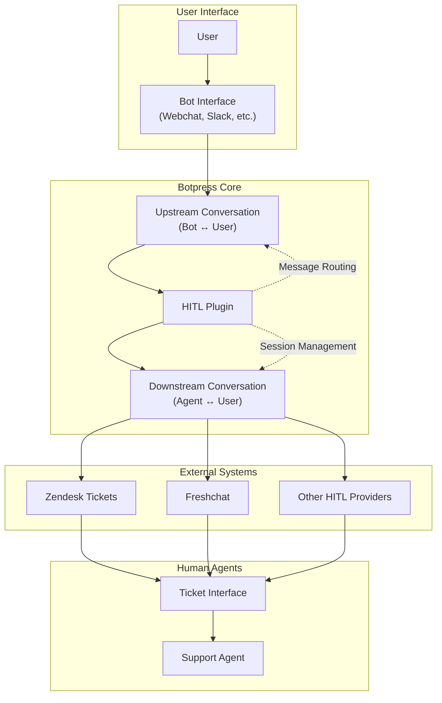
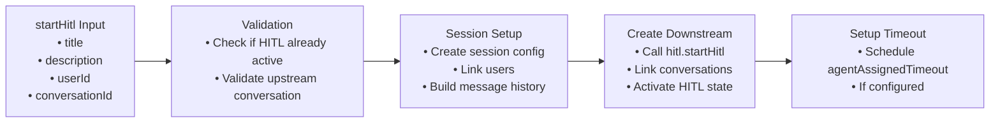
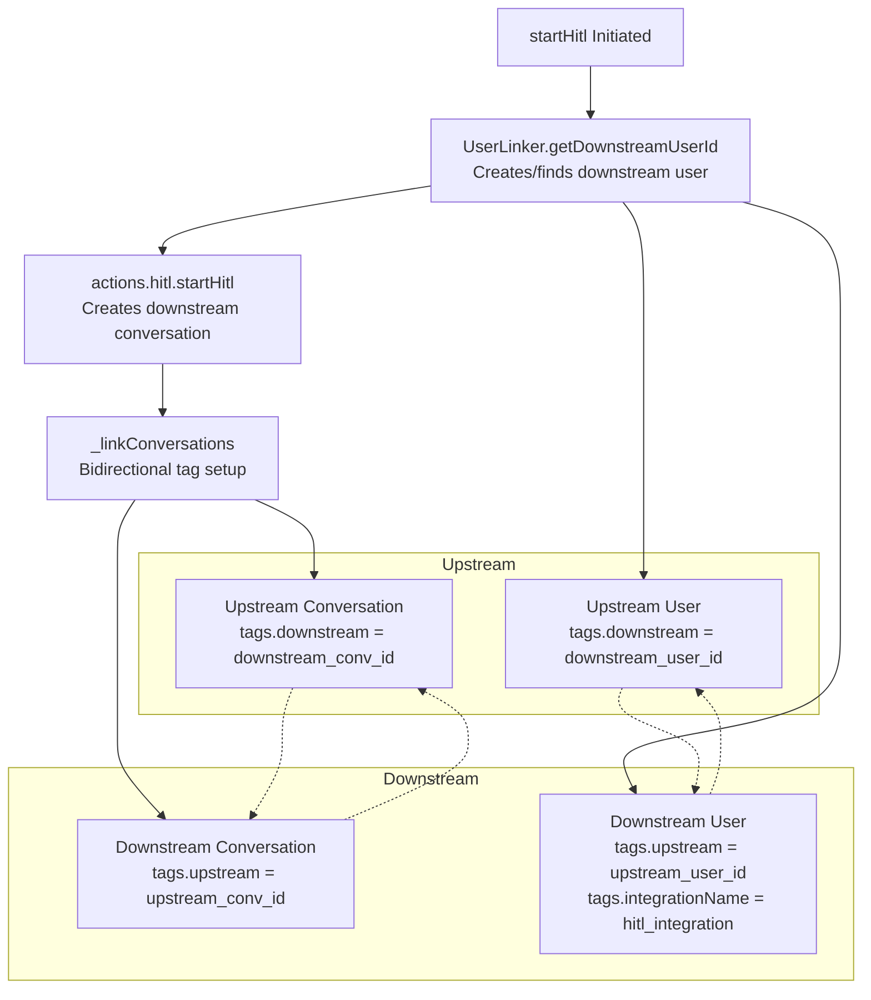
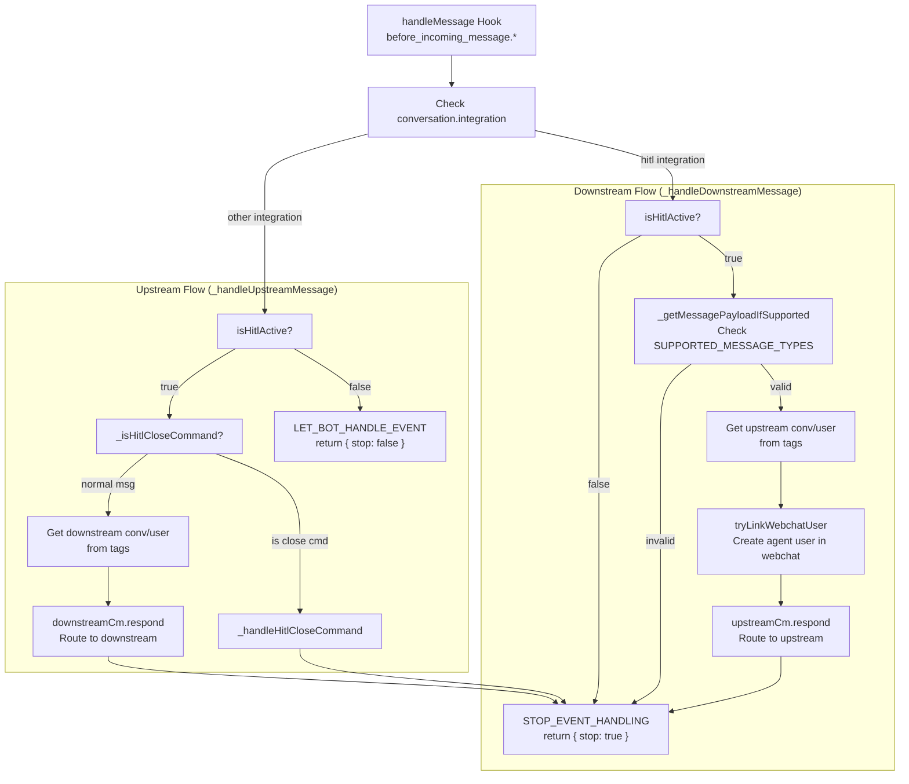
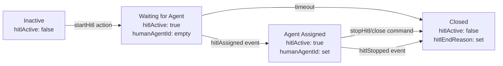
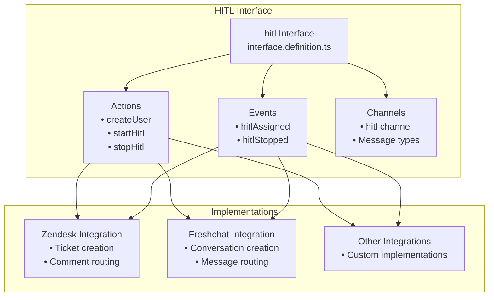
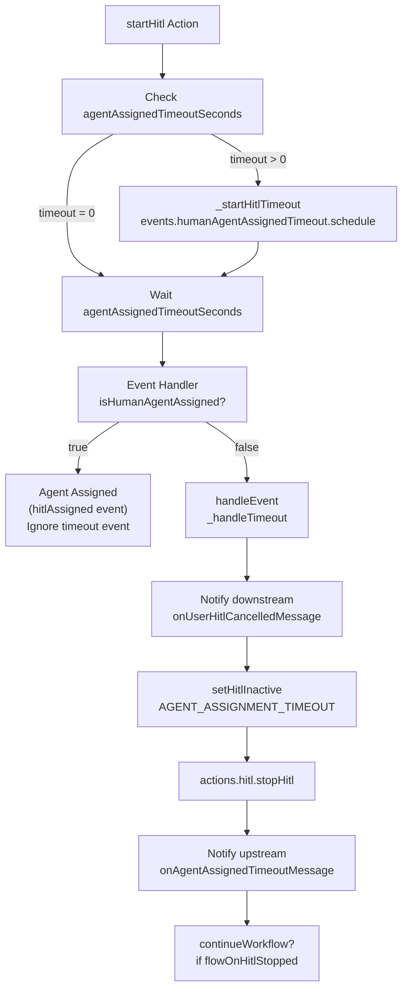
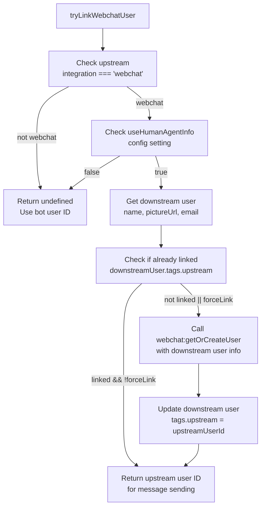

<!-- source: DeepWiki mcp.deepwiki.com · repo botpress/botpress · page 5.2 HITL Plugin · fetched 2026-10-26 -->

# HITL Plugin

<details>
<summary>Relevant source files</summary>

The following files were used as context for generating this wiki page:

- [bots/hit-looper/bot.definition.ts](bots/hit-looper/bot.definition.ts)
- [bots/hit-looper/src/api-utils.ts](bots/hit-looper/src/api-utils.ts)
- [bots/hit-looper/src/index.ts](bots/hit-looper/src/index.ts)
- [bots/knowledgiani/package.json](bots/knowledgiani/package.json)
- [bots/synchrotron/package.json](bots/synchrotron/package.json)
- [integrations/freshchat/integration.definition.ts](integrations/freshchat/integration.definition.ts)
- [integrations/freshchat/src/actions/hitl.ts](integrations/freshchat/src/actions/hitl.ts)
- [integrations/freshchat/src/client.ts](integrations/freshchat/src/client.ts)
- [integrations/zendesk/hub.md](integrations/zendesk/hub.md)
- [integrations/zendesk/integration.definition.ts](integrations/zendesk/integration.definition.ts)
- [integrations/zendesk/src/actions/create-user.ts](integrations/zendesk/src/actions/create-user.ts)
- [integrations/zendesk/src/actions/hitl.ts](integrations/zendesk/src/actions/hitl.ts)
- [integrations/zendesk/src/actions/index.ts](integrations/zendesk/src/actions/index.ts)
- [integrations/zendesk/src/channels.ts](integrations/zendesk/src/channels.ts)
- [integrations/zendesk/src/client.ts](integrations/zendesk/src/client.ts)
- [integrations/zendesk/src/definitions/actions.ts](integrations/zendesk/src/definitions/actions.ts)
- [integrations/zendesk/src/definitions/channels.ts](integrations/zendesk/src/definitions/channels.ts)
- [integrations/zendesk/src/definitions/schemas.ts](integrations/zendesk/src/definitions/schemas.ts)
- [integrations/zendesk/src/misc/axios-utils.ts](integrations/zendesk/src/misc/axios-utils.ts)
- [interfaces/hitl/interface.definition.ts](interfaces/hitl/interface.definition.ts)
- [packages/cli/src/code-generation/plugin-implementation/plugin-implementation.ts](packages/cli/src/code-generation/plugin-implementation/plugin-implementation.ts)
- [plugins/file-synchronizer/package.json](plugins/file-synchronizer/package.json)
- [plugins/hitl/package.json](plugins/hitl/package.json)
- [plugins/hitl/plugin.definition.ts](plugins/hitl/plugin.definition.ts)
- [plugins/hitl/src/actions/start-hitl.ts](plugins/hitl/src/actions/start-hitl.ts)
- [plugins/hitl/src/actions/stop-hitl.ts](plugins/hitl/src/actions/stop-hitl.ts)
- [plugins/hitl/src/configuration.ts](plugins/hitl/src/configuration.ts)
- [plugins/hitl/src/conv-manager.ts](plugins/hitl/src/conv-manager.ts)
- [plugins/hitl/src/hooks/before-incoming-event/all.ts](plugins/hitl/src/hooks/before-incoming-event/all.ts)
- [plugins/hitl/src/hooks/before-incoming-event/hitl-assigned.ts](plugins/hitl/src/hooks/before-incoming-event/hitl-assigned.ts)
- [plugins/hitl/src/hooks/before-incoming-event/hitl-stopped.ts](plugins/hitl/src/hooks/before-incoming-event/hitl-stopped.ts)
- [plugins/hitl/src/hooks/before-incoming-event/human-agent-assigned-timeout.ts](plugins/hitl/src/hooks/before-incoming-event/human-agent-assigned-timeout.ts)
- [plugins/hitl/src/hooks/before-incoming-event/index.ts](plugins/hitl/src/hooks/before-incoming-event/index.ts)
- [plugins/hitl/src/hooks/before-incoming-message/all.ts](plugins/hitl/src/hooks/before-incoming-message/all.ts)
- [plugins/hitl/src/hooks/consts.ts](plugins/hitl/src/hooks/consts.ts)
- [plugins/hitl/src/hooks/index.ts](plugins/hitl/src/hooks/index.ts)
- [plugins/hitl/src/hooks/operations.ts](plugins/hitl/src/hooks/operations.ts)
- [plugins/hitl/src/index.ts](plugins/hitl/src/index.ts)
- [plugins/hitl/src/types.ts](plugins/hitl/src/types.ts)
- [plugins/hitl/src/user-linker.ts](plugins/hitl/src/user-linker.ts)
- [plugins/hitl/src/webchat.ts](plugins/hitl/src/webchat.ts)
- [plugins/knowledge/package.json](plugins/knowledge/package.json)
- [plugins/personality/package.json](plugins/personality/package.json)
- [plugins/synchronizer/package.json](plugins/synchronizer/package.json)
- [plugins/synchronizer/src/index.ts](plugins/synchronizer/src/index.ts)

</details>


This document covers the Human-in-the-Loop (HITL) plugin, which enables seamless escalation of bot conversations to human agents through external ticketing systems. The plugin manages bidirectional message routing, session lifecycle, and integration with customer support platforms.

For information about the broader plugin system architecture, see [Plugin Definition & Implementation](#5.1). For details on specific messaging platform integrations, see [Messaging Integrations](#4.3).

## Purpose and Architecture

The HITL plugin creates a bridge between bot conversations (upstream) and human agent conversations (downstream) through external ticketing systems. When a user requests human assistance, the plugin creates a linked conversation in the external system while maintaining message synchronization between both sides.

### Core Architecture



**Sources:** [plugins/hitl/plugin.definition.ts:1-227](), [plugins/hitl/src/conv-manager.ts:1-102](), [interfaces/hitl/interface.definition.ts:1-178]()

## Plugin Configuration

The HITL plugin accepts extensive configuration options for customizing user messages and behavior during session transitions.

### Configuration Schema

| Parameter | Type | Description | Default |
|-----------|------|-------------|---------|
| `onHitlHandoffMessage` | string | Message sent when transferring to human agent | "I have escalated this conversation..." |
| `onHumanAgentAssignedMessage` | string | Message sent when human agent is assigned | "A human agent has joined..." |
| `onHitlStoppedMessage` | string | Message sent when HITL session ends | "The human agent closed the conversation..." |
| `onUserHitlCancelledMessage` | string | Message sent to agent when user ends session | "( The user has ended the session. )" |
| `onIncompatibleMsgTypeMessage` | string | Warning sent to agent for unsupported message types | "Sorry, the user can not receive..." |
| `onUserHitlCloseMessage` | string | Message sent to the user when they end the HITL session using the termination command. | "You have ended the session with the human agent. I will continue assisting you." |
| `onAgentAssignedTimeoutMessage` | string | Message sent to the user when no human agent is assigned within the timeout period. | "No human agent is available at the moment. Please try again later. I will continue assisting you for the time being." |
| `userHitlCloseCommand` | string | Command users can send to end session | "/end" |
| `agentAssignedTimeoutSeconds` | number | Timeout for agent assignment (0 = disabled) | 0 |
| `useHumanAgentInfo` | boolean | Use agent's name/photo in webchat (webchat only) | true |
| `flowOnHitlStopped` | boolean | Continue bot flow when session ends | true |

Configuration can be overridden per session using the `configurationOverrides` parameter in `startHitl`.

**Sources:** [plugins/hitl/plugin.definition.ts:18-101]()

## Core Components

### Actions

The plugin provides two primary actions for session management:

#### startHitl Action



The `startHitl` action performs the following steps:

1.  **Validation**: Checks if conversation is already in HITL mode or is itself a downstream conversation [plugins/hitl/src/actions/start-hitl.ts:24-36]()
2.  **Configuration**: Creates per-session configuration using `configureNewHitlSession` [plugins/hitl/src/actions/start-hitl.ts:47-51]()
3.  **User Linking**: Uses `UserLinker.getDownstreamUserId` to create/link users in external system [plugins/hitl/src/actions/start-hitl.ts:54-55]()
4.  **Message History**: Builds transcript via `_buildMessageHistory` from upstream conversation [plugins/hitl/src/actions/start-hitl.ts:57]()
5.  **Downstream Creation**: Calls `actions.hitl.startHitl` on the HITL integration (e.g., Zendesk) [plugins/hitl/src/actions/start-hitl.ts:116-123]()
6.  **Conversation Linking**: Links upstream/downstream conversations via tags [plugins/hitl/src/actions/start-hitl.ts:68](), [plugins/hitl/src/actions/start-hitl.ts:133-147]()
7.  **State Activation**: Sets `hitl.hitlActive = true` on both conversations [plugins/hitl/src/actions/start-hitl.ts:69](), [plugins/hitl/src/actions/start-hitl.ts:149]()
8.  **Timeout**: Schedules `humanAgentAssignedTimeout` event if configured [plugins/hitl/src/actions/start-hitl.ts:70](), [plugins/hitl/src/actions/start-hitl.ts:151-171]()

**Sources:** [plugins/hitl/src/actions/start-hitl.ts:1-213]()

#### stopHitl Action

The `stopHitl` action terminates an active HITL session:

1.  Checks if HITL is active via `upstreamCm.isHitlActive()` [plugins/hitl/src/actions/stop-hitl.ts:19]()
2.  Sends cancellation message to downstream conversation [plugins/hitl/src/actions/stop-hitl.ts:22]()
3.  Sets HITL inactive on both conversations with reason `CLOSE_ACTION_CALLED` [plugins/hitl/src/actions/stop-hitl.ts:24-27]()
4.  Calls `actions.hitl.stopHitl` on the HITL integration to close ticket/conversation [plugins/hitl/src/actions/stop-hitl.ts:30]()

**Sources:** [plugins/hitl/src/actions/stop-hitl.ts:1-49]()

### States

The plugin maintains two conversation-level states:

| State Name | Type | Schema | Purpose |
|------------|------|--------|---------|
| `hitl` | conversation | `{ hitlActive: boolean }` | Tracks whether HITL is active for a conversation |
| `effectiveSessionConfig` | conversation | `PLUGIN_CONFIG_SCHEMA` | Stores per-session configuration overrides |

**Sources:** [plugins/hitl/plugin.definition.ts:172-183]()

### Tags

The plugin uses tags on both users and conversations to maintain bidirectional links:

**User Tags:**

| Tag | Description |
|-----|-------------|
| `downstream` | ID of the downstream user bound to the upstream user |
| `upstream` | ID of the upstream user bound to the downstream user |
| `integrationName` | Name of the integration that created the downstream user |

**Conversation Tags:**

| Tag | Description |
|-----|-------------|
| `downstream` | ID of the downstream conversation bound to the upstream one |
| `upstream` | ID of the upstream conversation bound to the downstream one |
| `humanAgentId` | ID of the human agent assigned to the ticket |
| `humanAgentName` | Name of the human agent assigned to the ticket |
| `hitlEndReason` | Reason why the HITL session ended |
| `startMessageId` | ID of the user message that initiated the HITL session |

**Sources:** [plugins/hitl/plugin.definition.ts:184-227]()

### Events

| Event | Purpose |
|-------|---------|
| `humanAgentAssignedTimeout` | Triggered when no agent is assigned within timeout |
| `continueWorkflow` | Signals bot to continue conversation flow |

**Sources:** [plugins/hitl/plugin.definition.ts:217-226]()

## Message Routing System

### Conversation and User Linking

The HITL system uses conversation and user tags to maintain bidirectional links between upstream and downstream conversations. The linking is established during `startHitl`:

**Conversation Linking Flow**



**Sources:** [plugins/hitl/src/actions/start-hitl.ts:53-69](), [plugins/hitl/src/actions/start-hitl.ts:133-147]()

### ConversationManager Class

The `ConversationManager` class provides a high-level API for managing HITL state and sending messages:

| Method | Purpose |
|--------|---------|
| `from(props, convId)` | Static factory method to create instance [plugins/hitl/src/conv-manager.ts:24]() |
| `isHitlActive()` | Returns whether HITL is active on conversation [plugins/hitl/src/conv-manager.ts:46]() |
| `setHitlActive()` | Activates HITL mode [plugins/hitl/src/conv-manager.ts:51]() |
| `setHitlInactive(reason)` | Deactivates HITL mode with end reason [plugins/hitl/src/conv-manager.ts:56]() |
| `isHumanAgentAssigned()` | Checks if agent has been assigned [plugins/hitl/src/conv-manager.ts:42]() |
| `setHumanAgent(id, name)` | Records agent assignment in conversation tags [plugins/hitl/src/conv-manager.ts:38]() |
| `respond(payload)` | Sends message to conversation [plugins/hitl/src/conv-manager.ts:88]() |
| `continueWorkflow()` | Emits `continueWorkflow` event to resume bot flow [plugins/hitl/src/conv-manager.ts:64]() |
| `abortHitlSession(errorMsg)` | Emergency session termination with error message [plugins/hitl/src/conv-manager.ts:150]() |

**Sources:** [plugins/hitl/src/conv-manager.ts:1-102]()

### Message Handling Flow

The `before_incoming_message` hook intercepts all incoming messages and routes them based on conversation type. This hook is registered on `'*'` to catch all messages.

**Message Routing Logic**



**Key Functions:**

-   `handleMessage`: Main hook handler registered on `'*'` [plugins/hitl/src/hooks/before-incoming-message/all.ts:16]()
-   `_handleUpstreamMessage`: Routes user messages to agent [plugins/hitl/src/hooks/before-incoming-message/all.ts:105]()
-   `_handleDownstreamMessage`: Routes agent messages to user [plugins/hitl/src/hooks/before-incoming-message/all.ts:29]()
-   `_isHitlCloseCommand`: Checks if message matches `userHitlCloseCommand` [plugins/hitl/src/hooks/before-incoming-message/all.ts:193]()
-   `_handleHitlCloseCommand`: Terminates session when user sends close command [plugins/hitl/src/hooks/before-incoming-message/all.ts:159]()
-   `_getMessagePayloadIfSupported`: Validates message type against `SUPPORTED_MESSAGE_TYPES` [plugins/hitl/src/hooks/before-incoming-message/all.ts:91]()

**Sources:** [plugins/hitl/src/hooks/before-incoming-message/all.ts:15-218]()

## Session Lifecycle

### Session States

The HITL session progresses through several states tracked by the `hitl.hitlActive` flag and conversation tags:

| State | hitlActive | humanAgentId | Description |
|-------|-----------|--------------|-------------|
| Inactive | false | empty | No HITL session active |
| Active, Waiting | true | empty | HITL session created, waiting for agent assignment |
| Active, Assigned | true | set | Human agent assigned to session |
| Closed | false | set | Session ended, end reason in tags |

**State Transition Diagram**



**Sources:** [plugins/hitl/src/conv-manager.ts:1-102]()

### End Reasons

Sessions can end for various reasons tracked in the `HITL_END_REASON` constant:

```typescript
const HITL_END_REASON = {
  PATIENT_USED_TERMINATION_COMMAND: 'patient-used-termination-command',
  AGENT_ASSIGNMENT_TIMEOUT: 'agent-assignment-timeout',
  AGENT_CLOSED_TICKET: 'agent-closed-ticket',
  CLOSE_ACTION_CALLED: 'close-action-called',
  INTERNAL_ERROR: 'internal-error',
}
```

Each end reason is stored in the `hitlEndReason` conversation tag when `setHitlInactive(reason)` is called.

**Sources:** [plugins/hitl/src/conv-manager.ts:8-21]()

### Event Handlers

The plugin registers three event handlers for session lifecycle management:

#### hitlAssigned Event Handler

Triggered when a human agent is assigned to the HITL session:

1.  Validates HITL is active [plugins/hitl/src/hooks/before-incoming-event/hitl-assigned.ts:17]()
2.  Retrieves human agent information [plugins/hitl/src/hooks/before-incoming-event/hitl-assigned.ts:20]()
3.  Sends `onHumanAgentAssignedMessage` to upstream conversation [plugins/hitl/src/hooks/before-incoming-event/hitl-assigned.ts:26]()
4.  Sets human agent tags via `setHumanAgent()` [plugins/hitl/src/hooks/before-incoming-event/hitl-assigned.ts:30]()
5.  Attempts `tryLinkWebchatUser` to enable agent impersonation [plugins/hitl/src/hooks/before-incoming-event/hitl-assigned.ts:44]()

**Sources:** [plugins/hitl/src/hooks/before-incoming-event/hitl-assigned.ts:1-48]()

#### hitlStopped Event Handler

Triggered when the external system closes the HITL session:

1.  Validates HITL is active [plugins/hitl/src/hooks/before-incoming-event/hitl-stopped.ts:17]()
2.  Sends `onHitlStoppedMessage` to upstream conversation [plugins/hitl/src/hooks/before-incoming-event/hitl-stopped.ts:23]()
3.  Deactivates HITL with reason `AGENT_CLOSED_TICKET` [plugins/hitl/src/hooks/before-incoming-event/hitl-stopped.ts:25]()
4.  Emits `continueWorkflow` event if `flowOnHitlStopped` is enabled [plugins/hitl/src/hooks/before-incoming-event/hitl-stopped.ts:30]()

**Sources:** [plugins/hitl/src/hooks/before-incoming-event/hitl-stopped.ts:1-49]()

#### humanAgentAssignedTimeout Event Handler

Triggered when no agent is assigned within the configured timeout:

1.  Checks if agent has been assigned (via `isHumanAgentAssigned()`) [plugins/hitl/src/hooks/before-incoming-event/human-agent-assigned-timeout.ts:21]()
2.  Validates timeout has elapsed [plugins/hitl/src/hooks/before-incoming-event/human-agent-assigned-timeout.ts:36]()
3.  Sends cancellation message to downstream conversation [plugins/hitl/src/hooks/before-incoming-event/human-agent-assigned-timeout.ts:82]()
4.  Deactivates HITL with reason `AGENT_ASSIGNMENT_TIMEOUT` [plugins/hitl/src/hooks/before-incoming-event/human-agent-assigned-timeout.ts:84-87]()
5.  Calls `actions.hitl.stopHitl` to close external session [plugins/hitl/src/hooks/before-incoming-event/human-agent-assigned-timeout.ts:95]()
6.  Sends `onAgentAssignedTimeoutMessage` to upstream conversation [plugins/hitl/src/hooks/before-incoming-event/human-agent-assigned-timeout.ts:97]()
7.  Emits `continueWorkflow` if `flowOnHitlStopped` is enabled [plugins/hitl/src/hooks/before-incoming-event/human-agent-assigned-timeout.ts:48]()

**Sources:** [plugins/hitl/src/hooks/before-incoming-event/human-agent-assigned-timeout.ts:1-108]()

## Integration with External Systems

### HITL Interface

The plugin uses the `hitl` interface to communicate with external systems:



**Sources:** [interfaces/hitl/interface.definition.ts:1-178](), [integrations/zendesk/integration.definition.ts:22-44](), [integrations/freshchat/integration.definition.ts:18-39]()

### Zendesk Implementation

The Zendesk integration implements HITL through the ticket system:

**Entity Configuration:**

The integration extends the hitl interface with a `hitlTicket` entity:

```typescript
entities: {
  hitlSession: self.entities.hitlTicket,
}
```

The `hitlTicket` schema includes:
- `priority`: Ticket priority (low, normal, high, urgent) [integrations/zendesk/integration.definition.ts:32-36]()
- `chatbotName`: Name displayed for bot in Zendesk [integrations/zendesk/integration.definition.ts:37-41]()
- `chatbotPhotoUrl`: Photo URL for bot in Zendesk [integrations/zendesk/integration.definition.ts:42-49]()

**Action Implementations:**

**`startHitl`** ([integrations/zendesk/src/actions/hitl.ts:6-59]()):
1.  Updates bot user with custom name/photo via `_updateZendeskBotpressUser` [integrations/zendesk/src/actions/hitl.ts:27-31]()
2.  Builds ticket body using `_buildTicketBody` with conversation transcript [integrations/zendesk/src/actions/hitl.ts:41-43]()
3.  Creates Zendesk ticket via `zendeskClient.createTicket` [integrations/zendesk/src/actions/hitl.ts:40-47]()
4.  Creates or retrieves hitl channel conversation [integrations/zendesk/src/actions/hitl.ts:50-56]()
5.  Updates ticket with external\_id linking to Botpress conversation [integrations/zendesk/src/actions/hitl.ts:58-60]()

**`stopHitl`** ([integrations/zendesk/src/actions/hitl.ts:92-113]()):
1.  Retrieves conversation and ticket ID from tags [integrations/zendesk/src/actions/hitl.ts:101]()
2.  Closes ticket via `zendeskClient.updateTicket` with status 'closed' [integrations/zendesk/src/actions/hitl.ts:111-113]()

**Message Routing:**

Zendesk routes messages through ticket comments, with the bot user representing the chatbot.

**Sources:** [integrations/zendesk/integration.definition.ts:1-73](), [integrations/zendesk/src/actions/hitl.ts:1-114]()

### Freshchat Implementation

The Freshchat integration implements HITL through the conversation system:

**Entity Configuration:**

The integration extends the hitl interface with a `hitlConversation` entity:

```typescript
entities: {
  hitlSession: self.entities.hitlConversation,
}
```

The `hitlConversation` schema includes:
- `priority`: Conversation priority (Low, Medium, High, Urgent) [integrations/freshchat/integration.definition.ts:23-28]()

**Action Implementations:**

**`createUser`** ([integrations/freshchat/src/actions/hitl.ts:121-153]()):
1.  Gets or creates Botpress user [integrations/freshchat/src/actions/hitl.ts:124-131]()
2.  Gets or creates Freshchat user via `freshchatClient.getOrCreateUser` [integrations/freshchat/src/actions/hitl.ts:133-140]()
3.  Links users by storing Freshchat user ID in Botpress user tags [integrations/freshchat/src/actions/hitl.ts:142-147]()

**`startHitl`** ([integrations/freshchat/src/actions/hitl.ts:7-95]()):
1.  Retrieves user and validates Freshchat user ID exists [integrations/freshchat/src/actions/hitl.ts:14-19]()
2.  Builds message history with title, description, and transcript [integrations/freshchat/src/actions/hitl.ts:21-22]()
3.  Creates Freshchat conversation via `freshchatClient.createConversation` [integrations/freshchat/src/actions/hitl.ts:24-31]()
4.  Returns conversation ID for linking [integrations/freshchat/src/actions/hitl.ts:33]()

**`stopHitl`** ([integrations/freshchat/src/actions/hitl.ts:97-118]()):
1.  Retrieves conversation and Freshchat conversation ID from tags [integrations/freshchat/src/actions/hitl.ts:100-103]()
2.  Resolves conversation via `freshchatClient.setConversationAsResolved` [integrations/freshchat/src/actions/hitl.ts:110]()

**Message Routing:**

Freshchat routes messages through conversation messages, with actors identified by user IDs.

**Sources:** [integrations/freshchat/integration.definition.ts:1-56](), [integrations/freshchat/src/actions/hitl.ts:1-153]()

## Advanced Features

### Agent Assignment Timeout

The plugin supports automatic session termination when no agent is assigned within a configured timeout period.

**Timeout Flow**



**Implementation Details:**

The timeout is scheduled using the `schedule` method with a delay:

```typescript
await props.events.humanAgentAssignedTimeout
  .withConversationId(upstreamCm.conversationId)
  .withUserId(upstreamUserId)
  .schedule(
    {
      sessionStartedAt: new Date().toISOString(),
      downstreamConversationId: downstreamCm.conversationId,
    },
    { delay: agentAssignedTimeoutSeconds * 1000 }
  )
```

The event handler validates the timeout has actually elapsed before taking action.

**Sources:** [plugins/hitl/src/actions/start-hitl.ts:152-175](), [plugins/hitl/src/hooks/before-incoming-event/human-agent-assigned-timeout.ts:1-108]()

### Webchat User Linking

The `tryLinkWebchatUser` function enables agent impersonation in webchat by creating a user representation that makes messages appear to come from the human agent rather than the bot.

**Linking Flow**



**When Used:**

-   Called in `_handleDownstreamMessage` when routing agent messages to user [plugins/hitl/src/hooks/before-incoming-message/all.ts:70-71]()
-   Called in `hitlAssigned` event handler when agent is assigned (with `forceLink: true`) [plugins/hitl/src/hooks/before-incoming-event/hitl-assigned.ts:44]()

**Limitations:**

This feature only works with the webchat integration and is considered a workaround. It's not part of the formal interface contract.

**Sources:** [plugins/hitl/src/webchat.ts:1-100](), [plugins/hitl/src/hooks/before-incoming-message/all.ts:70-71](), [plugins/hitl/src/hooks/before-incoming-event/hitl-assigned.ts:44]()

### Message Type Support

The plugin only routes specific message types to ensure compatibility across platforms. Unsupported message types are rejected with a warning.

**Supported Message Types:**

```typescript
const SUPPORTED_MESSAGE_TYPES = ['text', 'image', 'audio', 'video', 'file', 'bloc']
```

**Validation:**

The `_getMessagePayloadIfSupported` function validates incoming messages:

```typescript
const _getMessagePayloadIfSupported = (msg: client.Message): types.MessagePayload | undefined =>
  consts.SUPPORTED_MESSAGE_TYPES.includes(msg.type as types.SupportedMessageTypes)
    ? ({ type: msg.type, ...msg.payload } as types.MessagePayload)
    : undefined
```

When an unsupported message type is received, the plugin sends the `onIncompatibleMsgTypeMessage` warning to the sender.

**Sources:** [plugins/hitl/src/hooks/consts.ts:1-2](), [plugins/hitl/src/types.ts:1-23](), [plugins/hitl/src/hooks/before-incoming-message/all.ts:91-94]()

### User Management

The HITL system requires creating/linking users across systems. The `UserLinker` class (defined in [plugins/hitl/src/user-linker.ts]()) manages this process.

**User Creation in Interface:**

The hitl interface defines a `createUser` action that integrations must implement:

```typescript
createUser: {
  input: {
    name: string
    pictureUrl?: string
    email?: string
  },
  output: {
    userId: string  // Botpress user ID
  }
}
```

This action creates the user in both the external system and Botpress, establishing the bidirectional link through user tags.

**Sources:** [interfaces/hitl/interface.definition.ts:79-112]()

### Configuration Overrides

The plugin supports per-session configuration overrides via the `startHitl` action:

```typescript
input: {
  // ... other fields
  configurationOverrides: PLUGIN_CONFIG_SCHEMA.partial().optional()
}
```

These overrides are stored in the `effectiveSessionConfig` conversation state and retrieved by all event handlers to ensure consistent behavior throughout the session.

**Configuration Management:**

-   `configureNewHitlSession`: Merges global config with overrides and stores in state [plugins/hitl/src/configuration.ts:10]()
-   `retrieveSessionConfig`: Retrieves session config from state, falls back to global config [plugins/hitl/src/configuration.ts:21]()

**Sources:** [plugins/hitl/plugin.definition.ts:148-152](), [plugins/hitl/src/configuration.ts:1-30]()

---

