<!-- source: DeepWiki mcp.deepwiki.com · repo botpress/botpress · page 6.2 CI/CD Pipeline · fetched 2026-10-26 -->

# CI/CD Pipeline

<details>
<summary>Relevant source files</summary>

The following files were used as context for generating this wiki page:

- [.github/ISSUE_TEMPLATE/config.yml](.github/ISSUE_TEMPLATE/config.yml)
- [.github/ISSUE_TEMPLATE/issue.yml](.github/ISSUE_TEMPLATE/issue.yml)
- [.github/actions/deploy-integrations/action.yml](.github/actions/deploy-integrations/action.yml)
- [.github/actions/deploy-interfaces/action.yml](.github/actions/deploy-interfaces/action.yml)
- [.github/actions/deploy-plugins/action.yml](.github/actions/deploy-plugins/action.yml)
- [.github/actions/docker-build/action.yml](.github/actions/docker-build/action.yml)
- [.github/actions/setup/action.yml](.github/actions/setup/action.yml)
- [.github/scripts/integration-exists.sh](.github/scripts/integration-exists.sh)
- [.github/scripts/integration-has-valid-category.sh](.github/scripts/integration-has-valid-category.sh)
- [.github/scripts/integration-implements-sandbox.sh](.github/scripts/integration-implements-sandbox.sh)
- [.github/scripts/interface-exists.sh](.github/scripts/interface-exists.sh)
- [.github/scripts/plugin-exists.sh](.github/scripts/plugin-exists.sh)
- [.github/workflows/check-integration-categories.yml](.github/workflows/check-integration-categories.yml)
- [.github/workflows/check-integration-versions.yml](.github/workflows/check-integration-versions.yml)
- [.github/workflows/deploy-bots.yml](.github/workflows/deploy-bots.yml)
- [.github/workflows/deploy-chat-production.yml](.github/workflows/deploy-chat-production.yml)
- [.github/workflows/deploy-chat-staging.yml](.github/workflows/deploy-chat-staging.yml)
- [.github/workflows/deploy-integrations-production.yml](.github/workflows/deploy-integrations-production.yml)
- [.github/workflows/deploy-integrations-staging.yml](.github/workflows/deploy-integrations-staging.yml)
- [.github/workflows/docker-chat.yml](.github/workflows/docker-chat.yml)
- [.github/workflows/prod-master-version-verification.yml](.github/workflows/prod-master-version-verification.yml)
- [.github/workflows/publish-packages.yml](.github/workflows/publish-packages.yml)
- [.github/workflows/run-chat-tests.yml](.github/workflows/run-chat-tests.yml)
- [.github/workflows/run-checks.yml](.github/workflows/run-checks.yml)
- [.github/workflows/run-cli-tests.yml](.github/workflows/run-cli-tests.yml)
- [.github/workflows/run-client-tests.yml](.github/workflows/run-client-tests.yml)
- [.tool-versions](.tool-versions)
- [CODEOWNERS](CODEOWNERS)
- [LICENSE](LICENSE)
- [integrations/asana/hub.md](integrations/asana/hub.md)
- [integrations/freshdesk/integration.definition.ts](integrations/freshdesk/integration.definition.ts)
- [integrations/groq/hub.md](integrations/groq/hub.md)
- [integrations/kommo/integration.definition.ts](integrations/kommo/integration.definition.ts)
- [integrations/openai/hub.md](integrations/openai/hub.md)
- [integrations/postmark/integration.definition.ts](integrations/postmark/integration.definition.ts)
- [integrations/zoom/integration.definition.ts](integrations/zoom/integration.definition.ts)
- [packages/cli/src/command-implementations/gen-command.ts](packages/cli/src/command-implementations/gen-command.ts)
- [packages/llmz/examples/21_chat_tool_components/README.md](packages/llmz/examples/21_chat_tool_components/README.md)
- [packages/llmz/examples/21_chat_tool_components/demo.svg](packages/llmz/examples/21_chat_tool_components/demo.svg)
- [packages/llmz/examples/21_chat_tool_components/index.ts](packages/llmz/examples/21_chat_tool_components/index.ts)
- [packages/llmz/examples/record-demo.sh](packages/llmz/examples/record-demo.sh)
- [packages/llmz/src/component.ts](packages/llmz/src/component.ts)
- [packages/llmz/src/tool.ts](packages/llmz/src/tool.ts)
- [readme.md](readme.md)
- [services.json](services.json)
- [turbo.json](turbo.json)

</details>


## Purpose and Scope

This document describes the Continuous Integration and Continuous Deployment (CI/CD) pipeline for the Botpress repository. It covers the GitHub Actions workflows that automatically deploy integrations, interfaces, and plugins to staging and production environments, as well as the quality checks and package publishing processes.

For information about local development workflows, see [Local Development](#6.1). For details on code quality tooling, see [Code Quality](#6.3).

## Overview

The CI/CD pipeline orchestrates the deployment of 50+ integrations, interfaces, plugins, and bots across staging and production environments. The pipeline uses GitHub Actions workflows that invoke reusable deployment actions, which in turn call the Botpress CLI to deploy projects.

**Key Components:**
- **Workflow Triggers**: Push to master, pull requests, manual dispatch
- **Reusable Actions**: `deploy-integrations`, `deploy-interfaces`, `deploy-plugins`, `setup`
- **CLI Commands**: `bp login`, `bp deploy`, `bp build`
- **Environments**: Staging (`https://api.botpress.dev`), Production (`https://api.botpress.cloud`)
- **Secrets Management**: Workspace tokens, Sentry tokens, bot-specific secrets

### CI/CD Architecture

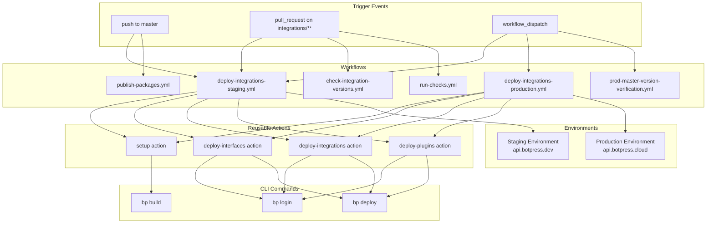

Sources: [.github/workflows/deploy-integrations-staging.yml:1-55](), [.github/workflows/deploy-integrations-production.yml:1-47](), [.github/workflows/publish-packages.yml:1-62](), [.github/workflows/prod-master-version-verification.yml:1-79]()

## Workflow Triggers

The CI/CD pipeline is triggered by three main events:

| Trigger | Workflow | Description |
|---------|----------|-------------|
| `push` to `master` | `deploy-integrations-staging.yml` | Automatically deploys to staging |
| `pull_request` on `integrations/**` | `deploy-integrations-staging.yml` | Runs dry-run validation |
| `workflow_dispatch` | `deploy-integrations-production.yml` | Manual production deployment |
| `workflow_dispatch` | `deploy-integrations-staging.yml` | Manual staging deployment |
| `workflow_dispatch` | `prod-master-version-verification.yml` | Manual production version verification |
| `push` to `master` | `publish-packages.yml` | Publishes core packages to NPM |
| `schedule` (cron) | `prod-master-version-verification.yml` | Daily production version verification |

Sources: [.github/workflows/deploy-integrations-staging.yml:3-17](), [.github/workflows/deploy-integrations-production.yml:3-10](), [.github/workflows/prod-master-version-verification.yml:3-6]()

## GitHub Actions Workflows

### Staging Deployment Workflow

The `deploy-integrations-staging.yml` workflow handles deployments to the staging environment:

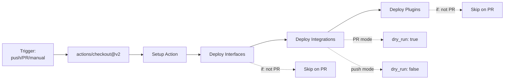

**Key Features:**
- **Conditional Deployment**: Interfaces and plugins are skipped on PRs; only integrations run in dry-run mode
- **Force Flag**: Manual dispatch allows forcing re-deployment via `github.event.inputs.force`
- **Secrets**: Uses `STAGING_TOKEN_CLOUD_OPS_ACCOUNT` and `STAGING_CLOUD_OPS_WORKSPACE_ID`

Sources: [.github/workflows/deploy-integrations-staging.yml:24-54]()

### Production Deployment Workflow

The `deploy-integrations-production.yml` workflow requires manual approval:

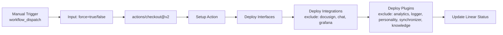

**Production Exclusions:**
- **Integrations**: `docusign`, `chat`, `grafana` are excluded via `extra_filter: "-F '!docusign' -F '!chat' -F '!grafana'"`
- **Plugins**: Multiple plugins excluded: `analytics`, `logger`, `personality`, `synchronizer`, `knowledge` via `extra_filter: "-F '!analytics' -F '!logger' -F '!personality' -F '!synchronizer' -F '!knowledge'"`

Sources: [.github/workflows/deploy-integrations-production.yml:16-46]()

### Package Publishing Workflow

The `publish-packages.yml` workflow publishes core packages to NPM when changes are pushed to `master`:

**Published Packages:**
1. `@bpinternal/zui`
2. `@botpress/client` - Platform API client
3. `@botpress/sdk` - Bot and integration development SDK
4. `@botpress/cli` - Command-line interface
5. `@botpress/chat-client` - Chat-specific client
6. `@botpress/cognitive` - LLM wrapper
7. `@botpress/vai` - AI testing framework
8. `@botpress/zai` - LLM utilities
9. `llmz` - LLM-native VM

Each package uses the `botpress/gh-actions/publish-if-not-exists@master` action, which only publishes if the version doesn't already exist on NPM.

Sources: [.github/workflows/publish-packages.yml:30-61]()

### Production Version Verification Workflow

The `prod-master-version-verification.yml` workflow checks if production integrations are up-to-date with `master`:

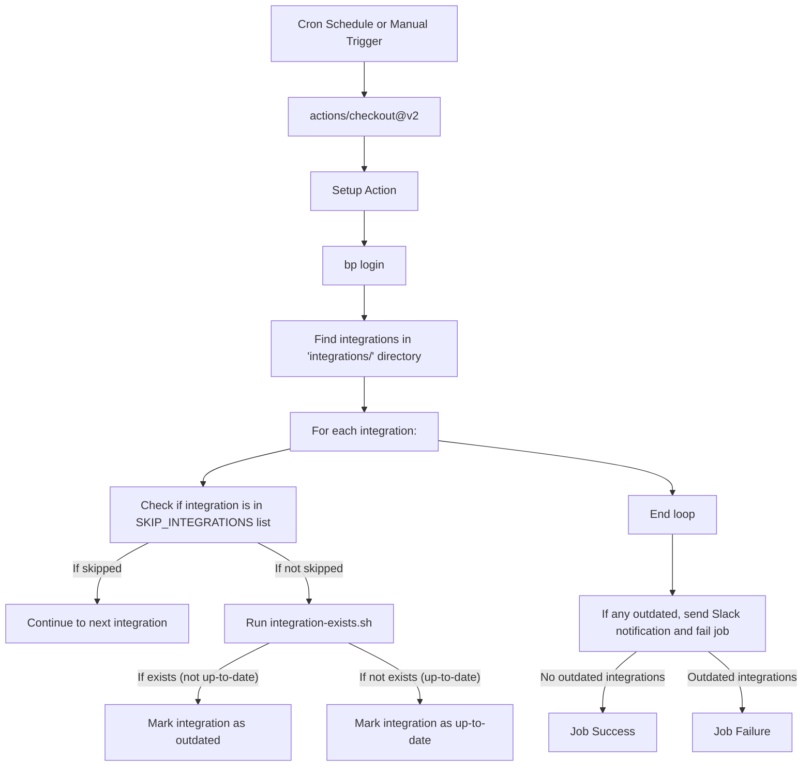

**Key Features:**
- **Scheduled Check**: Runs daily on weekdays at 8 AM UTC.
- **Manual Trigger**: Can be triggered manually via `workflow_dispatch`.
- **Integration Filtering**: Skips specific integrations (e.g., `chat`, `docusign`, `zendesk-messaging-hitl`) using `SKIP_INTEGRATIONS` array.
- **Version Check**: Uses `.github/scripts/integration-exists.sh` to determine if the current `master` version of an integration is deployed to production.
- **Notification**: If outdated integrations are found, a Slack message is sent to a configured webhook URL (`SLACK_WEBHOOK_URL`).
- **Failure Condition**: The job fails if any non-skipped integration is found to be outdated.

Sources: [.github/workflows/prod-master-version-verification.yml:1-79]()

## Reusable Deployment Actions

### Setup Action

The `setup` action installs dependencies and builds all packages:

```yaml
# .github/actions/setup/action.yml
steps:
  - uses: pnpm/action-setup@v4
  - uses: actions/setup-node@v6
  - name: Install Node Gyp Build
  - name: Install dependencies (pnpm i --frozen-lockfile)
  - name: Cache Turbo
  - name: Build (pnpm turbo run build + extra_filters)
```

**Build Process:**
- Uses `pnpm` workspace protocol for monorepo management
- Installs dependencies with frozen lockfile
- Caches Turborepo artifacts for faster subsequent builds
- Runs `pnpm turbo run build` with optional filters (e.g., `-F @botpress/cli`)

Sources: [.github/actions/setup/action.yml:1-46]()

### Deploy Integrations Action

The `deploy-integrations` action is the most complex reusable action:

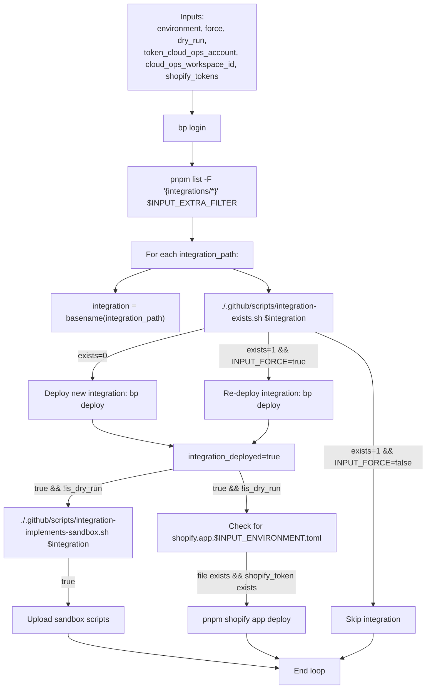

**Deployment Logic:**
- **Login**: Authenticates with Botpress Cloud using `bp login` [github/actions/deploy-integrations/action.yml:67-67]().
- **Integration Listing**: Uses `pnpm list` with filters to identify integrations to deploy [github/actions/deploy-integrations/action.yml:86-86]().
- **Conditional Deployment**: Only deploys if integration doesn't exist or `force` flag is set [github/actions/deploy-integrations/action.yml:91-100]().
- **Sandbox Scripts**: Uploads sandbox scripts if integration implements sandbox functionality and it's not a dry run [github/actions/deploy-integrations/action.yml:103-115]().
- **Shopify App Manifests**: Deploys Shopify app manifests (`shopify.app.<env>.toml`) if present and a Shopify automation token is provided [github/actions/deploy-integrations/action.yml:117-134]().
- **Retry Logic**: Uses `pnpm retry -n 2` for network resilience for `bp deploy` and `uploadSandboxScripts` commands [github/actions/deploy-integrations/action.yml:98, 107]().

Sources: [.github/actions/deploy-integrations/action.yml:1-136]()

### Sentry Source Maps

The integration with Sentry enables error tracking in production. This functionality is not directly visible in the provided `deploy-integrations/action.yml` but is typically handled by a separate script or action called within the deployment process.

**Process (Conceptual):**
1. Identify integrations with Sentry configuration.
2. `sentry-cli sourcemaps inject` injects source map references into bundled output.
3. `sentry-cli sourcemaps upload` uploads maps with release tag `${{ github.sha }}`.

**Environment Variables (Conceptual):**
- `SENTRY_AUTH_TOKEN`: Authentication token
- `SENTRY_ORG`: `botpress-rm`
- `SENTRY_RELEASE`: Git commit SHA
- `SENTRY_ENVIRONMENT`: `staging` or `production`

## Deployment Process Details

### CLI Deployment Command Flow

The `bp deploy` command orchestrates the deployment of projects:

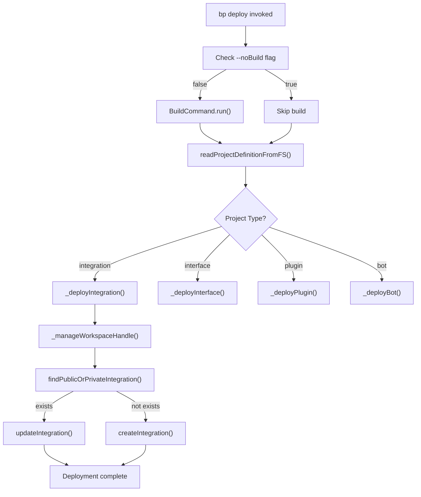

**Key Methods:**
- `DeployCommand.run()` - Entry point at [packages/cli/src/command-implementations/deploy-command.ts:16-42]()
- `_deployIntegration()` - Integration deployment logic at [packages/cli/src/command-implementations/deploy-command.ts:61-180]()
- `_manageWorkspaceHandle()` - Workspace handle validation at [packages/cli/src/command-implementations/deploy-command.ts:522-631]()

Sources: [packages/cli/src/command-implementations/deploy-command.ts:15-647]()

### Integration Deployment Pipeline

The deployment of an integration follows these steps:

**1. Build Phase:**
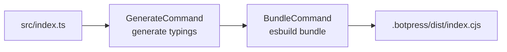

**2. Validation Phase:**
- Icon file must be `.svg` format
- Readme file must be `.md` format
- Version must be valid semver
- Workspace handle must be valid (if public/unlisted)

**3. Deployment Phase:**
```typescript
// Pseudocode from deploy-command.ts
const createBody = {
  ...prepareCreateIntegrationBody(integrationDef),
  ...prepareIntegrationDependencies(integrationDef, api),
  visibility: 'public' | 'private' | 'unlisted',
  secrets: promptSecrets(integrationDef),
}

if (integration) {
  await api.client.updateIntegration(updateBody)
} else {
  await api.client.createIntegration(createBody)
}
```

**Dry Run Mode:**
- When `--dryRun` flag is set, uses `validateIntegrationCreation()` or `validateIntegrationUpdate()`
- No actual deployment occurs, only validation

Sources: [packages/cli/src/command-implementations/deploy-command.ts:61-180](), [packages/cli/src/command-implementations/build-command.ts:1-36]()

### Workspace Handle Management

The CLI enforces workspace handle naming conventions for public integrations:

**Handle Format:** `{workspace-handle}/{integration-name}`

**Handle Resolution Flow:**
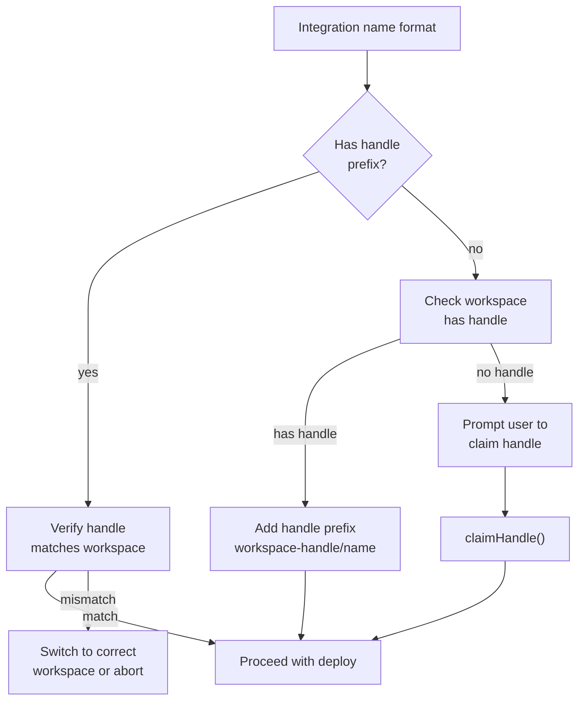

**Special Case:** Botpress workspace (IDs: `6a76fa10-...`, `95de33eb-...`, `11111111-...`) can omit workspace handle.

Sources: [packages/cli/src/command-implementations/deploy-command.ts:522-631]()

## Environment Management

### Staging vs Production

| Aspect | Staging | Production |
|--------|---------|------------|
| API URL | `https://api.botpress.dev` | `https://api.botpress.cloud` |
| Trigger | Automatic (push to master) + Manual | Manual only |
| Dry Run | Yes (on PR) | No |
| Token Secret | `STAGING_TOKEN_CLOUD_OPS_ACCOUNT` | `PRODUCTION_TOKEN_CLOUD_OPS_ACCOUNT` |
| Workspace ID Secret | `STAGING_CLOUD_OPS_WORKSPACE_ID` | `PRODUCTION_CLOUD_OPS_WORKSPACE_ID` |
| Deployment Filter | All integrations (excluding `chat`) | Excludes: `docusign`, `chat`, `grafana` |

**API URL Selection:**
```bash
# From deploy-integrations action
api_url="${{ inputs.environment == 'staging' && 'https://api.botpress.dev' || 'https://api.botpress.cloud' }}"
```

Sources: [.github/actions/deploy-integrations/action.yml:67]()

### Secrets Management

**Workspace-Level Secrets:**
- `STAGING_TOKEN_CLOUD_OPS_ACCOUNT`: Cloud ops account token for staging
- `STAGING_CLOUD_OPS_WORKSPACE_ID`: Workspace ID for staging deployments
- `PRODUCTION_TOKEN_CLOUD_OPS_ACCOUNT`: Cloud ops account token for production
- `PRODUCTION_CLOUD_OPS_WORKSPACE_ID`: Workspace ID for production deployments
- `SENTRY_AUTH_TOKEN`: Sentry authentication for source map uploads
- `SHOPIFY_ADMIN_AUTOMATION_TOKEN`: Shopify app automation token for Shopify Admin app (environment-specific) [github/actions/deploy-integrations/action.yml:33-36]()
- `SHOPIFY_STOREFRONT_AUTOMATION_TOKEN`: Shopify app automation token for Shopify Storefront app (environment-specific) [github/actions/deploy-integrations/action.yml:37-40]()
- `SLACK_WEBHOOK_URL`: Slack webhook for notifications (e.g., production version verification) [github/workflows/prod-master-version-verification.yml:25]()

**Bot-Specific Secrets:** (used in `deploy-bots.yml`)
- `BUGBUSTER_GITHUB_TOKEN`
- `BUGBUSTER_GITHUB_WEBHOOK_SECRET`
- `BUGBUSTER_LINEAR_API_KEY`
- `BUGBUSTER_LINEAR_WEBHOOK_SIGNING_SECRET`
- `BUGBUSTER_TELEGRAM_BOT_TOKEN`

Sources: [.github/workflows/deploy-integrations-staging.yml:36-37](), [.github/workflows/deploy-integrations-production.yml:28-39](), [.github/workflows/prod-master-version-verification.yml:25]()

## Version Management

### Version Checking

The `check-integration-versions.yml` workflow prevents accidental overwrites:

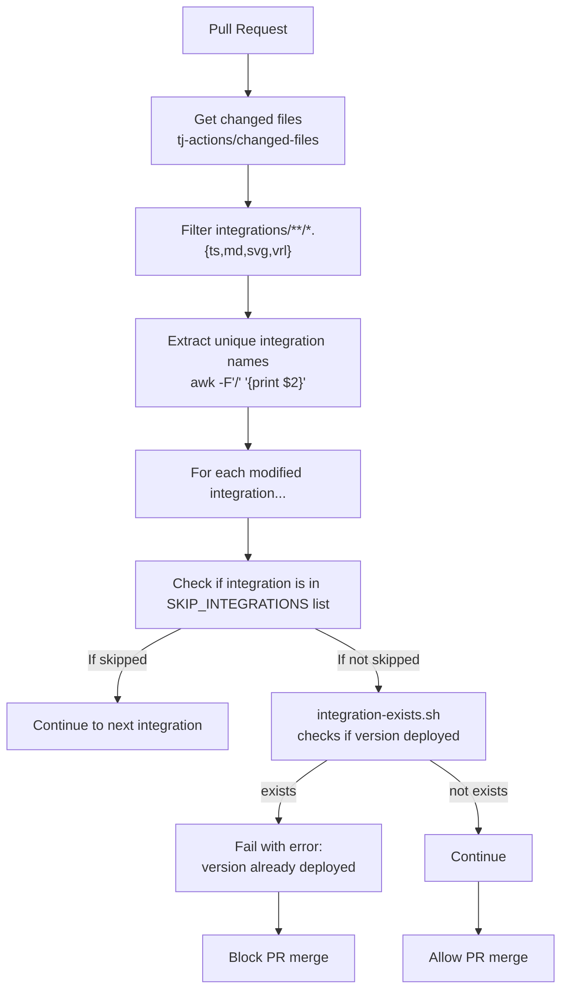

**Script Logic:**
```bash
# .github/scripts/integration-exists.sh
pnpm bp read | jq -r '.name, .version'
exists=$(pnpm bp get integration ... --json | jq ...)
[ $exists == "true" ] && echo "1" || echo "0"
```

Sources: [.github/workflows/check-integration-versions.yml:1-65]()

### Integration Existence Check

The `integration-exists.sh` script determines if an integration is already deployed:

**Implementation:**
1. Read integration name and version from `bp read` command.
2. Query Botpress API for existing integration with same name/version.
3. Return exit code: `0` = not exists, `1` = exists.

**Used By:**
- `check-integration-versions.yml` workflow
- `deploy-integrations` action's smart deployment logic
- `prod-master-version-verification.yml` workflow

Sources: [.github/actions/deploy-integrations/action.yml:91](), [.github/workflows/check-integration-versions.yml:53](), [.github/workflows/prod-master-version-verification.yml:51]()

## Quality Checks

### Pre-Deployment Checks

The `run-checks.yml` workflow validates code quality before deployment:

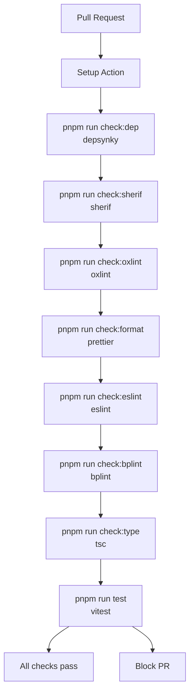

**Check Types:**
- **Dependency Checks**: `depsynky`, `sherif` validate monorepo dependencies
- **Linting**: `oxlint`, `eslint`, `bplint` check code quality
- **Formatting**: `prettier` validates code formatting
- **Type Checking**: `tsc --noEmit` validates TypeScript types
- **Testing**: `vitest` runs unit tests

Sources: [.github/workflows/run-checks.yml:1-27]()

## Deployment Flags and Options

### Force Re-deployment

The `force` flag controls whether to re-deploy existing integrations:

**Usage:**
```yaml
# In workflow dispatch
inputs:
  force:
    description: 'Force re-deploying integrations'
    type: boolean
    default: false
```

**Logic in deploy-integrations action:**
```bash
redeploy=${{ inputs.force == 'true' && 1 || 0 }}
if [ $exists -eq 0 ]; then
    # Deploy new integration
elif [ $redeploy -eq 1 ]; then
    # Re-deploy existing integration
else
    # Skip
fi
```

Sources: [.github/actions/deploy-integrations/action.yml:76-100]()

### Visibility Control

The `--visibility` flag (or legacy `--public` flag) controls integration visibility:

**Visibility Options:**
- `public`: Visible in public hub, anyone can install
- `private`: Only visible in workspace
- `unlisted`: Accessible via direct link, not in hub search

**CLI Implementation:**
```typescript
private get _visibility(): 'public' | 'private' | 'unlisted' {
  if (this.argv.public && this.argv.visibility === 'private') {
    this.logger.warn('The --public flag is deprecated. Please use "--visibility public" instead.')
    return 'public'
  }
  return this.argv.visibility
}
```

**Constraints:**
- Interfaces and plugins: Only support `public` or `private` (not `unlisted`)
- Public integrations: Cannot be updated, must bump version

Sources: [packages/cli/src/command-implementations/deploy-command.ts:48-59]()

## Advanced Deployment Features

### Sandbox Script Upload

Some integrations implement sandbox functionality, requiring script uploads:

```bash
# Check if integration implements sandbox
integration_implements_sandbox=$(./.github/scripts/integration-implements-sandbox.sh $integration)

if [ $integration_implements_sandbox == "true" ] && [ $upload_sandbox_scripts == "true" ]; then
  base_upload_command="uploadSandboxScripts --apiUrl=$api_url --workspaceId=$CLOUD_OPS_WORKSPACE_ID ..."
  pnpm retry -n 2 -- pnpm -F "{integrations/$integration}" run -- $base_upload_command
fi
```

**When Triggered:**
- Only after successful deployment (not on skip)
- Only in non-dry-run mode
- Only if integration has sandbox implementation

Sources: [.github/actions/deploy-integrations/action.yml:103-108]()

### Deprecated Feature Detection

The CLI detects and warns about deprecated features:

**Deprecated Fields:**
- `user.creation.enabled`
- `channels.{channelName}.conversation.creation.enabled`

**Handling:**
```typescript
private _detectDeprecatedFeatures(integrationDef: sdk.IntegrationDefinition, opts: { allowDeprecated?: boolean }) {
  const deprecatedFields: string[] = []
  if (user?.creation?.enabled) {
    deprecatedFields.push('user.creation')
  }
  // ... check channels
  
  if (opts.allowDeprecated) {
    this.logger.warn(errorMessage)
  } else {
    throw new BotpressCLIError(errorMessage)
  }
}
```

**Allowed When:**
- `--allowDeprecated` flag is set
- Deploying a minor/patch version (not major)

Sources: [packages/cli/src/command-implementations/deploy-command.ts:381-410]()

### Integration Registration Validation

After bot deployment, the CLI validates integration registration:

```typescript
protected validateIntegrationRegistration(
  updatedBot: UpdatedBot,
  onFailCallback: (failedIntegrations: UpdatedBot['integrations']) => void
) {
  let failedIntegrations: UpdatedBot['integrations'] = {}
  for (const [integrationName, integration] of Object.entries(updatedBot.integrations)) {
    if (integration.status === 'registration_failed') {
      failedIntegrations = { ...failedIntegrations, [integrationName]: integration }
    }
  }
  if (Object.keys(failedIntegrations).length > 0) {
    onFailCallback(failedIntegrations)
  }
}
```

**Behavior:**
- In `deploy` command: Logs warning
- In `dev` command: Throws error and stops

Sources: [packages/cli/src/command-implementations/project-command.ts:608-621]()

## Testing Workflows

### CLI End-to-End Tests

The `run-cli-tests.yml` workflow validates CLI functionality:

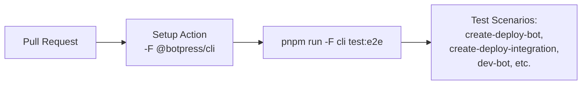

**Test Configuration:**
- API URL: `https://api.botpress.dev` (staging)
- Workspace ID: `secrets.STAGING_E2E_TESTS_WORKSPACE_ID`
- Token: `secrets.STAGING_TOKEN_CLOUD_OPS_ACCOUNT`
- SDK Path: Custom path for unreleased SDK versions
- Client Path: Custom path for unreleased client versions

Sources: [.github/workflows/run-cli-tests.yml:1-31]()

### Test Suite Architecture

The E2E test suite runs multiple test scenarios:

**Test Cases:**
- `createDeployBot` - Creates and deploys a bot
- `createDeployBotWithDependencies` - Bot with integrations/plugins
- `createDeployIntegration` - Integration deployment
- `devBot` - Dev mode testing
- `requiredSecrets` - Secret handling
- `prependWorkspaceHandle` - Workspace handle logic
- `enforceWorkspaceHandle` - Handle validation
- `addIntegration` - Add command for integrations
- `addPlugin` - Add command for plugins
- `installAllInterfaces` - Interface installation

**Test Execution:**
```typescript
for (const { name, handler } of filteredTests) {
  const tmpDir = TmpDirectory.create()
  await Promise.race([
    handler({ tmpDir: tmpDir.path, dependencies, logger, ...argv }),
    timeout(argv.timeout),
  ])
}
```

Sources: [packages/cli/e2e/index.ts:15-119]()

## Build System Integration

### Turborepo Configuration

The CI/CD pipeline uses Turborepo for efficient monorepo builds:

**Build Tasks:**
- `generate`: Generate type definitions (depends on `^generate`, `^build`)
- `llmz#generate`: Specific generation for `llmz` package [turbo.json:9-12]()
- `build`: Compile and bundle projects (depends on `generate`, `^build`)
- `@bpinternal/zui#build`: Specific build for `@bpinternal/zui` [turbo.json:17-20]()
- `@botpress/client#build`: Specific build for `@botpress/client` [turbo.json:21-24]()
- `@botpress/chat#build`: Specific build for `@botpress/chat` [turbo.json:25-28]()
- `@botpress/sdk#build`: Specific build for `@botpress/sdk` [turbo.json:29-32]()
- `@botpress/cli#build`: Specific build for `@botpress/cli` [turbo.json:33-36]()
- `@botpress/cognitive#build`: Specific build for `@botpress/cognitive` [turbo.json:37-40]()
- `@botpress/vai#build`: Specific build for `@botpress/vai` [turbo.json:41-44]()
- `@botpress/zai#build`: Specific build for `@botpress/zai` [turbo.json:45-48]()
- `llmz#build`: Specific build for `llmz` [turbo.json:49-52]()
- `check:type`: TypeScript type checking
- `check:bplint`: Custom linting
- `test`: Run tests

**Parallel Execution:**
Turborepo automatically parallelizes tasks that don't depend on each other, speeding up CI builds.

Sources: [turbo.json:1-57]()

### Setup Action Build Process

The `setup` action orchestrates the build:

```bash
# Install dependencies
pnpm i --frozen-lockfile

# Build with optional filters
pnpm turbo run build ${{ inputs.extra_filters }}
```

**Filter Examples:**
- `-F @botpress/cli` - Only build CLI package
- `-F @botpress/* -F llmz` - Build all @botpress packages and llmz
- `-F '{integrations/*}'` - Build all integrations

Sources: [.github/actions/setup/action.yml:26-45]()

## Deployment Scripts

### Integration Existence Script

The `.github/scripts/integration-exists.sh` script checks if an integration version is deployed:

**Purpose:** Prevent deploying unchanged integrations

**Usage in CI:**
```bash
exists=$(./.github/scripts/integration-exists.sh $integration)
if [ $exists -eq 0 ]; then
    # Deploy
elif [ $redeploy -eq 1 ]; then
    # Force redeploy
else
    # Skip
fi
```

Sources: [.github/actions/deploy-integrations/action.yml:91-100]()

### Sandbox Implementation Check

The `.github/scripts/integration-implements-sandbox.sh` determines if an integration has sandbox functionality:

**Purpose:** Decide whether to upload sandbox scripts after deployment

**Output:** `true` or `false`

Sources: [.github/actions/deploy-integrations/action.yml:103]()

### Sentry Integration List

The `.github/scripts/ls-sentry-integrations.sh` generates a pnpm filter for integrations with Sentry. This script is not directly referenced in the provided `deploy-integrations/action.yml` but is a common pattern for Sentry integration.

**Purpose:** Only inject/upload source maps for integrations that use Sentry

**Output Example:** `-F integration1 -F integration2 -F integration3`

**Usage (Conceptual):**
```bash
filter=$(./.github/scripts/ls-sentry-integrations.sh)
pnpm -r --stream $filter exec sentry-cli sourcemaps inject .botpress/dist
```

## CLI Command Implementation

### DeployCommand Class

The `DeployCommand` class implements the `bp deploy` command:

**Key Methods:**

| Method | Purpose | Line Reference |
|--------|---------|----------------|
| `run()` | Entry point, determines project type | [packages/cli/src/command-implementations/deploy-command.ts:16-42]() |
| `_deployIntegration()` | Deploy integration logic | [packages/cli/src/command-implementations/deploy-command.ts:61-180]() |
| `_deployInterface()` | Deploy interface logic | [packages/cli/src/command-implementations/deploy-command.ts:182-267]() |
| `_deployPlugin()` | Deploy plugin logic | [packages/cli/src/command-implementations/deploy-command.ts:269-359]() |
| `_deployBot()` | Deploy bot logic | [packages/cli/src/command-implementations/deploy-command.ts:412-477]() |
| `_manageWorkspaceHandle()` | Handle workspace handle logic | [packages/cli/src/command-implementations/deploy-command.ts:522-631]()

**Class Hierarchy:**
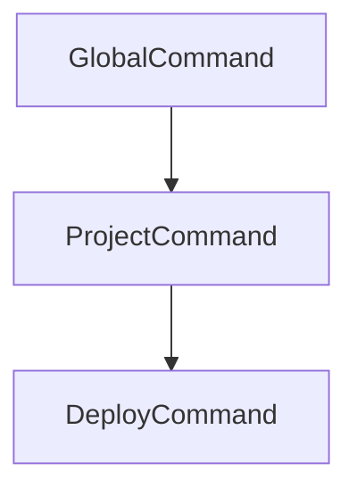

Sources: [packages/cli/src/command-implementations/deploy-command.ts:15-647]()

### ProjectCommand Base Class

The `ProjectCommand` abstract class provides shared functionality:

**Key Features:**
- `readProjectDefinitionFromFS()`: Read definition file (bot/integration/plugin/interface)
- `prepareCreateIntegrationBody()`: Prepare API request body
- `prepareBotDependencies()`: Fetch bot dependencies
- `promptSecrets()`: Interactive secret prompting
- `validateIntegrationRegistration()`: Check integration registration status

Sources: [packages/cli/src/command-implementations/project-command.ts:90-622]()

## Retry Mechanism

### Network Resilience

The deployment process includes retry logic for network failures:

```bash
# In deploy-integrations action
pnpm retry -n 2 -- pnpm -F "{integrations/$integration}" -c exec -- "$base_command"
```

**Retry Configuration:**
- **Attempts**: 2 retries (3 total attempts)
- **Commands**: `bp deploy`, `uploadSandboxScripts`, `shopify app deploy`

**Purpose:** Handle transient network failures during deployment

Sources: [.github/actions/deploy-integrations/action.yml:98, 107, 132]()

## Error Handling and Debugging

### Sentry Source Maps

Source maps enable better error tracking in production. While the direct Sentry source map upload steps are not explicitly in the provided `deploy-integrations/action.yml`, the `SENTRY_AUTH_TOKEN` input suggests its usage.

**Benefits:**
- Readable stack traces for bundled code
- Line-accurate error locations
- Integration-specific error tracking

**Upload Process (Conceptual):**
```bash
# Inject source map references
pnpm -r --stream $filter exec sentry-cli sourcemaps inject .botpress/dist

# Upload to Sentry with release tag
pnpm -r --stream $filter exec sentry-cli sourcemaps upload \
  --release=${{ github.sha }} \
  --url-prefix '~' \
  .botpress/dist
```

**Environment Variables (Conceptual):**
- `SENTRY_AUTH_TOKEN`: Authentication
- `SENTRY_ORG`: `botpress-rm`
- `SENTRY_RELEASE`: Git SHA for version tracking
- `SENTRY_ENVIRONMENT`: `staging` or `production`

### Verbose Logging

The CLI supports verbose logging for debugging:

**Usage:**
```bash
bp deploy -v --verbose
```

**Effect:**
- Enables `logLevel: 'info'` in esbuild
- Shows detailed API requests
- Displays deployment progress

Sources: [packages/cli/src/command-implementations/bundle-command.ts:68]()

---

