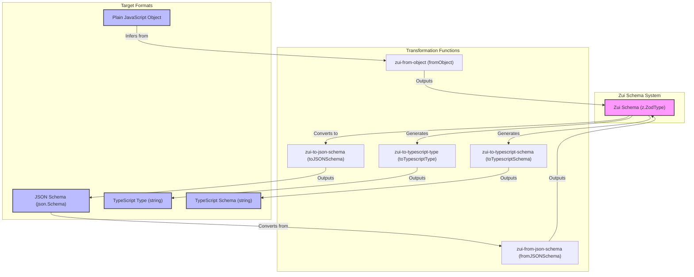

<!-- source: DeepWiki mcp.deepwiki.com · repo botpress/botpress · page 7 Zui Schema System · fetched 2026-10-26 -->

# Zui Schema System

<details>
<summary>Relevant source files</summary>

The following files were used as context for generating this wiki page:

- [packages/zui/package.json](packages/zui/package.json)
- [packages/zui/src/assertions.utils.test.ts](packages/zui/src/assertions.utils.test.ts)
- [packages/zui/src/transforms/common/errors.ts](packages/zui/src/transforms/common/errors.ts)
- [packages/zui/src/transforms/common/eval-zui-string.ts](packages/zui/src/transforms/common/eval-zui-string.ts)
- [packages/zui/src/transforms/zui-from-json-schema-legacy/json-schema-to-zui.test.ts](packages/zui/src/transforms/zui-from-json-schema-legacy/json-schema-to-zui.test.ts)
- [packages/zui/src/transforms/zui-from-json-schema/guards.ts](packages/zui/src/transforms/zui-from-json-schema/guards.ts)
- [packages/zui/src/transforms/zui-from-json-schema/index.test.ts](packages/zui/src/transforms/zui-from-json-schema/index.test.ts)
- [packages/zui/src/transforms/zui-from-json-schema/index.ts](packages/zui/src/transforms/zui-from-json-schema/index.ts)
- [packages/zui/src/transforms/zui-from-json-schema/iterables/array.ts](packages/zui/src/transforms/zui-from-json-schema/iterables/array.ts)
- [packages/zui/src/transforms/zui-from-json-schema/primitives/index.ts](packages/zui/src/transforms/zui-from-json-schema/primitives/index.ts)
- [packages/zui/src/transforms/zui-from-object/index.ts](packages/zui/src/transforms/zui-from-object/index.ts)
- [packages/zui/src/transforms/zui-from-object/object-to-zui.test.ts](packages/zui/src/transforms/zui-from-object/object-to-zui.test.ts)
- [packages/zui/src/transforms/zui-to-json-schema/index.test.ts](packages/zui/src/transforms/zui-to-json-schema/index.test.ts)
- [packages/zui/src/transforms/zui-to-json-schema/index.ts](packages/zui/src/transforms/zui-to-json-schema/index.ts)
- [packages/zui/src/transforms/zui-to-json-schema/type-processors/string.ts](packages/zui/src/transforms/zui-to-json-schema/type-processors/string.ts)
- [packages/zui/src/transforms/zui-to-json-schema/type-processors/tuple.ts](packages/zui/src/transforms/zui-to-json-schema/type-processors/tuple.ts)
- [packages/zui/src/transforms/zui-to-typescript-schema/index.test.ts](packages/zui/src/transforms/zui-to-typescript-schema/index.test.ts)
- [packages/zui/src/transforms/zui-to-typescript-schema/index.ts](packages/zui/src/transforms/zui-to-typescript-schema/index.ts)
- [packages/zui/src/transforms/zui-to-typescript-type/index.test.ts](packages/zui/src/transforms/zui-to-typescript-type/index.test.ts)
- [packages/zui/src/transforms/zui-to-typescript-type/index.ts](packages/zui/src/transforms/zui-to-typescript-type/index.ts)
- [packages/zui/src/transforms/zui-to-typescript-type/primitives.test.ts](packages/zui/src/transforms/zui-to-typescript-type/primitives.test.ts)
- [packages/zui/src/utils/ds-utils.ts](packages/zui/src/utils/ds-utils.ts)
- [packages/zui/src/utils/property-path-utils.test.ts](packages/zui/src/utils/property-path-utils.test.ts)
- [packages/zui/src/utils/property-path-utils.ts](packages/zui/src/utils/property-path-utils.ts)
- [packages/zui/src/z/__tests__/crazySchema.ts](packages/zui/src/z/__tests__/crazySchema.ts)
- [packages/zui/src/z/__tests__/deref.test.ts](packages/zui/src/z/__tests__/deref.test.ts)
- [packages/zui/src/z/__tests__/preprocess.test.ts](packages/zui/src/z/__tests__/preprocess.test.ts)
- [packages/zui/src/z/__tests__/transformer.test.ts](packages/zui/src/z/__tests__/transformer.test.ts)
- [packages/zui/src/z/builders.ts](packages/zui/src/z/builders.ts)
- [packages/zui/src/z/guards.ts](packages/zui/src/z/guards.ts)
- [packages/zui/src/z/index.ts](packages/zui/src/z/index.ts)
- [packages/zui/src/z/types/array/index.ts](packages/zui/src/z/types/array/index.ts)
- [packages/zui/src/z/types/basetype/index.ts](packages/zui/src/z/types/basetype/index.ts)
- [packages/zui/src/z/types/basetype/parseUtil.ts](packages/zui/src/z/types/basetype/parseUtil.ts)
- [packages/zui/src/z/types/discriminatedUnion/index.ts](packages/zui/src/z/types/discriminatedUnion/index.ts)
- [packages/zui/src/z/types/effects/index.ts](packages/zui/src/z/types/effects/index.ts)
- [packages/zui/src/z/types/function/index.ts](packages/zui/src/z/types/function/index.ts)
- [packages/zui/src/z/types/index.ts](packages/zui/src/z/types/index.ts)
- [packages/zui/src/z/types/intersection/index.ts](packages/zui/src/z/types/intersection/index.ts)
- [packages/zui/src/z/types/map/index.ts](packages/zui/src/z/types/map/index.ts)
- [packages/zui/src/z/types/object/index.ts](packages/zui/src/z/types/object/index.ts)
- [packages/zui/src/z/types/promise/index.ts](packages/zui/src/z/types/promise/index.ts)
- [packages/zui/src/z/types/readonly/index.ts](packages/zui/src/z/types/readonly/index.ts)
- [packages/zui/src/z/types/record/index.ts](packages/zui/src/z/types/record/index.ts)
- [packages/zui/src/z/types/set/index.ts](packages/zui/src/z/types/set/index.ts)
- [packages/zui/src/z/types/tuple/index.ts](packages/zui/src/z/types/tuple/index.ts)
- [packages/zui/src/z/types/union/index.ts](packages/zui/src/z/types/union/index.ts)
- [packages/zui/src/z/typings.ts](packages/zui/src/z/typings.ts)

</details>


The `@bpinternal/zui` library is Botpress's extended Zod-based type system. It is used throughout the Botpress platform for defining schemas for configurations, inputs, and outputs across integrations, bots, and plugins. Zui extends Zod by incorporating additional metadata for UI rendering and providing a robust transformation pipeline for various schema representations.

This page provides a high-level overview of the Zui schema system. For detailed information on specific aspects, please refer to the linked child pages.

Sources:
- [packages/zui/package.json:1-40]()

## Zui Core Types

Zui builds upon the popular Zod library, providing a powerful schema validation and parsing system. Its core innovation lies in extending Zod's capabilities with UI-specific metadata. This metadata allows developers to attach information like titles, descriptions, display hints, and other properties directly to schema definitions, which can then be used by UI components to render forms and other interactive elements automatically.

The Zui type system includes a comprehensive set of base types, such as strings, numbers, booleans, objects, arrays, and unions, mirroring Zod's offerings. It also provides a builders API (`z.string()`, `z.object()`, etc.) for easy schema construction. The `ZuiExtensionObject` type defines the structure for this UI metadata, including properties like `tooltip`, `displayAs`, `title`, `disabled`, `hidden`, `placeholder`, `secret`, and `coerce`.

For details, see [Zui Core Types](#7.1).

Sources:
- [packages/zui/src/z/typings.ts:15-36]()
- [packages/zui/src/z/builders.ts:107-249]()
- [packages/zui/src/z/index.ts:202-249]()
- [packages/zui/src/z/types/basetype/index.ts:54-70]()

## Zui Transforms

A key feature of the Zui schema system is its extensive transformation pipeline. This pipeline enables the conversion of Zui schemas into various other formats and vice-versa, facilitating code generation, API serialization, and interoperability with different systems.

The primary transformations include:
- **`zui-to-json-schema`**: Converts a Zui schema into a JSON Schema, which is widely used for data validation and API documentation. This transformation handles various Zui types and their corresponding JSON Schema representations, including objects, arrays, unions, and discriminated unions.
- **`zui-to-typescript-type`**: Generates TypeScript type definitions from Zui schemas, allowing for strong typing in application code. This is crucial for maintaining type safety and improving developer experience.
- **`zui-to-typescript-schema`**: Converts Zui schemas into TypeScript schema definitions, which can be used for runtime validation in TypeScript environments.
- **`zui-from-json-schema`**: Creates Zui schemas from existing JSON Schema definitions, enabling the integration of external schema sources into the Zui system.
- **`zui-from-object`**: Infers a Zui schema from a plain JavaScript object, useful for quickly generating schemas from example data.

These transformations are vital for Botpress's code generation processes and for ensuring consistent schema definitions across the platform.

For details, see [Zui Transforms](#7.2).

Sources:
- [packages/zui/src/transforms/zui-to-json-schema/index.ts:51-52]()
- [packages/zui/src/transforms/zui-to-typescript-type/index.ts:102-103]()
- [packages/zui/src/transforms/zui-to-typescript-schema/index.ts]()
- [packages/zui/src/transforms/zui-from-json-schema/index.ts]()
- [packages/zui/src/transforms/zui-from-object/index.ts]()
- [packages/zui/src/transforms/common/errors.ts:11-11]()

### Zui Transformation Pipeline

The following diagram illustrates the various transformations supported by the Zui schema system:


Sources:
- [packages/zui/src/transforms/zui-to-json-schema/index.ts:51-52]()
- [packages/zui/src/transforms/zui-to-typescript-type/index.ts:102-103]()
- [packages/zui/src/transforms/zui-to-typescript-schema/index.ts]()
- [packages/zui/src/transforms/zui-from-json-schema/index.ts]()
- [packages/zui/src/transforms/zui-from-object/index.ts]()

### Zui Object Schema Parsing

The `ZodObjectImpl` class is central to how Zui handles object schemas. It manages the parsing of input data against a defined object shape, including handling unknown keys based on specified strategies (`strip`, `strict`, `passthrough`). During parsing, it iterates through the defined shape, validates each property, and collects any issues. It also supports asynchronous parsing for complex scenarios.

```mermaid
graph TD
    A[Input Data] --> B{_parse(input)}
    B --> C{_getType(input)}
    C -- "Not 'object'" --> D[Add 'invalid_type' issue]
    C -- "'object'" --> E{_processInputParams(input)}
    E --> F[Get cached shape and keys]
    F --> G{Identify extraKeys}
    G -- "unknownKeys = 'passthrough'" --> H[Add extraKeys to pairs]
    G -- "unknownKeys = 'strict'" --> I{Check extraKeys length}
    I -- "> 0" --> J[Add 'unrecognized_keys' issue]
    G -- "unknownKeys = 'strip'" --> K[Do nothing]
    G -- "unknownKeys = ZodType" --> L[Validate extraKeys with ZodType]
    F --> M[Iterate shape keys]
    M --> N{keyValidator._parse(value)}
    N --> O[Collect key-value pairs]
    O --> P{Check ctx.common.async}
    P -- "true (async)" --> Q[Await all pairs]
    Q --> R[ParseStatus.mergeObjectSync]
    P -- "false (sync)" --> R
    R --> S[Return ParseResult]

    style A fill:#f9f,stroke:#333,stroke-width:2px
    style S fill:#bbf,stroke:#333,stroke-width:2px
```
Sources:
- [packages/zui/src/z/types/object/index.ts:78-172]()
- [packages/zui/src/z/types/basetype/parseUtil.ts:68-117]()
- [packages/zui/src/z/types/basetype/index.ts:78-127]()

---

