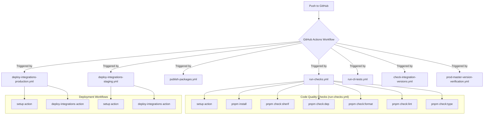

<!-- source: DeepWiki mcp.deepwiki.com · repo botpress/botpress · page 9 Glossary · fetched 2026-10-26 -->

# Glossary

<details>
<summary>Relevant source files</summary>

The following files were used as context for generating this wiki page:

- [.github/actions/deploy-integrations/action.yml](.github/actions/deploy-integrations/action.yml)
- [.github/actions/setup/action.yml](.github/actions/setup/action.yml)
- [.github/workflows/check-integration-versions.yml](.github/workflows/check-integration-versions.yml)
- [.github/workflows/deploy-bots.yml](.github/workflows/deploy-bots.yml)
- [.github/workflows/deploy-integrations-production.yml](.github/workflows/deploy-integrations-production.yml)
- [.github/workflows/deploy-integrations-staging.yml](.github/workflows/deploy-integrations-staging.yml)
- [.github/workflows/prod-master-version-verification.yml](.github/workflows/prod-master-version-verification.yml)
- [.github/workflows/publish-packages.yml](.github/workflows/publish-packages.yml)
- [.github/workflows/run-chat-tests.yml](.github/workflows/run-chat-tests.yml)
- [.github/workflows/run-checks.yml](.github/workflows/run-checks.yml)
- [.github/workflows/run-cli-tests.yml](.github/workflows/run-cli-tests.yml)
- [.github/workflows/run-client-tests.yml](.github/workflows/run-client-tests.yml)
- [.tool-versions](.tool-versions)
- [CODEOWNERS](CODEOWNERS)
- [bots/hit-looper/bot.definition.ts](bots/hit-looper/bot.definition.ts)
- [bots/hit-looper/src/api-utils.ts](bots/hit-looper/src/api-utils.ts)
- [bots/hit-looper/src/index.ts](bots/hit-looper/src/index.ts)
- [integrations/anthropic/integration.definition.ts](integrations/anthropic/integration.definition.ts)
- [integrations/anthropic/src/actions/generate-content.ts](integrations/anthropic/src/actions/generate-content.ts)
- [integrations/anthropic/src/index.ts](integrations/anthropic/src/index.ts)
- [integrations/anthropic/src/schemas.ts](integrations/anthropic/src/schemas.ts)
- [integrations/cerebras/integration.definition.ts](integrations/cerebras/integration.definition.ts)
- [integrations/cerebras/src/index.ts](integrations/cerebras/src/index.ts)
- [integrations/cerebras/src/schemas.ts](integrations/cerebras/src/schemas.ts)
- [integrations/fireworks-ai/integration.definition.ts](integrations/fireworks-ai/integration.definition.ts)
- [integrations/fireworks-ai/src/index.ts](integrations/fireworks-ai/src/index.ts)
- [integrations/fireworks-ai/src/schemas.ts](integrations/fireworks-ai/src/schemas.ts)
- [integrations/freshchat/integration.definition.ts](integrations/freshchat/integration.definition.ts)
- [integrations/freshchat/src/actions/hitl.ts](integrations/freshchat/src/actions/hitl.ts)
- [integrations/freshchat/src/client.ts](integrations/freshchat/src/client.ts)
- [integrations/groq/hub.md](integrations/groq/hub.md)
- [integrations/groq/integration.definition.ts](integrations/groq/integration.definition.ts)
- [integrations/groq/src/index.ts](integrations/groq/src/index.ts)
- [integrations/groq/src/schemas.ts](integrations/groq/src/schemas.ts)
- [integrations/openai/hub.md](integrations/openai/hub.md)
- [integrations/openai/integration.definition.ts](integrations/openai/integration.definition.ts)
- [integrations/openai/src/index.ts](integrations/openai/src/index.ts)
- [integrations/openai/src/schemas.ts](integrations/openai/src/schemas.ts)
- [integrations/zendesk/hub.md](integrations/zendesk/hub.md)
- [integrations/zendesk/integration.definition.ts](integrations/zendesk/integration.definition.ts)
- [integrations/zendesk/src/actions/create-user.ts](integrations/zendesk/src/actions/create-user.ts)
- [integrations/zendesk/src/actions/hitl.ts](integrations/zendesk/src/actions/hitl.ts)
- [integrations/zendesk/src/actions/index.ts](integrations/zendesk/src/actions/index.ts)
- [integrations/zendesk/src/channels.ts](integrations/zendesk/src/channels.ts)
- [integrations/zendesk/src/client.ts](integrations/zendesk/src/client.ts)
- [integrations/zendesk/src/definitions/actions.ts](integrations/zendesk/src/definitions/actions.ts)
- [integrations/zendesk/src/definitions/channels.ts](integrations/zendesk/src/definitions/channels.ts)
- [integrations/zendesk/src/definitions/schemas.ts](integrations/zendesk/src/definitions/schemas.ts)
- [integrations/zendesk/src/misc/axios-utils.ts](integrations/zendesk/src/misc/axios-utils.ts)
- [interfaces/hitl/interface.definition.ts](interfaces/hitl/interface.definition.ts)
- [package.json](package.json)
- [packages/cli/package.json](packages/cli/package.json)
- [packages/cli/src/code-generation/plugin-implementation/plugin-implementation.ts](packages/cli/src/code-generation/plugin-implementation/plugin-implementation.ts)
- [packages/cli/src/command-implementations/gen-command.ts](packages/cli/src/command-implementations/gen-command.ts)
- [packages/cli/templates/empty-bot/package.json](packages/cli/templates/empty-bot/package.json)
- [packages/cli/templates/empty-integration/package.json](packages/cli/templates/empty-integration/package.json)
- [packages/cli/templates/empty-plugin/package.json](packages/cli/templates/empty-plugin/package.json)
- [packages/cli/templates/hello-world/package.json](packages/cli/templates/hello-world/package.json)
- [packages/cli/templates/webhook-message/package.json](packages/cli/templates/webhook-message/package.json)
- [packages/client/package.json](packages/client/package.json)
- [packages/cognitive/package.json](packages/cognitive/package.json)
- [packages/common/src/llm/openai.ts](packages/common/src/llm/openai.ts)
- [packages/llmz/package.json](packages/llmz/package.json)
- [packages/sdk/package.json](packages/sdk/package.json)
- [packages/sdk/src/bot/definition.ts](packages/sdk/src/bot/definition.ts)
- [packages/sdk/src/integration/definition/index.ts](packages/sdk/src/integration/definition/index.ts)
- [packages/sdk/src/interface/definition.ts](packages/sdk/src/interface/definition.ts)
- [packages/sdk/src/plugin/definition.ts](packages/sdk/src/plugin/definition.ts)
- [packages/vai/package.json](packages/vai/package.json)
- [packages/zai/package.json](packages/zai/package.json)
- [packages/zui/src/z/__tests__/crazySchema.ts](packages/zui/src/z/__tests__/crazySchema.ts)
- [packages/zui/src/z/__tests__/deref.test.ts](packages/zui/src/z/__tests__/deref.test.ts)
- [packages/zui/src/z/__tests__/preprocess.test.ts](packages/zui/src/z/__tests__/preprocess.test.ts)
- [packages/zui/src/z/__tests__/transformer.test.ts](packages/zui/src/z/__tests__/transformer.test.ts)
- [packages/zui/src/z/builders.ts](packages/zui/src/z/builders.ts)
- [packages/zui/src/z/guards.ts](packages/zui/src/z/guards.ts)
- [packages/zui/src/z/index.ts](packages/zui/src/z/index.ts)
- [packages/zui/src/z/types/array/index.ts](packages/zui/src/z/types/array/index.ts)
- [packages/zui/src/z/types/basetype/index.ts](packages/zui/src/z/types/basetype/index.ts)
- [packages/zui/src/z/types/basetype/parseUtil.ts](packages/zui/src/z/types/basetype/parseUtil.ts)
- [packages/zui/src/z/types/discriminatedUnion/index.ts](packages/zui/src/z/types/discriminatedUnion/index.ts)
- [packages/zui/src/z/types/effects/index.ts](packages/zui/src/z/types/effects/index.ts)
- [packages/zui/src/z/types/function/index.ts](packages/zui/src/z/types/function/index.ts)
- [packages/zui/src/z/types/index.ts](packages/zui/src/z/types/index.ts)
- [packages/zui/src/z/types/intersection/index.ts](packages/zui/src/z/types/intersection/index.ts)
- [packages/zui/src/z/types/map/index.ts](packages/zui/src/z/types/map/index.ts)
- [packages/zui/src/z/types/object/index.ts](packages/zui/src/z/types/object/index.ts)
- [packages/zui/src/z/types/promise/index.ts](packages/zui/src/z/types/promise/index.ts)
- [packages/zui/src/z/types/readonly/index.ts](packages/zui/src/z/types/readonly/index.ts)
- [packages/zui/src/z/types/record/index.ts](packages/zui/src/z/types/record/index.ts)
- [packages/zui/src/z/types/set/index.ts](packages/zui/src/z/types/set/index.ts)
- [packages/zui/src/z/types/tuple/index.ts](packages/zui/src/z/types/tuple/index.ts)
- [packages/zui/src/z/types/union/index.ts](packages/zui/src/z/types/union/index.ts)
- [packages/zui/src/z/typings.ts](packages/zui/src/z/typings.ts)
- [plugins/hitl/plugin.definition.ts](plugins/hitl/plugin.definition.ts)
- [plugins/hitl/src/actions/start-hitl.ts](plugins/hitl/src/actions/start-hitl.ts)
- [plugins/hitl/src/actions/stop-hitl.ts](plugins/hitl/src/actions/stop-hitl.ts)
- [plugins/hitl/src/configuration.ts](plugins/hitl/src/configuration.ts)
- [plugins/hitl/src/conv-manager.ts](plugins/hitl/src/conv-manager.ts)
- [plugins/hitl/src/hooks/before-incoming-event/hitl-assigned.ts](plugins/hitl/src/hooks/before-incoming-event/hitl-assigned.ts)
- [plugins/hitl/src/hooks/before-incoming-event/hitl-stopped.ts](plugins/hitl/src/hooks/before-incoming-event/hitl-stopped.ts)
- [plugins/hitl/src/hooks/before-incoming-event/human-agent-assigned-timeout.ts](plugins/hitl/src/hooks/before-incoming-event/human-agent-assigned-timeout.ts)
- [plugins/hitl/src/hooks/before-incoming-message/all.ts](plugins/hitl/src/hooks/before-incoming-message/all.ts)
- [plugins/hitl/src/hooks/consts.ts](plugins/hitl/src/hooks/consts.ts)
- [plugins/hitl/src/hooks/operations.ts](plugins/hitl/src/hooks/operations.ts)
- [plugins/hitl/src/types.ts](plugins/hitl/src/types.ts)
- [plugins/hitl/src/user-linker.ts](plugins/hitl/src/user-linker.ts)
- [plugins/hitl/src/webchat.ts](plugins/hitl/src/webchat.ts)
- [pnpm-lock.yaml](pnpm-lock.yaml)
- [turbo.json](turbo.json)

</details>


This page provides definitions for codebase-specific terms, jargon, abbreviations, and domain concepts used within the Botpress monorepo. It aims to clarify SDK primitives, integration patterns, AI terminology, CI/CD concepts, and monorepo tooling for onboarding engineers.

## Monorepo Tooling & Concepts

### pnpm
A fast, disk space efficient package manager used in the Botpress monorepo. It uses a content-addressable store to link packages, saving disk space and speeding up installations.
Sources: [pnpm-lock.yaml:1-6]()

### Workspace
A feature of pnpm that allows managing multiple packages within a single repository. The Botpress monorepo is structured as a pnpm workspace, with packages categorized into `packages/`, `integrations/`, `plugins/`, `bots/`, and `interfaces/`.
Sources: [pnpm-lock.yaml:113-114]()

### Turbo
A high-performance build system for JavaScript and TypeScript monorepos. Botpress uses Turbo to orchestrate builds, tests, and other scripts across its many packages, enabling efficient caching and parallel execution.
Sources: [package.json:5](), [pnpm-lock.yaml:100-102]()

### depsynky
A custom tool used within the Botpress monorepo for managing and synchronizing dependencies. It helps ensure that all packages use consistent versions of shared dependencies.
Sources: [package.json:6,9,16](), [pnpm-lock.yaml:31-33]()

### sherif
A dependency constraint checker used to enforce rules on package dependencies, preventing unwanted or insecure dependencies from being introduced.
Sources: [package.json:10,17]()

### oxlint
A linter used for code quality checks, focusing on performance and correctness. It's integrated into the CI/CD pipeline and pre-commit hooks.
Sources: [package.json:13,19,21](), [pnpm-lock.yaml:71-72,85-87]()

### husky
A tool that enables Git hooks, such as pre-commit hooks. Botpress uses husky to run linters and formatters before commits, ensuring code quality.
Sources: [package.json:25](), [pnpm-lock.yaml:79-81]()

### lint-staged
A tool that runs linters on Git staged files. Used in conjunction with husky to only lint files that are about to be committed, improving performance.
Sources: [package.json:25-32](), [pnpm-lock.yaml:82-84]()

## Botpress SDK Primitives

### `@botpress/sdk`
The core Software Development Kit for building bots, integrations, and plugins on the Botpress platform. It provides the necessary APIs and types for defining and implementing Botpress components.
Sources: [packages/sdk/package.json:2-3](), [pnpm-lock.yaml:29-30]()

### `BotImplementation`
The main class or interface that defines the behavior of a Botpress bot. Developers implement this to create their custom bot logic.
Sources: [packages/sdk/src/bot/definition.ts]()

### `IntegrationDefinition`
A schema that describes the capabilities and configuration of an integration. It includes definitions for actions, events, channels, entities, and configuration fields.
Sources: [packages/sdk/src/integration/definition/index.ts]()

### `PluginImplementation`
The main class or interface for defining the behavior of a Botpress plugin. Plugins extend the core functionality of bots or the platform itself.
Sources: [packages/sdk/src/plugin/definition.ts]()

### Handler System
A mechanism within the SDK for processing various types of events (e.g., incoming messages, action calls, webhook events). Handlers are functions registered to respond to specific events.

### Hooks
Extension points within the Botpress platform that allow integrations and plugins to inject custom logic at specific stages of execution, such as `beforeIncomingMessage`.
Sources: [plugins/hitl/src/hooks/before-incoming-message/all.ts]()

## Integration Patterns

### Integration
A module that connects Botpress to external services, such as messaging platforms (e.g., Slack, WhatsApp), LLM providers (e.g., OpenAI, Anthropic), or CRM systems (e.g., Zendesk, HubSpot).
Sources: [packages/cli/templates/empty-integration/package.json:2]()

### LLM Integration
An integration specifically designed to connect Botpress to Large Language Model providers. These integrations typically implement actions like `generateContent`.
Sources: [integrations/openai/integration.definition.ts](), [integrations/anthropic/integration.definition.ts](), [integrations/groq/integration.definition.ts](), [integrations/fireworks-ai/integration.definition.ts](), [integrations/cerebras/integration.definition.ts]()

#### `generateContent`
A common action provided by LLM integrations, used to send prompts to an LLM and receive generated text.
Sources: [integrations/anthropic/src/actions/generate-content.ts]()

### Messaging Integration
An integration that enables communication with users through various messaging channels. These handle incoming messages, send outgoing messages, and manage channel-specific features.
Sources: [pnpm-lock.yaml:135-136,159-160,218-220]()

### Support & CRM Integration
Integrations that connect Botpress to customer support and CRM platforms, often involving Human-in-the-Loop (HITL) functionality.
Sources: [integrations/zendesk/integration.definition.ts](), [integrations/freshchat/integration.definition.ts]()

#### HITL (Human-in-the-Loop)
A pattern where a human agent can intervene in a conversation managed by a bot. This is often facilitated by integrations with support systems.
Sources: [plugins/hitl/plugin.definition.ts](), [integrations/zendesk/src/actions/hitl.ts]()

## AI Terminology

### `@botpress/cognitive`
A core package that provides an abstraction layer for interacting with various LLM providers, offering a unified API for common LLM operations.
Sources: [packages/cognitive/package.json](), [packages/zai/package.json:35]()

### `@botpress/zai`
(Zui AI) An LLM utility library built on top of Zui and the Botpress API, providing tools and helpers for AI-powered features.
Sources: [packages/zai/package.json:2-3]()

### `llmz`
An LLM-native TypeScript Virtual Machine (VM) built on top of Zui. It enables running LLM-generated code or logic within a controlled environment.
Sources: [packages/llmz/package.json:2-3]()

### `@botpress/vai`
An AI testing framework used for evaluating and validating AI models and bot behaviors.
Sources: [packages/vai/package.json](), [packages/zai/package.json:44]()

## CI/CD Concepts

### GitHub Actions
The CI/CD platform used by Botpress for automating workflows such as building, testing, and deploying code.
Sources: [.github/workflows/deploy-integrations-production.yml](), [.github/workflows/deploy-integrations-staging.yml](), [.github/workflows/publish-packages.yml](), [.github/workflows/run-cli-tests.yml](), [.github/workflows/run-checks.yml](), [.github/workflows/check-integration-versions.yml](), [.github/workflows/prod-master-version-verification.yml]()

### `deploy-integrations`
A reusable GitHub Action used to deploy integrations to various environments (staging, production).
Sources: [.github/actions/deploy-integrations/action.yml]()

### `setup`
A reusable GitHub Action for setting up the development environment in CI workflows, including installing dependencies and configuring Node.js.
Sources: [.github/actions/setup/action.yml]()

## Zui Schema System

### `@bpinternal/zui`
Botpress's extended Zod-based type system used for defining schemas across integrations, bots, and plugins. It adds UI metadata to Zod schemas.
Sources: [packages/llmz/package.json:77](), [packages/zai/package.json:59](), [packages/zui/src/z/typings.ts]()

### Zod
A TypeScript-first schema declaration and validation library that `@bpinternal/zui` extends.

### UI Metadata
Additional properties added to Zui schemas (e.g., `title`, `description`, `ui.widget`) to provide hints for generating user interfaces for configuration.

## Other Key Terms

### `@botpress/cli`
The Command Line Interface for Botpress, used by developers to initialize projects, develop, build, and deploy bots and integrations.
Sources: [packages/cli/package.json:2-3](), [pnpm-lock.yaml:23-24]()

### `@botpress/client`
A client library for interacting with the Botpress platform API. It's used by the SDK, CLI, and bots to manage conversations, users, messages, and other platform resources.
Sources: [packages/client/package.json:2-3](), [pnpm-lock.yaml:26-27]()

### Bot
A conversational agent built using the Botpress SDK, capable of interacting with users through various channels.
Sources: [packages/cli/templates/empty-bot/package.json:2]()

### Plugin
An extension that adds functionality to a Botpress bot or the platform itself, often providing reusable logic or integrations.
Sources: [packages/cli/templates/empty-plugin/package.json:2]()

### Template
Pre-configured project structures available through the CLI for quickly starting new bots, integrations, or plugins (e.g., `empty-integration`, `hello-world`, `webhook-message`, `empty-bot`, `empty-plugin`).
Sources: [packages/cli/templates/empty-integration/package.json:2](), [packages/cli/templates/hello-world/package.json:2](), [packages/cli/templates/webhook-message/package.json:2](), [packages/cli/templates/empty-bot/package.json:2](), [packages/cli/templates/empty-plugin/package.json:2]()

### `bp dev`
A CLI command used for local development, which typically includes features like hot-reloading, tunneling, and a development server.
Sources: [packages/cli/package.json:6]()

### `bp gen`
A CLI command used to generate code, often for templates or boilerplate.
Sources: [packages/cli/package.json:12]()

### `bp add`
A CLI command used to add dependencies or components to a project.
Sources: [packages/zai/package.json:17]()

## Diagrams

### Diagram: Botpress Monorepo Structure
```mermaid
graph TD
    A[Botpress Monorepo] --> B(packages/);
    A --> C(integrations/);
    A --> D(plugins/);
    A --> E(bots/);
    A --> F(interfaces/);

    B --> B1[@botpress/sdk];
    B --> B2[@botpress/cli];
    B --> B3[@botpress/client];
    B --> B4[@botpress/cognitive];
    B --> B5[llmz];
    B --> B6[@botpress/zai];
    B --> B7[@botpress/vai];
    B --> B8[@bpinternal/zui];

    C --> C1[openai];
    C --> C2[anthropic];
    C --> C3[zendesk];
    C --> C4[slack];
    C --> C5[whatsapp];
    C --> C6[github];
    C --> C7[linear];

    D --> D1[hitl];
    D --> D2[file-synchronizer];
    D --> D3[conversation-insights];

    E --> E1[bugbuster];
    E --> E2[hello-world];
    E --> E3[sheetzy];

    subgraph Core Packages
        B1
        B2
        B3
        B4
        B5
        B6
        B7
        B8
    end

    subgraph Integrations
        C1
        C2
        C3
        C4
        C5
        C6
        C7
    end

    subgraph Plugins
        D1
        D2
        D3
    end

    subgraph Example Bots
        E1
        E2
        E3
    end
```
Sources: [pnpm-lock.yaml:113-232](), [packages/cli/package.json:2-3](), [packages/sdk/package.json:2-3](), [packages/client/package.json:2-3](), [packages/cognitive/package.json](), [packages/llmz/package.json:2-3](), [packages/zai/package.json:2-3](), [packages/vai/package.json](), [packages/zui/src/z/typings.ts]()

### Diagram: SDK Primitives and Their Relationships
```mermaid
graph TD
    subgraph "Botpress SDK (@botpress/sdk)"
        BotImplementation[BotImplementation]
        IntegrationDefinition[IntegrationDefinition]
        PluginImplementation[PluginImplementation]
        HandlerSystem[Handler System]
        Hooks[Hooks]
    end

    BotImplementation -- "Uses" --> HandlerSystem
    IntegrationDefinition -- "Defines" --> HandlerSystem
    PluginImplementation -- "Uses" --> HandlerSystem
    HandlerSystem -- "Processes events via" --> Hooks

    BotImplementation -- "Interacts with" --> ClientAPI[@botpress/client API]
    IntegrationDefinition -- "Connects to" --> ExternalService[External Services]
    PluginImplementation -- "Extends" --> BotFunctionality[Bot Functionality]

    ClientAPI -- "Communicates with" --> BotpressPlatform[Botpress Platform]
```
Sources: [packages/sdk/src/bot/definition.ts](), [packages/sdk/src/integration/definition/index.ts](), [packages/sdk/src/plugin/definition.ts](), [packages/client/package.json:2-3]()

### Diagram: CI/CD Workflow with GitHub Actions

Sources: [.github/workflows/deploy-integrations-production.yml](), [.github/workflows/deploy-integrations-staging.yml](), [.github/workflows/publish-packages.yml](), [.github/workflows/run-cli-tests.yml](), [.github/workflows/run-checks.yml](), [.github/workflows/check-integration-versions.yml](), [.github/workflows/prod-master-version-verification.yml](), [.github/actions/deploy-integrations/action.yml](), [.github/actions/setup/action.yml](), [package.json:8-22]()