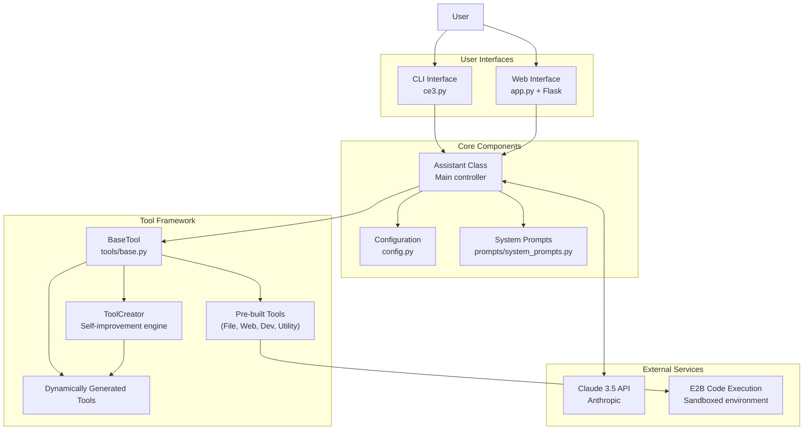
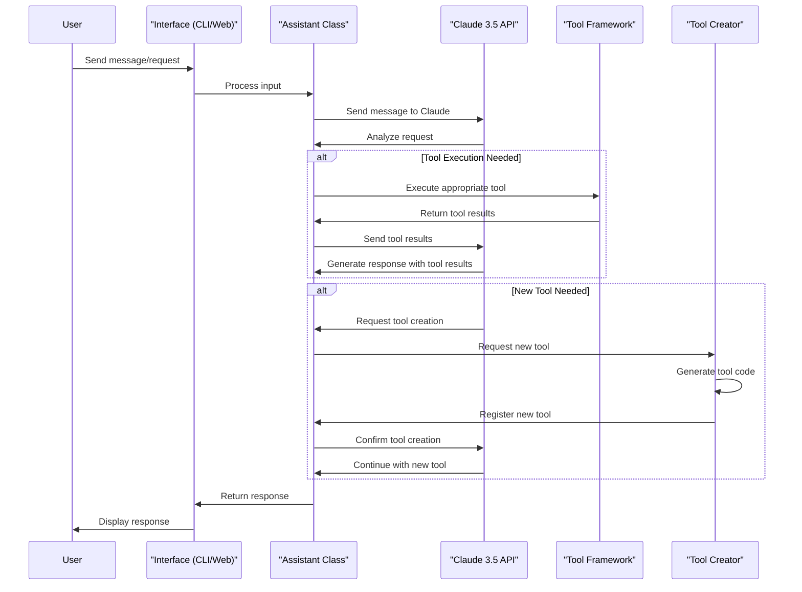
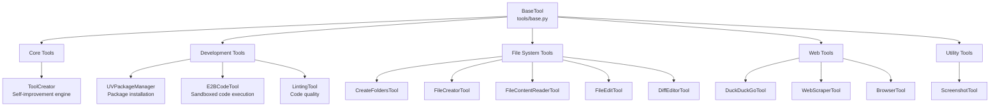

<!-- source: DeepWiki mcp.deepwiki.com · repo Doriandarko/claude-engineer · page 1 Overview · fetched 2026-10-26 -->

# Overview

Relevant source files

The following files were used as context for generating this wiki page:

- [pyproject.toml](pyproject.toml)
- [readme.md](readme.md)
- [requirements.txt](requirements.txt)

This document provides an introduction to Claude Engineer v3, a self-improving AI Assistant framework built around the Claude 3.5 Sonnet model. It covers the system's purpose, high-level architecture, and main capabilities. For installation instructions, see [Installation and Setup](#1.1). For usage details, see [Usage Guide](#1.2).

## What is Claude Engineer v3?

Claude Engineer v3 is a framework that enables Claude 3.5 to create and manage its own tools, continuously expanding its capabilities through conversation. The system combines a powerful self-improvement mechanism with flexible interfaces, allowing Claude to dynamically identify needs for new tools, design them, and implement them automatically.

This represents the third major iteration of the Claude Engineer framework, with significant improvements over previous versions:
- Integration with Claude 3.5 Sonnet model
- Enhanced token management using Anthropic's token counting API
- Self-improving tool creation system
- Streamlined conversation handling
- More precise token usage tracking

Sources: [readme.md:1-17]()

## Key Features

| Feature Category | Capabilities |
|------------------|--------------|
| **Self-Improvement** | • Autonomous tool identification and creation • Dynamic capability expansion • Smart tool dependency management • Automatic identification of capability gaps |
| **Core Functionality** | • Dynamic tool creation and loading • Hot-reload capability • Tool abstraction framework • Persistent conversation history • Advanced token tracking and management |
| **Interfaces** | • Modern web interface with image upload, token visualization • CLI with rich text formatting and tool interaction |
| **Tool Types** | • File system tools • Web tools • Development tools • Utility tools |

Sources: [readme.md:110-133](), [readme.md:151-170]()

## System Architecture

### High-Level Architecture

This diagram shows the main system components of Claude Engineer v3. The system is built around the central Assistant class, which interfaces with Claude 3.5 through the Anthropic API. Users interact with the system through either the CLI (`ce3.py`) or web interface (`app.py`). The tool framework is based on the `BaseTool` class, with pre-built tools and the ability to dynamically generate new tools through the `ToolCreator`.

Sources: [readme.md:134-149](), [readme.md:174-183](), [readme.md:209-242]()

### User Interaction Flow

This sequence diagram illustrates the typical interaction flow between the user and Claude Engineer v3, including the execution of existing tools and the creation of new tools when needed.

Sources: [readme.md:110-117](), [readme.md:118-133]()

## System Components

### Core Assistant

The heart of Claude Engineer v3 is the `Assistant` class, which handles:
- Conversation management with token tracking
- Tool loading, execution, and chaining
- Communication with the Claude 3.5 API
- Self-improvement through tool creation

The Assistant class provides a unified interface for both the CLI and web interfaces to interact with Claude 3.5 and the tool framework.

Sources: [readme.md:174-183]()

### Tool Framework

The tool framework is built around the `BaseTool` class in `tools/base.py`, which defines the interface for all tools. The system includes several categories of pre-built tools:

This diagram shows the hierarchical organization of the tool system in Claude Engineer v3. All tools inherit from the `BaseTool` class and are categorized by their functionality.

Sources: [readme.md:209-242]()

### Self-Improvement Mechanism

A key feature of Claude Engineer v3 is its ability to identify needs for new tools during conversations and create them automatically:

When Claude identifies a need for a new capability, it designs and implements a new tool through the `ToolCreator`, which generates the necessary code and registers the tool with the system. This allows the assistant to continuously expand its capabilities based on user needs.

Sources: [readme.md:110-117](), [readme.md:15-16]()

### Interface Options

Claude Engineer v3 offers two user interfaces:

1. **Web Interface** (`app.py`): A modern web UI built with Flask featuring:
   - Real-time token usage visualization
   - Image upload and analysis
   - Markdown rendering with syntax highlighting
   - Tool usage indicators

2. **CLI Interface** (`ce3.py`): A terminal-based interface with:
   - Rich text formatting
   - Progress indicators
   - Direct tool interaction
   - Detailed debugging output

Both interfaces provide access to the same underlying Assistant capabilities but cater to different use cases and preferences.

Sources: [readme.md:63-107](), [readme.md:151-170]()

## Dependencies and Requirements

Claude Engineer v3 requires:
- Python 3.8+
- Anthropic API Key (for Claude 3.5 access)
- E2B API Key (for code execution capabilities, optional)
- Required packages specified in `requirements.txt`

Key dependencies include:
- `anthropic` for API communication
- `flask` for the web interface
- `rich` for console formatting
- Various packages for web scraping, file operations, and utility functions

Sources: [requirements.txt:1-15](), [readme.md:194-253]()

## Technical Integration

For developers looking to extend or integrate with Claude Engineer v3, the system provides:
- A modular design with clear separation of concerns
- Consistent interfaces for creating new tools
- Configuration options through the `Config` class
- Support for both web and CLI integration

For detailed API documentation, see [API Reference](#7). For information on creating custom tools, see [Creating New Tools](#6).

Sources: [readme.md:174-193](), [pyproject.toml:1-116]()

---

