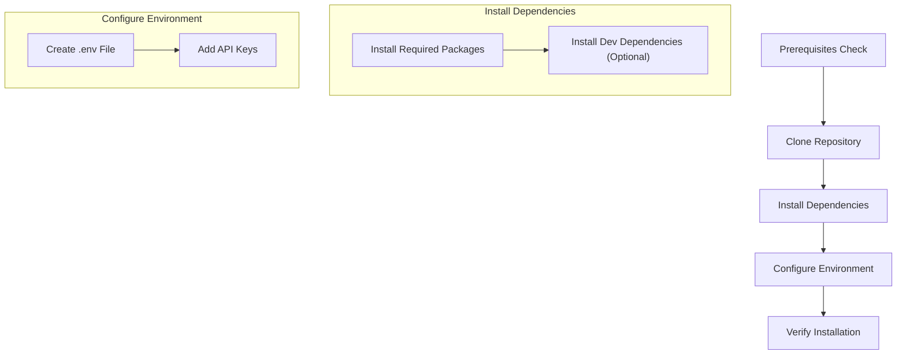
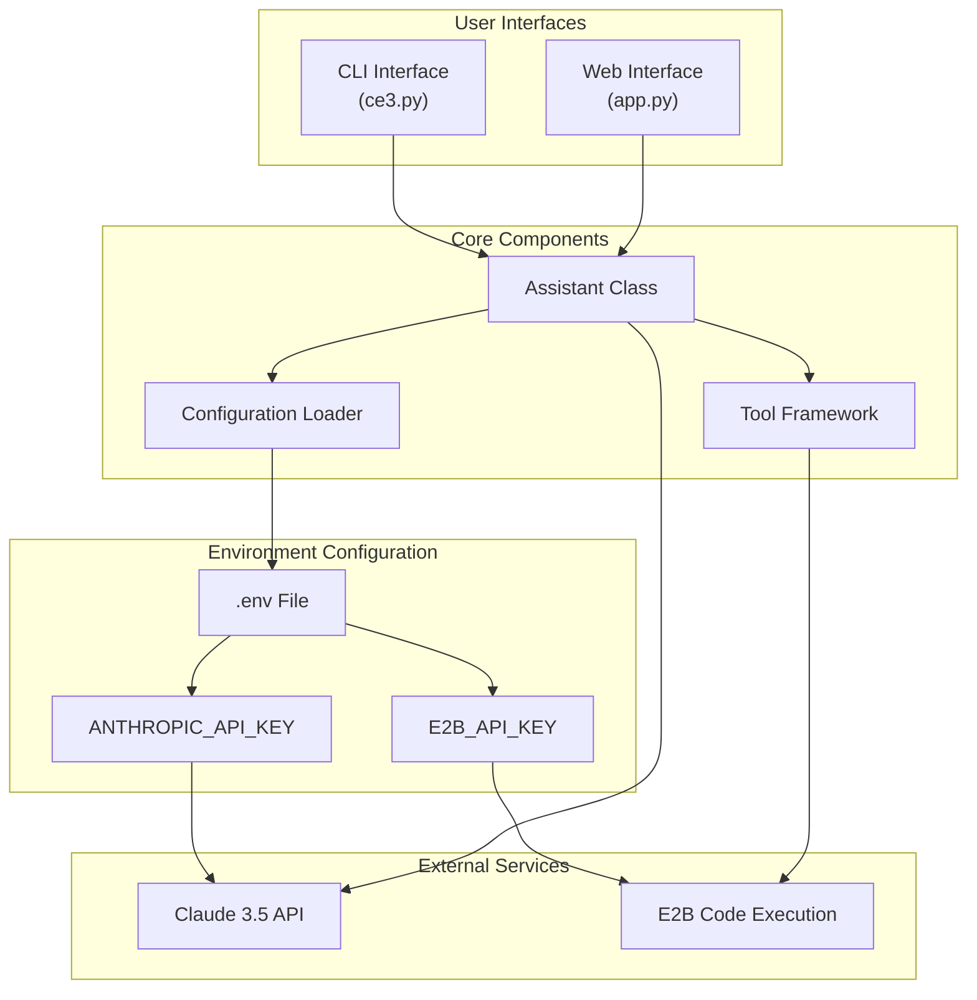
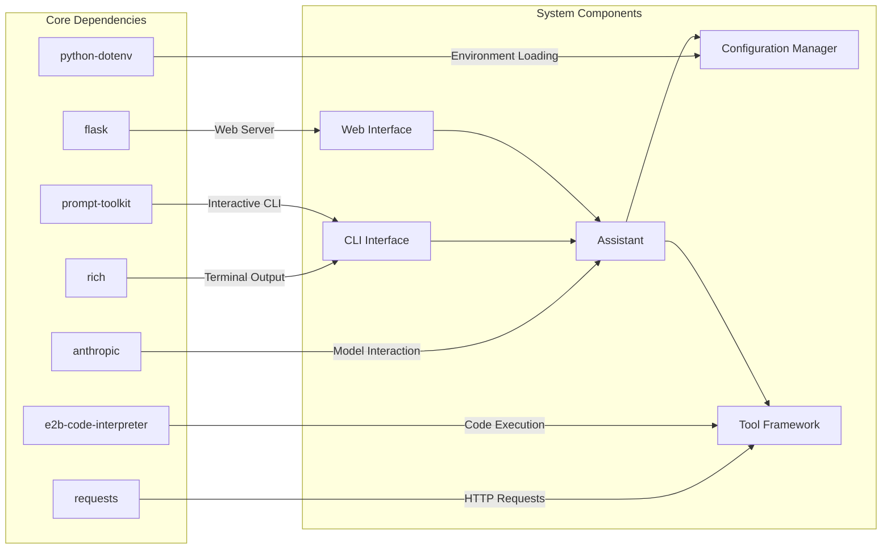

<!-- source: DeepWiki mcp.deepwiki.com · repo Doriandarko/claude-engineer · page 1.1 Installation and Setup · fetched 2026-10-26 -->

# Installation and Setup

<details>
<summary>Relevant source files</summary>

The following files were used as context for generating this wiki page:

- [.env.example](.env.example)
- [.gitignore](.gitignore)
- [pyproject.toml](pyproject.toml)
- [requirements.txt](requirements.txt)
- [uv.lock](uv.lock)

</details>


This page provides instructions for installing and setting up Claude Engineer v3. It covers system requirements, dependency installation, environment configuration, and verification steps. For information on how to use the system once installed, see [Usage Guide](#1.2).

## Prerequisites

Before installing Claude Engineer v3, ensure you have the following:

- Python 3.9 or higher
- Git (for cloning the repository)
- An Anthropic API key for accessing Claude 3.5 Sonnet
- (Optional) An E2B API key for code execution features

Sources: [pyproject.toml:10](), [.env.example:1-2]()

## Installation Workflow

The diagram below illustrates the overall installation process for Claude Engineer v3:



Sources: [requirements.txt:1-15](), [.env.example:1-2]()

## Repository Setup

1. Clone the repository:

```bash
git clone https://github.com/Doriandarko/claude-engineer.git
cd claude-engineer
```

2. Create a virtual environment (recommended):

```bash
python -m venv .venv
```

3. Activate the virtual environment:

On Windows:
```bash
.venv\Scripts\activate
```

On macOS/Linux:
```bash
source .venv/bin/activate
```

Sources: [.gitignore:4-5]()

## Installing Dependencies

Install the required dependencies using pip:

```bash
pip install -r requirements.txt
```

For development purposes, you can install additional development dependencies:

```bash
pip install -e ".[dev]"
```

The table below lists the key dependencies and their purposes:

| Package | Version | Purpose |
|---------|---------|---------|
| anthropic | >=0.18.1 | Claude API client for interacting with the model |
| flask | 3.0.0 | Web framework for the user interface |
| beautifulsoup4 | >=4.12.3 | HTML parsing for web scraping tools |
| python-dotenv | >=1.0.1 | Loading environment variables from `.env` files |
| requests | >=2.31.0 | HTTP requests for API interactions |
| rich | >=13.7.0 | Rich text formatting in terminal |
| prompt-toolkit | >=3.0.43 | Interactive command-line interface |
| e2b-code-interpreter | >=1.0.3 | Secure code execution environment |

Sources: [requirements.txt:1-15](), [pyproject.toml:23-40]()

## Environment Configuration

The application requires API keys to function properly. These are stored in a `.env` file that's loaded at runtime.

1. Create a `.env` file in the root directory by copying the example file:

```bash
cp .env.example .env
```

2. Edit the `.env` file to add your API keys:

```
ANTHROPIC_API_KEY=your_anthropic_api_key
E2B_API_KEY=your_e2b_api_key  # optional
```

Note: The `.env` file is excluded from version control in `.gitignore` to prevent accidentally exposing your API keys.

Sources: [.env.example:1-2](), [.gitignore:4]()

## System Components and Dependencies

The following diagram shows the key components of Claude Engineer v3 and how they relate to the configuration:



Sources: [.env.example:1-2](), [pyproject.toml:23-40](), [requirements.txt:1-15]()

## Starting the Application

Claude Engineer v3 can be run in two ways:

### Command Line Interface

Run the CLI with:

```bash
python ce3.py
```

### Web Interface

Start the web server with:

```bash
python app.py
```

By default, the web interface will be available at `http://localhost:5000`

Sources: [pyproject.toml:115]()

## Installation Verification

To verify your installation is working correctly, follow these steps:

1. Ensure your `.env` file is properly configured with the required API keys
2. Start the application using either the CLI or web interface
3. If using the CLI, you should see a welcome message and prompt
4. If using the web interface, navigate to `http://localhost:5000` in your browser

## Dependency Map

The diagram below shows how the key Python dependencies are used by different components of the system:



Sources: [requirements.txt:1-15](), [pyproject.toml:23-40]()

## Troubleshooting

Here are solutions to common installation issues:

| Issue | Possible Cause | Solution |
|-------|---------------|----------|
| Import errors | Missing dependencies | Run `pip install -r requirements.txt` again |
| Environment variable errors | Misconfigured `.env` file | Check that `.env` exists and contains valid API keys |
| API Key errors | Invalid API key | Verify your Anthropic API key is correct and has sufficient permissions |
| Port already in use | Another service using port 5000 | Change the port in `app.py` or stop the other service |
| SSL Certificate errors | Network issues | Check your internet connection and proxy settings |

## Next Steps

After completing the installation and setup:

- Explore the [Usage Guide](#1.2) to learn how to use Claude Engineer v3
- Check the [Tool Framework](#2.2) documentation to understand available tools
- Review the [System Architecture](#2) for a deeper understanding of the system

Sources: [pyproject.toml:23-40](), [requirements.txt:1-15]()

---

