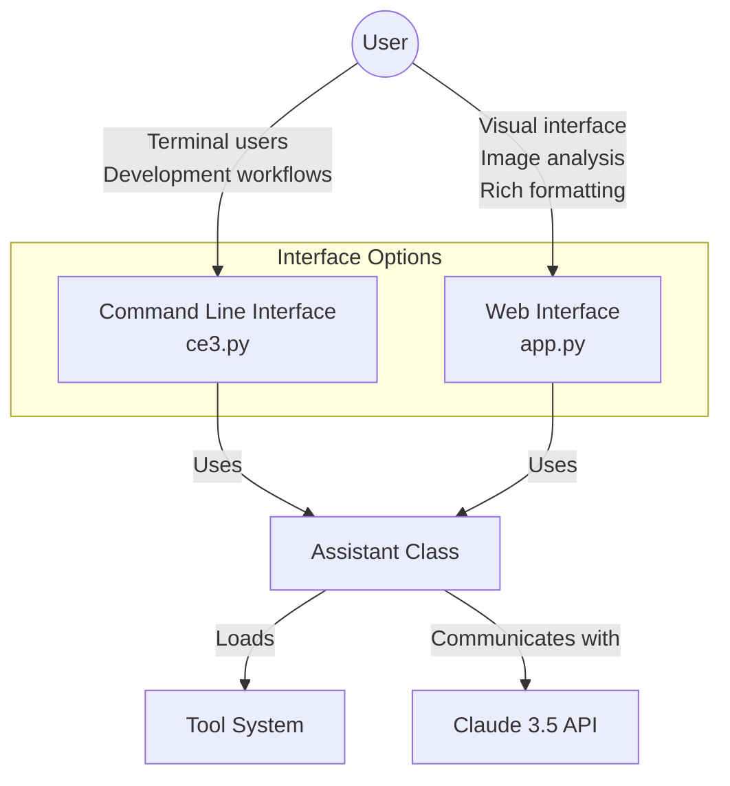
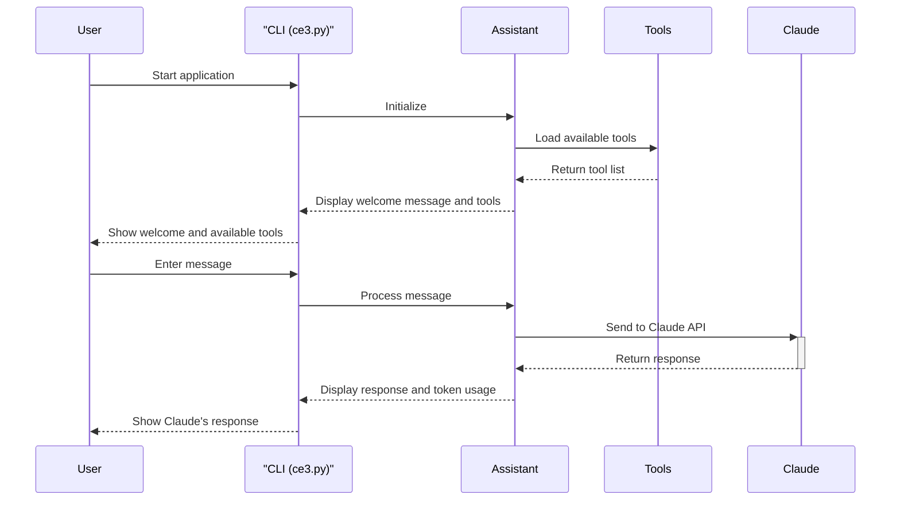
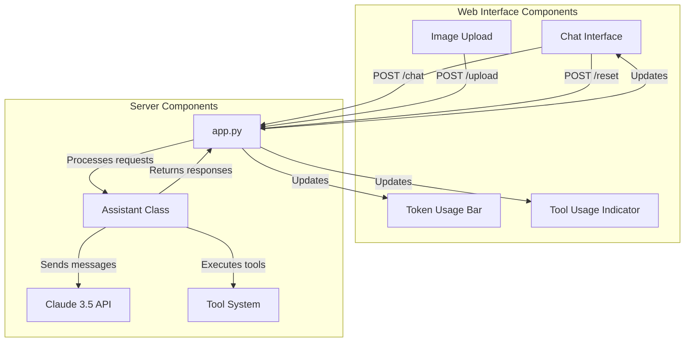
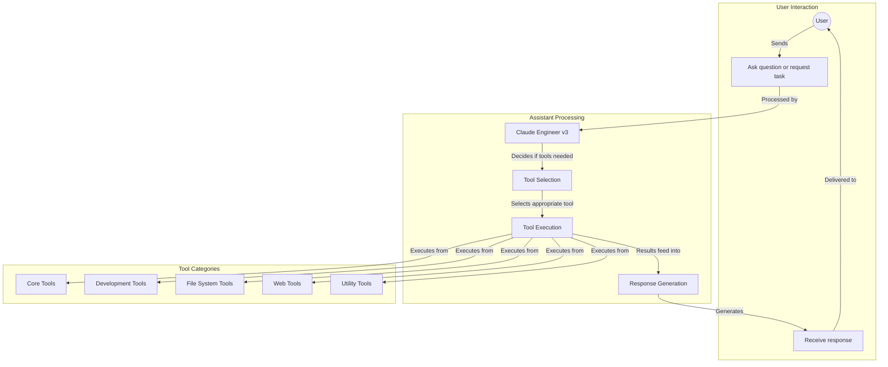
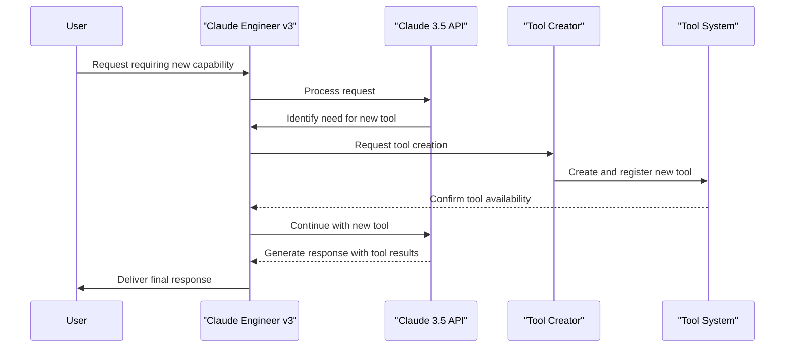
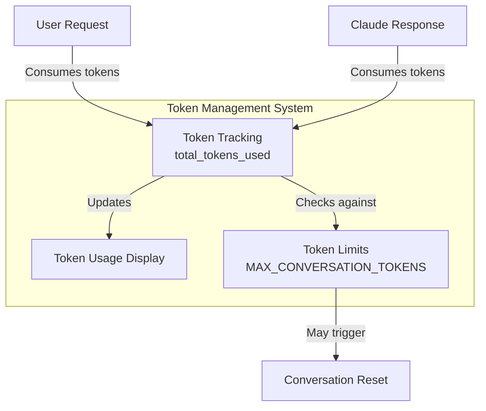

<!-- source: DeepWiki mcp.deepwiki.com · repo Doriandarko/claude-engineer · page 1.2 Usage Guide · fetched 2026-10-26 -->

# Usage Guide

<details>
<summary>Relevant source files</summary>

The following files were used as context for generating this wiki page:

- [app.py](app.py)
- [ce3.py](ce3.py)
- [readme.md](readme.md)

</details>


This guide provides detailed instructions on how to use Claude Engineer v3, covering both the command-line interface (CLI) and web interface. For installation instructions, see [Installation and Setup](#1.1).

## Interface Options

Claude Engineer v3 offers two distinct interfaces to accommodate different workflows:



Sources: [ce3.py:476-527](), [readme.md:65-107](), [app.py:18-20]()

## Command Line Interface

The CLI provides a terminal-based experience for users who prefer to work directly in the command line.

### Starting the CLI

```bash
# Using uv (recommended)
uv run ce3.py

# Or using traditional Python
python ce3.py
```

Upon starting, the CLI displays a welcome message and a list of available tools:



Sources: [ce3.py:476-527](), [readme.md:96-102]()

### CLI Commands

| Command | Description |
|---------|-------------|
| `refresh` | Reloads all available tools, displaying any newly discovered tools |
| `reset` | Clears conversation history and token usage |
| `quit` | Exits the application |

Sources: [ce3.py:418-453](), [ce3.py:455-474]()

### CLI Features

- Rich text formatting for better readability
- Visual token usage tracking with ASCII progress bar
- Live progress indicators during thinking/processing
- Direct tool execution with detailed output
- Terminal-optimized interface

Sources: [readme.md:163-169](), [ce3.py:305-330]()

## Web Interface

The web interface provides a modern, visual experience better suited for image analysis and rich content.

### Starting the Web Server

```bash
# Using uv (recommended)
uv run app.py

# Or using traditional Python
python app.py

# Then open your browser to:
http://localhost:5000
```

Sources: [readme.md:76-86](), [app.py:129-130]()

### Web Interface Features



Sources: [app.py:1-130](), [readme.md:153-162]()

#### Key Web Features

- **Image Analysis**: Upload and analyze images using Claude's vision capabilities
- **Token Usage Visualization**: Real-time display of token consumption
- **Markdown Rendering**: Supports syntax highlighting for code blocks
- **Responsive Design**: Works on mobile and desktop devices
- **Tool Usage Indicators**: Shows when tools are being used
- **Keyboard Shortcuts**: Command/Ctrl + Enter to send messages

Sources: [readme.md:153-162](), [app.py:22-89]()

### Web Interface Endpoints

| Endpoint | Method | Description |
|----------|--------|-------------|
| `/` | GET | Renders the main web interface |
| `/chat` | POST | Processes user messages and returns Claude's responses |
| `/upload` | POST | Handles image file uploads |
| `/reset` | POST | Resets the conversation history |

Sources: [app.py:18-127]()

## Working with Tools

Claude Engineer v3 comes with a wide range of built-in tools that Claude can use during conversations. These tools are automatically invoked when Claude determines they're needed.



Sources: [readme.md:209-241](), [ce3.py:261-292]()

### Available Tool Categories

| Category | Description | Example Tools |
|----------|-------------|---------------|
| Core Tools | Core functionality | Tool Creator |
| Development Tools | Code and package management | UV Package Manager, E2B Code Executor, Linting Tool |
| File System Tools | File operations | File Creator, File Content Reader, Diff Editor |
| Web Tools | Internet access | DuckDuckGo, Web Scraper, Browser |
| Utility Tools | General utilities | Screenshot Tool |

For detailed information about specific tools, see [Tools](#5).

Sources: [readme.md:212-233](), [ce3.py:75-128]()

## Self-Improvement Mechanism

A key feature of Claude Engineer v3 is its ability to identify needs for new tools and create them automatically.



For more details on this feature, see [Self-Improvement Mechanism](#2.3).

Sources: [readme.md:110-117](), [ce3.py:159-177]()

## Token Management

Claude Engineer v3 carefully tracks token usage to ensure conversations stay within API limits.



- Token usage is displayed after each response
- Warning is shown when token limit is approaching
- Conversation must be reset when token limit is reached

Sources: [ce3.py:305-330](), [ce3.py:332-416]()

## Best Practices

For optimal use of Claude Engineer v3:

1. **Be specific in requests**: Give clear, detailed instructions for best results
2. **Leverage multimodal capabilities**: Use image uploads in the web interface for visual analysis
3. **Monitor token usage**: Reset conversations when approaching the token limit
4. **Explore available tools**: Familiarize yourself with built-in tools to understand capabilities
5. **Use the right interface**: Choose CLI for development workflows, web interface for visual work

Sources: [readme.md:105-107](), [readme.md:152-170]()

## Troubleshooting

| Issue | Solution |
|-------|----------|
| **API Key Errors** | Ensure your Anthropic API key is correctly set in your environment |
| **Missing Dependencies** | When prompted to install dependencies, choose 'y' to install via UV |
| **Tool Errors** | Use `refresh` command to reload tools after fixing issues |
| **Token Limit Reached** | Use `reset` command to clear conversation history |
| **Image Upload Failures** | Ensure image is in supported format (.png, .jpg, .jpeg, .gif, .webp) |

Sources: [ce3.py:105-122](), [app.py:91-121](), [ce3.py:455-474]()

---

