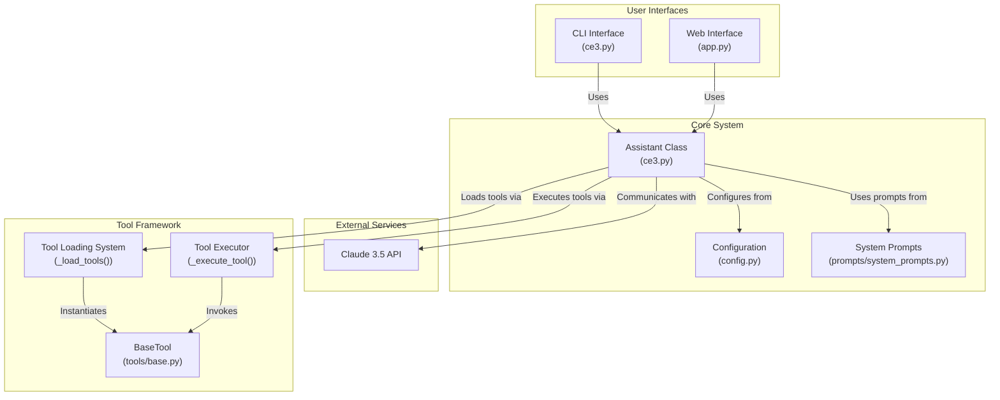
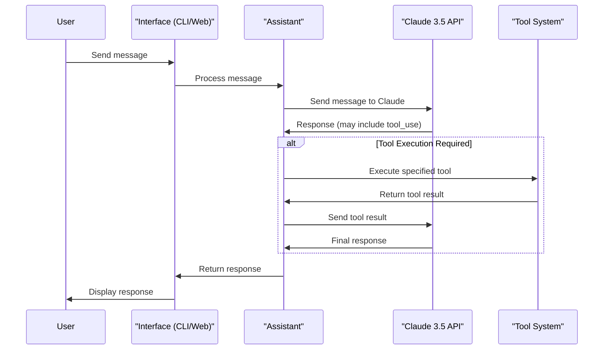
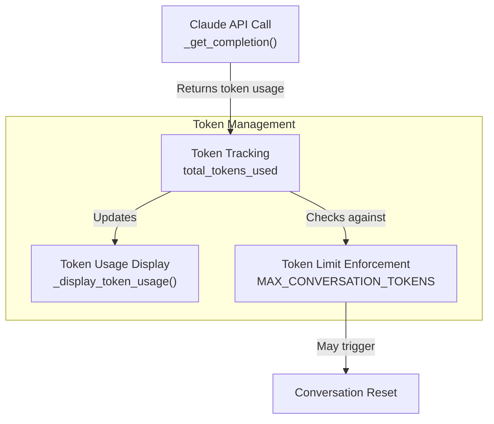
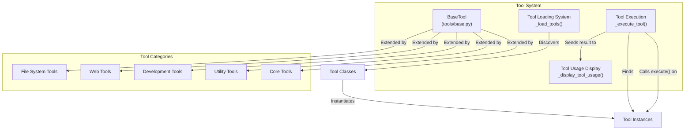
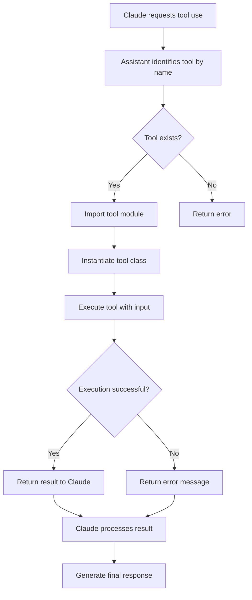
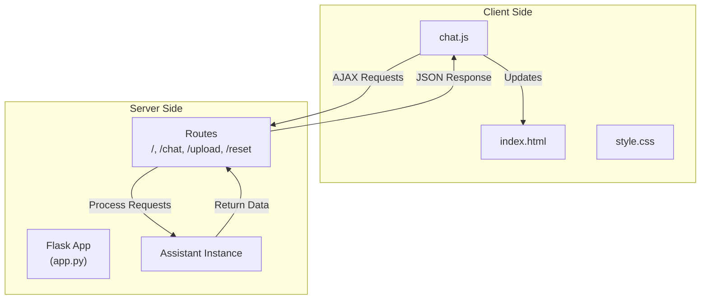
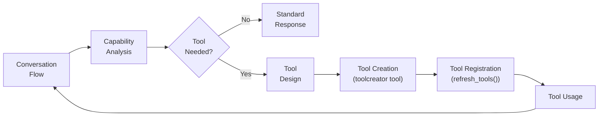
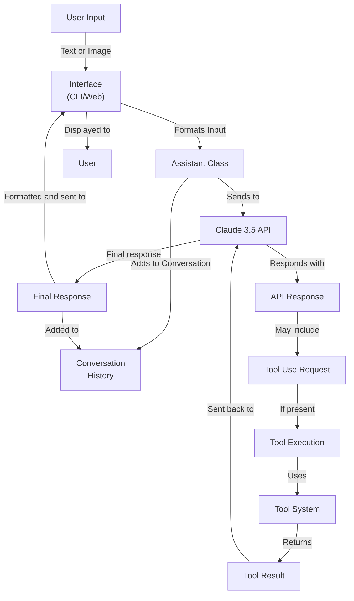

<!-- source: DeepWiki mcp.deepwiki.com · repo Doriandarko/claude-engineer · page 2 System Architecture · fetched 2026-10-26 -->

# System Architecture

Relevant source files

The following files were used as context for generating this wiki page:

- [app.py](app.py)
- [ce3.py](ce3.py)
- [config.py](config.py)
- [readme.md](readme.md)

This document provides an overview of the Claude Engineer v3 system architecture, detailing the core components and their interactions. It gives technical readers a comprehensive understanding of how the system is structured and functions. For specific implementation details about individual components, please refer to the relevant sub-pages, such as [Core Assistant](#2.1), [Tool Framework](#2.2), and [Self-Improvement Mechanism](#2.3).

## Overview

Claude Engineer v3 is designed with a modular architecture centered around the Assistant class, which orchestrates interactions between the user interfaces, Claude 3.5 API, and the extensible tool framework. The system features both a command-line interface and a web interface, sharing the same underlying Assistant functionality.

Sources: [readme.md:1-17](), [ce3.py:29-39]()

## High-Level Architecture

The system follows a layered architecture pattern with clear separation between interfaces, core assistant logic, and tool implementation.

### Architectural Diagram

Sources: [ce3.py:29-39](), [ce3.py:75-128](), [ce3.py:261-292](), [config.py:7-21](), [app.py:8-16]()

## Core Components

### Assistant Class

The `Assistant` class is the central orchestrator of the system. It manages:
- Conversation history with Claude 3.5
- Tool loading and execution
- Token usage tracking
- System prompt configuration

The Assistant maintains the conversation state and handles the recursive communication pattern required for tool execution.

Sources: [ce3.py:29-461]()

### Configuration

The `Config` class centralizes system-wide configuration:
- API keys and model parameters
- Token limits
- Directory paths
- Interface behavior settings

Sources: [config.py:7-21]()

### Interfaces

#### CLI Interface
The CLI provides a terminal-based interaction using Rich for formatted output and prompt_toolkit for input.

#### Web Interface
The Flask-based web interface serves HTML, CSS, and JavaScript for a browser-based experience.

Sources: [ce3.py:476-527](), [app.py:1-130]()

## Component Relationships

This diagram shows how data flows between components during a typical conversation:

Sources: [ce3.py:418-453](), [ce3.py:332-416](), [ce3.py:261-292]()

## Token Management System

The system implements a sophisticated token tracking mechanism:

1. Tracks input and output tokens for each API call
2. Maintains a running total of tokens used in the conversation
3. Enforces the conversation token limit defined in Config
4. Provides visual feedback on token usage

Sources: [ce3.py:305-330](), [ce3.py:332-359](), [config.py:10-11]()

## Tool Framework Architecture

The tool framework is built around the `BaseTool` abstract class, which all tools extend.

The tool system includes:
- Dynamic tool discovery and loading
- Tool execution with proper error handling
- Support for missing dependency detection and installation
- Tool usage visualization

Sources: [ce3.py:75-128](), [ce3.py:261-292](), [ce3.py:192-216](), [readme.md:209-240]()

### Tool Execution Flow

Sources: [ce3.py:261-292](), [ce3.py:332-416]()

## Web Interface Architecture

The web interface is built using Flask and follows a standard client-server architecture:

The web interface provides these endpoints:
- `/` - Serves the main page
- `/chat` - Handles chat messages and returns responses
- `/upload` - Processes image uploads for vision capabilities
- `/reset` - Resets the conversation history

Sources: [app.py:1-130](), [app.py:18-127]()

## Self-Improvement Architecture

A key feature of Claude Engineer v3 is its ability to self-improve by creating new tools:

The self-improvement cycle involves:
1. Identifying capability gaps during conversation
2. Designing a tool to address the gap
3. Implementing the tool using code generation
4. Registering the tool with the system
5. Using the new tool to solve the original problem

Sources: [readme.md:110-117](), [ce3.py:159-177]()

## Data Flow

This diagram illustrates the data flow through the entire system during a typical interaction:

Sources: [ce3.py:418-453](), [ce3.py:332-416](), [app.py:22-89]()

## Interdependencies

| Component | Depends On | Provides To |
|-----------|------------|------------|
| Assistant class | Config, SystemPrompts, Claude API | CLI Interface, Web Interface |
| CLI Interface | Assistant class, Rich library | User |
| Web Interface | Assistant class, Flask | User |
| Tool Framework | BaseTool, Python importlib | Assistant class |
| Tools | BaseTool, domain-specific libraries | Tool Framework |
| Configuration | Environment variables | Assistant class, Tools |

Sources: [ce3.py:29-39](), [app.py:16](), [config.py:7-21]()

## System Requirements

The system has several external dependencies:

- Python 3.8+
- Anthropic API (with Claude 3.5 access)
- E2B API (for code execution)
- Flask (for web interface)
- Rich (for CLI formatting)

And integrates with:
- File system
- Web services
- Package managers
- Code execution environments

Sources: [readme.md:194-197](), [readme.md:244-253]()

## Conclusion

Claude Engineer v3 employs a modular, extensible architecture centered around the Assistant class. The system's unique capability is its self-improvement mechanism, which allows it to create new tools dynamically. This architecture enables both CLI and web interfaces to share the same core functionality while providing appropriate user experiences for their respective contexts.

The system is designed to be:
- Modular (clear separation of concerns)
- Extensible (easily add new tools)
- Self-improving (can create new tools)
- Resilient (robust error handling)
- Token-efficient (careful management of context windows)

For more detailed information about specific components, see [Core Assistant](#2.1), [Tool Framework](#2.2), and [Self-Improvement Mechanism](#2.3).

---

