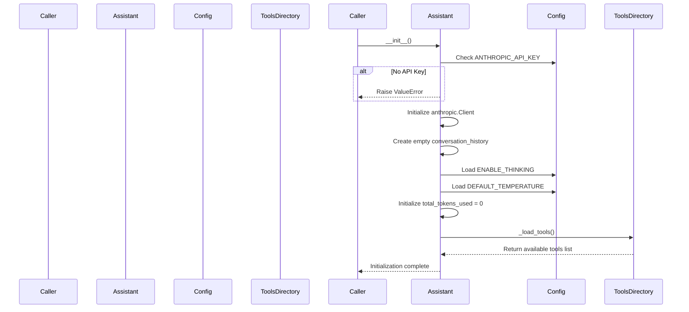
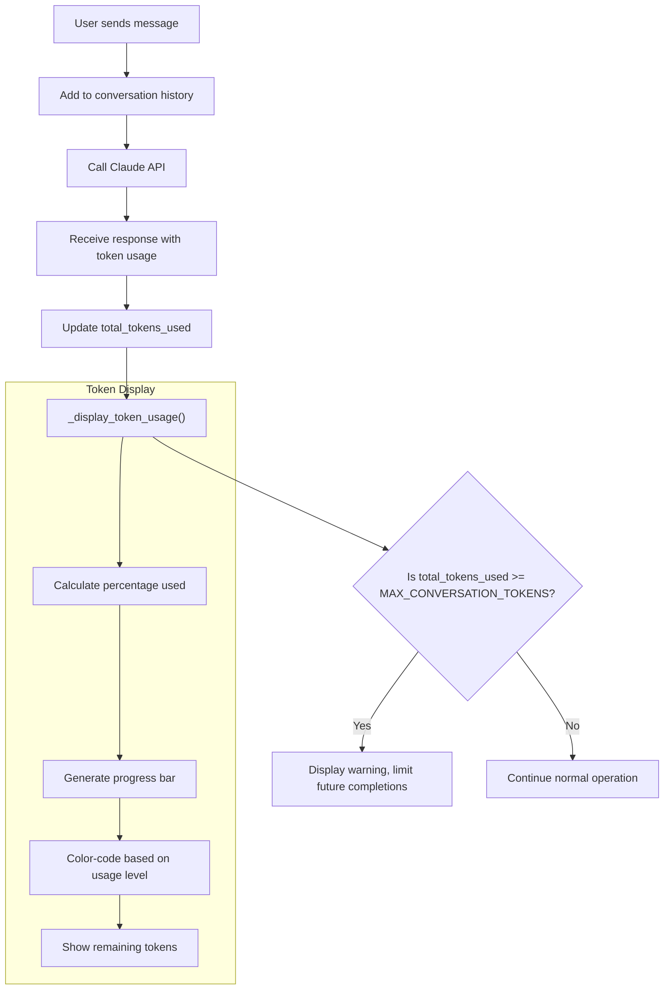
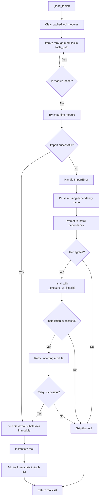
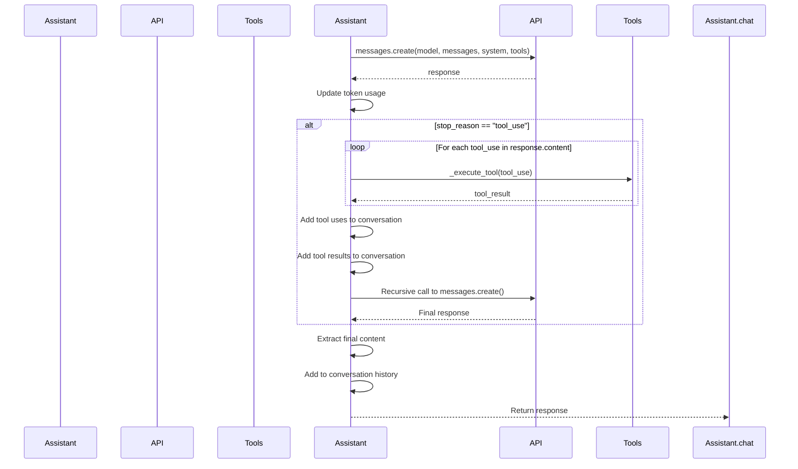
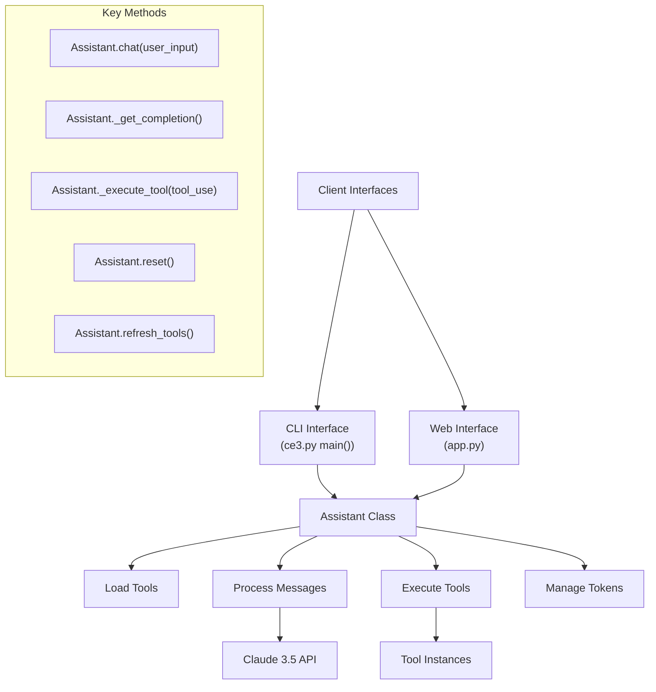

<!-- source: DeepWiki mcp.deepwiki.com · repo Doriandarko/claude-engineer · page 2.1 Core Assistant · fetched 2026-10-26 -->

# Core Assistant

<details>
<summary>Relevant source files</summary>

The following files were used as context for generating this wiki page:

- [ce3.py](ce3.py)
- [config.py](config.py)
- [prompts/system_prompts.py](prompts/system_prompts.py)
- [tools/diffeditortool.py](tools/diffeditortool.py)

</details>


The Core Assistant is the central component of Claude Engineer v3, responsible for facilitating interactions between users and Claude 3.5 API while managing conversation state, token usage, and tool execution. This page documents the `Assistant` class implementation, its initialization, conversation handling, and integration with the tool framework.

For information about the Tool Framework itself, see [Tool Framework](#2.2). For details on the Self-Improvement mechanism, see [Self-Improvement Mechanism](#2.3).

## Overview

The Core Assistant serves as the bridge between user interfaces (CLI or Web) and the Claude 3.5 API. It provides the following core functionalities:

- Loading and managing tools from the tools directory
- Tracking and optimizing token usage throughout conversations
- Handling conversation history and context management
- Executing tools based on Claude's requests
- Processing special commands (reset, refresh)
- Error handling and recovery

## Assistant Class Architecture

```mermaid
classDiagram
    class "Assistant" {
        -client: anthropic.Anthropic
        -conversation_history: List[Dict]
        -console: Console
        -thinking_enabled: bool
        -temperature: float
        -total_tokens_used: int
        -tools: List[Dict]
        +__init__()
        +_load_tools()
        +_execute_tool()
        +_get_completion()
        +chat(user_input)
        +reset()
        +refresh_tools()
    }
    
    "Assistant" --> "anthropic.Anthropic" : uses
    "Assistant" --> "Config" : loads settings from
    "Assistant" --> "SystemPrompts" : applies prompts from
    "Assistant" --> "BaseTool" : executes instances of
```

Sources: [ce3.py:29-474](), [config.py:7-21](), [prompts/system_prompts.py:1-76]()

## Initialization Process

The Assistant initialization performs several key setup tasks:

1. Validates the presence of an API key
2. Initializes the Anthropic client
3. Sets up the conversation history as an empty list
4. Configures thinking mode and temperature settings from Config
5. Initializes token tracking
6. Loads available tools



Sources: [ce3.py:39-53]()

## Conversation Management

The Assistant class maintains the conversation history as a list of message objects in the Anthropic API format. Each message has a `role` (either "user" or "assistant") and `content` field which can be a string or a structured message content list for multimodal conversations.

The main method for handling conversations is `chat(user_input)`, which:

1. Checks for special commands (reset, refresh, quit)
2. Adds the user message to conversation history
3. Calls `_get_completion()` to get Claude's response
4. Returns the response to the caller

Sources: [ce3.py:418-453]()

## Token Management

The Assistant tracks token usage to ensure conversations stay within the configured limits, using these key components:

1. `total_tokens_used`: Tracks cumulative token usage across the entire conversation
2. `MAX_CONVERSATION_TOKENS`: Configuration limit for maximum tokens per conversation
3. `_display_token_usage()`: Visual representation of token usage and warnings
4. Token limit enforcement in `_get_completion()`



Sources: [ce3.py:305-330](), [ce3.py:337-358](), [config.py:10-11]()

## Tool Management

### Tool Loading

The tool loading process dynamically discovers and loads tools from the configured tools directory:

1. Iterates through modules in the tools directory using `pkgutil.iter_modules()`
2. Imports each module dynamically with `importlib.import_module()`
3. Extracts tool classes that inherit from `BaseTool`
4. Instantiates each tool and collects its metadata (name, description, input_schema)
5. Handles dependency errors by offering to install missing packages



Sources: [ce3.py:75-128](), [ce3.py:141-157]()

### Tool Execution

The tool execution process handles Claude's requests to use specific tools:

1. Receives tool use request with tool name and inputs
2. Dynamically imports and instantiates the requested tool
3. Executes the tool with provided inputs
4. Handles and formats tool results
5. Displays tool usage information if enabled
6. Returns results to be sent back to Claude

Sources: [ce3.py:261-292](), [ce3.py:294-303]()

## Interaction with Anthropic API

The `_get_completion()` method manages interactions with the Claude 3.5 API:

1. Prepares message request with conversation history, system prompts, tools list, and token limits
2. Sends request to Claude API
3. Processes response, including tool usage requests
4. Updates token usage tracking
5. Handles recursive tool execution when needed
6. Returns final response content



Sources: [ce3.py:332-416]()

## Special Commands

The Core Assistant handles special text commands:

| Command  | Function | Description |
|----------|----------|-------------|
| refresh  | refresh_tools() | Reloads all tools, discovering any new tools |
| reset    | reset() | Clears conversation history and token usage |
| quit     | (handled in CLI) | Exits the application |

Sources: [ce3.py:418-433](), [ce3.py:159-177](), [ce3.py:455-474]()

## Error Handling

The Assistant implements several error handling mechanisms:

1. **Tool loading errors**: Gracefully handles missing dependencies with install prompts
2. **Tool execution errors**: Captures exceptions and returns error messages
3. **API errors**: Logs errors and provides user-friendly messages
4. **Token limit handling**: Prevents exceeding token limits with warnings

Sources: [ce3.py:101-124](), [ce3.py:261-292](), [ce3.py:414-416](), [ce3.py:356-358]()

## Usage in Applications

The Core Assistant is used by both CLI and Web interfaces:



Sources: [ce3.py:476-527]()

## Configuration Options

The Assistant behavior can be configured through the `Config` class with the following key settings:

| Setting | Description | Default |
|---------|-------------|---------|
| ANTHROPIC_API_KEY | API key for Claude access | From environment |
| MODEL | Claude model to use | "claude-3-5-sonnet-20241022" |
| MAX_TOKENS | Max tokens per response | 8000 |
| MAX_CONVERSATION_TOKENS | Token limit per conversation | 200000 |
| ENABLE_THINKING | Show thinking indicator | True |
| SHOW_TOOL_USAGE | Display tool execution details | True |
| DEFAULT_TEMPERATURE | Response randomness | 0.7 |

Sources: [config.py:7-21]()

---

