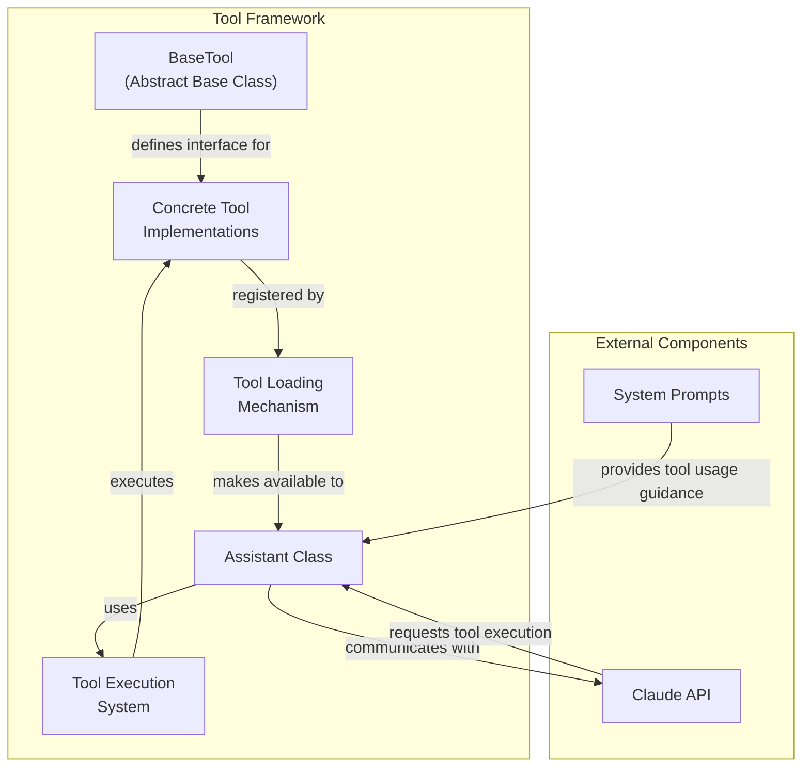
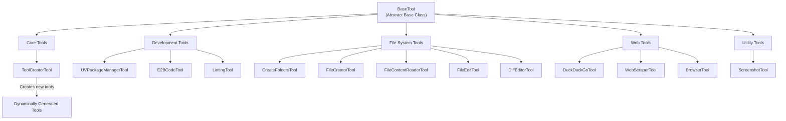
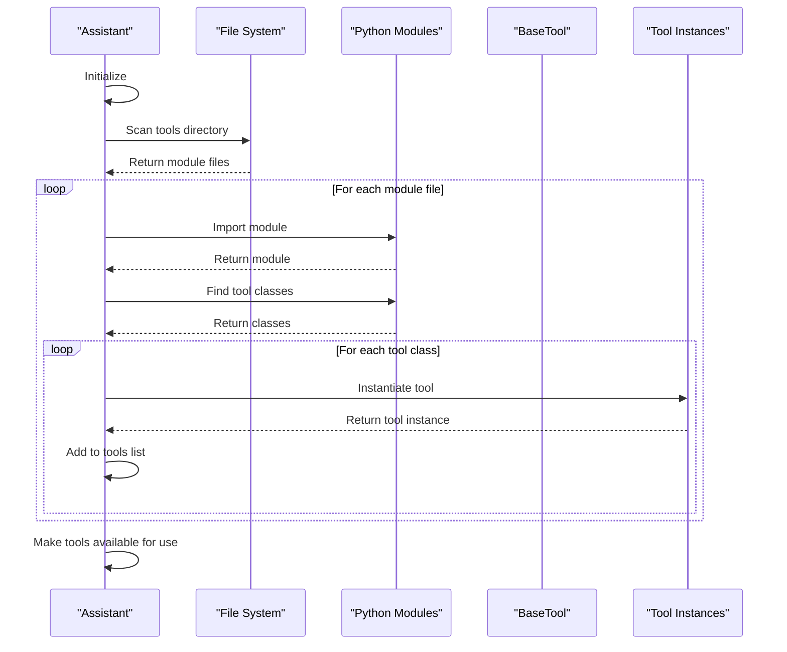
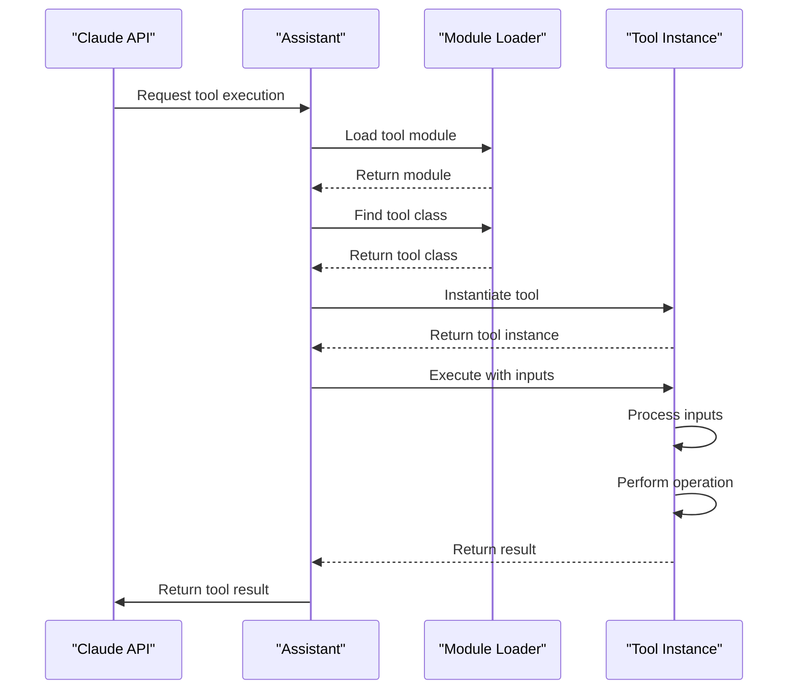
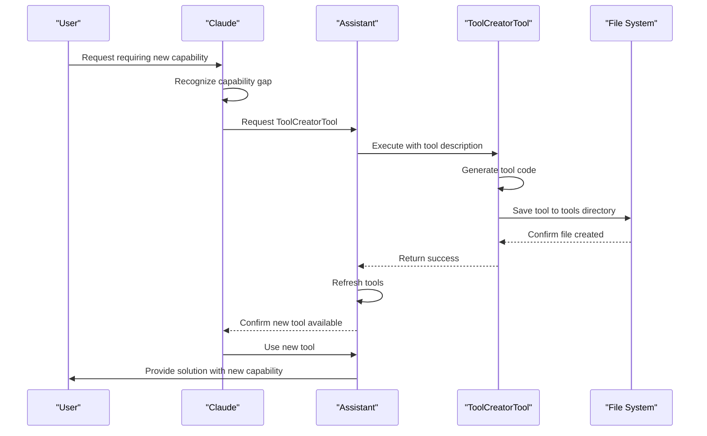

<!-- source: DeepWiki mcp.deepwiki.com · repo Doriandarko/claude-engineer · page 2.2 Tool Framework · fetched 2026-10-26 -->

# Tool Framework

<details>
<summary>Relevant source files</summary>

The following files were used as context for generating this wiki page:

- [ce3.py](ce3.py)
- [prompts/system_prompts.py](prompts/system_prompts.py)
- [readme.md](readme.md)
- [tools/diffeditortool.py](tools/diffeditortool.py)

</details>


This document describes the Tool Framework within Claude Engineer v3, which provides the foundation for extending Claude's capabilities through executable tools. The framework handles tool discovery, loading, registration, and execution.

For information about specific tools available in the system, see [Tools](#5). For details on how to create new custom tools, see [Creating New Tools](#6).

## 1. Overview

The Tool Framework is a modular system that enables Claude Engineer v3 to extend its capabilities by discovering, loading, and executing various tools. Each tool is a specialized component that performs specific functions, from file operations to web scraping, code execution, or package management.

### Key Features

- Dynamic tool discovery and loading
- Common interface for all tools via the BaseTool class
- Self-improving through dynamic tool creation
- Error handling and graceful degradation
- Tool categorization for better organization

Sources: [readme.md:142-149](), [ce3.py:75-129]()

## 2. Architecture

The Tool Framework architecture consists of several components that work together to provide a flexible and extensible tool system.

### Tool Framework Architecture Diagram



Sources: [ce3.py:75-129](), [ce3.py:261-293](), [tools/base.py]()

### Tool Categories and Hierarchy



Sources: [readme.md:210-241](), [prompts/system_prompts.py:16-31]()

## 3. BaseTool Interface

The BaseTool class provides a standard interface that all tools must implement. It defines the structure and required components for creating tools that work within the Claude Engineer v3 ecosystem.

### BaseTool Class Structure

| Component | Type | Description | Required |
|-----------|------|-------------|----------|
| `name` | String | Unique identifier for the tool | Yes |
| `description` | String | Detailed explanation of the tool's purpose and usage | Yes |
| `input_schema` | Dict | JSON Schema defining the tool's input parameters | Yes |
| `execute()` | Method | Main method implementing the tool's functionality | Yes |

### Example Base Tool Implementation

Here's an example of a tool implementation (DiffEditorTool):

```python
class DiffEditorTool(BaseTool):
    name = "diffeditortool"
    description = '''
    Performs a precise replacement of a given text snippet in a specified file.
    It takes the following inputs:
    - path: The path to the target file.
    - old_text: The exact substring that should be replaced.
    - new_text: The new substring that replaces the old one.
    ...
    '''

    input_schema = {
        "type": "object",
        "properties": {
            "path": {
                "type": "string",
                "description": "Path to the file to be edited."
            },
            "old_text": {
                "type": "string",
                "description": "Exact substring in the file to replace."
            },
            "new_text": {
                "type": "string",
                "description": "New substring that will replace old_text."
            }
        },
        "required": ["path", "old_text", "new_text"]
    }

    def execute(self, **kwargs) -> str:
        # Implementation of the tool's functionality
        # ...
```

Sources: [tools/diffeditortool.py:1-40]()

## 4. Tool Loading and Registration

The Tool Framework includes a dynamic loading mechanism that discovers and registers tools from the specified tools directory.

### Tool Loading Process Diagram



### Tool Loading Implementation

The tool loading process:

1. Scans the specified tools directory for Python modules
2. Imports each module
3. Searches for classes that inherit from BaseTool
4. Instantiates each tool class
5. Registers the tool with the system

The Assistant class provides methods to refresh tools at runtime, allowing for dynamic extension of capabilities without restarting the system.

Sources: [ce3.py:75-158]()

## 5. Tool Execution Mechanism

When Claude requests a tool execution, the Assistant locates and executes the appropriate tool, then returns the results back to Claude.

### Tool Execution Flow Diagram



### Tool Execution Process

1. The Assistant receives a tool execution request from Claude
2. The tool is dynamically imported (if not already loaded)
3. The Assistant instantiates the tool
4. The tool's `execute()` method is called with the provided inputs
5. The result is returned to Claude for further processing

The execution mechanism includes error handling to prevent tool failures from crashing the entire system.

Sources: [ce3.py:261-293]()

## 6. Tool Implementation Guidelines

When creating new tools, follow these guidelines to ensure compatibility with the Tool Framework:

1. **Inherit from BaseTool**: All tools must inherit from the BaseTool class
2. **Define required properties**:
   - `name`: A unique identifier (lowercase, no spaces)
   - `description`: Detailed documentation on purpose and usage
   - `input_schema`: JSON Schema defining expected inputs
3. **Implement execute method**: The main functionality goes here
4. **Handle errors gracefully**: Catch exceptions and return informative error messages
5. **Return consistent outputs**: String outputs are recommended for simplicity

### Tool Properties Table

| Property | Purpose | Format | Example |
|----------|---------|--------|---------|
| `name` | Unique identifier | String, lowercase, no spaces | "filecreatortool" |
| `description` | Tool documentation | Multi-line string | "Creates a new file with specified content..." |
| `input_schema` | Defines expected inputs | JSON Schema object | `{"type": "object", "properties": {...}}` |
| `execute()` | Implements functionality | Method that returns a result | `def execute(self, **kwargs): ...` |

Sources: [tools/diffeditortool.py:1-73](), [prompts/system_prompts.py:2-40]()

## 7. Self-Improvement Through Tools

A unique feature of Claude Engineer v3 is its ability to create new tools through the ToolCreatorTool.

### Tool Creation Process



The Tool Creation process allows Claude to expand its capabilities over time based on user needs, creating a self-improving system.

Sources: [readme.md:110-117](), [ce3.py:159-158](), [prompts/system_prompts.py:31-39]()

## 8. Tool Categories

Claude Engineer v3 organizes tools into logical categories based on their functionality:

### Built-in Tool Categories

| Category | Purpose | Example Tools |
|----------|---------|---------------|
| Core Tools | Foundational capabilities | ToolCreatorTool |
| Development Tools | Software development tasks | UVPackageManagerTool, E2BCodeTool, LintingTool |
| File System Tools | File and directory operations | FileCreatorTool, FileContentReaderTool, DiffEditorTool |
| Web Tools | Internet interactions | WebScraperTool, DuckDuckGoTool, BrowserTool |
| Utility Tools | Miscellaneous helpers | ScreenshotTool |

Each category serves a specific domain of functionality, allowing for organized access to capabilities.

Sources: [readme.md:212-241](), [prompts/system_prompts.py:16-31]()

## Conclusion

The Tool Framework is a core architectural component of Claude Engineer v3, providing a flexible and extensible system for adding capabilities to the assistant. Through its dynamic loading, standardized interface, and self-improvement mechanisms, it enables the system to continuously expand its capabilities to meet user needs.

For more information on specific tools, see [Tools](#5), and for details on creating custom tools, see [Creating New Tools](#6).

---

