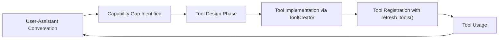
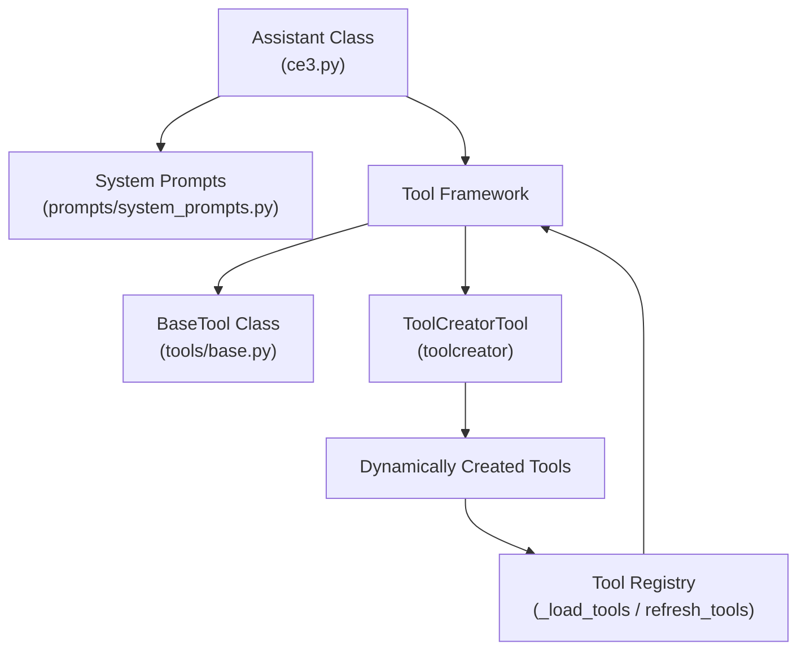
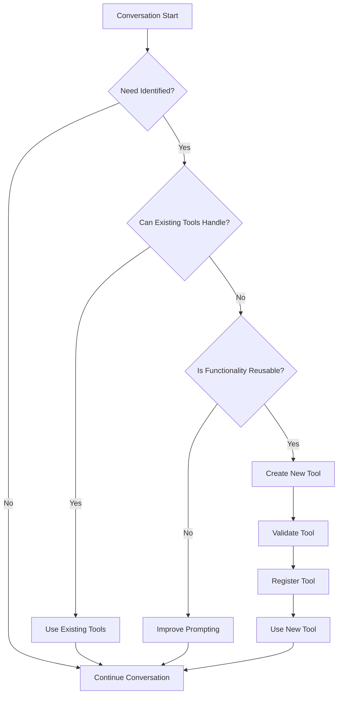
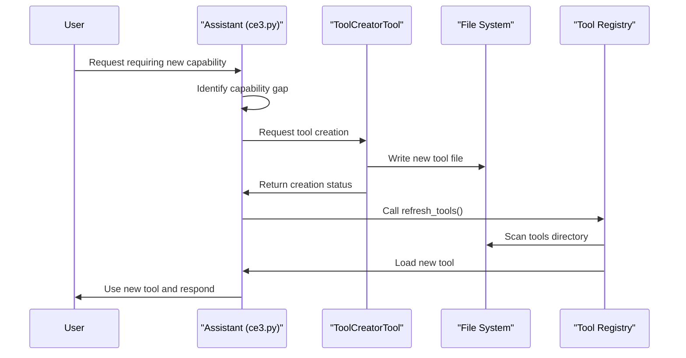

<!-- source: DeepWiki mcp.deepwiki.com · repo Doriandarko/claude-engineer · page 2.3 Self-Improvement Mechanism · fetched 2026-10-26 -->

# Self-Improvement Mechanism

<details>
<summary>Relevant source files</summary>

The following files were used as context for generating this wiki page:

- [ce3.py](ce3.py)
- [prompts/system_prompts.py](prompts/system_prompts.py)
- [readme.md](readme.md)
- [tools/diffeditortool.py](tools/diffeditortool.py)

</details>


This document explains how Claude Engineer v3 identifies capability gaps during conversations and autonomously creates new tools to address those gaps. This self-improvement mechanism allows the system to evolve its capabilities over time without requiring manual developer intervention. 

For information about the general Tool Framework architecture, see [Tool Framework](#2.2).

## Overview

Claude Engineer v3's self-improvement mechanism enables the system to:
- Identify capability gaps during user interactions
- Design and implement new tools to address those gaps
- Register these tools with the system for immediate use
- Continuously expand its functionality based on usage patterns

Sources: [readme.md:7-13](), [readme.md:110-117]()

## Self-Improvement Cycle

![Self-Improvement Cycle Diagram]



The self-improvement cycle begins with a regular conversation where Claude identifies a capability gap. After designing and implementing a new tool, the system registers it and makes it available for immediate use, continuing the conversation with enhanced capabilities.

Sources: [readme.md:110-117](), [ce3.py:159-177]()

## Components of the Self-Improvement System

![Self-Improvement Components Diagram]



The self-improvement system consists of several key components:

1. **Assistant Class**: Manages conversations and tool execution
2. **System Prompts**: Provide guidelines for when to create new tools
3. **Tool Framework**: The underlying architecture for all tools
4. **BaseTool Class**: The foundation class that all tools extend
5. **ToolCreatorTool**: The core tool responsible for creating new tools
6. **Dynamic Tools**: Tools created during runtime
7. **Tool Registry**: Manages tool loading and registration

Sources: [ce3.py:29-39](), [ce3.py:75-128](), [prompts/system_prompts.py:2-40]()

## Tool Creation Decision Process

Claude follows a specific decision process to determine when creating a new tool is appropriate:

![Tool Creation Decision Flow]



This decision flow ensures that new tools are created only when:
- The capability is completely outside existing tools
- The functionality can't be achieved by combining existing tools
- The new tool would serve a distinct and reusable purpose

Tools are not created when:
- An existing tool can handle the task, even partially
- The functionality is too similar to existing tools
- The tool would be too specific or single-use

Sources: [prompts/system_prompts.py:32-39]()

## ToolCreatorTool Implementation

The ToolCreatorTool is the cornerstone of the self-improvement mechanism. While we don't have direct access to its implementation in the provided files, we know from the system description that it:

1. Receives a natural language description of the needed functionality
2. Designs a Python class implementation that extends BaseTool
3. Validates the tool code for syntax and security
4. Writes the tool to the tools directory with appropriate naming
5. Returns the creation status to the assistant

After a new tool is created, it can be immediately loaded into the system using the `refresh_tools()` method.

Sources: [readme.md:213-214]()

## Tool Registration and Loading

![Tool Registration Flow]



The tool registration process involves:

1. **Dynamic Discovery**: The `_load_tools()` method scans the tools directory to find all available tools:
   ```python
   for module_info in pkgutil.iter_modules([str(tools_path)]):
       if module_info.name == 'base':
           continue
       module = importlib.import_module(f'tools.{module_info.name}')
       self._extract_tools_from_module(module, tools)
   ```

2. **Tool Extraction**: The `_extract_tools_from_module()` method inspects each module for BaseTool subclasses:
   ```python
   if (inspect.isclass(obj) and issubclass(obj, BaseTool) and obj != BaseTool):
       tool_instance = obj()
       tools.append({
           "name": tool_instance.name,
           "description": tool_instance.description,
           "input_schema": tool_instance.input_schema
       })
   ```

3. **Tool Refresh**: The `refresh_tools()` method reloads tools and identifies new ones:
   ```python
   current_tool_names = {tool['name'] for tool in self.tools}
   self.tools = self._load_tools()
   new_tool_names = {tool['name'] for tool in self.tools}
   new_tools = new_tool_names - current_tool_names
   ```

Sources: [ce3.py:75-128](), [ce3.py:159-177](), [ce3.py:141-157]()

## Integration with Assistant Workflow

The self-improvement mechanism integrates with the assistant's workflow through:

1. **Conversation Analysis**: During conversation, Claude analyzes requests to identify capability gaps
2. **Tool Execution**: When a new tool is needed, the ToolCreatorTool is executed via the standard tool execution pathway
3. **Token Management**: Tool creation and usage are tracked within the conversation's token limit
4. **Tool Chaining**: New tools can be used in combination with existing tools to solve complex problems

Sources: [ce3.py:261-292](), [ce3.py:418-453]()

## Example Use Case

Consider a user who needs to analyze and transform CSV data. During the conversation, Claude identifies that no existing tool can efficiently parse and manipulate CSV data. Following the self-improvement cycle:

1. **Gap Identification**: Claude recognizes the need for CSV manipulation capabilities
2. **Tool Design**: Claude designs a CSVProcessorTool with appropriate methods
3. **Implementation**: The ToolCreatorTool generates the tool code:
   ```python
   class CSVProcessorTool(BaseTool):
       name = "csvprocessortool"
       description = "Processes CSV files with operations like filtering, sorting, and transforming data."
       # ...implementation details...
   ```
4. **Registration**: The tool is written to the filesystem and loaded via `refresh_tools()`
5. **Usage**: Claude uses the new CSVProcessorTool to complete the user's request

## Error Handling and Limitations

The self-improvement mechanism includes several safeguards:

1. **Dependency Management**: If a new tool requires dependencies, the system can install them using the UVPackageManager
2. **Validation**: New tools are validated for syntax and basic functionality before registration
3. **Isolation**: Tools are executed in a controlled manner to prevent system damage

Limitations include:
- Tools must follow the BaseTool interface
- Complex dependencies may require manual installation
- Some capabilities may be outside the scope of what tool creation can address

Sources: [ce3.py:55-73](), [ce3.py:104-122]()

## Architectural Significance

The self-improvement mechanism represents a significant advancement in Claude Engineer v3 compared to previous versions. It enables:

1. **Adaptability**: The system can adapt to new user needs without code changes
2. **Extensibility**: The tool set grows organically based on actual usage patterns
3. **Efficiency**: Common operations can be abstracted into tools instead of being repeatedly implemented
4. **Personalization**: The assistant can develop custom tools specific to a user's workflow

Sources: [readme.md:5-13](), [readme.md:111-116]()

---

