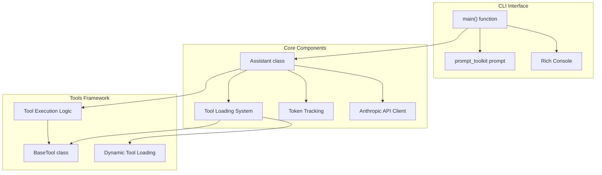
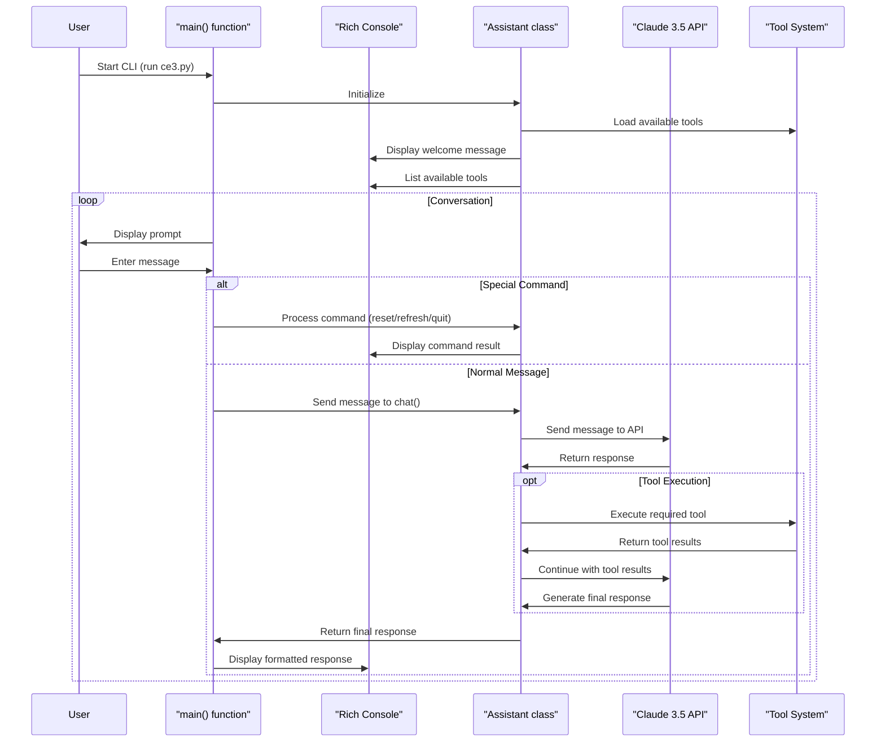
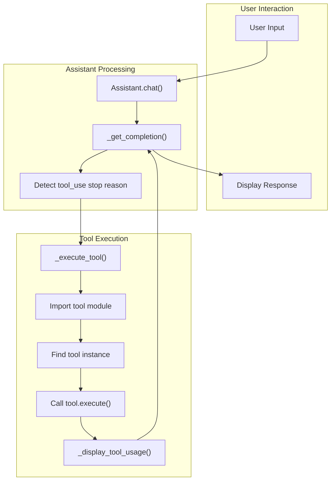

<!-- source: DeepWiki mcp.deepwiki.com · repo Doriandarko/claude-engineer · page 3 Command Line Interface · fetched 2026-10-26 -->

# Command Line Interface

<details>
<summary>Relevant source files</summary>

The following files were used as context for generating this wiki page:

- [ce3.py](ce3.py)
- [readme.md](readme.md)

</details>


This document provides comprehensive information about the Command Line Interface (CLI) for Claude Engineer v3. The CLI offers a terminal-based way to interact with the Claude 3.5-powered assistant framework, execute tools, and take advantage of its self-improving capabilities. For information about the web interface, see [Web Interface](#4).

## Purpose and Scope

The CLI provides a lightweight, terminal-friendly interface for interacting with Claude Engineer. It offers all the core capabilities of the framework including:

- Conversational AI interaction with Claude 3.5 Sonnet
- Dynamic tool loading and execution
- Real-time token usage tracking
- Self-improvement through tool creation
- Rich text formatting in terminal

Sources: [ce3.py:476-527](), [readme.md:88-103]()

## Getting Started

### Installation and Setup

Before using the CLI, ensure you have completed the installation steps described in the [Installation and Setup](#1.1) guide, including setting your Anthropic API key as an environment variable.

To run the CLI:

```bash
# Using uv (recommended)
uv run ce3.py

# Or using traditional Python
python ce3.py
```

Sources: [readme.md:97-102]()

### CLI User Interface

The CLI presents a clean, terminal-optimized interface with the following components:

- Rich text formatting for readability
- ASCII token usage bar for monitoring context window
- Thinking indicators during processing
- Tool usage display (when enabled)
- Clear command prompt

Sources: [readme.md:163-170](), [ce3.py:501-502]()

## Architecture

The CLI interface is built on the core Assistant class and integrates with the tool framework. The following diagram illustrates the CLI architecture:



Sources: [ce3.py:476-527](), [ce3.py:29-45]()

### Interaction Flow

The following sequence diagram illustrates the flow of interaction when using the CLI:



Sources: [ce3.py:476-527](), [ce3.py:418-453]()

## Key Features

### Command System

The CLI supports the following built-in commands:

| Command | Description |
|---------|-------------|
| `reset` | Clears conversation history and token usage |
| `refresh` | Reloads available tools, discovering newly created ones |
| `quit` | Exits the CLI application |

Sources: [ce3.py:424-432](), [ce3.py:503-512]()

### Tool Management

The CLI interface dynamically loads tools from the `tools` directory and makes them available for Claude to use during conversations. When a new tool is created, the `refresh` command allows users to discover and use the newly created tool.

The tool loading process includes:
- Dynamic discovery of tools in the configured tools directory
- Automatic detection of missing dependencies
- Interactive dependency installation via UV package manager
- Clear display of available tools

Sources: [ce3.py:75-128](), [ce3.py:159-177]()

### Tool Execution Flow

When Claude decides to use a tool during a conversation, the CLI interfaces with the tool system as shown:



Sources: [ce3.py:261-292](), [ce3.py:360-394]()

### Token Usage Tracking

The CLI provides real-time token usage tracking with a visual ASCII progress bar:

```
Total used: 1,234 / 200,000
[████████████████████░░░░░░░░░░░░░░░░░░] 47.2%
```

The system monitors:
- Total tokens used in the conversation
- Percentage of the maximum context window used
- Color-coded warnings when approaching token limits

Sources: [ce3.py:305-330]()

### Thinking Indicator

When enabled in the configuration, the CLI displays a spinner during Claude's processing time, providing visual feedback that the system is working.

Sources: [ce3.py:442-446]()

## Implementation Details

### Main Function

The `main()` function serves as the entry point for the CLI application. It creates an instance of the `Assistant` class, displays the welcome message, and enters the main conversation loop where it processes user input and displays responses.

Sources: [ce3.py:476-527]()

### Assistant Class Integration

The CLI directly utilizes the `Assistant` class to handle:
- Message processing via the `chat()` method
- Tool loading through `_load_tools()`
- Token tracking via `_display_token_usage()`
- Special command processing

Sources: [ce3.py:29-45](), [ce3.py:418-453]()

### Error Handling

The CLI includes robust error handling for various scenarios:
- Missing dependencies for tools
- API connection issues
- Tool execution failures
- User interrupts (Ctrl+C)

Sources: [ce3.py:124-126](), [ce3.py:522-525]()

## Advanced Usage Tips

### Managing Tool Dependencies

When a tool requires a dependency that isn't installed, the CLI will:
1. Detect the missing dependency
2. Prompt the user to install it
3. Use the `uvpackagemanager` tool to install the package if approved
4. Retry loading the tool after installation

This allows seamless extension of the system's capabilities without requiring manual package management.

Sources: [ce3.py:104-122]()

### Tool Output Display

When the `SHOW_TOOL_USAGE` configuration is enabled, the CLI provides detailed information about tool executions:
- Tool name and inputs
- Results of the execution
- Special handling for base64 and image data

This feature is useful for debugging and understanding how Claude is utilizing tools.

Sources: [ce3.py:192-216]()

## CLI vs Web Interface

The following table compares key features between the CLI and web interface:

| Feature | CLI | Web Interface |
|---------|-----|---------------|
| Rich text formatting | ✅ (Terminal) | ✅ (HTML/Markdown) |
| Image upload | ❌ | ✅ |
| Token usage tracking | ✅ (ASCII bar) | ✅ (Visual progress bar) |
| Tool execution | ✅ | ✅ |
| Progress indicator | ✅ (Spinner) | ✅ (Animation) |
| Output formatting | Terminal-optimized | Web-optimized with syntax highlighting |
| Direct file interaction | ✅ | ✅ |

Sources: [readme.md:63-107](), [readme.md:151-170]()

## Configuration Options

The CLI behavior can be customized through the `Config` class settings:

| Setting | Description | Default |
|---------|-------------|---------|
| `MODEL` | Claude model to use | Claude 3.5 Sonnet |
| `MAX_TOKENS` | Maximum tokens per response | Varies |
| `MAX_CONVERSATION_TOKENS` | Total token limit for conversations | Varies |
| `TOOLS_DIR` | Directory for tool storage | `tools` |
| `SHOW_TOOL_USAGE` | Toggle tool usage display | `False` |
| `ENABLE_THINKING` | Toggle thinking indicator | `False` |
| `DEFAULT_TEMPERATURE` | Model temperature setting | `0.7` |

Sources: [ce3.py:40-52](), [readme.md:183-193]()

---

