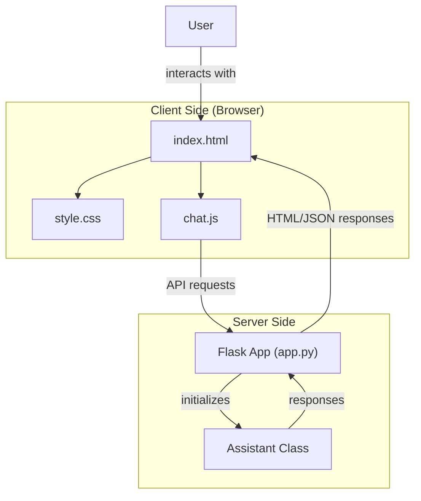
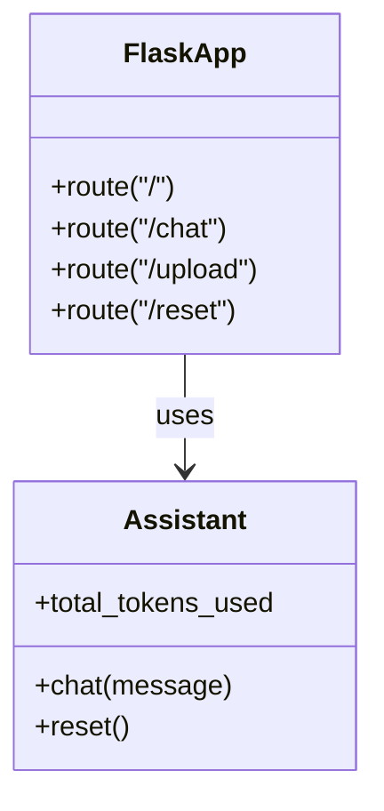
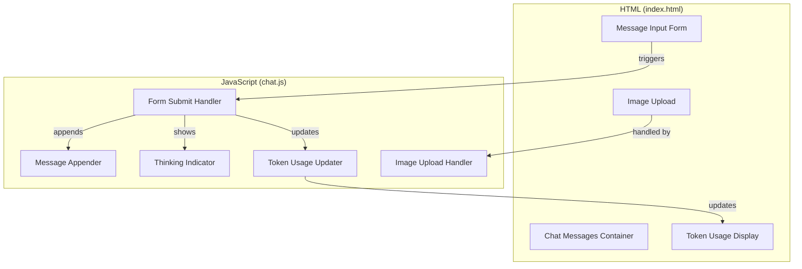
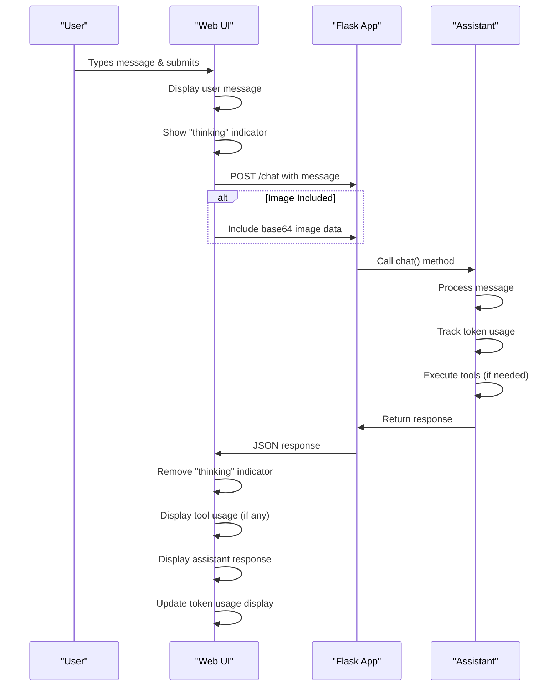
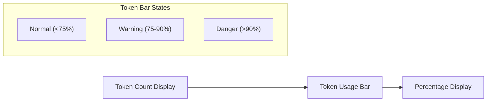
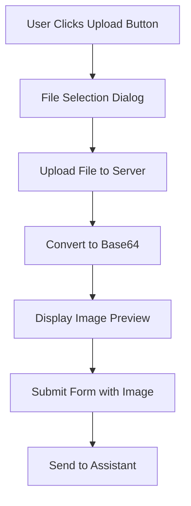
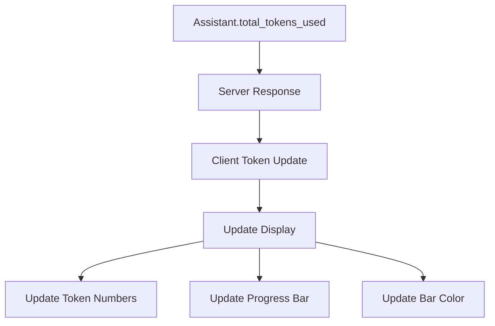
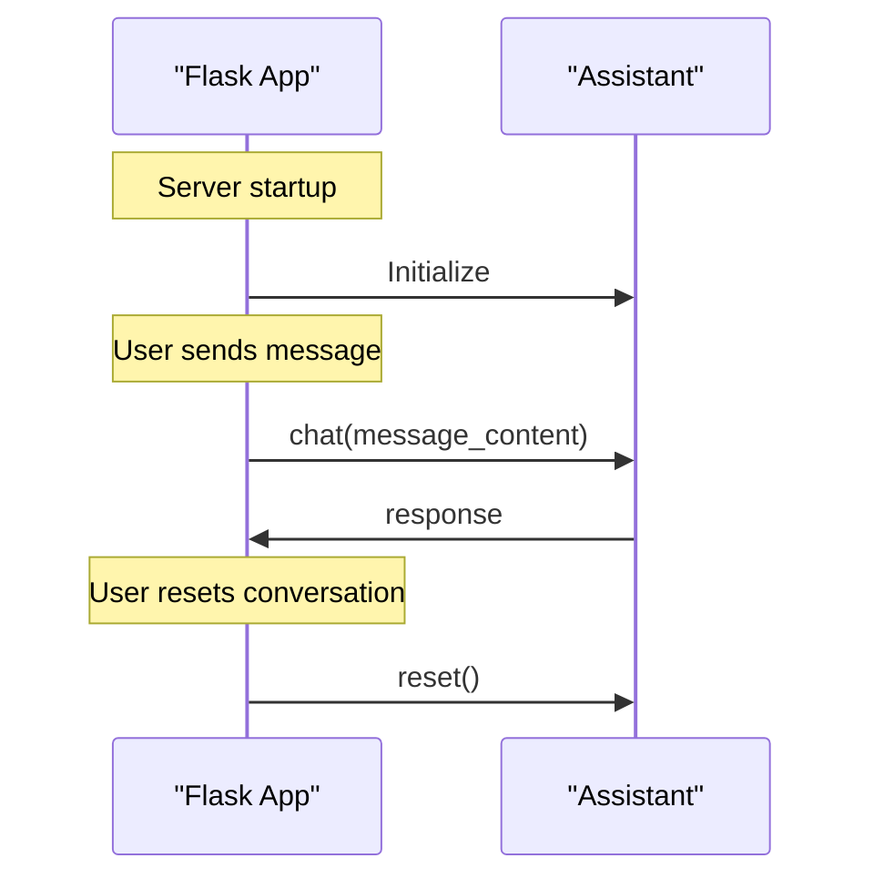

<!-- source: DeepWiki mcp.deepwiki.com · repo Doriandarko/claude-engineer · page 4 Web Interface · fetched 2026-10-26 -->

# Web Interface

<details>
<summary>Relevant source files</summary>

The following files were used as context for generating this wiki page:

- [app.py](app.py)
- [static/css/style.css](static/css/style.css)
- [static/js/chat.js](static/js/chat.js)
- [templates/index.html](templates/index.html)
- [ui.png](ui.png)

</details>


This page documents the web interface of Claude Engineer v3, which provides a user-friendly way to interact with the system through a browser. The web interface is implemented as a Flask web application that communicates with the core Assistant class.

For information about the command-line interface, see [Command Line Interface](#3).

## 1. Architecture Overview

The web interface follows a standard client-server architecture where a Flask backend communicates with a browser-based frontend.



Sources: [app.py:1-16](), [templates/index.html:1-107](), [static/css/style.css:1-205](), [static/js/chat.js:1-300]()

## 2. Key Components

### 2.1 Server-Side Components

The backend is built with Flask and serves as the bridge between the web UI and the Assistant class.



The Flask application provides four main endpoints:

| Endpoint | Method | Purpose |
|----------|--------|---------|
| `/` | GET | Serves the main chat interface HTML |
| `/chat` | POST | Processes chat messages and returns responses |
| `/upload` | POST | Handles image uploads for visual analysis |
| `/reset` | POST | Resets the conversation history |

Sources: [app.py:18-128]()

### 2.2 Client-Side Components

The frontend consists of HTML, CSS, and JavaScript files that create the user interface and handle client-side interactions.



Sources: [templates/index.html:24-103](), [static/js/chat.js:10-257]()

## 3. Message Flow

This diagram shows how a message flows through the system from user input to response display:



Sources: [app.py:22-89](), [static/js/chat.js:184-255]()

## 4. User Interface Elements

The web interface consists of several key UI elements:

### 4.1 Chat Messages Container

The main area where messages between the user and Claude Engineer are displayed. Messages are styled differently based on the sender (user or assistant).

Sources: [templates/index.html:26-52](), [static/js/chat.js:11-53]()

### 4.2 Message Input

A text area where users can type their messages. The textarea automatically resizes based on content.

Sources: [templates/index.html:68-101](), [static/js/chat.js:5-9]()

### 4.3 Token Usage Display

Shows the current token usage with a progress bar and percentage. The color changes based on usage levels.



Sources: [templates/index.html:54-65](), [static/css/style.css:143-182](), [static/js/chat.js:161-181]()

### 4.4 Image Upload

Users can upload images to be analyzed by Claude. The interface shows a preview of the uploaded image.

Sources: [templates/index.html:71-80](), [static/js/chat.js:56-89]()

## 5. Features and Implementation Details

### 5.1 Image Handling

The web interface supports image uploads for visual analysis:

1. User clicks the upload button
2. Image is selected and uploaded to the server
3. Server processes the image and converts it to base64
4. Image preview is displayed
5. Image is sent along with the text message when submitting



Sources: [app.py:91-121](), [static/js/chat.js:56-89](), [static/js/chat.js:193-200]()

### 5.2 Thinking Indicator

While waiting for a response, the UI displays a "thinking" indicator with animated dots to show that the system is processing.

Sources: [static/css/style.css:57-91](), [static/js/chat.js:91-120]()

### 5.3 Tool Usage Display

When the Assistant uses a tool, the UI displays which tool is being used.

Sources: [static/css/style.css:115-129](), [static/js/chat.js:131-158](), [app.py:62-75]()

### 5.4 Token Management

The interface tracks and displays token usage throughout the conversation.



Sources: [app.py:56-60](), [static/js/chat.js:161-181](), [templates/index.html:54-65]()

### 5.5 Markdown Rendering

Assistant responses are rendered as Markdown using the marked.js library, which includes syntax highlighting for code blocks.

Sources: [templates/index.html:8-22](), [static/js/chat.js:36-42]()

## 6. Implementation Details

### 6.1 Flask Routes

The Flask application defines four main routes:

1. **Home Route** (`/`): 
   Renders the main HTML template.

2. **Chat Route** (`/chat`):
   Processes user messages and returns assistant responses.

3. **Upload Route** (`/upload`):
   Handles image file uploads.

4. **Reset Route** (`/reset`):
   Resets the conversation history.

Sources: [app.py:18-128]()

### 6.2. Assistant Integration

The web interface initializes an instance of the `Assistant` class at startup and uses it to handle all chat interactions.



Sources: [app.py:16](), [app.py:54](), [app.py:126]()

## 7. Usage and Examples

### 7.1 Starting the Web Interface

To start the web interface, run the `app.py` file:

```
python app.py
```

This will start the Flask server on the default port (5000).

### 7.2 Special Commands

The web interface supports several special commands:

| Command | Description |
|---------|-------------|
| `refresh` | Reload available tools |
| `reset` | Clear conversation history |
| `quit` | Exit the conversation |

Sources: [templates/index.html:38-43]()

## 8. Security Considerations

The web interface includes some basic security measures:

1. **File upload limits**: Maximum file size is set to 16MB
2. **Secure filename handling**: Uses `secure_filename` to sanitize filenames
3. **File type validation**: Only accepts image files with specific extensions

Sources: [app.py:9-10](), [app.py:98-101]()

---

