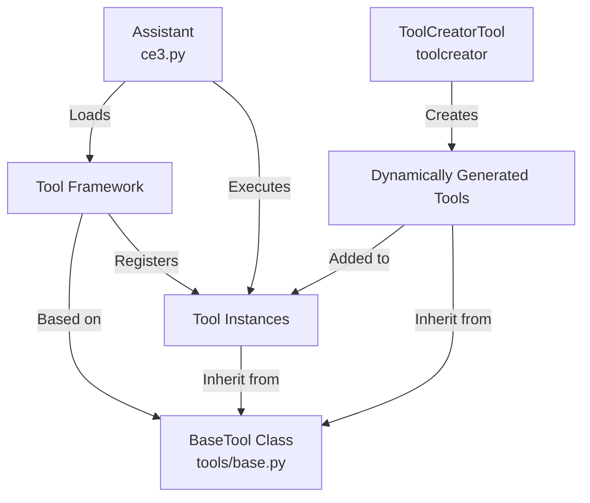
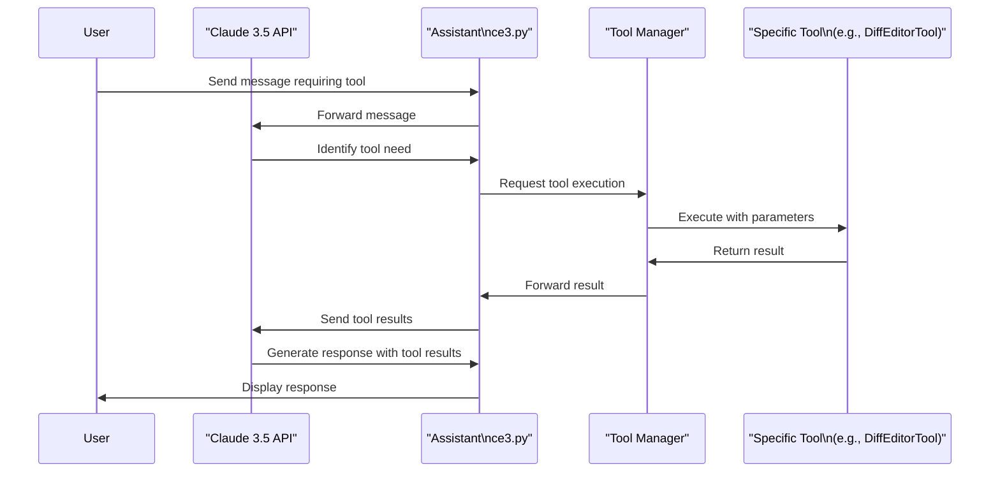
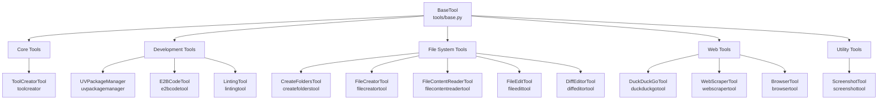
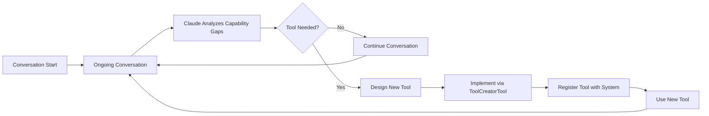

<!-- source: DeepWiki mcp.deepwiki.com · repo Doriandarko/claude-engineer · page 5 Tools · fetched 2026-10-26 -->

# Tools

<details>
<summary>Relevant source files</summary>

The following files were used as context for generating this wiki page:

- [prompts/system_prompts.py](prompts/system_prompts.py)
- [readme.md](readme.md)
- [tools/diffeditortool.py](tools/diffeditortool.py)

</details>


The Tools system forms the backbone of Claude Engineer v3's capabilities beyond text generation. This page provides a technical overview of the tool architecture and the categories of available tools that allow Claude to interact with files, the web, execute code, and perform various system operations.

For detailed information about specific tool categories, see:
- [File System Tools](#5.1)
- [Web Tools](#5.2) 
- [Development Tools](#5.3)
- [Utility Tools](#5.4)

For information on creating custom tools, see [Creating New Tools](#6).

## Tool System Architecture

The tool system in Claude Engineer v3 is built around the `BaseTool` abstract class, providing a consistent interface for all tools and supporting dynamic tool creation during runtime.

### Tool System Overview

**Tool System Architecture**


Sources: [readme.md:134-149]()

### Tool Execution Flow

**Tool Execution Flow**


Sources: [readme.md:171-183]()

### BaseTool Class

The `BaseTool` class is the foundation of the tool system. All tools inherit from this class, which defines the common interface and functionality that every tool must implement:

- `name`: A unique identifier for the tool
- `description`: A detailed description of what the tool does
- `input_schema`: A JSON schema defining the required inputs
- `execute(**kwargs)`: The main method that implements the tool's functionality

Example from DiffEditorTool implementation:

```python
class DiffEditorTool(BaseTool):
    name = "diffeditortool"
    description = '''
    Performs a precise replacement of a given text snippet in a specified file.
    # ...description details...
    '''
    input_schema = {
        "type": "object",
        "properties": {
            "path": {
                "type": "string",
                "description": "Path to the file to be edited."
            },
            # ...other properties...
        },
        "required": ["path", "old_text", "new_text"]
    }

    def execute(self, **kwargs) -> str:
        # Implementation details...
        return f"Successfully replaced '{old_text}' with '{new_text}' in {path}."
```

Sources: [tools/diffeditortool.py:1-73]()

## Tool Categories

Claude Engineer v3 organizes tools into five functional categories:

**Tool Categories**


Sources: [readme.md:209-241](), [prompts/system_prompts.py:16-30]()

The following table provides an overview of the tool categories and their purposes:

| Category | Purpose | Key Features |
|----------|---------|-------------|
| Core Tools | Fundamental tools for system operation | Self-improvement capabilities |
| Development Tools | Programming and development support | Package management, code execution, linting |
| File System Tools | File and directory operations | Creating, reading, editing files and directories |
| Web Tools | Internet interaction | Web searches, content extraction, browser control |
| Utility Tools | Miscellaneous functionality | Screen capture and other utilities |

Sources: [readme.md:212-234]()

### Core Tools

Core tools are foundational to the system's operation and self-improvement capabilities:

| Tool Name | Tool ID | Description |
|-----------|---------|-------------|
| Tool Creator | `toolcreator` | Creates new tools based on natural language descriptions, enabling the framework's self-improvement capabilities. |

Sources: [readme.md:212-214]()

### Development Tools

Development tools assist with programming tasks, package management, and code execution:

| Tool Name | Tool ID | Description |
|-----------|---------|-------------|
| UV Package Manager | `uvpackagemanager` | Interface to the UV package manager for Python dependency management, supporting package installation, removal, updates, and virtual environment management. |
| E2B Code Executor | `e2bcodetool` | Securely executes Python code in a sandboxed environment powered by E2B. |
| Linting Tool | `lintingtool` | Runs the Ruff linter on Python files to detect and fix coding style or syntax issues. |

Sources: [readme.md:215-219]()

### File System Tools

File system tools enable interaction with the local file system:

| Tool Name | Tool ID | Description |
|-----------|---------|-------------|
| Create Folders Tool | `createfolderstool` | Creates new directories and nested directory structures. |
| File Creator | `filecreatortool` | Creates new files with specified content. |
| File Content Reader | `filecontentreadertool` | Reads content from multiple files simultaneously. |
| File Edit | `fileedittool` | Advanced file editing with support for full content replacement and partial edits. |
| Diff Editor | `diffeditortool` | Performs precise text replacements in files by matching exact substrings. |

Sources: [readme.md:220-226](), [tools/diffeditortool.py:1-73]()

### Web Tools

Web tools provide capabilities for interacting with the internet:

| Tool Name | Tool ID | Description |
|-----------|---------|-------------|
| DuckDuckGo | `duckduckgotool` | Performs web searches using DuckDuckGo. |
| Web Scraper | `webscrapertool` | Intelligently extracts readable content from web pages. |
| Browser | `browsertool` | Opens URLs in the system's default web browser. |

Sources: [readme.md:227-231]()

### Utility Tools

Utility tools provide miscellaneous functionality:

| Tool Name | Tool ID | Description |
|-----------|---------|-------------|
| Screenshot Tool | `screenshottool` | Captures screenshots of the entire screen or specific regions. |

Sources: [readme.md:232-234]()

## Tool Usage Guidelines

When using tools, Claude follows these guidelines as defined in the system prompts:

1. Think carefully about which tool is appropriate for the task
2. Only use tools when necessary
3. Ask for clarification if required parameters are missing
4. Explain choices and results in a natural way
5. Chain multiple tools together to achieve complex goals:
   - Break down the goal into logical steps
   - Use tools sequentially to complete each step
   - Pass outputs from one tool as inputs to the next
   - Continue running tools until the full goal is achieved
   - Provide clear updates on progress through the chain

Sources: [prompts/system_prompts.py:2-15]()

## Self-Improvement Capability

A key feature of Claude Engineer v3 is its ability to create new tools dynamically using the Tool Creator. The system can identify gaps in its capabilities during conversations and design new tools to address those gaps.

**Self-Improvement Flow**


The Tool Creator considers creating new tools only when:
- The requested capability is completely outside existing tools
- The functionality can't be achieved by combining existing tools
- The new tool would serve a distinct and reusable purpose

Sources: [readme.md:110-117](), [prompts/system_prompts.py:32-39]()

For more information about creating custom tools, see [Creating New Tools](#6).

---

