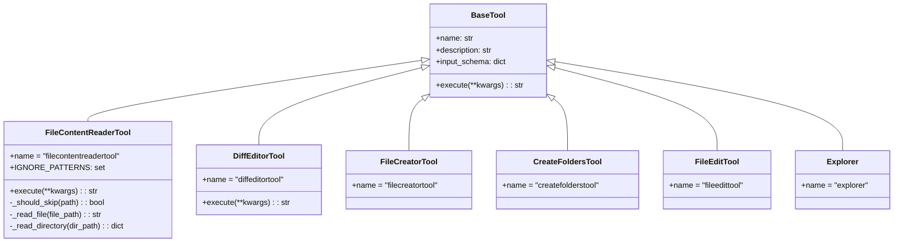
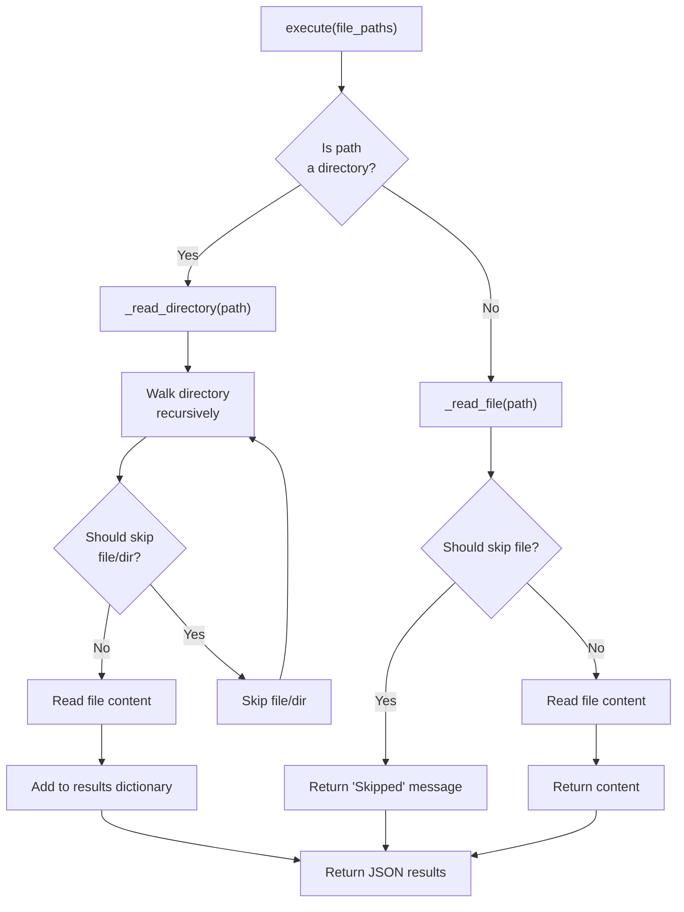
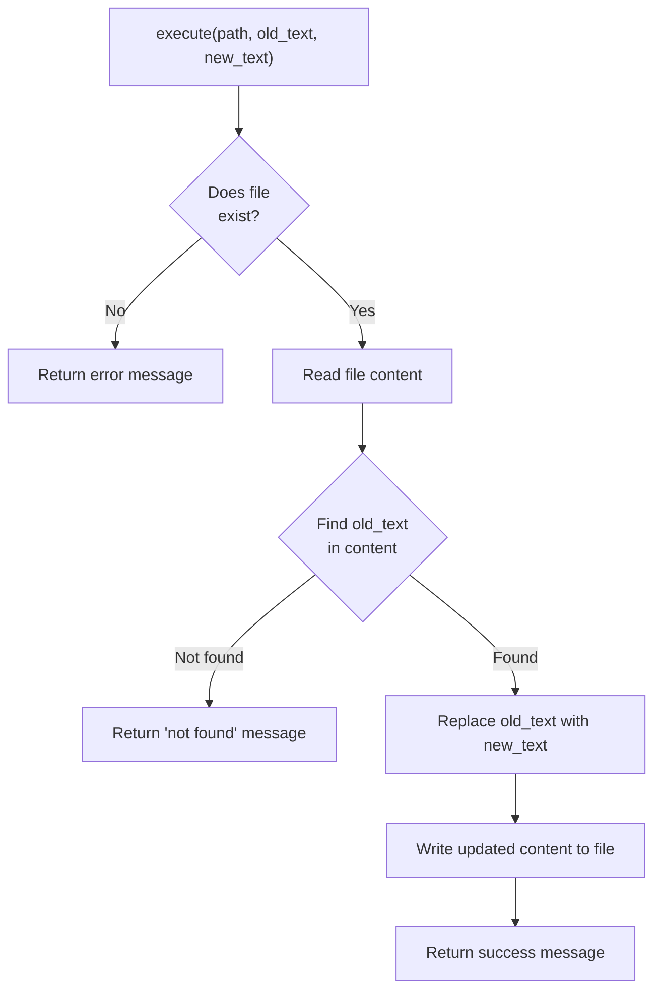
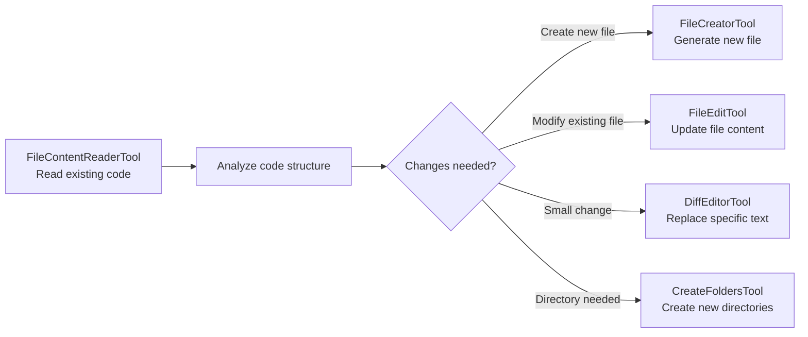

<!-- source: DeepWiki mcp.deepwiki.com · repo Doriandarko/claude-engineer · page 5.1 File System Tools · fetched 2026-10-26 -->

# File System Tools

Relevant source files

The following files were used as context for generating this wiki page:

- [prompts/system_prompts.py](prompts/system_prompts.py)
- [tools/diffeditortool.py](tools/diffeditortool.py)
- [tools/filecontentreadertool.py](tools/filecontentreadertool.py)

This document details the file system tools available in Claude Engineer v3. These tools enable the assistant to interact with the local file system for reading, creating, editing, and managing files and directories. For information about web-based tools, see [Web Tools](#5.2).

## Overview

File System Tools are core components that extend the `BaseTool` class to provide file and directory manipulation capabilities. They allow Claude Engineer v3 to perform operations such as reading file contents, creating files and directories, editing files, and making precise replacements within files.

Sources: [tools/filecontentreadertool.py:1-2](), [tools/diffeditortool.py:1-2]()

### File System Tools Architecture

Sources: [tools/filecontentreadertool.py:6-8](), [tools/diffeditortool.py:5-7](), [prompts/system_prompts.py:17-22]()

## Available File System Tools

### FileContentReaderTool

The `FileContentReaderTool` reads content from files and directories, handling various edge cases and file types intelligently.

**Key features:**
- Reads content from multiple files in a single operation
- Recursively reads all files in directories
- Automatically skips binary files and common ignore patterns
- Handles file reading errors gracefully
- Returns results as a JSON-formatted dictionary

**Input parameters:**
- `file_paths`: List of file paths to read

**Ignore patterns:**
The tool automatically skips files and directories that match common patterns such as:
- Hidden files and directories (starting with `.`)
- Build directories (`node_modules`, `__pycache__`, etc.)
- Binary files (based on extension and MIME type)
- Media files and archives

Sources: [tools/filecontentreadertool.py:6-137]()

### File Content Reading Flow

Sources: [tools/filecontentreadertool.py:119-137](), [tools/filecontentreadertool.py:98-118](), [tools/filecontentreadertool.py:77-96]()

### DiffEditorTool

The `DiffEditorTool` performs precise text replacements within files. It's designed for targeted modifications where entire file rewrites aren't necessary.

**Key features:**
- Performs exact substring replacement
- Preserves file encoding and content outside the replaced area
- Provides detailed success/error messages

**Input parameters:**
- `path`: Path to the file to edit
- `old_text`: Exact substring to replace
- `new_text`: Replacement text

Sources: [tools/diffeditortool.py:5-73]()

### DiffEditorTool Execution Flow

Sources: [tools/diffeditortool.py:41-73]()

### Other File System Tools

Based on the system prompts, these additional file system tools are available:

| Tool Name | Description | Use Case |
|-----------|-------------|----------|
| CreateFoldersTool | Creates new folders and nested directories | When new directory structures are needed |
| FileCreatorTool | Creates new files with specified content | When generating new files |
| FileEditTool | Edits existing file contents | For general file modification |
| Explorer | Enhanced file/directory management | For listing, creating, deleting, moving, and searching files |

Sources: [prompts/system_prompts.py:16-22]()

## Usage Patterns

File System Tools can be used individually or chained together to perform complex file operations. The typical workflow involves:

1. Using `FileContentReaderTool` to read existing files or explore directories
2. Using `FileCreatorTool` or `FileEditTool` to create or modify files
3. Using `DiffEditorTool` for precise text replacements
4. Using `CreateFoldersTool` to create directory structures

### Common Usage Example Flow

Sources: [prompts/system_prompts.py:9-14]()

## Implementation Details

### FileContentReaderTool Key Methods

The `FileContentReaderTool` implements several core methods to handle file reading operations:

1. `_should_skip(path)`: Determines if a file or directory should be skipped based on patterns and file type
2. `_read_file(file_path)`: Safely reads a single file with error handling
3. `_read_directory(dir_path)`: Recursively reads all appropriate files in a directory
4. `execute(**kwargs)`: Main entry point that processes input arguments and returns results

The tool intelligently handles binary files, directories, and error conditions using a comprehensive set of ignore patterns defined in `IGNORE_PATTERNS`.

Sources: [tools/filecontentreadertool.py:56-118]()

### DiffEditorTool Implementation

The `DiffEditorTool` follows a straightforward implementation that:

1. Checks if the target file exists
2. Reads the current file content
3. Locates the exact substring to replace
4. Creates new content by concatenating:
   - Content before the match
   - The replacement text
   - Content after the match
5. Writes the updated content back to the file

This approach ensures precise replacements without affecting the rest of the file.

Sources: [tools/diffeditortool.py:41-73]()

## Integration with the Assistant

File System Tools are loaded and used by the Assistant class to interact with the local file system. When a user request requires file operations, the Assistant:

1. Selects the appropriate file system tool
2. Prepares the necessary parameters
3. Executes the tool
4. Processes the results

This integration allows Claude Engineer v3 to handle file-based tasks seamlessly within conversations.

Sources: [prompts/system_prompts.py:47-52]()

---

