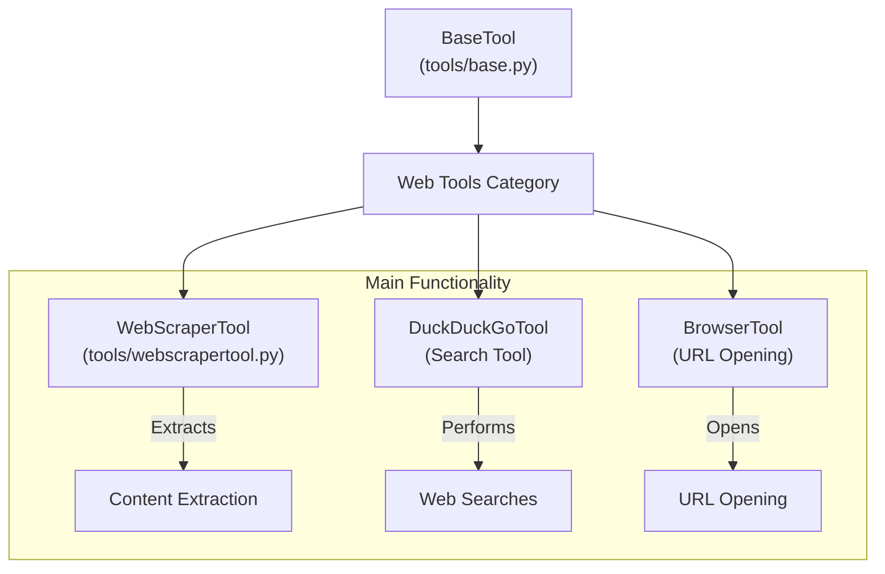
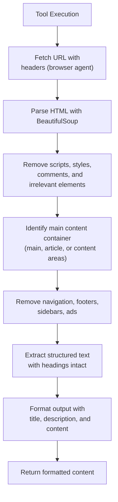
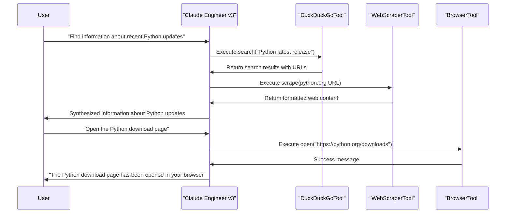
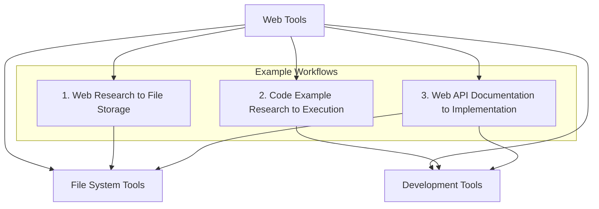

<!-- source: DeepWiki mcp.deepwiki.com · repo Doriandarko/claude-engineer · page 5.2 Web Tools · fetched 2026-10-26 -->

# Web Tools

<details>
<summary>Relevant source files</summary>

The following files were used as context for generating this wiki page:

- [prompts/system_prompts.py](prompts/system_prompts.py)
- [tools/diffeditortool.py](tools/diffeditortool.py)
- [tools/webscrapertool.py](tools/webscrapertool.py)

</details>


This document provides comprehensive information about the web-related tools available in Claude Engineer v3. These tools enable interactions with the web, including web scraping, search capabilities, and browser interactions. For information about development tools like package management, see [Development Tools](#5.3).

## Overview

Web Tools are specialized tools designed to interact with web resources. They allow Claude Engineer v3 to fetch information from the internet, process web content, and perform web searches to enhance its knowledge base during runtime.

Sources: [prompts/system_prompts.py:56-59]()

## Web Tools Architecture

Web Tools are built on the BaseTool class, which provides the foundation for all tools in the Claude Engineer v3 system. The web tools specifically support internet-related tasks and form a significant component of the tool ecosystem.



Sources: [prompts/system_prompts.py:16-30]()

## Available Web Tools

Claude Engineer v3 includes the following web interaction tools:

| Tool Name | Primary Function | Key Capabilities |
|-----------|------------------|------------------|
| WebScraperTool | Content extraction | Fetches and cleanses web page content |
| DuckDuckGoTool | Web search | Performs online searches via DuckDuckGo |
| BrowserTool | URL opening | Opens URLs in the system's default browser |

Sources: [prompts/system_prompts.py:16-30]()

### WebScraperTool

The WebScraperTool is designed to extract and clean text content from web pages. It provides structured access to web page information, including titles, meta descriptions, and main content.

#### Implementation Details

The WebScraperTool is implemented in `webscrapertool.py` and provides intelligent web content extraction:



The WebScraperTool features:

- Intelligent main content detection by targeting semantic HTML5 tags like `<article>` and `<main>`
- Removal of boilerplate content like navigation, footers, and advertisements
- Preservation of heading structure for context
- Extraction of page title and meta description when available
- Error handling for network and parsing issues

Input schema:
- `url`: The URL of the webpage to scrape (required)

Sources: [tools/webscrapertool.py:1-124]()

#### WebScraperTool Implementation Highlights

Key aspects of the WebScraperTool implementation include:

1. **User Agent Handling**: Uses a modern browser user agent to avoid being blocked by websites
   ```
   headers = {
       'User-Agent': ('Mozilla/5.0 (Windows NT 10.0; Win64; x64) '
                      'AppleWebKit/537.36 (KHTML, like Gecko) '
                      'Chrome/91.0.4472.124 Safari/537.36')
   }
   ```

2. **Content Extraction Strategy**:
   - Identifies the main content container using priority selection
   - Removes elements unlikely to contain main content
   - Extracts text in a structured way that preserves document flow

3. **Metadata Handling**: Extracts page title and meta description when available

Sources: [tools/webscrapertool.py:26-124]()

### DuckDuckGoTool

The DuckDuckGoTool enables web searches using the DuckDuckGo search engine. This tool allows Claude Engineer v3 to query the internet for up-to-date information.

The tool accepts a search query string and returns search results as formatted text.

Sources: [prompts/system_prompts.py:19]()

### BrowserTool

The BrowserTool opens specified URLs in the system's default web browser. This enables direct interaction with web resources when needed.

Sources: [prompts/system_prompts.py:16]()

## Web Tools in Action

The Web Tools can be used individually or in combination to achieve complex goals. Here are common workflows involving Web Tools:



This sequence diagram shows how multiple Web Tools can be chained together to gather information and interact with web resources.

Sources: [prompts/system_prompts.py:9-14](), [tools/webscrapertool.py:26-124]()

## Integration with Other Tools

Web Tools can be integrated with other tools to create powerful workflows. For example:

1. Using WebScraperTool to extract data, then passing it to a file tool to save the content
2. Running a DuckDuckGo search to find a resource, then using WebScraperTool to extract the content
3. Finding code examples online and then using them with development tools



Sources: [prompts/system_prompts.py:9-14]()

## Adding Custom Web Tools

While Claude Engineer v3 includes these built-in Web Tools, the system also supports creating new custom web tools using the ToolCreatorTool. New web tools might handle specialized web APIs, provide different web scraping strategies, or integrate with specific web services.

When creating custom web tools, follow the pattern established by the existing tools:
1. Inherit from BaseTool
2. Define name, description, and input_schema
3. Implement the execute method with appropriate error handling

Sources: [tools/webscrapertool.py:6-8](), [prompts/system_prompts.py:32-39]()

## Error Handling

Web Tools include robust error handling to manage common issues when interacting with web resources:

- Network connectivity problems
- HTTP errors (404, 403, etc.)
- Content parsing failures
- Resource timeouts

For example, the WebScraperTool handles request exceptions and general exceptions separately, providing informative error messages for each case:

```
try:
    # Web scraping logic
except requests.RequestException as e:
    return f"Error scraping the webpage: {str(e)}"
except Exception as e:
    return f"An unexpected error occurred: {str(e)}"
```

Sources: [tools/webscrapertool.py:121-124]()

## Best Practices for Using Web Tools

When using Web Tools in Claude Engineer v3, consider these best practices:

1. **URL Validation**: Ensure URLs are properly formatted before passing them to tools
2. **Rate Limiting**: Avoid making too many rapid requests to the same domain
3. **Result Processing**: Process and summarize web content before presenting it to users
4. **Error Recovery**: Implement fallback strategies when web requests fail
5. **Content Attribution**: Properly attribute content sources when using scraped information

Sources: [tools/webscrapertool.py:26-124](), [prompts/system_prompts.py:3-7]()

---

