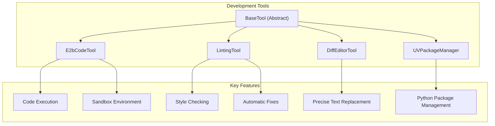
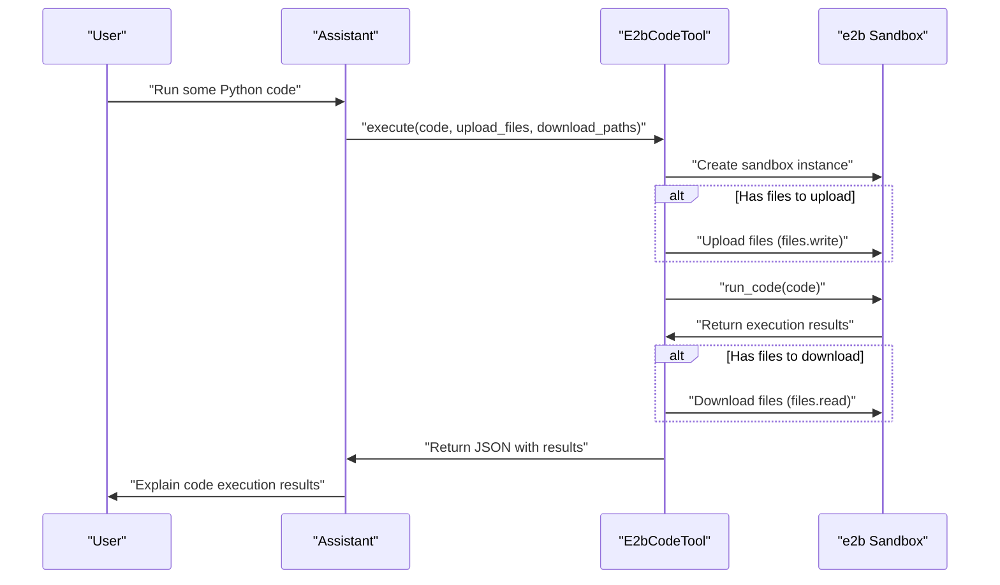
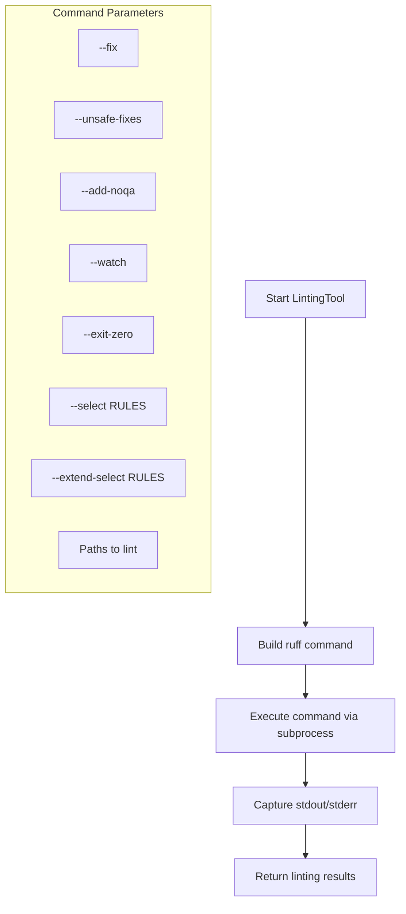
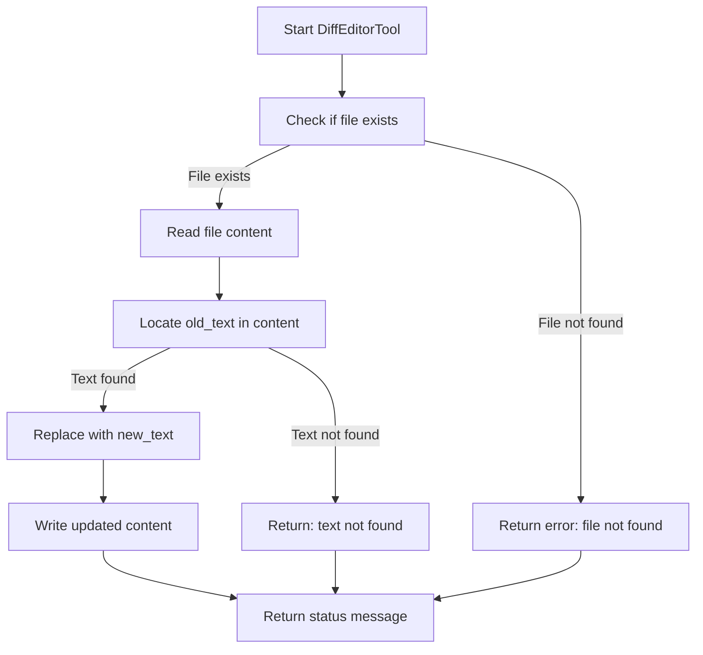
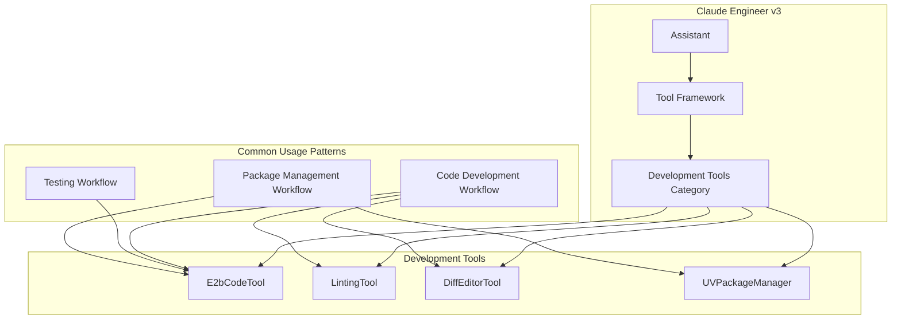

<!-- source: DeepWiki mcp.deepwiki.com · repo Doriandarko/claude-engineer · page 5.3 Development Tools · fetched 2026-10-26 -->

# Development Tools

Relevant source files

The following files were used as context for generating this wiki page:

- [prompts/system_prompts.py](prompts/system_prompts.py)
- [tools/diffeditortool.py](tools/diffeditortool.py)
- [tools/e2bcodetool.py](tools/e2bcodetool.py)
- [tools/lintingtool.py](tools/lintingtool.py)

## Purpose and Scope

This page documents the development tools integrated within Claude Engineer v3. These specialized tools enable software development tasks including code execution, linting, precise file editing, and package management. They form a critical component of the system's ability to assist with technical development workflows.

For an overview of the tool framework architecture, see [Tool Framework](#2.2). For information about file system operations, see [File System Tools](#5.1).

## Development Tools Overview

The development tools in Claude Engineer v3 provide capabilities specifically designed for software development tasks. These tools can be used individually or chained together to accomplish complex development workflows.

Sources: [tools/e2bcodetool.py:1-125](), [tools/lintingtool.py:1-111](), [tools/diffeditortool.py:1-74](), [prompts/system_prompts.py:52-55]()

## Code Execution Tool

The `E2bCodeTool` provides a secure environment for executing Python code through integration with the e2b-code-interpreter library. It creates a sandboxed environment that isolates code execution from the host system.

### Features

- Executes Python code in an isolated sandbox environment
- Supports uploading files to the sandbox
- Enables downloading files from the sandbox
- Handles environment variables
- Manages both text and binary (base64-encoded) content

### Implementation Details

### Input Schema

| Parameter | Type | Required | Description |
|-----------|------|----------|-------------|
| code | string | Yes | Python code to execute |
| env_vars | object | No | Dictionary of environment variables |
| upload_files | array | No | List of files to upload to sandbox |
| download_paths | array | No | List of file paths to download from sandbox |

The `upload_files` parameter accepts objects with the following properties:
- `sandbox_path`: Target path in the sandbox
- `content`: File content (string or base64-encoded)
- `local_path`: Optional local file path

### Output Format

The tool returns a JSON object with:
- `stdout`: Standard output from code execution
- `stderr`: Standard error output
- `success`: Boolean indicating success/failure
- `error`: Error message (if any)
- `uploaded_files`: List of successfully uploaded files
- `downloaded_files`: Dictionary of downloaded file contents

Sources: [tools/e2bcodetool.py:1-125]()

## Linting Tool

The `LintingTool` provides code quality analysis for Python files by integrating with the Ruff linter. It can detect style issues, syntax problems, and potential bugs in code, with options to automatically fix issues.

### Features

- Runs Ruff linter on Python files or directories
- Supports automatic fixing of issues with the `--fix` flag
- Configurable rule selection and enforcement
- Ability to add noqa directives to suppress warnings
- Watch mode for continuous linting during development

### Implementation Details

### Input Schema

| Parameter | Type | Default | Description |
|-----------|------|---------|-------------|
| paths | array of strings | ["."] | File or directory paths to lint |
| fix | boolean | false | Automatically fix fixable issues |
| unsafe_fixes | boolean | false | Enable unsafe fixes |
| add_noqa | boolean | false | Add noqa directives to lines with violations |
| select | array of strings | [] | Rule codes to exclusively enforce |
| extend_select | array of strings | [] | Additional rule codes to enforce |
| watch | boolean | false | Watch for file changes and re-run linting |
| exit_zero | boolean | false | Exit with code 0 even with violations |
| exit_non_zero_on_fix | boolean | false | Exit with non-zero even if all violations fixed |

### Output Format

The tool returns the combined stdout and stderr output from the Ruff linter, which typically includes:
- File paths with issues
- Line numbers and positions
- Rule codes that were violated
- Descriptions of the issues
- Suggestion counts and fix information when applicable

Sources: [tools/lintingtool.py:1-111]()

## File Editing Tool

The `DiffEditorTool` provides precise text replacement functionality for editing files. Unlike more general file editing tools, it specializes in making targeted changes by replacing specific text patterns with new content.

### Features

- Performs exact substring replacement in files
- Maintains the rest of the file content unchanged
- Verifies file existence before attempting edits
- Reports detailed status of the operation

### Implementation Details

### Input Schema

| Parameter | Type | Required | Description |
|-----------|------|----------|-------------|
| path | string | Yes | Path to the file to be edited |
| old_text | string | Yes | Exact substring in the file to replace |
| new_text | string | Yes | New substring that will replace old_text |

### Output Format

The tool returns a string message indicating the result of the operation:
- Success: "Successfully replaced '[old_text]' with '[new_text]' in [path]."
- Text not found: "'[old_text]' not found in the file. No changes made."
- File not found: "Error: File does not exist at path: [path]"
- Read/write errors: Error message with details

Sources: [tools/diffeditortool.py:1-74]()

## Package Management

The `UVPackageManager` tool allows for Python package management using the UV package manager, which is a faster alternative to pip. While the detailed implementation file was not provided, it's referenced in the system prompts.

### Expected Features

Based on references in the system prompts, the tool likely supports:
- Installing Python packages
- Updating existing packages
- Managing virtual environments
- Resolving dependencies

Sources: [prompts/system_prompts.py:54]()

## Integration with Claude Engineer

The development tools are integrated into Claude Engineer v3's toolset and can be used individually or in combination to perform complex development tasks.

Sources: [prompts/system_prompts.py:42-76](), [tools/e2bcodetool.py:1-125](), [tools/lintingtool.py:1-111](), [tools/diffeditortool.py:1-74]()

## Usage Examples

### Combined Development Workflow

A typical development workflow might combine these tools in sequence:

1. Use `UVPackageManager` to install required dependencies
2. Use `E2bCodeTool` to execute code and test functionality
3. Use `LintingTool` to check code quality and style
4. Use `DiffEditorTool` to make precise edits based on linting feedback

This integration allows Claude Engineer v3 to assist with complete development workflows, from dependency management to code execution, quality checking, and targeted editing.

Sources: [prompts/system_prompts.py:1-77]()

---

