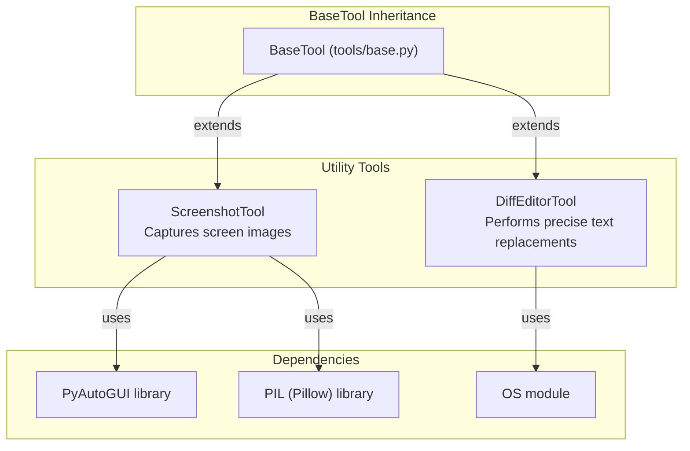
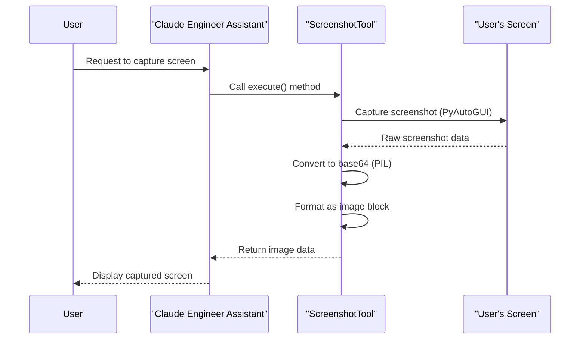
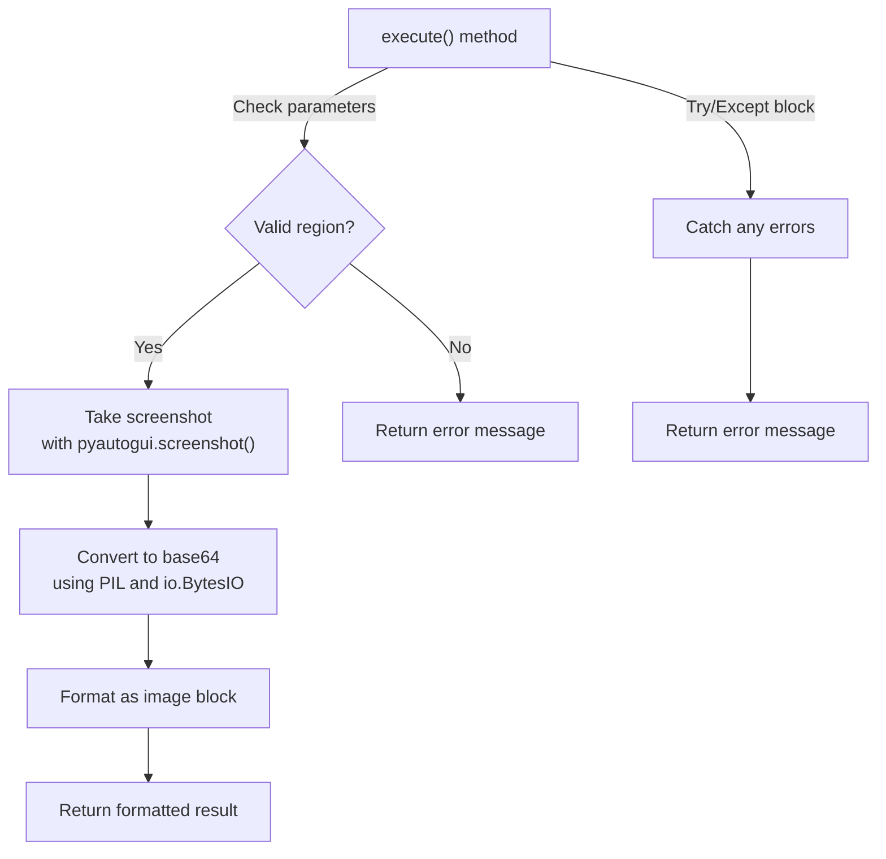
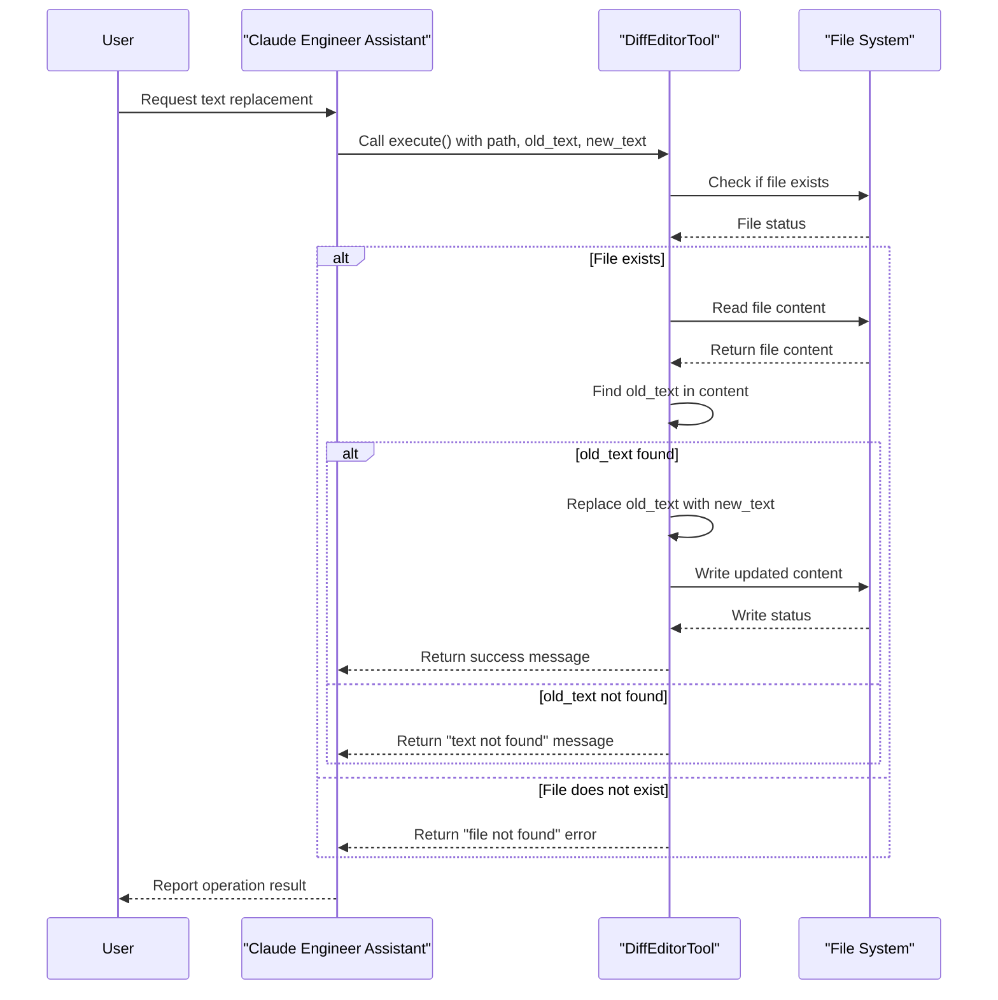
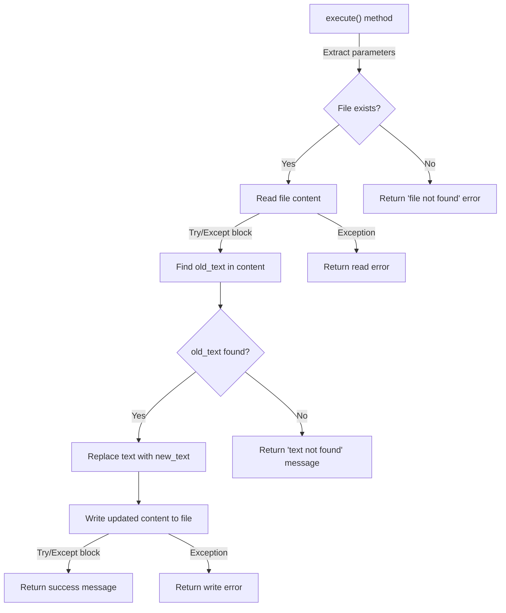

<!-- source: DeepWiki mcp.deepwiki.com · repo Doriandarko/claude-engineer · page 5.4 Utility Tools · fetched 2026-10-26 -->

# Utility Tools

<details>
<summary>Relevant source files</summary>

The following files were used as context for generating this wiki page:

- [prompts/system_prompts.py](prompts/system_prompts.py)
- [tools/diffeditortool.py](tools/diffeditortool.py)
- [tools/screenshottool.py](tools/screenshottool.py)

</details>


This page documents the utility tools available in Claude Engineer v3. Utility tools provide general-purpose functionality that supports various tasks but don't fit neatly into file system, web, or development tool categories. These tools enhance Claude Engineer's ability to interact with the user's environment and perform supportive functions.

For information about other tool categories, see [File System Tools](#5.1), [Web Tools](#5.2), and [Development Tools](#5.3).

## Overview of Utility Tools

Utility tools in Claude Engineer v3 include tools for capturing screen information and performing specialized text operations. These tools are designed to support the AI assistant's ability to observe the user's environment and make targeted changes to text files.



Sources: [tools/screenshottool.py:1-80](), [tools/diffeditortool.py:1-73]()

## ScreenshotTool

The ScreenshotTool captures images of the user's screen and formats them for use with Claude. It can capture the entire screen or a specific region, enabling Claude to "see" what the user is seeing and provide more informed assistance.

### Functionality and Implementation

ScreenshotTool uses PyAutoGUI and PIL (Python Imaging Library) to capture screen content and convert it to a base64-encoded format that Claude can interpret as an image.



Sources: [tools/screenshottool.py:15-80]()

### Parameters and Usage

The ScreenshotTool accepts the following parameters:

| Parameter | Type | Required | Description |
|-----------|------|----------|-------------|
| region | array[integer] | No | Four integers [x, y, width, height] specifying the region to capture. If omitted, captures the entire screen. |

### Return Format

The tool returns a specially formatted object that represents an image block ready to be sent to Claude:

```json
[
  {
    "type": "image",
    "source": {
      "type": "base64",
      "media_type": "image/png",
      "data": "<base64-encoded png>"
    }
  }
]
```

Sources: [tools/screenshottool.py:53-77]()

### Implementation Details

The ScreenshotTool has the following dependencies:
- `pyautogui`: For capturing screenshots
- `PIL` (Pillow): For image processing

The tool includes error handling for missing dependencies and provides clear error messages when screenshot capture fails.



Sources: [tools/screenshottool.py:7-13](), [tools/screenshottool.py:53-80]()

## DiffEditorTool

The DiffEditorTool performs precise text replacements in files. It's designed for targeted modifications when you need to replace specific text content within a file without altering the rest of the file.

### Functionality and Implementation

DiffEditorTool works by:
1. Reading the entire content of a specified file
2. Finding the first occurrence of a specified text substring
3. Replacing that substring with new text
4. Writing the modified content back to the file



Sources: [tools/diffeditortool.py:5-73]()

### Parameters and Usage

The DiffEditorTool requires the following parameters:

| Parameter | Type | Required | Description |
|-----------|------|----------|-------------|
| path | string | Yes | Path to the file to be edited |
| old_text | string | Yes | Exact substring in the file to replace |
| new_text | string | Yes | New substring that will replace old_text |

Sources: [tools/diffeditortool.py:22-39]()

### Implementation Details

The DiffEditorTool implements precise text replacement with these key steps:
1. Validates that the target file exists
2. Reads the entire file into memory
3. Uses Python's `find()` method to locate the exact position of the old text
4. Performs a substring replacement operation
5. Writes the modified content back to the file

The tool includes error handling for:
- Non-existent files
- File read/write errors
- Cases where the old text is not found in the file



Sources: [tools/diffeditortool.py:41-73]()

## Using Utility Tools

Utility tools are available to Claude Engineer v3 alongside other tool categories and can be combined with other tools to accomplish complex tasks. For example:

1. The ScreenshotTool can be used to:
   - Capture the current state of a UI for analysis
   - Document issues by capturing error messages
   - Verify changes made by other tools

2. The DiffEditorTool is particularly useful for:
   - Making targeted code changes
   - Updating configuration files
   - Performing find-and-replace operations with precise control

Sources: [prompts/system_prompts.py:1-76]()

## Summary

Utility tools in Claude Engineer v3 provide important supporting functionality that enhances the system's ability to interact with and modify the user's environment. The ScreenshotTool provides visual context by capturing screen content, while the DiffEditorTool enables precise text replacements in files.

These tools, combined with the other tool categories in the system, give Claude Engineer v3 a versatile set of capabilities for assisting with a wide range of tasks.

---

