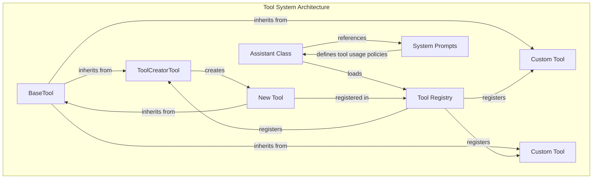
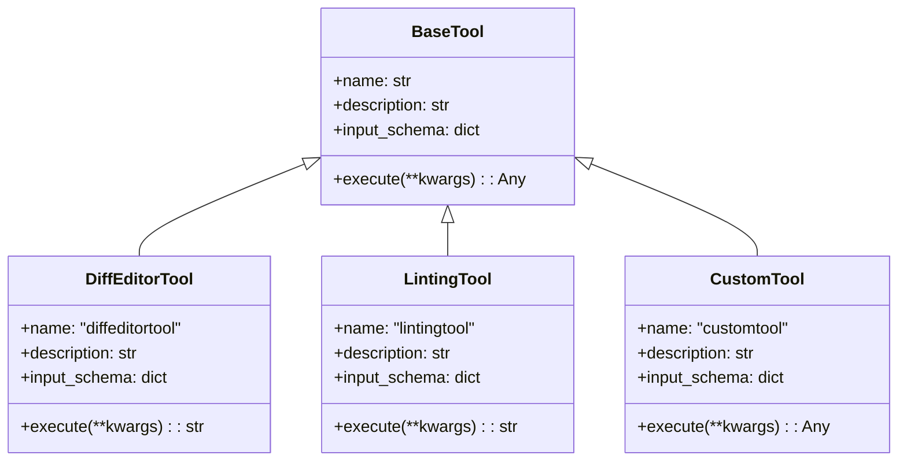
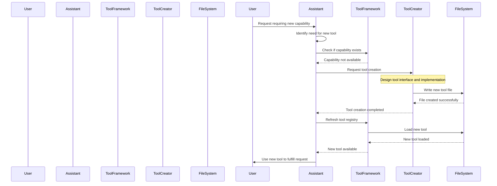
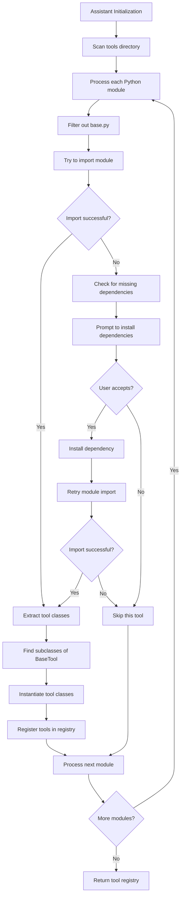

<!-- source: DeepWiki mcp.deepwiki.com · repo Doriandarko/claude-engineer · page 6 Creating New Tools · fetched 2026-10-26 -->

# Creating New Tools

<details>
<summary>Relevant source files</summary>

The following files were used as context for generating this wiki page:

- [ce3.py](ce3.py)
- [prompts/system_prompts.py](prompts/system_prompts.py)
- [tools/diffeditortool.py](tools/diffeditortool.py)
- [tools/lintingtool.py](tools/lintingtool.py)

</details>


This document explains how to develop custom tools for Claude Engineer v3. It covers the tool architecture, the process of creating new tools manually, and how the system can dynamically generate tools. For information about using existing tools, see [Tools](#5).

## Tool System Overview

The Claude Engineer v3 system uses a flexible tool architecture that allows for extending the assistant's capabilities through custom tools. Tools are Python classes that inherit from a common `BaseTool` class and follow a standardized interface, enabling the assistant to discover and execute them dynamically.



Sources: [ce3.py:30-37](), [ce3.py:75-128](), [ce3.py:141-157]()

## Tool Interface and Components

All tools in Claude Engineer v3 must implement the `BaseTool` interface, which requires specific components:

| Component | Type | Description |
|-----------|------|-------------|
| `name` | string | Unique identifier for the tool |
| `description` | string | Detailed description of what the tool does and how to use it |
| `input_schema` | dict | JSON Schema defining the tool's input parameters |
| `execute(**kwargs)` | method | Method implementing the tool's functionality |



Sources: [tools/diffeditortool.py:5-73](), [tools/lintingtool.py:6-110]()

## Creating a Custom Tool

To create a new tool for Claude Engineer v3, follow these steps:

### 1. Create a New Python File

Create a new Python file in the `tools` directory with a descriptive name: `tools/yourtoolname.py`.

### 2. Implement the Tool Class

In your file, import the `BaseTool` class and define your tool class:

```python
from tools.base import BaseTool

class YourToolName(BaseTool):
    name = "yourtoolname"
    description = '''
    Detailed description of what your tool does.
    Include information about:
    - What the tool is used for
    - The inputs it accepts
    - The output it provides
    - Any limitations or considerations
    '''
    
    input_schema = {
        "type": "object",
        "properties": {
            "param1": {
                "type": "string",
                "description": "Description of parameter 1"
            },
            "param2": {
                "type": "integer",
                "description": "Description of parameter 2"
            }
        },
        "required": ["param1"]  # List required parameters
    }
    
    def execute(self, **kwargs) -> str:
        # Extract parameters
        param1 = kwargs.get("param1")
        param2 = kwargs.get("param2", 0)  # Default value if not provided
        
        # Implement tool logic
        result = f"Processed {param1} with value {param2}"
        
        # Return the result
        return result
```

Sources: [tools/diffeditortool.py:5-73](), [tools/lintingtool.py:6-110]()

### 3. Input Schema Definition

The `input_schema` is a JSON Schema object that defines the parameters your tool accepts. It's crucial for proper validation and documentation:

- Use appropriate types (`string`, `number`, `boolean`, `array`, `object`)
- Provide clear descriptions for each parameter
- Specify which parameters are required
- Define default values when applicable
- Add constraints when needed (min/max values, pattern matching, etc.)

Example from DiffEditorTool:

```python
input_schema = {
    "type": "object",
    "properties": {
        "path": {
            "type": "string",
            "description": "Path to the file to be edited."
        },
        "old_text": {
            "type": "string",
            "description": "Exact substring in the file to replace."
        },
        "new_text": {
            "type": "string",
            "description": "New substring that will replace old_text."
        }
    },
    "required": ["path", "old_text", "new_text"]
}
```

Sources: [tools/diffeditortool.py:22-39]()

### 4. Execute Method Implementation

The `execute` method is where your tool's functionality is implemented:

1. Extract parameters from the `kwargs` dictionary
2. Validate inputs and handle edge cases
3. Implement the tool's core logic
4. Return results as a string or structured data (dict/list)
5. Handle exceptions gracefully with informative error messages

Example from DiffEditorTool:

```python
def execute(self, **kwargs) -> str:
    path = kwargs.get("path")
    old_text = kwargs.get("old_text")
    new_text = kwargs.get("new_text")

    # Check if file exists
    if not os.path.isfile(path):
        return f"Error: File does not exist at path: {path}"

    # Read the file content
    try:
        with open(path, 'r', encoding='utf-8') as f:
            content = f.read()
    except Exception as e:
        return f"Error reading file {path}: {str(e)}"

    # Locate the old_text in the file
    index = content.find(old_text)
    if index == -1:
        return f"'{old_text}' not found in the file. No changes made."

    # Replace the first occurrence of old_text with new_text
    new_content = content[:index] + new_text + content[index+len(old_text):]

    # Write the updated content back to the file
    try:
        with open(path, 'w', encoding='utf-8') as f:
            f.write(new_content)
    except Exception as e:
        return f"Error writing updated content to file {path}: {str(e)}"

    return f"Successfully replaced '{old_text}' with '{new_text}' in {path}."
```

Sources: [tools/diffeditortool.py:41-73]()

## Dynamic Tool Creation

Claude Engineer v3 includes a unique capability: creating new tools dynamically based on identified needs through the `ToolCreatorTool`.



Sources: [ce3.py:159-177](), [prompts/system_prompts.py:32-39]()

### When to Create New Tools

According to the system prompts, new tools should be created only when:

- The requested capability is completely outside existing tools
- The functionality can't be achieved by combining existing tools
- The new tool would serve a distinct and reusable purpose

New tools should NOT be created when:

- An existing tool can handle the task, even partially
- The functionality is too similar to existing tools
- The tool would be too specific or single-use

Sources: [prompts/system_prompts.py:32-39]()

## Best Practices for Tool Development

When developing tools for Claude Engineer v3, follow these best practices:

### Tool Name and Description

- Use descriptive, lowercase names without spaces (e.g., `filecreatortool`)
- Write comprehensive descriptions that explain:
  - Tool purpose and functionality
  - Required inputs and their format
  - Expected outputs and behavior
  - Examples or usage patterns when appropriate

### Input Schema Design

- Use precise JSON Schema types and constraints
- Include clear descriptions for each parameter
- Mark parameters as required only when absolutely necessary
- Provide sensible defaults for optional parameters
- Use appropriate types for parameters (string, number, boolean, array, object)

### Implementation

- Handle errors gracefully with informative messages
- Validate inputs before processing
- Include proper error handling for external dependencies
- Return structured data when appropriate
- Keep tools focused on a single responsibility
- Follow security best practices when dealing with file systems, network requests, or code execution

### Performance and Reliability

- Make tools robust to unexpected inputs
- Avoid excessive dependencies
- Implement timeouts for operations that might hang
- Ensure proper resource cleanup
- Log errors and important events for debugging

## Tool Loading Process

When the Claude Engineer v3 system starts, it dynamically loads available tools using the following process:



Sources: [ce3.py:75-128](), [ce3.py:141-157]()

## Testing Your Tool

After creating your tool, you can test it using the following methods:

1. **Refresh Command**: Place your tool file in the `tools` directory and use the `refresh` command in Claude Engineer v3's CLI or web interface to reload available tools.

2. **Interactive Testing**: Use Claude Engineer v3 to interact with your tool, providing specific tasks that require your tool's functionality.

3. **Direct Execution**: Create a separate Python script that imports and directly tests your tool implementation.

Sources: [ce3.py:159-177](), [ce3.py:425-430]()

## Summary

Creating custom tools for Claude Engineer v3 involves:

1. Creating a Python class that inherits from `BaseTool`
2. Defining a name, description, and input schema for your tool
3. Implementing the execute method with your tool's logic
4. Adding the tool file to the `tools` directory
5. Refreshing the tool registry when the assistant is running

By following the patterns and best practices outlined in this document, you can extend Claude Engineer v3's capabilities to meet your specific needs or enhance its general functionality.

---

