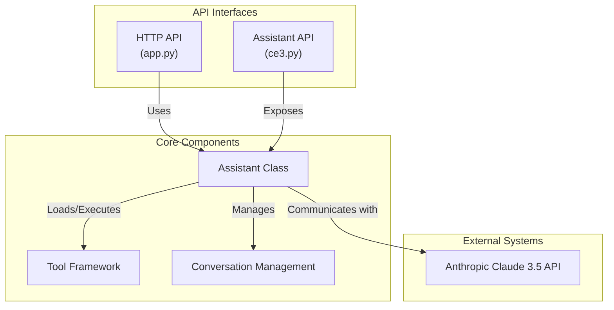
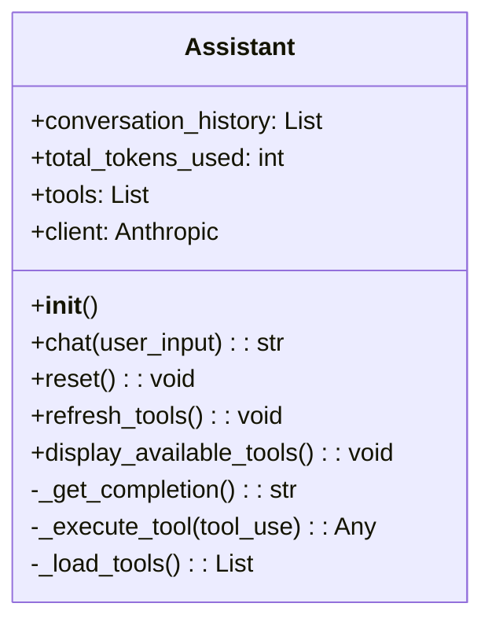
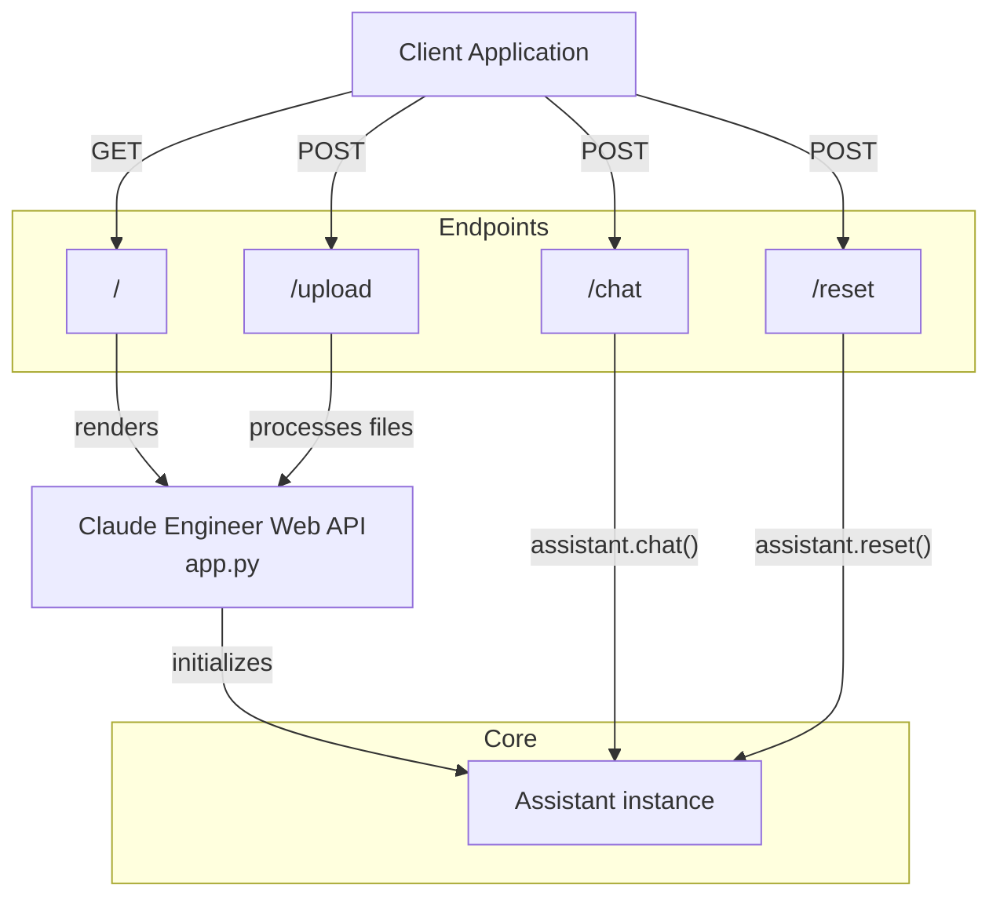
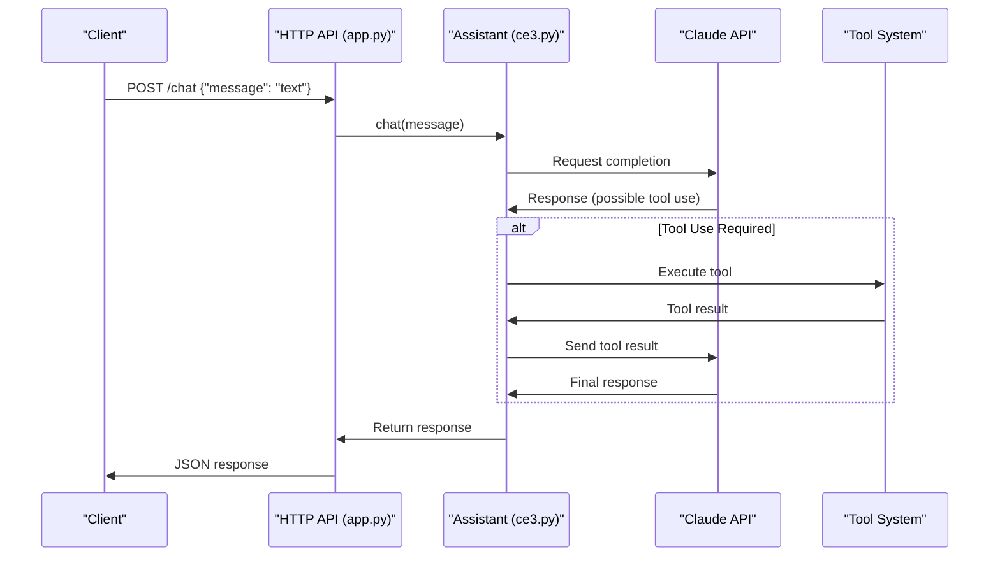

<!-- source: DeepWiki mcp.deepwiki.com · repo Doriandarko/claude-engineer · page 7 API Reference · fetched 2026-10-26 -->

# API Reference

<details>
<summary>Relevant source files</summary>

The following files were used as context for generating this wiki page:

- [app.py](app.py)
- [ce3.py](ce3.py)

</details>


This document provides detailed information about the programmatic interfaces available in Claude Engineer v3. It covers both the Python Assistant API for direct integration into your applications and the HTTP API for web-based interactions. For information about the tool system and available tools, see [Tools](#5).

## 1. Overview

Claude Engineer v3 offers two primary interfaces for programmatic interaction:

1. **Assistant API**: A Python class-based API for direct integration into Python applications
2. **HTTP API**: RESTful endpoints for web-based interactions

The following diagram illustrates how these APIs relate to the overall system architecture:



Sources: [ce3.py:29-454](), [app.py:1-128]()

## 2. Assistant API

The Assistant API is implemented through the `Assistant` class in `ce3.py`. This class provides the core functionality for interacting with Claude, managing tools, and handling conversations.

### 2.1 Initialization

To create a new Assistant instance:

```python
from ce3 import Assistant

assistant = Assistant()
```

The constructor performs the following operations:
- Validates the presence of `ANTHROPIC_API_KEY` in configuration
- Initializes the Anthropic client
- Sets up conversation history and token tracking
- Loads available tools from the configured directory

Sources: [ce3.py:39-53]()

### 2.2 Core Methods



#### 2.2.1 chat(user_input)

The primary method for sending messages to the assistant.

**Parameters:**
- `user_input`: Can be either a string (text-only) or a list of content blocks (multimodal)

**Returns:**
- String response from Claude or a status message for special commands

**Special commands:**
- `'refresh'`: Reloads available tools
- `'reset'`: Clears conversation history
- `'quit'`: Exits the conversation (CLI only)

**Example:**
```python
# Text-only message
response = assistant.chat("How can I create a web scraper tool?")

# Multimodal message with image
image_content = {
    "type": "image",
    "source": {
        "type": "base64",
        "media_type": "image/jpeg",
        "data": base64_encoded_image
    }
}
response = assistant.chat([image_content, {"type": "text", "text": "What's in this image?"}])
```

Sources: [ce3.py:418-453]()

#### 2.2.2 reset()

Resets the assistant's conversation history and token usage.

**Example:**
```python
assistant.reset()
```

Sources: [ce3.py:455-473]()

#### 2.2.3 refresh_tools()

Refreshes the list of available tools, identifying any newly added tools.

**Example:**
```python
assistant.refresh_tools()
```

Sources: [ce3.py:159-177]()

#### 2.2.4 display_available_tools()

Prints a list of currently loaded tools to the console.

**Example:**
```python
assistant.display_available_tools()
```

Sources: [ce3.py:179-190]()

### 2.3 Internal Methods

These methods are not typically called directly but are used internally by the Assistant:

- `_load_tools()`: Dynamically loads all tool classes from the tools directory
- `_execute_tool(tool_use)`: Executes a specified tool with the provided inputs
- `_get_completion()`: Handles interaction with the Anthropic API to get responses
- `_display_token_usage(usage)`: Shows token usage information

Sources: [ce3.py:75-128](), [ce3.py:261-302](), [ce3.py:332-416](), [ce3.py:305-330]()

### 2.4 Attributes

Key attributes that can be accessed or modified:

- `conversation_history`: List of conversation messages
- `total_tokens_used`: Tracks token usage throughout the conversation
- `tools`: List of available tools with their schemas
- `thinking_enabled`: Controls whether thinking indicator is shown
- `temperature`: Controls the randomness of Claude's responses

## 3. HTTP API

The HTTP API is implemented through Flask routes in `app.py`. It provides RESTful endpoints for web-based interactions with the Assistant.



Sources: [app.py:1-128]()

### 3.1 Endpoints

#### 3.1.1 GET /

Returns the web interface HTML.

**Response:**
- HTML content for the web interface

Sources: [app.py:18-20]()

#### 3.1.2 POST /chat

Sends a message to the assistant and receives a response.

**Request Body:**
```json
{
  "message": "User message text", 
  "image": "optional base64 encoded image data"
}
```

**Response:**
```json
{
  "response": "Assistant's response text",
  "thinking": false,
  "tool_name": "Name of tool if one was used",
  "token_usage": {
    "total_tokens": 1234,
    "max_tokens": 100000
  }
}
```

Sources: [app.py:22-89]()

#### 3.1.3 POST /upload

Uploads and processes an image file.

**Request:**
- Form data with a `file` field containing an image file

**Response:**
```json
{
  "success": true,
  "image_data": "base64 encoded image data",
  "media_type": "image/jpeg"
}
```

Sources: [app.py:91-121]()

#### 3.1.4 POST /reset

Resets the assistant's conversation history.

**Response:**
```json
{
  "status": "success"
}
```

Sources: [app.py:123-127]()

### 3.2 Data Flow

The following sequence diagram illustrates the data flow for a typical chat interaction using the HTTP API:



Sources: [app.py:22-89](), [ce3.py:418-453](), [ce3.py:332-416]()

## 4. Integration Examples

### 4.1 Python Integration

```python
from ce3 import Assistant

# Initialize the assistant
assistant = Assistant()

# Display available tools
assistant.display_available_tools()

# Send a message
response = assistant.chat("Create a Python function to scrape product information from Amazon")
print(response)

# Use an image in the conversation
with open("screenshot.jpg", "rb") as image_file:
    import base64
    image_data = base64.b64encode(image_file.read()).decode("utf-8")
    
image_content = {
    "type": "image",
    "source": {
        "type": "base64",
        "media_type": "image/jpeg",
        "data": image_data
    }
}
text_content = {"type": "text", "text": "What's shown in this image?"}
response = assistant.chat([image_content, text_content])
print(response)

# Reset the conversation
assistant.reset()
```

### 4.2 HTTP API Integration

```javascript
// Example using fetch API in JavaScript

// Sending a text message
async function sendMessage(message) {
  const response = await fetch('/chat', {
    method: 'POST',
    headers: {
      'Content-Type': 'application/json',
    },
    body: JSON.stringify({ message }),
  });
  
  return response.json();
}

// Uploading an image
async function uploadImage(imageFile) {
  const formData = new FormData();
  formData.append('file', imageFile);
  
  const response = await fetch('/upload', {
    method: 'POST',
    body: formData,
  });
  
  return response.json();
}

// Sending a message with an image
async function sendMessageWithImage(text, imageData) {
  const response = await fetch('/chat', {
    method: 'POST',
    headers: {
      'Content-Type': 'application/json',
    },
    body: JSON.stringify({ 
      message: text,
      image: imageData 
    }),
  });
  
  return response.json();
}

// Resetting the conversation
async function resetConversation() {
  const response = await fetch('/reset', {
    method: 'POST',
  });
  
  return response.json();
}
```

## 5. Configuration

The Assistant API and HTTP API both use the configuration settings defined in `config.py`. Key configuration parameters include:

| Parameter | Description | Default |
|-----------|-------------|---------|
| ANTHROPIC_API_KEY | API key for Anthropic Claude API | Environment variable |
| MODEL | Claude model to use | "claude-3-5-sonnet-20240620" |
| MAX_TOKENS | Maximum tokens per response | 4096 |
| MAX_CONVERSATION_TOKENS | Maximum tokens for entire conversation | 100000 |
| TOOLS_DIR | Directory containing tool implementations | "tools" |
| ENABLE_THINKING | Show thinking indicator | False |
| DEFAULT_TEMPERATURE | Temperature for Claude responses | 0.7 |
| SHOW_TOOL_USAGE | Display tool inputs and outputs | True |

Sources: [ce3.py:39-53]()

## 6. Error Handling

Both APIs include error handling mechanisms:

### 6.1 Assistant API Errors

The Assistant API uses try-except blocks to catch and handle errors, including:
- API key validation errors
- Tool loading and execution errors
- Token limit errors
- General exceptions during conversation

Errors are logged using Python's logging module and returned as response strings.

Sources: [ce3.py:414-416](), [ce3.py:451-453]()

### 6.2 HTTP API Errors

The HTTP API handles errors by returning JSON responses with error messages:

```json
{
  "response": "Error: [error message]",
  "thinking": false,
  "tool_name": null,
  "token_usage": null
}
```

For file upload errors, the API returns specific error messages with appropriate HTTP status codes.

Sources: [app.py:83-89](), [app.py:93-121]()

## 7. Limitations and Considerations

When using the Claude Engineer v3 APIs, be aware of the following limitations:

1. **Token Limits**: Conversations are limited by `MAX_CONVERSATION_TOKENS` (default: 100,000)
2. **File Size Limits**: The HTTP API limits uploaded files to 16MB
3. **Tool Availability**: Dynamically loaded tools may require additional dependencies
4. **API Key Requirements**: An Anthropic API key is required and must be properly configured
5. **Error Handling**: Client applications should implement appropriate error handling

Sources: [app.py:10](), [ce3.py:40-41](), [ce3.py:356-358]()