# Page: Overview

# Overview

<details>
<summary>Relevant source files</summary>

The following files were used as context for generating this wiki page:

- [pyproject.toml](pyproject.toml)
- [readme.md](readme.md)
- [requirements.txt](requirements.txt)

</details>


This document provides an introduction to Claude Engineer v3, a self-improving AI Assistant framework built around the Claude 3.5 Sonnet model. It covers the system's purpose, high-level architecture, and main capabilities. For installation instructions, see [Installation and Setup](#1.1). For usage details, see [Usage Guide](#1.2).

## What is Claude Engineer v3?

Claude Engineer v3 is a framework that enables Claude 3.5 to create and manage its own tools, continuously expanding its capabilities through conversation. The system combines a powerful self-improvement mechanism with flexible interfaces, allowing Claude to dynamically identify needs for new tools, design them, and implement them automatically.

This represents the third major iteration of the Claude Engineer framework, with significant improvements over previous versions:
- Integration with Claude 3.5 Sonnet model
- Enhanced token management using Anthropic's token counting API
- Self-improving tool creation system
- Streamlined conversation handling
- More precise token usage tracking

Sources: [readme.md:1-17]()

## Key Features

| Feature Category | Capabilities |
|------------------|--------------|
| **Self-Improvement** | • Autonomous tool identification and creation<br>• Dynamic capability expansion<br>• Smart tool dependency management<br>• Automatic identification of capability gaps |
| **Core Functionality** | • Dynamic tool creation and loading<br>• Hot-reload capability<br>• Tool abstraction framework<br>• Persistent conversation history<br>• Advanced token tracking and management |
| **Interfaces** | • Modern web interface with image upload, token visualization<br>• CLI with rich text formatting and tool interaction |
| **Tool Types** | • File system tools<br>• Web tools<br>• Development tools<br>• Utility tools |

Sources: [readme.md:110-133](), [readme.md:151-170]()

## System Architecture

### High-Level Architecture

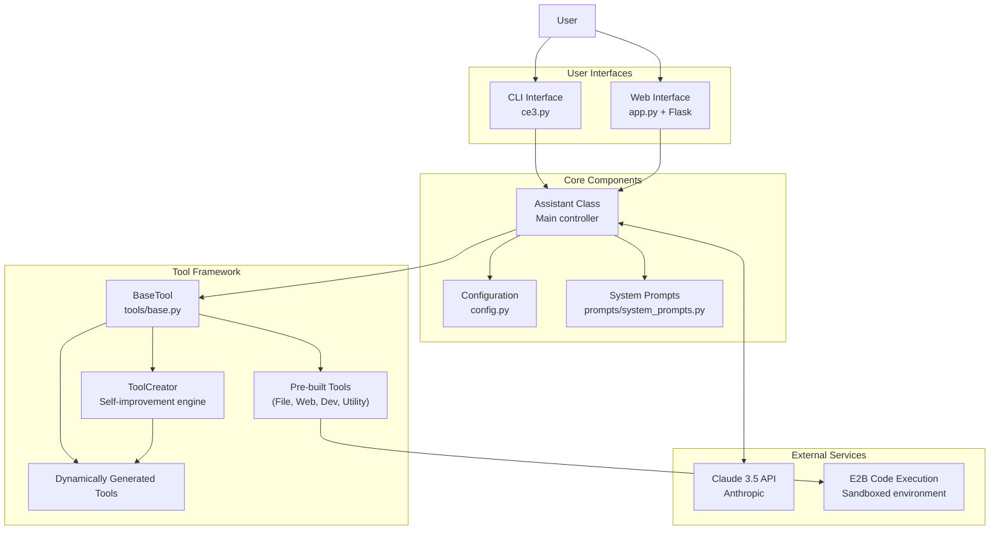

This diagram shows the main system components of Claude Engineer v3. The system is built around the central Assistant class, which interfaces with Claude 3.5 through the Anthropic API. Users interact with the system through either the CLI (`ce3.py`) or web interface (`app.py`). The tool framework is based on the `BaseTool` class, with pre-built tools and the ability to dynamically generate new tools through the `ToolCreator`.

Sources: [readme.md:134-149](), [readme.md:174-183](), [readme.md:209-242]()

### User Interaction Flow

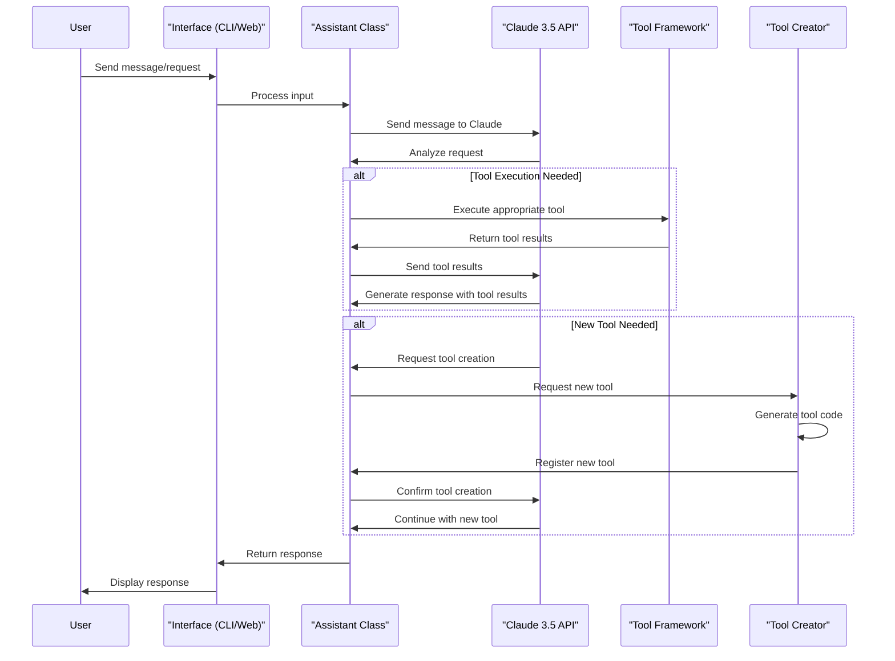

This sequence diagram illustrates the typical interaction flow between the user and Claude Engineer v3, including the execution of existing tools and the creation of new tools when needed.

Sources: [readme.md:110-117](), [readme.md:118-133]()

## System Components

### Core Assistant

The heart of Claude Engineer v3 is the `Assistant` class, which handles:
- Conversation management with token tracking
- Tool loading, execution, and chaining
- Communication with the Claude 3.5 API
- Self-improvement through tool creation

The Assistant class provides a unified interface for both the CLI and web interfaces to interact with Claude 3.5 and the tool framework.

Sources: [readme.md:174-183]()

### Tool Framework

The tool framework is built around the `BaseTool` class in `tools/base.py`, which defines the interface for all tools. The system includes several categories of pre-built tools:

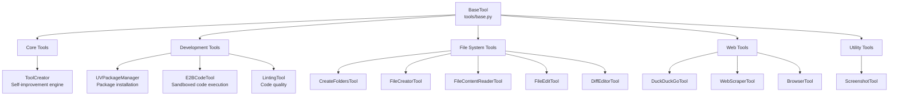

This diagram shows the hierarchical organization of the tool system in Claude Engineer v3. All tools inherit from the `BaseTool` class and are categorized by their functionality.

Sources: [readme.md:209-242]()

### Self-Improvement Mechanism

A key feature of Claude Engineer v3 is its ability to identify needs for new tools during conversations and create them automatically:


When Claude identifies a need for a new capability, it designs and implements a new tool through the `ToolCreator`, which generates the necessary code and registers the tool with the system. This allows the assistant to continuously expand its capabilities based on user needs.

Sources: [readme.md:110-117](), [readme.md:15-16]()

### Interface Options

Claude Engineer v3 offers two user interfaces:

1. **Web Interface** (`app.py`): A modern web UI built with Flask featuring:
   - Real-time token usage visualization
   - Image upload and analysis
   - Markdown rendering with syntax highlighting
   - Tool usage indicators

2. **CLI Interface** (`ce3.py`): A terminal-based interface with:
   - Rich text formatting
   - Progress indicators
   - Direct tool interaction
   - Detailed debugging output

Both interfaces provide access to the same underlying Assistant capabilities but cater to different use cases and preferences.

Sources: [readme.md:63-107](), [readme.md:151-170]()

## Dependencies and Requirements

Claude Engineer v3 requires:
- Python 3.8+
- Anthropic API Key (for Claude 3.5 access)
- E2B API Key (for code execution capabilities, optional)
- Required packages specified in `requirements.txt`

Key dependencies include:
- `anthropic` for API communication
- `flask` for the web interface
- `rich` for console formatting
- Various packages for web scraping, file operations, and utility functions

Sources: [requirements.txt:1-15](), [readme.md:194-253]()

## Technical Integration

For developers looking to extend or integrate with Claude Engineer v3, the system provides:
- A modular design with clear separation of concerns
- Consistent interfaces for creating new tools
- Configuration options through the `Config` class
- Support for both web and CLI integration

For detailed API documentation, see [API Reference](#7). For information on creating custom tools, see [Creating New Tools](#6).

Sources: [readme.md:174-193](), [pyproject.toml:1-116]()

---

# Page: Installation and Setup

# Installation and Setup

<details>
<summary>Relevant source files</summary>

The following files were used as context for generating this wiki page:

- [.env.example](.env.example)
- [.gitignore](.gitignore)
- [pyproject.toml](pyproject.toml)
- [requirements.txt](requirements.txt)
- [uv.lock](uv.lock)

</details>


This page provides instructions for installing and setting up Claude Engineer v3. It covers system requirements, dependency installation, environment configuration, and verification steps. For information on how to use the system once installed, see [Usage Guide](#1.2).

## Prerequisites

Before installing Claude Engineer v3, ensure you have the following:

- Python 3.9 or higher
- Git (for cloning the repository)
- An Anthropic API key for accessing Claude 3.5 Sonnet
- (Optional) An E2B API key for code execution features

Sources: [pyproject.toml:10](), [.env.example:1-2]()

## Installation Workflow

The diagram below illustrates the overall installation process for Claude Engineer v3:

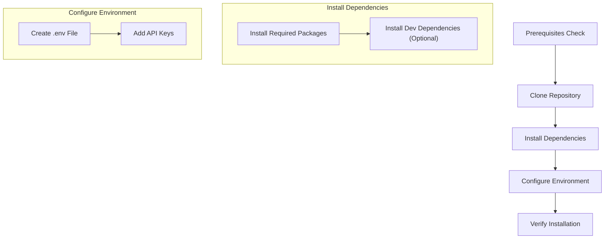

Sources: [requirements.txt:1-15](), [.env.example:1-2]()

## Repository Setup

1. Clone the repository:

```bash
git clone https://github.com/Doriandarko/claude-engineer.git
cd claude-engineer
```

2. Create a virtual environment (recommended):

```bash
python -m venv .venv
```

3. Activate the virtual environment:

On Windows:
```bash
.venv\Scripts\activate
```

On macOS/Linux:
```bash
source .venv/bin/activate
```

Sources: [.gitignore:4-5]()

## Installing Dependencies

Install the required dependencies using pip:

```bash
pip install -r requirements.txt
```

For development purposes, you can install additional development dependencies:

```bash
pip install -e ".[dev]"
```

The table below lists the key dependencies and their purposes:

| Package | Version | Purpose |
|---------|---------|---------|
| anthropic | >=0.18.1 | Claude API client for interacting with the model |
| flask | 3.0.0 | Web framework for the user interface |
| beautifulsoup4 | >=4.12.3 | HTML parsing for web scraping tools |
| python-dotenv | >=1.0.1 | Loading environment variables from `.env` files |
| requests | >=2.31.0 | HTTP requests for API interactions |
| rich | >=13.7.0 | Rich text formatting in terminal |
| prompt-toolkit | >=3.0.43 | Interactive command-line interface |
| e2b-code-interpreter | >=1.0.3 | Secure code execution environment |

Sources: [requirements.txt:1-15](), [pyproject.toml:23-40]()

## Environment Configuration

The application requires API keys to function properly. These are stored in a `.env` file that's loaded at runtime.

1. Create a `.env` file in the root directory by copying the example file:

```bash
cp .env.example .env
```

2. Edit the `.env` file to add your API keys:

```
ANTHROPIC_API_KEY=your_anthropic_api_key
E2B_API_KEY=your_e2b_api_key  # optional
```

Note: The `.env` file is excluded from version control in `.gitignore` to prevent accidentally exposing your API keys.

Sources: [.env.example:1-2](), [.gitignore:4]()

## System Components and Dependencies

The following diagram shows the key components of Claude Engineer v3 and how they relate to the configuration:

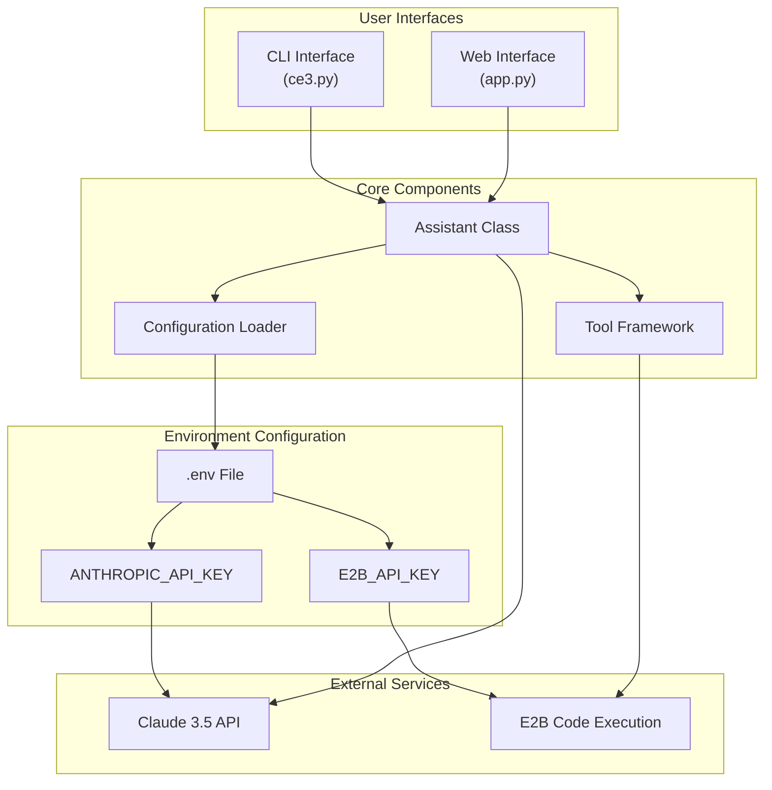

Sources: [.env.example:1-2](), [pyproject.toml:23-40](), [requirements.txt:1-15]()

## Starting the Application

Claude Engineer v3 can be run in two ways:

### Command Line Interface

Run the CLI with:

```bash
python ce3.py
```

### Web Interface

Start the web server with:

```bash
python app.py
```

By default, the web interface will be available at `http://localhost:5000`

Sources: [pyproject.toml:115]()

## Installation Verification

To verify your installation is working correctly, follow these steps:

1. Ensure your `.env` file is properly configured with the required API keys
2. Start the application using either the CLI or web interface
3. If using the CLI, you should see a welcome message and prompt
4. If using the web interface, navigate to `http://localhost:5000` in your browser

## Dependency Map

The diagram below shows how the key Python dependencies are used by different components of the system:

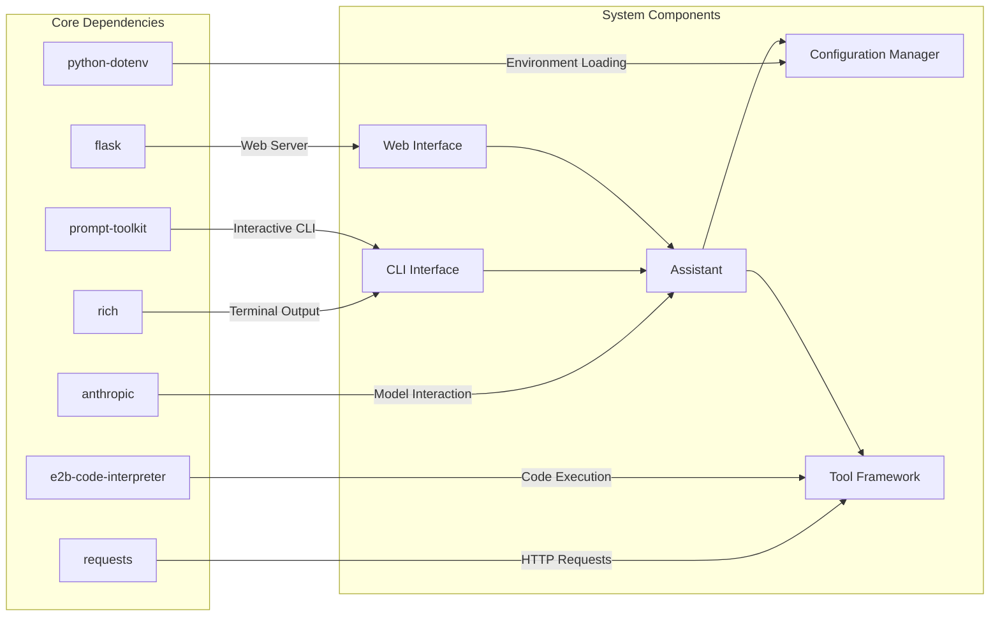

Sources: [requirements.txt:1-15](), [pyproject.toml:23-40]()

## Troubleshooting

Here are solutions to common installation issues:

| Issue | Possible Cause | Solution |
|-------|---------------|----------|
| Import errors | Missing dependencies | Run `pip install -r requirements.txt` again |
| Environment variable errors | Misconfigured `.env` file | Check that `.env` exists and contains valid API keys |
| API Key errors | Invalid API key | Verify your Anthropic API key is correct and has sufficient permissions |
| Port already in use | Another service using port 5000 | Change the port in `app.py` or stop the other service |
| SSL Certificate errors | Network issues | Check your internet connection and proxy settings |

## Next Steps

After completing the installation and setup:

- Explore the [Usage Guide](#1.2) to learn how to use Claude Engineer v3
- Check the [Tool Framework](#2.2) documentation to understand available tools
- Review the [System Architecture](#2) for a deeper understanding of the system

Sources: [pyproject.toml:23-40](), [requirements.txt:1-15]()

---

# Page: Usage Guide

# Usage Guide

<details>
<summary>Relevant source files</summary>

The following files were used as context for generating this wiki page:

- [app.py](app.py)
- [ce3.py](ce3.py)
- [readme.md](readme.md)

</details>


This guide provides detailed instructions on how to use Claude Engineer v3, covering both the command-line interface (CLI) and web interface. For installation instructions, see [Installation and Setup](#1.1).

## Interface Options

Claude Engineer v3 offers two distinct interfaces to accommodate different workflows:

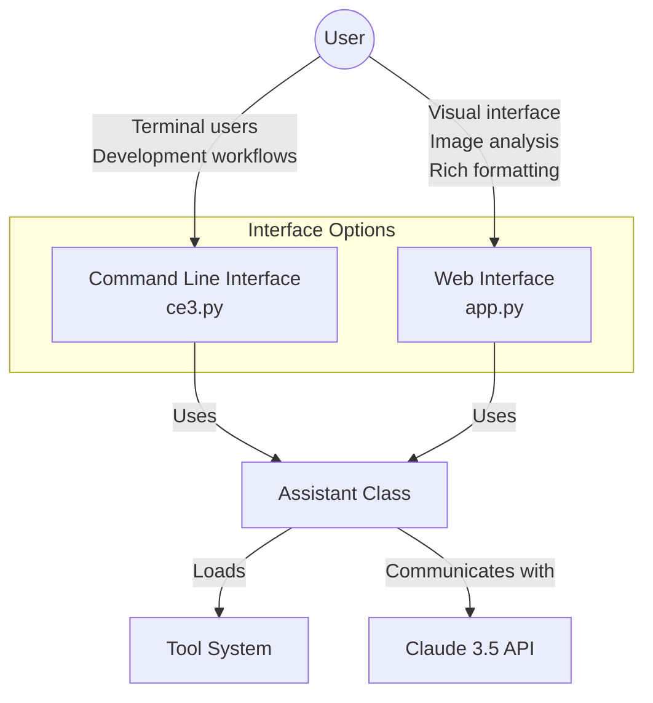

Sources: [ce3.py:476-527](), [readme.md:65-107](), [app.py:18-20]()

## Command Line Interface

The CLI provides a terminal-based experience for users who prefer to work directly in the command line.

### Starting the CLI

```bash
# Using uv (recommended)
uv run ce3.py

# Or using traditional Python
python ce3.py
```

Upon starting, the CLI displays a welcome message and a list of available tools:

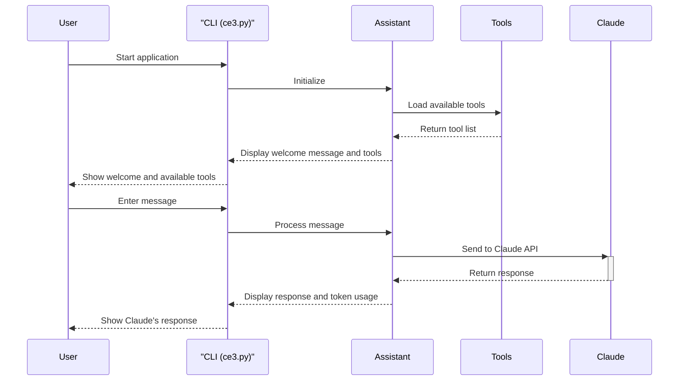

Sources: [ce3.py:476-527](), [readme.md:96-102]()

### CLI Commands

| Command | Description |
|---------|-------------|
| `refresh` | Reloads all available tools, displaying any newly discovered tools |
| `reset` | Clears conversation history and token usage |
| `quit` | Exits the application |

Sources: [ce3.py:418-453](), [ce3.py:455-474]()

### CLI Features

- Rich text formatting for better readability
- Visual token usage tracking with ASCII progress bar
- Live progress indicators during thinking/processing
- Direct tool execution with detailed output
- Terminal-optimized interface

Sources: [readme.md:163-169](), [ce3.py:305-330]()

## Web Interface

The web interface provides a modern, visual experience better suited for image analysis and rich content.

### Starting the Web Server

```bash
# Using uv (recommended)
uv run app.py

# Or using traditional Python
python app.py

# Then open your browser to:
http://localhost:5000
```

Sources: [readme.md:76-86](), [app.py:129-130]()

### Web Interface Features

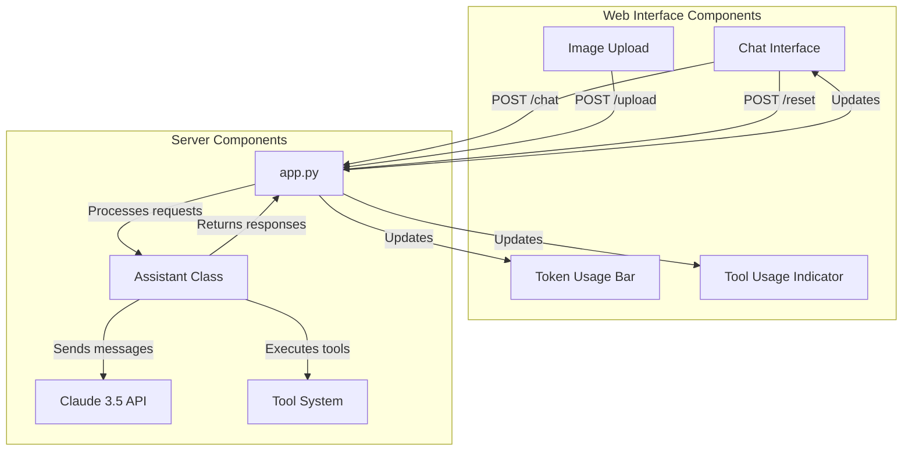

Sources: [app.py:1-130](), [readme.md:153-162]()

#### Key Web Features

- **Image Analysis**: Upload and analyze images using Claude's vision capabilities
- **Token Usage Visualization**: Real-time display of token consumption
- **Markdown Rendering**: Supports syntax highlighting for code blocks
- **Responsive Design**: Works on mobile and desktop devices
- **Tool Usage Indicators**: Shows when tools are being used
- **Keyboard Shortcuts**: Command/Ctrl + Enter to send messages

Sources: [readme.md:153-162](), [app.py:22-89]()

### Web Interface Endpoints

| Endpoint | Method | Description |
|----------|--------|-------------|
| `/` | GET | Renders the main web interface |
| `/chat` | POST | Processes user messages and returns Claude's responses |
| `/upload` | POST | Handles image file uploads |
| `/reset` | POST | Resets the conversation history |

Sources: [app.py:18-127]()

## Working with Tools

Claude Engineer v3 comes with a wide range of built-in tools that Claude can use during conversations. These tools are automatically invoked when Claude determines they're needed.

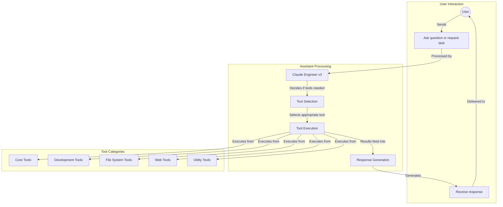

Sources: [readme.md:209-241](), [ce3.py:261-292]()

### Available Tool Categories

| Category | Description | Example Tools |
|----------|-------------|---------------|
| Core Tools | Core functionality | Tool Creator |
| Development Tools | Code and package management | UV Package Manager, E2B Code Executor, Linting Tool |
| File System Tools | File operations | File Creator, File Content Reader, Diff Editor |
| Web Tools | Internet access | DuckDuckGo, Web Scraper, Browser |
| Utility Tools | General utilities | Screenshot Tool |

For detailed information about specific tools, see [Tools](#5).

Sources: [readme.md:212-233](), [ce3.py:75-128]()

## Self-Improvement Mechanism

A key feature of Claude Engineer v3 is its ability to identify needs for new tools and create them automatically.

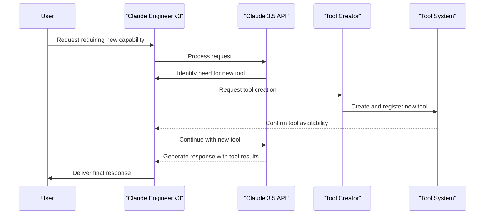

For more details on this feature, see [Self-Improvement Mechanism](#2.3).

Sources: [readme.md:110-117](), [ce3.py:159-177]()

## Token Management

Claude Engineer v3 carefully tracks token usage to ensure conversations stay within API limits.

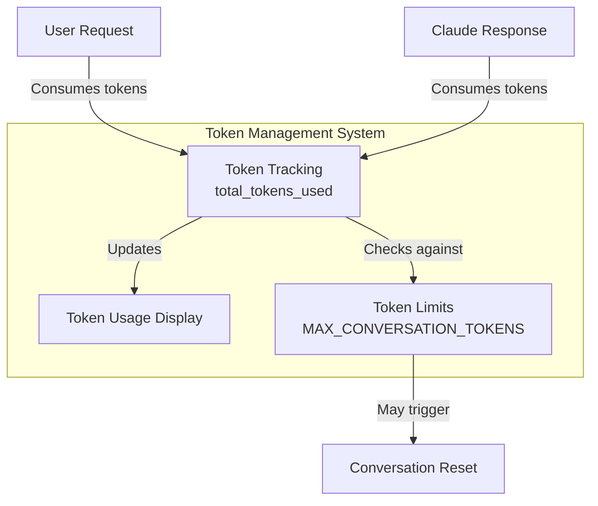

- Token usage is displayed after each response
- Warning is shown when token limit is approaching
- Conversation must be reset when token limit is reached

Sources: [ce3.py:305-330](), [ce3.py:332-416]()

## Best Practices

For optimal use of Claude Engineer v3:

1. **Be specific in requests**: Give clear, detailed instructions for best results
2. **Leverage multimodal capabilities**: Use image uploads in the web interface for visual analysis
3. **Monitor token usage**: Reset conversations when approaching the token limit
4. **Explore available tools**: Familiarize yourself with built-in tools to understand capabilities
5. **Use the right interface**: Choose CLI for development workflows, web interface for visual work

Sources: [readme.md:105-107](), [readme.md:152-170]()

## Troubleshooting

| Issue | Solution |
|-------|----------|
| **API Key Errors** | Ensure your Anthropic API key is correctly set in your environment |
| **Missing Dependencies** | When prompted to install dependencies, choose 'y' to install via UV |
| **Tool Errors** | Use `refresh` command to reload tools after fixing issues |
| **Token Limit Reached** | Use `reset` command to clear conversation history |
| **Image Upload Failures** | Ensure image is in supported format (.png, .jpg, .jpeg, .gif, .webp) |

Sources: [ce3.py:105-122](), [app.py:91-121](), [ce3.py:455-474]()

---

# Page: System Architecture

# System Architecture

<details>
<summary>Relevant source files</summary>

The following files were used as context for generating this wiki page:

- [app.py](app.py)
- [ce3.py](ce3.py)
- [config.py](config.py)
- [readme.md](readme.md)

</details>


This document provides an overview of the Claude Engineer v3 system architecture, detailing the core components and their interactions. It gives technical readers a comprehensive understanding of how the system is structured and functions. For specific implementation details about individual components, please refer to the relevant sub-pages, such as [Core Assistant](#2.1), [Tool Framework](#2.2), and [Self-Improvement Mechanism](#2.3).

## Overview

Claude Engineer v3 is designed with a modular architecture centered around the Assistant class, which orchestrates interactions between the user interfaces, Claude 3.5 API, and the extensible tool framework. The system features both a command-line interface and a web interface, sharing the same underlying Assistant functionality.

Sources: [readme.md:1-17](), [ce3.py:29-39]()

## High-Level Architecture

The system follows a layered architecture pattern with clear separation between interfaces, core assistant logic, and tool implementation.

### Architectural Diagram

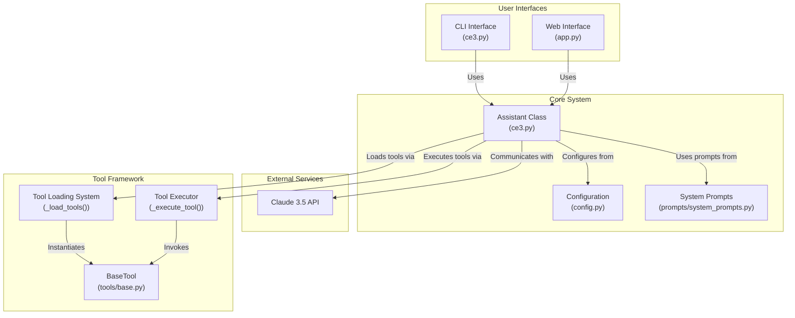

Sources: [ce3.py:29-39](), [ce3.py:75-128](), [ce3.py:261-292](), [config.py:7-21](), [app.py:8-16]()

## Core Components

### Assistant Class

The `Assistant` class is the central orchestrator of the system. It manages:
- Conversation history with Claude 3.5
- Tool loading and execution
- Token usage tracking
- System prompt configuration

The Assistant maintains the conversation state and handles the recursive communication pattern required for tool execution.

Sources: [ce3.py:29-461]()

### Configuration

The `Config` class centralizes system-wide configuration:
- API keys and model parameters
- Token limits
- Directory paths
- Interface behavior settings

Sources: [config.py:7-21]()

### Interfaces

#### CLI Interface
The CLI provides a terminal-based interaction using Rich for formatted output and prompt_toolkit for input.

#### Web Interface
The Flask-based web interface serves HTML, CSS, and JavaScript for a browser-based experience.

Sources: [ce3.py:476-527](), [app.py:1-130]()

## Component Relationships

This diagram shows how data flows between components during a typical conversation:

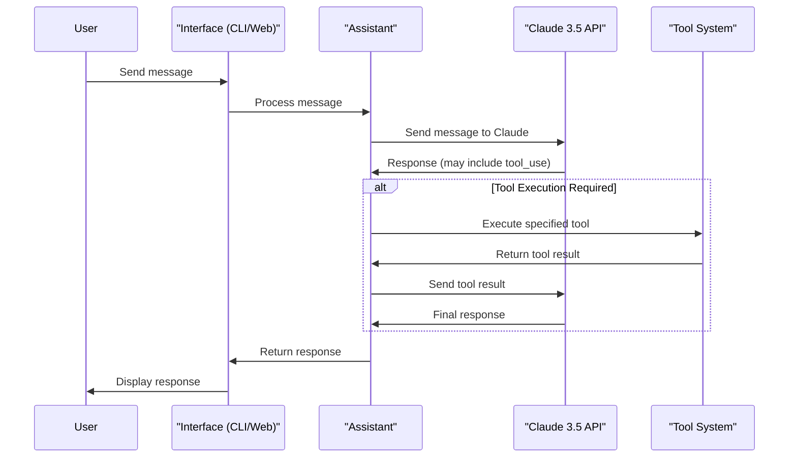

Sources: [ce3.py:418-453](), [ce3.py:332-416](), [ce3.py:261-292]()

## Token Management System

The system implements a sophisticated token tracking mechanism:

1. Tracks input and output tokens for each API call
2. Maintains a running total of tokens used in the conversation
3. Enforces the conversation token limit defined in Config
4. Provides visual feedback on token usage

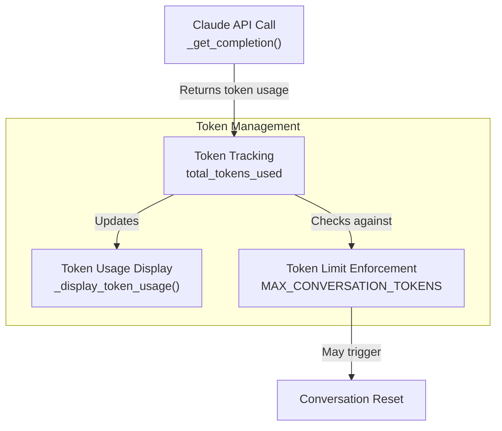

Sources: [ce3.py:305-330](), [ce3.py:332-359](), [config.py:10-11]()

## Tool Framework Architecture

The tool framework is built around the `BaseTool` abstract class, which all tools extend.

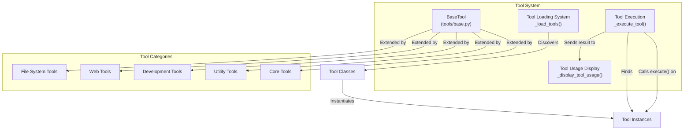

The tool system includes:
- Dynamic tool discovery and loading
- Tool execution with proper error handling
- Support for missing dependency detection and installation
- Tool usage visualization

Sources: [ce3.py:75-128](), [ce3.py:261-292](), [ce3.py:192-216](), [readme.md:209-240]()

### Tool Execution Flow

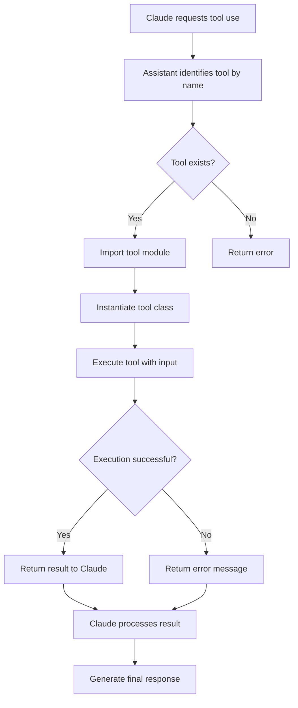

Sources: [ce3.py:261-292](), [ce3.py:332-416]()

## Web Interface Architecture

The web interface is built using Flask and follows a standard client-server architecture:

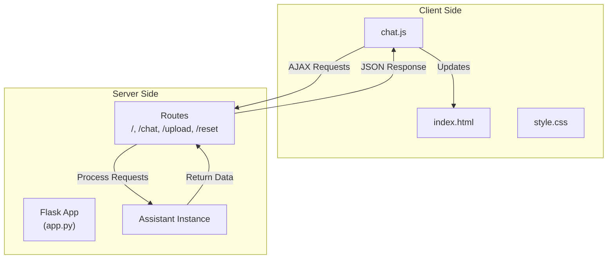

The web interface provides these endpoints:
- `/` - Serves the main page
- `/chat` - Handles chat messages and returns responses
- `/upload` - Processes image uploads for vision capabilities
- `/reset` - Resets the conversation history

Sources: [app.py:1-130](), [app.py:18-127]()

## Self-Improvement Architecture

A key feature of Claude Engineer v3 is its ability to self-improve by creating new tools:

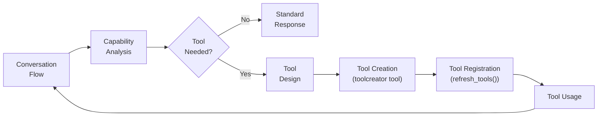

The self-improvement cycle involves:
1. Identifying capability gaps during conversation
2. Designing a tool to address the gap
3. Implementing the tool using code generation
4. Registering the tool with the system
5. Using the new tool to solve the original problem

Sources: [readme.md:110-117](), [ce3.py:159-177]()

## Data Flow

This diagram illustrates the data flow through the entire system during a typical interaction:

```mermaid
graph TD
    UserInput["User Input"] -->|"Text or Image"| Interface["Interface\n(CLI/Web)"]
    
    Interface -->|"Formats Input"| Assistant["Assistant Class"]
    Assistant -->|"Adds to Conversation"| History["Conversation\nHistory"]
    Assistant -->|"Sends to"| Claude["Claude 3.5 API"]
    
    Claude -->|"Responds with"| Response["API Response"]
    Response -->|"May include"| ToolRequest["Tool Use Request"]
    
    ToolRequest -->|"If present"| ToolExecution["Tool Execution"]
    ToolExecution -->|"Uses"| Tools["Tool System"]
    Tools -->|"Returns"| ToolResult["Tool Result"]
    
    ToolResult -->|"Sent back to"| Claude
    Claude -->|"Final response"| FinalResponse["Final Response"]
    
    FinalResponse -->|"Added to"| History
    FinalResponse -->|"Formatted and sent to"| Interface
    Interface -->|"Displayed to"| User["User"]
```

Sources: [ce3.py:418-453](), [ce3.py:332-416](), [app.py:22-89]()

## Interdependencies

| Component | Depends On | Provides To |
|-----------|------------|------------|
| Assistant class | Config, SystemPrompts, Claude API | CLI Interface, Web Interface |
| CLI Interface | Assistant class, Rich library | User |
| Web Interface | Assistant class, Flask | User |
| Tool Framework | BaseTool, Python importlib | Assistant class |
| Tools | BaseTool, domain-specific libraries | Tool Framework |
| Configuration | Environment variables | Assistant class, Tools |

Sources: [ce3.py:29-39](), [app.py:16](), [config.py:7-21]()

## System Requirements

The system has several external dependencies:

- Python 3.8+
- Anthropic API (with Claude 3.5 access)
- E2B API (for code execution)
- Flask (for web interface)
- Rich (for CLI formatting)

And integrates with:
- File system
- Web services
- Package managers
- Code execution environments

Sources: [readme.md:194-197](), [readme.md:244-253]()

## Conclusion

Claude Engineer v3 employs a modular, extensible architecture centered around the Assistant class. The system's unique capability is its self-improvement mechanism, which allows it to create new tools dynamically. This architecture enables both CLI and web interfaces to share the same core functionality while providing appropriate user experiences for their respective contexts.

The system is designed to be:
- Modular (clear separation of concerns)
- Extensible (easily add new tools)
- Self-improving (can create new tools)
- Resilient (robust error handling)
- Token-efficient (careful management of context windows)

For more detailed information about specific components, see [Core Assistant](#2.1), [Tool Framework](#2.2), and [Self-Improvement Mechanism](#2.3).

---

# Page: Core Assistant

# Core Assistant

<details>
<summary>Relevant source files</summary>

The following files were used as context for generating this wiki page:

- [ce3.py](ce3.py)
- [config.py](config.py)
- [prompts/system_prompts.py](prompts/system_prompts.py)
- [tools/diffeditortool.py](tools/diffeditortool.py)

</details>


The Core Assistant is the central component of Claude Engineer v3, responsible for facilitating interactions between users and Claude 3.5 API while managing conversation state, token usage, and tool execution. This page documents the `Assistant` class implementation, its initialization, conversation handling, and integration with the tool framework.

For information about the Tool Framework itself, see [Tool Framework](#2.2). For details on the Self-Improvement mechanism, see [Self-Improvement Mechanism](#2.3).

## Overview

The Core Assistant serves as the bridge between user interfaces (CLI or Web) and the Claude 3.5 API. It provides the following core functionalities:

- Loading and managing tools from the tools directory
- Tracking and optimizing token usage throughout conversations
- Handling conversation history and context management
- Executing tools based on Claude's requests
- Processing special commands (reset, refresh)
- Error handling and recovery

## Assistant Class Architecture

```mermaid
classDiagram
    class "Assistant" {
        -client: anthropic.Anthropic
        -conversation_history: List[Dict]
        -console: Console
        -thinking_enabled: bool
        -temperature: float
        -total_tokens_used: int
        -tools: List[Dict]
        +__init__()
        +_load_tools()
        +_execute_tool()
        +_get_completion()
        +chat(user_input)
        +reset()
        +refresh_tools()
    }
    
    "Assistant" --> "anthropic.Anthropic" : uses
    "Assistant" --> "Config" : loads settings from
    "Assistant" --> "SystemPrompts" : applies prompts from
    "Assistant" --> "BaseTool" : executes instances of
```

Sources: [ce3.py:29-474](), [config.py:7-21](), [prompts/system_prompts.py:1-76]()

## Initialization Process

The Assistant initialization performs several key setup tasks:

1. Validates the presence of an API key
2. Initializes the Anthropic client
3. Sets up the conversation history as an empty list
4. Configures thinking mode and temperature settings from Config
5. Initializes token tracking
6. Loads available tools

```mermaid
sequenceDiagram
    participant "Caller" as Caller
    participant "Assistant" as Assistant
    participant "Config" as Config
    participant "ToolsDirectory" as ToolsDirectory
    
    Caller->>Assistant: __init__()
    Assistant->>Config: Check ANTHROPIC_API_KEY
    alt No API Key
        Assistant-->>Caller: Raise ValueError
    end
    Assistant->>Assistant: Initialize anthropic.Client
    Assistant->>Assistant: Create empty conversation_history
    Assistant->>Config: Load ENABLE_THINKING
    Assistant->>Config: Load DEFAULT_TEMPERATURE
    Assistant->>Assistant: Initialize total_tokens_used = 0
    Assistant->>ToolsDirectory: _load_tools()
    ToolsDirectory-->>Assistant: Return available tools list
    Assistant-->>Caller: Initialization complete
```

Sources: [ce3.py:39-53]()

## Conversation Management

The Assistant class maintains the conversation history as a list of message objects in the Anthropic API format. Each message has a `role` (either "user" or "assistant") and `content` field which can be a string or a structured message content list for multimodal conversations.

The main method for handling conversations is `chat(user_input)`, which:

1. Checks for special commands (reset, refresh, quit)
2. Adds the user message to conversation history
3. Calls `_get_completion()` to get Claude's response
4. Returns the response to the caller

Sources: [ce3.py:418-453]()

## Token Management

The Assistant tracks token usage to ensure conversations stay within the configured limits, using these key components:

1. `total_tokens_used`: Tracks cumulative token usage across the entire conversation
2. `MAX_CONVERSATION_TOKENS`: Configuration limit for maximum tokens per conversation
3. `_display_token_usage()`: Visual representation of token usage and warnings
4. Token limit enforcement in `_get_completion()`

```mermaid
flowchart TD
    A["User sends message"] --> B["Add to conversation history"]
    B --> C["Call Claude API"]
    C --> D["Receive response with token usage"]
    D --> E["Update total_tokens_used"]
    E --> F["_display_token_usage()"]
    F --> G{"Is total_tokens_used >= MAX_CONVERSATION_TOKENS?"}
    G -->|"Yes"| H["Display warning, limit future completions"]
    G -->|"No"| I["Continue normal operation"]
    
    subgraph "Token Display"
        F --> F1["Calculate percentage used"]
        F1 --> F2["Generate progress bar"]
        F2 --> F3["Color-code based on usage level"]
        F3 --> F4["Show remaining tokens"]
    end
```

Sources: [ce3.py:305-330](), [ce3.py:337-358](), [config.py:10-11]()

## Tool Management

### Tool Loading

The tool loading process dynamically discovers and loads tools from the configured tools directory:

1. Iterates through modules in the tools directory using `pkgutil.iter_modules()`
2. Imports each module dynamically with `importlib.import_module()`
3. Extracts tool classes that inherit from `BaseTool`
4. Instantiates each tool and collects its metadata (name, description, input_schema)
5. Handles dependency errors by offering to install missing packages

```mermaid
flowchart TD
    A["_load_tools()"] --> B["Clear cached tool modules"]
    B --> C["Iterate through modules in tools_path"]
    C --> D{"Is module 'base'?"}
    D -->|"Yes"| C
    D -->|"No"| E["Try importing module"]
    
    E --> F{"Import successful?"}
    F -->|"Yes"| G["Find BaseTool subclasses in module"]
    F -->|"No"| H["Handle ImportError"]
    
    G --> I["Instantiate tool"]
    I --> J["Add tool metadata to tools list"]
    
    H --> K["Parse missing dependency name"]
    K --> L["Prompt to install dependency"]
    L --> M{"User agrees?"}
    M -->|"Yes"| N["Install with _execute_uv_install()"]
    M -->|"No"| O["Skip this tool"]
    
    N --> P{"Installation successful?"}
    P -->|"Yes"| Q["Retry importing module"]
    P -->|"No"| O
    
    Q --> R{"Retry successful?"}
    R -->|"Yes"| G
    R -->|"No"| O
    
    J --> S["Return tools list"]
    O --> S
```

Sources: [ce3.py:75-128](), [ce3.py:141-157]()

### Tool Execution

The tool execution process handles Claude's requests to use specific tools:

1. Receives tool use request with tool name and inputs
2. Dynamically imports and instantiates the requested tool
3. Executes the tool with provided inputs
4. Handles and formats tool results
5. Displays tool usage information if enabled
6. Returns results to be sent back to Claude

Sources: [ce3.py:261-292](), [ce3.py:294-303]()

## Interaction with Anthropic API

The `_get_completion()` method manages interactions with the Claude 3.5 API:

1. Prepares message request with conversation history, system prompts, tools list, and token limits
2. Sends request to Claude API
3. Processes response, including tool usage requests
4. Updates token usage tracking
5. Handles recursive tool execution when needed
6. Returns final response content

```mermaid
sequenceDiagram
    participant "Assistant" as Assistant
    participant "AnthropicAPI" as API
    participant "Tools" as Tools
    
    Assistant->>API: messages.create(model, messages, system, tools)
    API-->>Assistant: response
    
    Assistant->>Assistant: Update token usage
    
    alt stop_reason == "tool_use"
        loop For each tool_use in response.content
            Assistant->>Tools: _execute_tool(tool_use)
            Tools-->>Assistant: tool_result
        end
        
        Assistant->>Assistant: Add tool uses to conversation
        Assistant->>Assistant: Add tool results to conversation
        Assistant->>API: Recursive call to messages.create()
        API-->>Assistant: Final response
    end
    
    Assistant->>Assistant: Extract final content
    Assistant->>Assistant: Add to conversation history
    Assistant-->>Assistant.chat: Return response
```

Sources: [ce3.py:332-416]()

## Special Commands

The Core Assistant handles special text commands:

| Command  | Function | Description |
|----------|----------|-------------|
| refresh  | refresh_tools() | Reloads all tools, discovering any new tools |
| reset    | reset() | Clears conversation history and token usage |
| quit     | (handled in CLI) | Exits the application |

Sources: [ce3.py:418-433](), [ce3.py:159-177](), [ce3.py:455-474]()

## Error Handling

The Assistant implements several error handling mechanisms:

1. **Tool loading errors**: Gracefully handles missing dependencies with install prompts
2. **Tool execution errors**: Captures exceptions and returns error messages
3. **API errors**: Logs errors and provides user-friendly messages
4. **Token limit handling**: Prevents exceeding token limits with warnings

Sources: [ce3.py:101-124](), [ce3.py:261-292](), [ce3.py:414-416](), [ce3.py:356-358]()

## Usage in Applications

The Core Assistant is used by both CLI and Web interfaces:

```mermaid
flowchart TD
    A["Client Interfaces"] --> B["CLI Interface\n(ce3.py main())"]
    A --> C["Web Interface\n(app.py)"]
    
    B --> D["Assistant Class"]
    C --> D
    
    D --> E["Load Tools"]
    D --> F["Process Messages"]
    D --> G["Execute Tools"]
    D --> H["Manage Tokens"]
    
    F --> I["Claude 3.5 API"]
    G --> J["Tool Instances"]
    
    subgraph "Key Methods"
        K["Assistant.chat(user_input)"]
        L["Assistant._get_completion()"]
        M["Assistant._execute_tool(tool_use)"]
        N["Assistant.reset()"]
        O["Assistant.refresh_tools()"]
    end
```

Sources: [ce3.py:476-527]()

## Configuration Options

The Assistant behavior can be configured through the `Config` class with the following key settings:

| Setting | Description | Default |
|---------|-------------|---------|
| ANTHROPIC_API_KEY | API key for Claude access | From environment |
| MODEL | Claude model to use | "claude-3-5-sonnet-20241022" |
| MAX_TOKENS | Max tokens per response | 8000 |
| MAX_CONVERSATION_TOKENS | Token limit per conversation | 200000 |
| ENABLE_THINKING | Show thinking indicator | True |
| SHOW_TOOL_USAGE | Display tool execution details | True |
| DEFAULT_TEMPERATURE | Response randomness | 0.7 |

Sources: [config.py:7-21]()

---

# Page: Tool Framework

# Tool Framework

<details>
<summary>Relevant source files</summary>

The following files were used as context for generating this wiki page:

- [ce3.py](ce3.py)
- [prompts/system_prompts.py](prompts/system_prompts.py)
- [readme.md](readme.md)
- [tools/diffeditortool.py](tools/diffeditortool.py)

</details>


This document describes the Tool Framework within Claude Engineer v3, which provides the foundation for extending Claude's capabilities through executable tools. The framework handles tool discovery, loading, registration, and execution.

For information about specific tools available in the system, see [Tools](#5). For details on how to create new custom tools, see [Creating New Tools](#6).

## 1. Overview

The Tool Framework is a modular system that enables Claude Engineer v3 to extend its capabilities by discovering, loading, and executing various tools. Each tool is a specialized component that performs specific functions, from file operations to web scraping, code execution, or package management.

### Key Features

- Dynamic tool discovery and loading
- Common interface for all tools via the BaseTool class
- Self-improving through dynamic tool creation
- Error handling and graceful degradation
- Tool categorization for better organization

Sources: [readme.md:142-149](), [ce3.py:75-129]()

## 2. Architecture

The Tool Framework architecture consists of several components that work together to provide a flexible and extensible tool system.

### Tool Framework Architecture Diagram

```mermaid
graph TD
    subgraph "Tool Framework"
        BaseTool["BaseTool<br>(Abstract Base Class)"]
        ToolLoader["Tool Loading<br>Mechanism"]
        ToolExecutor["Tool Execution<br>System"]
        
        BaseTool --> |"defines interface for"| ConcreteTools["Concrete Tool<br>Implementations"]
        ConcreteTools --> |"registered by"| ToolLoader
        ToolLoader --> |"makes available to"| Assistant["Assistant Class"]
        Assistant --> |"uses"| ToolExecutor
        ToolExecutor --> |"executes"| ConcreteTools
    end
    
    subgraph "External Components"
        SystemPrompts["System Prompts"]
        Claude["Claude API"]
    end
    
    SystemPrompts --> |"provides tool usage guidance"| Assistant
    Assistant --> |"communicates with"| Claude
    Claude --> |"requests tool execution"| Assistant
```

Sources: [ce3.py:75-129](), [ce3.py:261-293](), [tools/base.py]()

### Tool Categories and Hierarchy

```mermaid
graph TD
    BaseTool["BaseTool<br>(Abstract Base Class)"]
    
    BaseTool --> CoreTools["Core Tools"]
    BaseTool --> DevTools["Development Tools"]
    BaseTool --> FSTools["File System Tools"]
    BaseTool --> WebTools["Web Tools"]
    BaseTool --> UtilTools["Utility Tools"]
    
    CoreTools --> ToolCreator["ToolCreatorTool"]
    
    DevTools --> UVPackageManager["UVPackageManagerTool"]
    DevTools --> CodeExecutor["E2BCodeTool"]
    DevTools --> LintingTool["LintingTool"]
    
    FSTools --> CreateFoldersTool["CreateFoldersTool"]
    FSTools --> FileCreatorTool["FileCreatorTool"]
    FSTools --> FileContentReader["FileContentReaderTool"]
    FSTools --> FileEditTool["FileEditTool"]
    FSTools --> DiffEditorTool["DiffEditorTool"]
    
    WebTools --> DuckDuckGo["DuckDuckGoTool"]
    WebTools --> WebScraper["WebScraperTool"]
    WebTools --> Browser["BrowserTool"]
    
    UtilTools --> ScreenshotTool["ScreenshotTool"]
    
    ToolCreator --> |"Creates new tools"| DynamicTools["Dynamically Generated Tools"]
```

Sources: [readme.md:210-241](), [prompts/system_prompts.py:16-31]()

## 3. BaseTool Interface

The BaseTool class provides a standard interface that all tools must implement. It defines the structure and required components for creating tools that work within the Claude Engineer v3 ecosystem.

### BaseTool Class Structure

| Component | Type | Description | Required |
|-----------|------|-------------|----------|
| `name` | String | Unique identifier for the tool | Yes |
| `description` | String | Detailed explanation of the tool's purpose and usage | Yes |
| `input_schema` | Dict | JSON Schema defining the tool's input parameters | Yes |
| `execute()` | Method | Main method implementing the tool's functionality | Yes |

### Example Base Tool Implementation

Here's an example of a tool implementation (DiffEditorTool):

```python
class DiffEditorTool(BaseTool):
    name = "diffeditortool"
    description = '''
    Performs a precise replacement of a given text snippet in a specified file.
    It takes the following inputs:
    - path: The path to the target file.
    - old_text: The exact substring that should be replaced.
    - new_text: The new substring that replaces the old one.
    ...
    '''

    input_schema = {
        "type": "object",
        "properties": {
            "path": {
                "type": "string",
                "description": "Path to the file to be edited."
            },
            "old_text": {
                "type": "string",
                "description": "Exact substring in the file to replace."
            },
            "new_text": {
                "type": "string",
                "description": "New substring that will replace old_text."
            }
        },
        "required": ["path", "old_text", "new_text"]
    }

    def execute(self, **kwargs) -> str:
        # Implementation of the tool's functionality
        # ...
```

Sources: [tools/diffeditortool.py:1-40]()

## 4. Tool Loading and Registration

The Tool Framework includes a dynamic loading mechanism that discovers and registers tools from the specified tools directory.

### Tool Loading Process Diagram

```mermaid
sequenceDiagram
    participant Assistant as "Assistant"
    participant FS as "File System"
    participant PyModules as "Python Modules"
    participant BaseTool as "BaseTool"
    participant Tools as "Tool Instances"
    
    Assistant->>Assistant: Initialize
    Assistant->>FS: Scan tools directory
    FS-->>Assistant: Return module files
    
    loop For each module file
        Assistant->>PyModules: Import module
        PyModules-->>Assistant: Return module
        
        Assistant->>PyModules: Find tool classes
        PyModules-->>Assistant: Return classes
        
        loop For each tool class
            Assistant->>Tools: Instantiate tool
            Tools-->>Assistant: Return tool instance
            Assistant->>Assistant: Add to tools list
        end
    end
    
    Assistant->>Assistant: Make tools available for use
```

### Tool Loading Implementation

The tool loading process:

1. Scans the specified tools directory for Python modules
2. Imports each module
3. Searches for classes that inherit from BaseTool
4. Instantiates each tool class
5. Registers the tool with the system

The Assistant class provides methods to refresh tools at runtime, allowing for dynamic extension of capabilities without restarting the system.

Sources: [ce3.py:75-158]()

## 5. Tool Execution Mechanism

When Claude requests a tool execution, the Assistant locates and executes the appropriate tool, then returns the results back to Claude.

### Tool Execution Flow Diagram

```mermaid
sequenceDiagram
    participant Claude as "Claude API"
    participant Assistant as "Assistant"
    participant ModuleLoader as "Module Loader"
    participant Tool as "Tool Instance"
    
    Claude->>Assistant: Request tool execution
    Assistant->>ModuleLoader: Load tool module
    ModuleLoader-->>Assistant: Return module
    
    Assistant->>ModuleLoader: Find tool class
    ModuleLoader-->>Assistant: Return tool class
    
    Assistant->>Tool: Instantiate tool
    Tool-->>Assistant: Return tool instance
    
    Assistant->>Tool: Execute with inputs
    Tool->>Tool: Process inputs
    Tool->>Tool: Perform operation
    Tool-->>Assistant: Return result
    
    Assistant->>Claude: Return tool result
```

### Tool Execution Process

1. The Assistant receives a tool execution request from Claude
2. The tool is dynamically imported (if not already loaded)
3. The Assistant instantiates the tool
4. The tool's `execute()` method is called with the provided inputs
5. The result is returned to Claude for further processing

The execution mechanism includes error handling to prevent tool failures from crashing the entire system.

Sources: [ce3.py:261-293]()

## 6. Tool Implementation Guidelines

When creating new tools, follow these guidelines to ensure compatibility with the Tool Framework:

1. **Inherit from BaseTool**: All tools must inherit from the BaseTool class
2. **Define required properties**:
   - `name`: A unique identifier (lowercase, no spaces)
   - `description`: Detailed documentation on purpose and usage
   - `input_schema`: JSON Schema defining expected inputs
3. **Implement execute method**: The main functionality goes here
4. **Handle errors gracefully**: Catch exceptions and return informative error messages
5. **Return consistent outputs**: String outputs are recommended for simplicity

### Tool Properties Table

| Property | Purpose | Format | Example |
|----------|---------|--------|---------|
| `name` | Unique identifier | String, lowercase, no spaces | "filecreatortool" |
| `description` | Tool documentation | Multi-line string | "Creates a new file with specified content..." |
| `input_schema` | Defines expected inputs | JSON Schema object | `{"type": "object", "properties": {...}}` |
| `execute()` | Implements functionality | Method that returns a result | `def execute(self, **kwargs): ...` |

Sources: [tools/diffeditortool.py:1-73](), [prompts/system_prompts.py:2-40]()

## 7. Self-Improvement Through Tools

A unique feature of Claude Engineer v3 is its ability to create new tools through the ToolCreatorTool.

### Tool Creation Process

```mermaid
sequenceDiagram
    participant User as "User"
    participant Claude as "Claude"
    participant Assistant as "Assistant"
    participant ToolCreator as "ToolCreatorTool"
    participant FS as "File System"
    
    User->>Claude: Request requiring new capability
    Claude->>Claude: Recognize capability gap
    Claude->>Assistant: Request ToolCreatorTool
    Assistant->>ToolCreator: Execute with tool description
    
    ToolCreator->>ToolCreator: Generate tool code
    ToolCreator->>FS: Save tool to tools directory
    FS-->>ToolCreator: Confirm file created
    ToolCreator-->>Assistant: Return success
    
    Assistant->>Assistant: Refresh tools
    Assistant-->>Claude: Confirm new tool available
    Claude->>Assistant: Use new tool
    Assistant->>User: Provide solution with new capability
```

The Tool Creation process allows Claude to expand its capabilities over time based on user needs, creating a self-improving system.

Sources: [readme.md:110-117](), [ce3.py:159-158](), [prompts/system_prompts.py:31-39]()

## 8. Tool Categories

Claude Engineer v3 organizes tools into logical categories based on their functionality:

### Built-in Tool Categories

| Category | Purpose | Example Tools |
|----------|---------|---------------|
| Core Tools | Foundational capabilities | ToolCreatorTool |
| Development Tools | Software development tasks | UVPackageManagerTool, E2BCodeTool, LintingTool |
| File System Tools | File and directory operations | FileCreatorTool, FileContentReaderTool, DiffEditorTool |
| Web Tools | Internet interactions | WebScraperTool, DuckDuckGoTool, BrowserTool |
| Utility Tools | Miscellaneous helpers | ScreenshotTool |

Each category serves a specific domain of functionality, allowing for organized access to capabilities.

Sources: [readme.md:212-241](), [prompts/system_prompts.py:16-31]()

## Conclusion

The Tool Framework is a core architectural component of Claude Engineer v3, providing a flexible and extensible system for adding capabilities to the assistant. Through its dynamic loading, standardized interface, and self-improvement mechanisms, it enables the system to continuously expand its capabilities to meet user needs.

For more information on specific tools, see [Tools](#5), and for details on creating custom tools, see [Creating New Tools](#6).

---

# Page: Self-Improvement Mechanism

# Self-Improvement Mechanism

<details>
<summary>Relevant source files</summary>

The following files were used as context for generating this wiki page:

- [ce3.py](ce3.py)
- [prompts/system_prompts.py](prompts/system_prompts.py)
- [readme.md](readme.md)
- [tools/diffeditortool.py](tools/diffeditortool.py)

</details>


This document explains how Claude Engineer v3 identifies capability gaps during conversations and autonomously creates new tools to address those gaps. This self-improvement mechanism allows the system to evolve its capabilities over time without requiring manual developer intervention. 

For information about the general Tool Framework architecture, see [Tool Framework](#2.2).

## Overview

Claude Engineer v3's self-improvement mechanism enables the system to:
- Identify capability gaps during user interactions
- Design and implement new tools to address those gaps
- Register these tools with the system for immediate use
- Continuously expand its functionality based on usage patterns

Sources: [readme.md:7-13](), [readme.md:110-117]()

## Self-Improvement Cycle

![Self-Improvement Cycle Diagram]

```mermaid
graph LR
    Conversation["User-Assistant Conversation"] --> Gap["Capability Gap Identified"]
    Gap --> Design["Tool Design Phase"]
    Design --> Implementation["Tool Implementation via ToolCreator"]
    Implementation --> Registration["Tool Registration with refresh_tools()"]
    Registration --> Usage["Tool Usage"]
    Usage --> Conversation
```

The self-improvement cycle begins with a regular conversation where Claude identifies a capability gap. After designing and implementing a new tool, the system registers it and makes it available for immediate use, continuing the conversation with enhanced capabilities.

Sources: [readme.md:110-117](), [ce3.py:159-177]()

## Components of the Self-Improvement System

![Self-Improvement Components Diagram]

```mermaid
graph TD
    Assistant["Assistant Class<br>(ce3.py)"] --> SystemPrompts["System Prompts<br>(prompts/system_prompts.py)"]
    Assistant --> ToolFramework["Tool Framework"]
    ToolFramework --> BaseTool["BaseTool Class<br>(tools/base.py)"]
    ToolFramework --> ToolCreator["ToolCreatorTool<br>(toolcreator)"]
    ToolCreator --> DynamicTools["Dynamically Created Tools"]
    DynamicTools --> ToolRegistry["Tool Registry<br>(_load_tools / refresh_tools)"]
    ToolRegistry --> ToolFramework
```

The self-improvement system consists of several key components:

1. **Assistant Class**: Manages conversations and tool execution
2. **System Prompts**: Provide guidelines for when to create new tools
3. **Tool Framework**: The underlying architecture for all tools
4. **BaseTool Class**: The foundation class that all tools extend
5. **ToolCreatorTool**: The core tool responsible for creating new tools
6. **Dynamic Tools**: Tools created during runtime
7. **Tool Registry**: Manages tool loading and registration

Sources: [ce3.py:29-39](), [ce3.py:75-128](), [prompts/system_prompts.py:2-40]()

## Tool Creation Decision Process

Claude follows a specific decision process to determine when creating a new tool is appropriate:

![Tool Creation Decision Flow]

```mermaid
graph TD
    Start["Conversation Start"] --> Need{"Need Identified?"}
    Need -->|"No"| ContinueConv["Continue Conversation"]
    Need -->|"Yes"| CanExisting{"Can Existing Tools Handle?"}
    CanExisting -->|"Yes"| UseExisting["Use Existing Tools"]
    CanExisting -->|"No"| IsReusable{"Is Functionality Reusable?"}
    IsReusable -->|"No"| ImprovePrompt["Improve Prompting"]
    IsReusable -->|"Yes"| CreateTool["Create New Tool"]
    CreateTool --> ValidateTool["Validate Tool"]
    ValidateTool --> RegisterTool["Register Tool"]
    RegisterTool --> UseTool["Use New Tool"]
    UseExisting --> ContinueConv
    ImprovePrompt --> ContinueConv
    UseTool --> ContinueConv
```

This decision flow ensures that new tools are created only when:
- The capability is completely outside existing tools
- The functionality can't be achieved by combining existing tools
- The new tool would serve a distinct and reusable purpose

Tools are not created when:
- An existing tool can handle the task, even partially
- The functionality is too similar to existing tools
- The tool would be too specific or single-use

Sources: [prompts/system_prompts.py:32-39]()

## ToolCreatorTool Implementation

The ToolCreatorTool is the cornerstone of the self-improvement mechanism. While we don't have direct access to its implementation in the provided files, we know from the system description that it:

1. Receives a natural language description of the needed functionality
2. Designs a Python class implementation that extends BaseTool
3. Validates the tool code for syntax and security
4. Writes the tool to the tools directory with appropriate naming
5. Returns the creation status to the assistant

After a new tool is created, it can be immediately loaded into the system using the `refresh_tools()` method.

Sources: [readme.md:213-214]()

## Tool Registration and Loading

![Tool Registration Flow]

```mermaid
sequenceDiagram
    participant User
    participant Assistant as "Assistant (ce3.py)"
    participant ToolCreator as "ToolCreatorTool"
    participant FileSystem as "File System"
    participant ToolRegistry as "Tool Registry"
    
    User->>Assistant: Request requiring new capability
    Assistant->>Assistant: Identify capability gap
    Assistant->>ToolCreator: Request tool creation
    ToolCreator->>FileSystem: Write new tool file
    ToolCreator->>Assistant: Return creation status
    Assistant->>ToolRegistry: Call refresh_tools()
    ToolRegistry->>FileSystem: Scan tools directory
    ToolRegistry->>Assistant: Load new tool
    Assistant->>User: Use new tool and respond
```

The tool registration process involves:

1. **Dynamic Discovery**: The `_load_tools()` method scans the tools directory to find all available tools:
   ```python
   for module_info in pkgutil.iter_modules([str(tools_path)]):
       if module_info.name == 'base':
           continue
       module = importlib.import_module(f'tools.{module_info.name}')
       self._extract_tools_from_module(module, tools)
   ```

2. **Tool Extraction**: The `_extract_tools_from_module()` method inspects each module for BaseTool subclasses:
   ```python
   if (inspect.isclass(obj) and issubclass(obj, BaseTool) and obj != BaseTool):
       tool_instance = obj()
       tools.append({
           "name": tool_instance.name,
           "description": tool_instance.description,
           "input_schema": tool_instance.input_schema
       })
   ```

3. **Tool Refresh**: The `refresh_tools()` method reloads tools and identifies new ones:
   ```python
   current_tool_names = {tool['name'] for tool in self.tools}
   self.tools = self._load_tools()
   new_tool_names = {tool['name'] for tool in self.tools}
   new_tools = new_tool_names - current_tool_names
   ```

Sources: [ce3.py:75-128](), [ce3.py:159-177](), [ce3.py:141-157]()

## Integration with Assistant Workflow

The self-improvement mechanism integrates with the assistant's workflow through:

1. **Conversation Analysis**: During conversation, Claude analyzes requests to identify capability gaps
2. **Tool Execution**: When a new tool is needed, the ToolCreatorTool is executed via the standard tool execution pathway
3. **Token Management**: Tool creation and usage are tracked within the conversation's token limit
4. **Tool Chaining**: New tools can be used in combination with existing tools to solve complex problems

Sources: [ce3.py:261-292](), [ce3.py:418-453]()

## Example Use Case

Consider a user who needs to analyze and transform CSV data. During the conversation, Claude identifies that no existing tool can efficiently parse and manipulate CSV data. Following the self-improvement cycle:

1. **Gap Identification**: Claude recognizes the need for CSV manipulation capabilities
2. **Tool Design**: Claude designs a CSVProcessorTool with appropriate methods
3. **Implementation**: The ToolCreatorTool generates the tool code:
   ```python
   class CSVProcessorTool(BaseTool):
       name = "csvprocessortool"
       description = "Processes CSV files with operations like filtering, sorting, and transforming data."
       # ...implementation details...
   ```
4. **Registration**: The tool is written to the filesystem and loaded via `refresh_tools()`
5. **Usage**: Claude uses the new CSVProcessorTool to complete the user's request

## Error Handling and Limitations

The self-improvement mechanism includes several safeguards:

1. **Dependency Management**: If a new tool requires dependencies, the system can install them using the UVPackageManager
2. **Validation**: New tools are validated for syntax and basic functionality before registration
3. **Isolation**: Tools are executed in a controlled manner to prevent system damage

Limitations include:
- Tools must follow the BaseTool interface
- Complex dependencies may require manual installation
- Some capabilities may be outside the scope of what tool creation can address

Sources: [ce3.py:55-73](), [ce3.py:104-122]()

## Architectural Significance

The self-improvement mechanism represents a significant advancement in Claude Engineer v3 compared to previous versions. It enables:

1. **Adaptability**: The system can adapt to new user needs without code changes
2. **Extensibility**: The tool set grows organically based on actual usage patterns
3. **Efficiency**: Common operations can be abstracted into tools instead of being repeatedly implemented
4. **Personalization**: The assistant can develop custom tools specific to a user's workflow

Sources: [readme.md:5-13](), [readme.md:111-116]()

---

# Page: Command Line Interface

# Command Line Interface

<details>
<summary>Relevant source files</summary>

The following files were used as context for generating this wiki page:

- [ce3.py](ce3.py)
- [readme.md](readme.md)

</details>


This document provides comprehensive information about the Command Line Interface (CLI) for Claude Engineer v3. The CLI offers a terminal-based way to interact with the Claude 3.5-powered assistant framework, execute tools, and take advantage of its self-improving capabilities. For information about the web interface, see [Web Interface](#4).

## Purpose and Scope

The CLI provides a lightweight, terminal-friendly interface for interacting with Claude Engineer. It offers all the core capabilities of the framework including:

- Conversational AI interaction with Claude 3.5 Sonnet
- Dynamic tool loading and execution
- Real-time token usage tracking
- Self-improvement through tool creation
- Rich text formatting in terminal

Sources: [ce3.py:476-527](), [readme.md:88-103]()

## Getting Started

### Installation and Setup

Before using the CLI, ensure you have completed the installation steps described in the [Installation and Setup](#1.1) guide, including setting your Anthropic API key as an environment variable.

To run the CLI:

```bash
# Using uv (recommended)
uv run ce3.py

# Or using traditional Python
python ce3.py
```

Sources: [readme.md:97-102]()

### CLI User Interface

The CLI presents a clean, terminal-optimized interface with the following components:

- Rich text formatting for readability
- ASCII token usage bar for monitoring context window
- Thinking indicators during processing
- Tool usage display (when enabled)
- Clear command prompt

Sources: [readme.md:163-170](), [ce3.py:501-502]()

## Architecture

The CLI interface is built on the core Assistant class and integrates with the tool framework. The following diagram illustrates the CLI architecture:

```mermaid
graph TD
    subgraph "CLI Interface"
        Main["main() function"]
        UserPrompt["prompt_toolkit prompt"]
        RichConsole["Rich Console"]
    end

    subgraph "Core Components"
        Assistant["Assistant class"]
        ToolLoader["Tool Loading System"]
        TokenTracker["Token Tracking"]
        APIClient["Anthropic API Client"]
    end

    subgraph "Tools Framework"
        BaseTool["BaseTool class"]
        ToolExecutor["Tool Execution Logic"]
        DynamicTools["Dynamic Tool Loading"]
    end

    Main --> UserPrompt
    Main --> Assistant
    Main --> RichConsole
    
    Assistant --> ToolLoader
    Assistant --> TokenTracker
    Assistant --> APIClient
    Assistant --> ToolExecutor
    
    ToolLoader --> BaseTool
    ToolLoader --> DynamicTools
    ToolExecutor --> BaseTool
```

Sources: [ce3.py:476-527](), [ce3.py:29-45]()

### Interaction Flow

The following sequence diagram illustrates the flow of interaction when using the CLI:

```mermaid
sequenceDiagram
    participant User
    participant Main as "main() function"
    participant Console as "Rich Console"
    participant Assistant as "Assistant class"
    participant Claude as "Claude 3.5 API"
    participant ToolSystem as "Tool System"
    
    User->>Main: Start CLI (run ce3.py)
    Main->>Assistant: Initialize
    Assistant->>ToolSystem: Load available tools
    Assistant->>Console: Display welcome message
    Assistant->>Console: List available tools
    
    loop Conversation
        Main->>User: Display prompt
        User->>Main: Enter message
        
        alt Special Command
            Main->>Assistant: Process command (reset/refresh/quit)
            Assistant->>Console: Display command result
        else Normal Message
            Main->>Assistant: Send message to chat()
            Assistant->>Claude: Send message to API
            Claude->>Assistant: Return response
            
            opt Tool Execution
                Assistant->>ToolSystem: Execute required tool
                ToolSystem->>Assistant: Return tool results
                Assistant->>Claude: Continue with tool results
                Claude->>Assistant: Generate final response
            end
            
            Assistant->>Main: Return final response
            Main->>Console: Display formatted response
        end
    end
```

Sources: [ce3.py:476-527](), [ce3.py:418-453]()

## Key Features

### Command System

The CLI supports the following built-in commands:

| Command | Description |
|---------|-------------|
| `reset` | Clears conversation history and token usage |
| `refresh` | Reloads available tools, discovering newly created ones |
| `quit` | Exits the CLI application |

Sources: [ce3.py:424-432](), [ce3.py:503-512]()

### Tool Management

The CLI interface dynamically loads tools from the `tools` directory and makes them available for Claude to use during conversations. When a new tool is created, the `refresh` command allows users to discover and use the newly created tool.

The tool loading process includes:
- Dynamic discovery of tools in the configured tools directory
- Automatic detection of missing dependencies
- Interactive dependency installation via UV package manager
- Clear display of available tools

Sources: [ce3.py:75-128](), [ce3.py:159-177]()

### Tool Execution Flow

When Claude decides to use a tool during a conversation, the CLI interfaces with the tool system as shown:

```mermaid
graph TD
    subgraph "User Interaction"
        UserInput["User Input"]
        DisplayResponse["Display Response"]
    end
    
    subgraph "Assistant Processing"
        Chat["Assistant.chat()"]
        GetCompletion["_get_completion()"]
        DetectToolUse["Detect tool_use stop reason"]
    end
    
    subgraph "Tool Execution"
        ExecuteTool["_execute_tool()"]
        LoadToolModule["Import tool module"]
        FindToolInstance["Find tool instance"]
        RunToolExecute["Call tool.execute()"]
        DisplayToolUsage["_display_tool_usage()"]
    end
    
    UserInput --> Chat
    Chat --> GetCompletion
    GetCompletion --> DetectToolUse
    
    DetectToolUse --> ExecuteTool
    ExecuteTool --> LoadToolModule
    LoadToolModule --> FindToolInstance
    FindToolInstance --> RunToolExecute
    RunToolExecute --> DisplayToolUsage
    
    DisplayToolUsage --> GetCompletion
    GetCompletion --> DisplayResponse
```

Sources: [ce3.py:261-292](), [ce3.py:360-394]()

### Token Usage Tracking

The CLI provides real-time token usage tracking with a visual ASCII progress bar:

```
Total used: 1,234 / 200,000
[████████████████████░░░░░░░░░░░░░░░░░░] 47.2%
```

The system monitors:
- Total tokens used in the conversation
- Percentage of the maximum context window used
- Color-coded warnings when approaching token limits

Sources: [ce3.py:305-330]()

### Thinking Indicator

When enabled in the configuration, the CLI displays a spinner during Claude's processing time, providing visual feedback that the system is working.

Sources: [ce3.py:442-446]()

## Implementation Details

### Main Function

The `main()` function serves as the entry point for the CLI application. It creates an instance of the `Assistant` class, displays the welcome message, and enters the main conversation loop where it processes user input and displays responses.

Sources: [ce3.py:476-527]()

### Assistant Class Integration

The CLI directly utilizes the `Assistant` class to handle:
- Message processing via the `chat()` method
- Tool loading through `_load_tools()`
- Token tracking via `_display_token_usage()`
- Special command processing

Sources: [ce3.py:29-45](), [ce3.py:418-453]()

### Error Handling

The CLI includes robust error handling for various scenarios:
- Missing dependencies for tools
- API connection issues
- Tool execution failures
- User interrupts (Ctrl+C)

Sources: [ce3.py:124-126](), [ce3.py:522-525]()

## Advanced Usage Tips

### Managing Tool Dependencies

When a tool requires a dependency that isn't installed, the CLI will:
1. Detect the missing dependency
2. Prompt the user to install it
3. Use the `uvpackagemanager` tool to install the package if approved
4. Retry loading the tool after installation

This allows seamless extension of the system's capabilities without requiring manual package management.

Sources: [ce3.py:104-122]()

### Tool Output Display

When the `SHOW_TOOL_USAGE` configuration is enabled, the CLI provides detailed information about tool executions:
- Tool name and inputs
- Results of the execution
- Special handling for base64 and image data

This feature is useful for debugging and understanding how Claude is utilizing tools.

Sources: [ce3.py:192-216]()

## CLI vs Web Interface

The following table compares key features between the CLI and web interface:

| Feature | CLI | Web Interface |
|---------|-----|---------------|
| Rich text formatting | ✅ (Terminal) | ✅ (HTML/Markdown) |
| Image upload | ❌ | ✅ |
| Token usage tracking | ✅ (ASCII bar) | ✅ (Visual progress bar) |
| Tool execution | ✅ | ✅ |
| Progress indicator | ✅ (Spinner) | ✅ (Animation) |
| Output formatting | Terminal-optimized | Web-optimized with syntax highlighting |
| Direct file interaction | ✅ | ✅ |

Sources: [readme.md:63-107](), [readme.md:151-170]()

## Configuration Options

The CLI behavior can be customized through the `Config` class settings:

| Setting | Description | Default |
|---------|-------------|---------|
| `MODEL` | Claude model to use | Claude 3.5 Sonnet |
| `MAX_TOKENS` | Maximum tokens per response | Varies |
| `MAX_CONVERSATION_TOKENS` | Total token limit for conversations | Varies |
| `TOOLS_DIR` | Directory for tool storage | `tools` |
| `SHOW_TOOL_USAGE` | Toggle tool usage display | `False` |
| `ENABLE_THINKING` | Toggle thinking indicator | `False` |
| `DEFAULT_TEMPERATURE` | Model temperature setting | `0.7` |

Sources: [ce3.py:40-52](), [readme.md:183-193]()

---

# Page: Web Interface

# Web Interface

<details>
<summary>Relevant source files</summary>

The following files were used as context for generating this wiki page:

- [app.py](app.py)
- [static/css/style.css](static/css/style.css)
- [static/js/chat.js](static/js/chat.js)
- [templates/index.html](templates/index.html)
- [ui.png](ui.png)

</details>


This page documents the web interface of Claude Engineer v3, which provides a user-friendly way to interact with the system through a browser. The web interface is implemented as a Flask web application that communicates with the core Assistant class.

For information about the command-line interface, see [Command Line Interface](#3).

## 1. Architecture Overview

The web interface follows a standard client-server architecture where a Flask backend communicates with a browser-based frontend.

```mermaid
flowchart TD
    subgraph "Client Side (Browser)"
        HTML["index.html"]
        CSS["style.css"]
        JS["chat.js"]
        HTML --> CSS
        HTML --> JS
    end
    
    subgraph "Server Side"
        Flask["Flask App (app.py)"]
        Assistant["Assistant Class"]
        Flask -->|"initializes"| Assistant
    end
    
    User["User"] -->|"interacts with"| HTML
    JS -->|"API requests"| Flask
    Assistant -->|"responses"| Flask
    Flask -->|"HTML/JSON responses"| HTML
```

Sources: [app.py:1-16](), [templates/index.html:1-107](), [static/css/style.css:1-205](), [static/js/chat.js:1-300]()

## 2. Key Components

### 2.1 Server-Side Components

The backend is built with Flask and serves as the bridge between the web UI and the Assistant class.

```mermaid
classDiagram
    class FlaskApp {
        +route("/")
        +route("/chat")
        +route("/upload")
        +route("/reset")
    }
    
    class Assistant {
        +chat(message)
        +reset()
        +total_tokens_used
    }
    
    FlaskApp --> Assistant : uses
```

The Flask application provides four main endpoints:

| Endpoint | Method | Purpose |
|----------|--------|---------|
| `/` | GET | Serves the main chat interface HTML |
| `/chat` | POST | Processes chat messages and returns responses |
| `/upload` | POST | Handles image uploads for visual analysis |
| `/reset` | POST | Resets the conversation history |

Sources: [app.py:18-128]()

### 2.2 Client-Side Components

The frontend consists of HTML, CSS, and JavaScript files that create the user interface and handle client-side interactions.

```mermaid
flowchart TD
    subgraph "HTML (index.html)"
        MessageContainer["Chat Messages Container"]
        TokenUsage["Token Usage Display"]
        InputForm["Message Input Form"]
        ImageUpload["Image Upload"]
    end
    
    subgraph "JavaScript (chat.js)"
        SubmitHandler["Form Submit Handler"]
        MessageAppender["Message Appender"]
        ThinkingIndicator["Thinking Indicator"]
        TokenUpdater["Token Usage Updater"]
        ImageHandler["Image Upload Handler"]
    end
    
    InputForm -->|"triggers"| SubmitHandler
    SubmitHandler -->|"appends"| MessageAppender
    SubmitHandler -->|"shows"| ThinkingIndicator
    ImageUpload -->|"handled by"| ImageHandler
    SubmitHandler -->|"updates"| TokenUpdater
    TokenUpdater -->|"updates"| TokenUsage
```

Sources: [templates/index.html:24-103](), [static/js/chat.js:10-257]()

## 3. Message Flow

This diagram shows how a message flows through the system from user input to response display:

```mermaid
sequenceDiagram
    participant User as "User"
    participant UI as "Web UI"
    participant Flask as "Flask App"
    participant Assistant as "Assistant"
    
    User->>UI: Types message & submits
    UI->>UI: Display user message
    UI->>UI: Show "thinking" indicator
    UI->>Flask: POST /chat with message
    
    alt Image Included
        UI->>Flask: Include base64 image data
    end
    
    Flask->>Assistant: Call chat() method
    Assistant->>Assistant: Process message
    Assistant->>Assistant: Track token usage
    Assistant->>Assistant: Execute tools (if needed)
    Assistant->>Flask: Return response
    
    Flask->>UI: JSON response
    UI->>UI: Remove "thinking" indicator
    UI->>UI: Display tool usage (if any)
    UI->>UI: Display assistant response
    UI->>UI: Update token usage display
```

Sources: [app.py:22-89](), [static/js/chat.js:184-255]()

## 4. User Interface Elements

The web interface consists of several key UI elements:

### 4.1 Chat Messages Container

The main area where messages between the user and Claude Engineer are displayed. Messages are styled differently based on the sender (user or assistant).

Sources: [templates/index.html:26-52](), [static/js/chat.js:11-53]()

### 4.2 Message Input

A text area where users can type their messages. The textarea automatically resizes based on content.

Sources: [templates/index.html:68-101](), [static/js/chat.js:5-9]()

### 4.3 Token Usage Display

Shows the current token usage with a progress bar and percentage. The color changes based on usage levels.

```mermaid
flowchart LR
    TokenCount["Token Count Display"] --> TokenBar["Token Usage Bar"]
    TokenBar --> TokenPercentage["Percentage Display"]
    
    subgraph "Token Bar States"
        NormalState["Normal (<75%)"]
        WarningState["Warning (75-90%)"]
        DangerState["Danger (>90%)"]
    end
```

Sources: [templates/index.html:54-65](), [static/css/style.css:143-182](), [static/js/chat.js:161-181]()

### 4.4 Image Upload

Users can upload images to be analyzed by Claude. The interface shows a preview of the uploaded image.

Sources: [templates/index.html:71-80](), [static/js/chat.js:56-89]()

## 5. Features and Implementation Details

### 5.1 Image Handling

The web interface supports image uploads for visual analysis:

1. User clicks the upload button
2. Image is selected and uploaded to the server
3. Server processes the image and converts it to base64
4. Image preview is displayed
5. Image is sent along with the text message when submitting

```mermaid
flowchart TD
    UserClick["User Clicks Upload Button"] --> FileSelect["File Selection Dialog"]
    FileSelect --> UploadFile["Upload File to Server"]
    UploadFile --> ConvertBase64["Convert to Base64"]
    ConvertBase64 --> DisplayPreview["Display Image Preview"]
    DisplayPreview --> SubmitForm["Submit Form with Image"]
    SubmitForm --> SendToAssistant["Send to Assistant"]
```

Sources: [app.py:91-121](), [static/js/chat.js:56-89](), [static/js/chat.js:193-200]()

### 5.2 Thinking Indicator

While waiting for a response, the UI displays a "thinking" indicator with animated dots to show that the system is processing.

Sources: [static/css/style.css:57-91](), [static/js/chat.js:91-120]()

### 5.3 Tool Usage Display

When the Assistant uses a tool, the UI displays which tool is being used.

Sources: [static/css/style.css:115-129](), [static/js/chat.js:131-158](), [app.py:62-75]()

### 5.4 Token Management

The interface tracks and displays token usage throughout the conversation.

```mermaid
flowchart TD
    AssistantTokens["Assistant.total_tokens_used"] --> ServerResponse["Server Response"]
    ServerResponse --> ClientUpdate["Client Token Update"]
    ClientUpdate --> UpdateDisplay["Update Display"]
    
    UpdateDisplay --> UpdateNumbers["Update Token Numbers"]
    UpdateDisplay --> UpdateBar["Update Progress Bar"]
    UpdateDisplay --> UpdateColor["Update Bar Color"]
```

Sources: [app.py:56-60](), [static/js/chat.js:161-181](), [templates/index.html:54-65]()

### 5.5 Markdown Rendering

Assistant responses are rendered as Markdown using the marked.js library, which includes syntax highlighting for code blocks.

Sources: [templates/index.html:8-22](), [static/js/chat.js:36-42]()

## 6. Implementation Details

### 6.1 Flask Routes

The Flask application defines four main routes:

1. **Home Route** (`/`): 
   Renders the main HTML template.

2. **Chat Route** (`/chat`):
   Processes user messages and returns assistant responses.

3. **Upload Route** (`/upload`):
   Handles image file uploads.

4. **Reset Route** (`/reset`):
   Resets the conversation history.

Sources: [app.py:18-128]()

### 6.2. Assistant Integration

The web interface initializes an instance of the `Assistant` class at startup and uses it to handle all chat interactions.

```mermaid
sequenceDiagram
    participant Flask as "Flask App"
    participant Assistant as "Assistant"
    
    Note over Flask: Server startup
    Flask->>Assistant: Initialize
    
    Note over Flask: User sends message
    Flask->>Assistant: chat(message_content)
    Assistant->>Flask: response
    
    Note over Flask: User resets conversation
    Flask->>Assistant: reset()
```

Sources: [app.py:16](), [app.py:54](), [app.py:126]()

## 7. Usage and Examples

### 7.1 Starting the Web Interface

To start the web interface, run the `app.py` file:

```
python app.py
```

This will start the Flask server on the default port (5000).

### 7.2 Special Commands

The web interface supports several special commands:

| Command | Description |
|---------|-------------|
| `refresh` | Reload available tools |
| `reset` | Clear conversation history |
| `quit` | Exit the conversation |

Sources: [templates/index.html:38-43]()

## 8. Security Considerations

The web interface includes some basic security measures:

1. **File upload limits**: Maximum file size is set to 16MB
2. **Secure filename handling**: Uses `secure_filename` to sanitize filenames
3. **File type validation**: Only accepts image files with specific extensions

Sources: [app.py:9-10](), [app.py:98-101]()

---

# Page: Tools

# Tools

<details>
<summary>Relevant source files</summary>

The following files were used as context for generating this wiki page:

- [prompts/system_prompts.py](prompts/system_prompts.py)
- [readme.md](readme.md)
- [tools/diffeditortool.py](tools/diffeditortool.py)

</details>


The Tools system forms the backbone of Claude Engineer v3's capabilities beyond text generation. This page provides a technical overview of the tool architecture and the categories of available tools that allow Claude to interact with files, the web, execute code, and perform various system operations.

For detailed information about specific tool categories, see:
- [File System Tools](#5.1)
- [Web Tools](#5.2) 
- [Development Tools](#5.3)
- [Utility Tools](#5.4)

For information on creating custom tools, see [Creating New Tools](#6).

## Tool System Architecture

The tool system in Claude Engineer v3 is built around the `BaseTool` abstract class, providing a consistent interface for all tools and supporting dynamic tool creation during runtime.

### Tool System Overview

**Tool System Architecture**
```mermaid
graph TD
    Assistant["Assistant\nce3.py"] -->|"Loads"| ToolFramework["Tool Framework"]
    ToolFramework -->|"Based on"| BaseTool["BaseTool Class\ntools/base.py"]
    ToolFramework -->|"Registers"| Tools["Tool Instances"]
    Tools -->|"Inherit from"| BaseTool
    Assistant -->|"Executes"| Tools
    ToolCreator["ToolCreatorTool\ntoolcreator"] -->|"Creates"| DynamicTools["Dynamically Generated Tools"]
    DynamicTools -->|"Inherit from"| BaseTool
    DynamicTools -->|"Added to"| Tools
```

Sources: [readme.md:134-149]()

### Tool Execution Flow

**Tool Execution Flow**
```mermaid
sequenceDiagram
    participant User
    participant Claude as "Claude 3.5 API"
    participant Assistant as "Assistant\nce3.py"
    participant ToolManager as "Tool Manager"
    participant Tool as "Specific Tool\n(e.g., DiffEditorTool)"
    
    User->>Assistant: Send message requiring tool
    Assistant->>Claude: Forward message
    Claude->>Assistant: Identify tool need
    Assistant->>ToolManager: Request tool execution
    ToolManager->>Tool: Execute with parameters
    Tool->>ToolManager: Return result
    ToolManager->>Assistant: Forward result
    Assistant->>Claude: Send tool results
    Claude->>Assistant: Generate response with tool results
    Assistant->>User: Display response
```

Sources: [readme.md:171-183]()

### BaseTool Class

The `BaseTool` class is the foundation of the tool system. All tools inherit from this class, which defines the common interface and functionality that every tool must implement:

- `name`: A unique identifier for the tool
- `description`: A detailed description of what the tool does
- `input_schema`: A JSON schema defining the required inputs
- `execute(**kwargs)`: The main method that implements the tool's functionality

Example from DiffEditorTool implementation:

```python
class DiffEditorTool(BaseTool):
    name = "diffeditortool"
    description = '''
    Performs a precise replacement of a given text snippet in a specified file.
    # ...description details...
    '''
    input_schema = {
        "type": "object",
        "properties": {
            "path": {
                "type": "string",
                "description": "Path to the file to be edited."
            },
            # ...other properties...
        },
        "required": ["path", "old_text", "new_text"]
    }

    def execute(self, **kwargs) -> str:
        # Implementation details...
        return f"Successfully replaced '{old_text}' with '{new_text}' in {path}."
```

Sources: [tools/diffeditortool.py:1-73]()

## Tool Categories

Claude Engineer v3 organizes tools into five functional categories:

**Tool Categories**
```mermaid
graph TD
    BaseTool["BaseTool\ntools/base.py"] --> CoreTools["Core Tools"]
    BaseTool --> DevTools["Development Tools"]
    BaseTool --> FSTools["File System Tools"]
    BaseTool --> WebTools["Web Tools"]
    BaseTool --> UtilTools["Utility Tools"]
    
    CoreTools --> ToolCreator["ToolCreatorTool\ntoolcreator"]
    
    DevTools --> UVPackageManager["UVPackageManager\nuvpackagemanager"]
    DevTools --> CodeExecutor["E2BCodeTool\ne2bcodetool"]
    DevTools --> LintingTool["LintingTool\nlintingtool"]
    
    FSTools --> CreateFoldersTool["CreateFoldersTool\ncreatefolderstool"]
    FSTools --> FileCreatorTool["FileCreatorTool\nfilecreatortool"]
    FSTools --> FileContentReader["FileContentReaderTool\nfilecontentreadertool"]
    FSTools --> FileEditTool["FileEditTool\nfileedittool"]
    FSTools --> DiffEditorTool["DiffEditorTool\ndiffeditortool"]
    
    WebTools --> DuckDuckGo["DuckDuckGoTool\nduckduckgotool"]
    WebTools --> WebScraper["WebScraperTool\nwebscrapertool"]
    WebTools --> Browser["BrowserTool\nbrowsertool"]
    
    UtilTools --> ScreenshotTool["ScreenshotTool\nscreenshottool"]
```

Sources: [readme.md:209-241](), [prompts/system_prompts.py:16-30]()

The following table provides an overview of the tool categories and their purposes:

| Category | Purpose | Key Features |
|----------|---------|-------------|
| Core Tools | Fundamental tools for system operation | Self-improvement capabilities |
| Development Tools | Programming and development support | Package management, code execution, linting |
| File System Tools | File and directory operations | Creating, reading, editing files and directories |
| Web Tools | Internet interaction | Web searches, content extraction, browser control |
| Utility Tools | Miscellaneous functionality | Screen capture and other utilities |

Sources: [readme.md:212-234]()

### Core Tools

Core tools are foundational to the system's operation and self-improvement capabilities:

| Tool Name | Tool ID | Description |
|-----------|---------|-------------|
| Tool Creator | `toolcreator` | Creates new tools based on natural language descriptions, enabling the framework's self-improvement capabilities. |

Sources: [readme.md:212-214]()

### Development Tools

Development tools assist with programming tasks, package management, and code execution:

| Tool Name | Tool ID | Description |
|-----------|---------|-------------|
| UV Package Manager | `uvpackagemanager` | Interface to the UV package manager for Python dependency management, supporting package installation, removal, updates, and virtual environment management. |
| E2B Code Executor | `e2bcodetool` | Securely executes Python code in a sandboxed environment powered by E2B. |
| Linting Tool | `lintingtool` | Runs the Ruff linter on Python files to detect and fix coding style or syntax issues. |

Sources: [readme.md:215-219]()

### File System Tools

File system tools enable interaction with the local file system:

| Tool Name | Tool ID | Description |
|-----------|---------|-------------|
| Create Folders Tool | `createfolderstool` | Creates new directories and nested directory structures. |
| File Creator | `filecreatortool` | Creates new files with specified content. |
| File Content Reader | `filecontentreadertool` | Reads content from multiple files simultaneously. |
| File Edit | `fileedittool` | Advanced file editing with support for full content replacement and partial edits. |
| Diff Editor | `diffeditortool` | Performs precise text replacements in files by matching exact substrings. |

Sources: [readme.md:220-226](), [tools/diffeditortool.py:1-73]()

### Web Tools

Web tools provide capabilities for interacting with the internet:

| Tool Name | Tool ID | Description |
|-----------|---------|-------------|
| DuckDuckGo | `duckduckgotool` | Performs web searches using DuckDuckGo. |
| Web Scraper | `webscrapertool` | Intelligently extracts readable content from web pages. |
| Browser | `browsertool` | Opens URLs in the system's default web browser. |

Sources: [readme.md:227-231]()

### Utility Tools

Utility tools provide miscellaneous functionality:

| Tool Name | Tool ID | Description |
|-----------|---------|-------------|
| Screenshot Tool | `screenshottool` | Captures screenshots of the entire screen or specific regions. |

Sources: [readme.md:232-234]()

## Tool Usage Guidelines

When using tools, Claude follows these guidelines as defined in the system prompts:

1. Think carefully about which tool is appropriate for the task
2. Only use tools when necessary
3. Ask for clarification if required parameters are missing
4. Explain choices and results in a natural way
5. Chain multiple tools together to achieve complex goals:
   - Break down the goal into logical steps
   - Use tools sequentially to complete each step
   - Pass outputs from one tool as inputs to the next
   - Continue running tools until the full goal is achieved
   - Provide clear updates on progress through the chain

Sources: [prompts/system_prompts.py:2-15]()

## Self-Improvement Capability

A key feature of Claude Engineer v3 is its ability to create new tools dynamically using the Tool Creator. The system can identify gaps in its capabilities during conversations and design new tools to address those gaps.

**Self-Improvement Flow**
```mermaid
graph LR
    Start["Conversation Start"] --> Conversation["Ongoing Conversation"]
    Conversation --> Analysis["Claude Analyzes Capability Gaps"]
    Analysis --> ToolNeeded{"Tool Needed?"}
    
    ToolNeeded -->|"No"| ContinueConversation["Continue Conversation"]
    ContinueConversation --> Conversation
    
    ToolNeeded -->|"Yes"| DesignTool["Design New Tool"]
    DesignTool --> ImplementTool["Implement via ToolCreatorTool"]
    ImplementTool --> RegisterTool["Register Tool with System"]
    RegisterTool --> UseTool["Use New Tool"]
    UseTool --> Conversation
```

The Tool Creator considers creating new tools only when:
- The requested capability is completely outside existing tools
- The functionality can't be achieved by combining existing tools
- The new tool would serve a distinct and reusable purpose

Sources: [readme.md:110-117](), [prompts/system_prompts.py:32-39]()

For more information about creating custom tools, see [Creating New Tools](#6).

---

# Page: File System Tools

# File System Tools

<details>
<summary>Relevant source files</summary>

The following files were used as context for generating this wiki page:

- [prompts/system_prompts.py](prompts/system_prompts.py)
- [tools/diffeditortool.py](tools/diffeditortool.py)
- [tools/filecontentreadertool.py](tools/filecontentreadertool.py)

</details>


This document details the file system tools available in Claude Engineer v3. These tools enable the assistant to interact with the local file system for reading, creating, editing, and managing files and directories. For information about web-based tools, see [Web Tools](#5.2).

## Overview

File System Tools are core components that extend the `BaseTool` class to provide file and directory manipulation capabilities. They allow Claude Engineer v3 to perform operations such as reading file contents, creating files and directories, editing files, and making precise replacements within files.

Sources: [tools/filecontentreadertool.py:1-2](), [tools/diffeditortool.py:1-2]()

### File System Tools Architecture

```mermaid
classDiagram
    class BaseTool {
        +name: str
        +description: str
        +input_schema: dict
        +execute(**kwargs): str
    }
    
    class FileContentReaderTool {
        +name = "filecontentreadertool"
        +IGNORE_PATTERNS: set
        +execute(**kwargs): str
        -_should_skip(path): bool
        -_read_file(file_path): str
        -_read_directory(dir_path): dict
    }
    
    class DiffEditorTool {
        +name = "diffeditortool"
        +execute(**kwargs): str
    }
    
    class FileCreatorTool {
        +name = "filecreatortool"
    }
    
    class CreateFoldersTool {
        +name = "createfolderstool"
    }
    
    class FileEditTool {
        +name = "fileedittool"
    }
    
    class Explorer {
        +name = "explorer"
    }
    
    BaseTool <|-- FileContentReaderTool
    BaseTool <|-- DiffEditorTool
    BaseTool <|-- FileCreatorTool
    BaseTool <|-- CreateFoldersTool
    BaseTool <|-- FileEditTool
    BaseTool <|-- Explorer
```

Sources: [tools/filecontentreadertool.py:6-8](), [tools/diffeditortool.py:5-7](), [prompts/system_prompts.py:17-22]()

## Available File System Tools

### FileContentReaderTool

The `FileContentReaderTool` reads content from files and directories, handling various edge cases and file types intelligently.

**Key features:**
- Reads content from multiple files in a single operation
- Recursively reads all files in directories
- Automatically skips binary files and common ignore patterns
- Handles file reading errors gracefully
- Returns results as a JSON-formatted dictionary

**Input parameters:**
- `file_paths`: List of file paths to read

**Ignore patterns:**
The tool automatically skips files and directories that match common patterns such as:
- Hidden files and directories (starting with `.`)
- Build directories (`node_modules`, `__pycache__`, etc.)
- Binary files (based on extension and MIME type)
- Media files and archives

Sources: [tools/filecontentreadertool.py:6-137]()

### File Content Reading Flow

```mermaid
flowchart TD
    A["execute(file_paths)"] --> B{"Is path\na directory?"}
    B -->|Yes| C["_read_directory(path)"]
    B -->|No| D["_read_file(path)"]
    
    C --> E["Walk directory\nrecursively"]
    E --> F{"Should skip\nfile/dir?"}
    F -->|No| G["Read file content"]
    F -->|Yes| H["Skip file/dir"]
    G --> I["Add to results dictionary"]
    H --> E
    
    D --> J{"Should skip file?"}
    J -->|Yes| K["Return 'Skipped' message"]
    J -->|No| L["Read file content"]
    L --> M["Return content"]
    
    I --> N["Return JSON results"]
    K --> N
    M --> N
```

Sources: [tools/filecontentreadertool.py:119-137](), [tools/filecontentreadertool.py:98-118](), [tools/filecontentreadertool.py:77-96]()

### DiffEditorTool

The `DiffEditorTool` performs precise text replacements within files. It's designed for targeted modifications where entire file rewrites aren't necessary.

**Key features:**
- Performs exact substring replacement
- Preserves file encoding and content outside the replaced area
- Provides detailed success/error messages

**Input parameters:**
- `path`: Path to the file to edit
- `old_text`: Exact substring to replace
- `new_text`: Replacement text

Sources: [tools/diffeditortool.py:5-73]()

### DiffEditorTool Execution Flow

```mermaid
flowchart TD
    A["execute(path, old_text, new_text)"] --> B{"Does file\nexist?"}
    B -->|No| C["Return error message"]
    B -->|Yes| D["Read file content"]
    D --> E{"Find old_text\nin content"}
    E -->|Not found| F["Return 'not found' message"]
    E -->|Found| G["Replace old_text with new_text"]
    G --> H["Write updated content to file"]
    H --> I["Return success message"]
```

Sources: [tools/diffeditortool.py:41-73]()

### Other File System Tools

Based on the system prompts, these additional file system tools are available:

| Tool Name | Description | Use Case |
|-----------|-------------|----------|
| CreateFoldersTool | Creates new folders and nested directories | When new directory structures are needed |
| FileCreatorTool | Creates new files with specified content | When generating new files |
| FileEditTool | Edits existing file contents | For general file modification |
| Explorer | Enhanced file/directory management | For listing, creating, deleting, moving, and searching files |

Sources: [prompts/system_prompts.py:16-22]()

## Usage Patterns

File System Tools can be used individually or chained together to perform complex file operations. The typical workflow involves:

1. Using `FileContentReaderTool` to read existing files or explore directories
2. Using `FileCreatorTool` or `FileEditTool` to create or modify files
3. Using `DiffEditorTool` for precise text replacements
4. Using `CreateFoldersTool` to create directory structures

### Common Usage Example Flow

```mermaid
flowchart LR
    A["FileContentReaderTool\nRead existing code"] --> B["Analyze code structure"]
    B --> C{"Changes needed?"}
    C -->|Create new file| D["FileCreatorTool\nGenerate new file"]
    C -->|Modify existing file| E["FileEditTool\nUpdate file content"]
    C -->|Small change| F["DiffEditorTool\nReplace specific text"]
    C -->|Directory needed| G["CreateFoldersTool\nCreate new directories"]
```

Sources: [prompts/system_prompts.py:9-14]()

## Implementation Details

### FileContentReaderTool Key Methods

The `FileContentReaderTool` implements several core methods to handle file reading operations:

1. `_should_skip(path)`: Determines if a file or directory should be skipped based on patterns and file type
2. `_read_file(file_path)`: Safely reads a single file with error handling
3. `_read_directory(dir_path)`: Recursively reads all appropriate files in a directory
4. `execute(**kwargs)`: Main entry point that processes input arguments and returns results

The tool intelligently handles binary files, directories, and error conditions using a comprehensive set of ignore patterns defined in `IGNORE_PATTERNS`.

Sources: [tools/filecontentreadertool.py:56-118]()

### DiffEditorTool Implementation

The `DiffEditorTool` follows a straightforward implementation that:

1. Checks if the target file exists
2. Reads the current file content
3. Locates the exact substring to replace
4. Creates new content by concatenating:
   - Content before the match
   - The replacement text
   - Content after the match
5. Writes the updated content back to the file

This approach ensures precise replacements without affecting the rest of the file.

Sources: [tools/diffeditortool.py:41-73]()

## Integration with the Assistant

File System Tools are loaded and used by the Assistant class to interact with the local file system. When a user request requires file operations, the Assistant:

1. Selects the appropriate file system tool
2. Prepares the necessary parameters
3. Executes the tool
4. Processes the results

This integration allows Claude Engineer v3 to handle file-based tasks seamlessly within conversations.

Sources: [prompts/system_prompts.py:47-52]()

---

# Page: Web Tools

# Web Tools

<details>
<summary>Relevant source files</summary>

The following files were used as context for generating this wiki page:

- [prompts/system_prompts.py](prompts/system_prompts.py)
- [tools/diffeditortool.py](tools/diffeditortool.py)
- [tools/webscrapertool.py](tools/webscrapertool.py)

</details>


This document provides comprehensive information about the web-related tools available in Claude Engineer v3. These tools enable interactions with the web, including web scraping, search capabilities, and browser interactions. For information about development tools like package management, see [Development Tools](#5.3).

## Overview

Web Tools are specialized tools designed to interact with web resources. They allow Claude Engineer v3 to fetch information from the internet, process web content, and perform web searches to enhance its knowledge base during runtime.

Sources: [prompts/system_prompts.py:56-59]()

## Web Tools Architecture

Web Tools are built on the BaseTool class, which provides the foundation for all tools in the Claude Engineer v3 system. The web tools specifically support internet-related tasks and form a significant component of the tool ecosystem.

```mermaid
graph TD
    BaseTool["BaseTool
    (tools/base.py)"]
    WebTools["Web Tools Category"]
    
    WebScraperTool["WebScraperTool
    (tools/webscrapertool.py)"]
    
    DuckDuckGoTool["DuckDuckGoTool
    (Search Tool)"]
    
    BrowserTool["BrowserTool
    (URL Opening)"]
    
    BaseTool --> WebTools
    WebTools --> WebScraperTool
    WebTools --> DuckDuckGoTool
    WebTools --> BrowserTool
    
    subgraph "Main Functionality"
        WebScraperTool --> |"Extracts"| Content["Content Extraction"]
        DuckDuckGoTool --> |"Performs"| Search["Web Searches"]
        BrowserTool --> |"Opens"| URLs["URL Opening"]
    end
```

Sources: [prompts/system_prompts.py:16-30]()

## Available Web Tools

Claude Engineer v3 includes the following web interaction tools:

| Tool Name | Primary Function | Key Capabilities |
|-----------|------------------|------------------|
| WebScraperTool | Content extraction | Fetches and cleanses web page content |
| DuckDuckGoTool | Web search | Performs online searches via DuckDuckGo |
| BrowserTool | URL opening | Opens URLs in the system's default browser |

Sources: [prompts/system_prompts.py:16-30]()

### WebScraperTool

The WebScraperTool is designed to extract and clean text content from web pages. It provides structured access to web page information, including titles, meta descriptions, and main content.

#### Implementation Details

The WebScraperTool is implemented in `webscrapertool.py` and provides intelligent web content extraction:

```mermaid
flowchart TD
    Start["Tool Execution"] --> FetchURL["Fetch URL with
    headers (browser agent)"]
    FetchURL --> ParseHTML["Parse HTML with BeautifulSoup"]
    ParseHTML --> CleanContent["Remove scripts, styles,
    comments, and irrelevant elements"]
    CleanContent --> FindMain["Identify main content container
    (main, article, or content areas)"]
    FindMain --> RemoveNoise["Remove navigation, footers,
    sidebars, ads"]
    RemoveNoise --> ExtractText["Extract structured text
    with headings intact"]
    ExtractText --> FormatOutput["Format output with
    title, description, and content"]
    FormatOutput --> Return["Return formatted content"]
```

The WebScraperTool features:

- Intelligent main content detection by targeting semantic HTML5 tags like `<article>` and `<main>`
- Removal of boilerplate content like navigation, footers, and advertisements
- Preservation of heading structure for context
- Extraction of page title and meta description when available
- Error handling for network and parsing issues

Input schema:
- `url`: The URL of the webpage to scrape (required)

Sources: [tools/webscrapertool.py:1-124]()

#### WebScraperTool Implementation Highlights

Key aspects of the WebScraperTool implementation include:

1. **User Agent Handling**: Uses a modern browser user agent to avoid being blocked by websites
   ```
   headers = {
       'User-Agent': ('Mozilla/5.0 (Windows NT 10.0; Win64; x64) '
                      'AppleWebKit/537.36 (KHTML, like Gecko) '
                      'Chrome/91.0.4472.124 Safari/537.36')
   }
   ```

2. **Content Extraction Strategy**:
   - Identifies the main content container using priority selection
   - Removes elements unlikely to contain main content
   - Extracts text in a structured way that preserves document flow

3. **Metadata Handling**: Extracts page title and meta description when available

Sources: [tools/webscrapertool.py:26-124]()

### DuckDuckGoTool

The DuckDuckGoTool enables web searches using the DuckDuckGo search engine. This tool allows Claude Engineer v3 to query the internet for up-to-date information.

The tool accepts a search query string and returns search results as formatted text.

Sources: [prompts/system_prompts.py:19]()

### BrowserTool

The BrowserTool opens specified URLs in the system's default web browser. This enables direct interaction with web resources when needed.

Sources: [prompts/system_prompts.py:16]()

## Web Tools in Action

The Web Tools can be used individually or in combination to achieve complex goals. Here are common workflows involving Web Tools:

```mermaid
sequenceDiagram
    participant User
    participant Assistant as "Claude Engineer v3"
    participant DDG as "DuckDuckGoTool"
    participant Scraper as "WebScraperTool"
    participant Browser as "BrowserTool"
    
    User->>Assistant: "Find information about recent Python updates"
    Assistant->>DDG: Execute search("Python latest release")
    DDG->>Assistant: Return search results with URLs
    Assistant->>Scraper: Execute scrape(python.org URL)
    Scraper->>Assistant: Return formatted web content
    Assistant->>User: Synthesized information about Python updates
    
    User->>Assistant: "Open the Python download page"
    Assistant->>Browser: Execute open("https://python.org/downloads")
    Browser->>Assistant: Success message
    Assistant->>User: "The Python download page has been opened in your browser"
```

This sequence diagram shows how multiple Web Tools can be chained together to gather information and interact with web resources.

Sources: [prompts/system_prompts.py:9-14](), [tools/webscrapertool.py:26-124]()

## Integration with Other Tools

Web Tools can be integrated with other tools to create powerful workflows. For example:

1. Using WebScraperTool to extract data, then passing it to a file tool to save the content
2. Running a DuckDuckGo search to find a resource, then using WebScraperTool to extract the content
3. Finding code examples online and then using them with development tools

```mermaid
graph TD
    WebTools["Web Tools"] --> FileTools["File System Tools"]
    WebTools --> DevTools["Development Tools"]
    
    subgraph "Example Workflows"
        flow1["1. Web Research to File Storage"]
        flow2["2. Code Example Research to Execution"]
        flow3["3. Web API Documentation to Implementation"]
    end
    
    WebTools --> flow1
    flow1 --> FileTools
    
    WebTools --> flow2
    flow2 --> DevTools
    
    WebTools --> flow3
    flow3 --> FileTools
    flow3 --> DevTools
```

Sources: [prompts/system_prompts.py:9-14]()

## Adding Custom Web Tools

While Claude Engineer v3 includes these built-in Web Tools, the system also supports creating new custom web tools using the ToolCreatorTool. New web tools might handle specialized web APIs, provide different web scraping strategies, or integrate with specific web services.

When creating custom web tools, follow the pattern established by the existing tools:
1. Inherit from BaseTool
2. Define name, description, and input_schema
3. Implement the execute method with appropriate error handling

Sources: [tools/webscrapertool.py:6-8](), [prompts/system_prompts.py:32-39]()

## Error Handling

Web Tools include robust error handling to manage common issues when interacting with web resources:

- Network connectivity problems
- HTTP errors (404, 403, etc.)
- Content parsing failures
- Resource timeouts

For example, the WebScraperTool handles request exceptions and general exceptions separately, providing informative error messages for each case:

```
try:
    # Web scraping logic
except requests.RequestException as e:
    return f"Error scraping the webpage: {str(e)}"
except Exception as e:
    return f"An unexpected error occurred: {str(e)}"
```

Sources: [tools/webscrapertool.py:121-124]()

## Best Practices for Using Web Tools

When using Web Tools in Claude Engineer v3, consider these best practices:

1. **URL Validation**: Ensure URLs are properly formatted before passing them to tools
2. **Rate Limiting**: Avoid making too many rapid requests to the same domain
3. **Result Processing**: Process and summarize web content before presenting it to users
4. **Error Recovery**: Implement fallback strategies when web requests fail
5. **Content Attribution**: Properly attribute content sources when using scraped information

Sources: [tools/webscrapertool.py:26-124](), [prompts/system_prompts.py:3-7]()

---

# Page: Development Tools

# Development Tools

<details>
<summary>Relevant source files</summary>

The following files were used as context for generating this wiki page:

- [prompts/system_prompts.py](prompts/system_prompts.py)
- [tools/diffeditortool.py](tools/diffeditortool.py)
- [tools/e2bcodetool.py](tools/e2bcodetool.py)
- [tools/lintingtool.py](tools/lintingtool.py)

</details>


## Purpose and Scope

This page documents the development tools integrated within Claude Engineer v3. These specialized tools enable software development tasks including code execution, linting, precise file editing, and package management. They form a critical component of the system's ability to assist with technical development workflows.

For an overview of the tool framework architecture, see [Tool Framework](#2.2). For information about file system operations, see [File System Tools](#5.1).

## Development Tools Overview

The development tools in Claude Engineer v3 provide capabilities specifically designed for software development tasks. These tools can be used individually or chained together to accomplish complex development workflows.

```mermaid
graph TD
    subgraph "Development Tools"
        BaseTool["BaseTool (Abstract)"]
        E2BCodeTool["E2bCodeTool"]
        LintingTool["LintingTool"]
        DiffEditorTool["DiffEditorTool"]
        UVPackageManager["UVPackageManager"]
        
        BaseTool --> E2BCodeTool
        BaseTool --> LintingTool  
        BaseTool --> DiffEditorTool
        BaseTool --> UVPackageManager
    end
    
    subgraph "Key Features"
        CodeExecution["Code Execution"]
        SandboxEnvironment["Sandbox Environment"]
        StyleChecking["Style Checking"]
        AutoFixes["Automatic Fixes"]
        PreciseEditing["Precise Text Replacement"]
        PackageManagement["Python Package Management"]
        
        E2BCodeTool --> CodeExecution
        E2BCodeTool --> SandboxEnvironment
        LintingTool --> StyleChecking
        LintingTool --> AutoFixes
        DiffEditorTool --> PreciseEditing
        UVPackageManager --> PackageManagement
    end
```

Sources: [tools/e2bcodetool.py:1-125](), [tools/lintingtool.py:1-111](), [tools/diffeditortool.py:1-74](), [prompts/system_prompts.py:52-55]()

## Code Execution Tool

The `E2bCodeTool` provides a secure environment for executing Python code through integration with the e2b-code-interpreter library. It creates a sandboxed environment that isolates code execution from the host system.

### Features

- Executes Python code in an isolated sandbox environment
- Supports uploading files to the sandbox
- Enables downloading files from the sandbox
- Handles environment variables
- Manages both text and binary (base64-encoded) content

### Implementation Details

```mermaid
sequenceDiagram
    participant User as "User"
    participant Assistant as "Assistant"
    participant E2BCodeTool as "E2bCodeTool"
    participant Sandbox as "e2b Sandbox"
    
    User->>Assistant: "Run some Python code"
    Assistant->>E2BCodeTool: "execute(code, upload_files, download_paths)"
    E2BCodeTool->>Sandbox: "Create sandbox instance"
    
    alt Has files to upload
        E2BCodeTool->>Sandbox: "Upload files (files.write)"
    end
    
    E2BCodeTool->>Sandbox: "run_code(code)"
    Sandbox->>E2BCodeTool: "Return execution results"
    
    alt Has files to download
        E2BCodeTool->>Sandbox: "Download files (files.read)"
    end
    
    E2BCodeTool->>Assistant: "Return JSON with results"
    Assistant->>User: "Explain code execution results"
```

### Input Schema

| Parameter | Type | Required | Description |
|-----------|------|----------|-------------|
| code | string | Yes | Python code to execute |
| env_vars | object | No | Dictionary of environment variables |
| upload_files | array | No | List of files to upload to sandbox |
| download_paths | array | No | List of file paths to download from sandbox |

The `upload_files` parameter accepts objects with the following properties:
- `sandbox_path`: Target path in the sandbox
- `content`: File content (string or base64-encoded)
- `local_path`: Optional local file path

### Output Format

The tool returns a JSON object with:
- `stdout`: Standard output from code execution
- `stderr`: Standard error output
- `success`: Boolean indicating success/failure
- `error`: Error message (if any)
- `uploaded_files`: List of successfully uploaded files
- `downloaded_files`: Dictionary of downloaded file contents

Sources: [tools/e2bcodetool.py:1-125]()

## Linting Tool

The `LintingTool` provides code quality analysis for Python files by integrating with the Ruff linter. It can detect style issues, syntax problems, and potential bugs in code, with options to automatically fix issues.

### Features

- Runs Ruff linter on Python files or directories
- Supports automatic fixing of issues with the `--fix` flag
- Configurable rule selection and enforcement
- Ability to add noqa directives to suppress warnings
- Watch mode for continuous linting during development

### Implementation Details

```mermaid
flowchart TD
    Start["Start LintingTool"]
    BuildCommand["Build ruff command"]
    ExecuteCommand["Execute command via subprocess"]
    CaptureOutput["Capture stdout/stderr"]
    ReturnResult["Return linting results"]
    
    Start --> BuildCommand
    BuildCommand --> ExecuteCommand
    ExecuteCommand --> CaptureOutput
    CaptureOutput --> ReturnResult
    
    subgraph "Command Parameters"
        FixFlag["--fix"]
        UnsafeFixesFlag["--unsafe-fixes"]
        AddNoqaFlag["--add-noqa"]
        WatchFlag["--watch"]
        ExitZeroFlag["--exit-zero"]
        SelectRules["--select RULES"]
        ExtendSelectRules["--extend-select RULES"]
        PathsToLint["Paths to lint"]
    end
```

### Input Schema

| Parameter | Type | Default | Description |
|-----------|------|---------|-------------|
| paths | array of strings | ["."] | File or directory paths to lint |
| fix | boolean | false | Automatically fix fixable issues |
| unsafe_fixes | boolean | false | Enable unsafe fixes |
| add_noqa | boolean | false | Add noqa directives to lines with violations |
| select | array of strings | [] | Rule codes to exclusively enforce |
| extend_select | array of strings | [] | Additional rule codes to enforce |
| watch | boolean | false | Watch for file changes and re-run linting |
| exit_zero | boolean | false | Exit with code 0 even with violations |
| exit_non_zero_on_fix | boolean | false | Exit with non-zero even if all violations fixed |

### Output Format

The tool returns the combined stdout and stderr output from the Ruff linter, which typically includes:
- File paths with issues
- Line numbers and positions
- Rule codes that were violated
- Descriptions of the issues
- Suggestion counts and fix information when applicable

Sources: [tools/lintingtool.py:1-111]()

## File Editing Tool

The `DiffEditorTool` provides precise text replacement functionality for editing files. Unlike more general file editing tools, it specializes in making targeted changes by replacing specific text patterns with new content.

### Features

- Performs exact substring replacement in files
- Maintains the rest of the file content unchanged
- Verifies file existence before attempting edits
- Reports detailed status of the operation

### Implementation Details

```mermaid
flowchart TD
    Start["Start DiffEditorTool"]
    CheckFile["Check if file exists"]
    ReadFile["Read file content"]
    FindText["Locate old_text in content"]
    ReplaceText["Replace with new_text"]
    WriteFile["Write updated content"]
    Return["Return status message"]
    
    Start --> CheckFile
    
    CheckFile -->|"File exists"| ReadFile
    CheckFile -->|"File not found"| ErrorFile["Return error: file not found"]
    
    ReadFile --> FindText
    
    FindText -->|"Text found"| ReplaceText
    FindText -->|"Text not found"| NotFound["Return: text not found"]
    
    ReplaceText --> WriteFile
    WriteFile --> Return
    
    ErrorFile --> Return
    NotFound --> Return
```

### Input Schema

| Parameter | Type | Required | Description |
|-----------|------|----------|-------------|
| path | string | Yes | Path to the file to be edited |
| old_text | string | Yes | Exact substring in the file to replace |
| new_text | string | Yes | New substring that will replace old_text |

### Output Format

The tool returns a string message indicating the result of the operation:
- Success: "Successfully replaced '[old_text]' with '[new_text]' in [path]."
- Text not found: "'[old_text]' not found in the file. No changes made."
- File not found: "Error: File does not exist at path: [path]"
- Read/write errors: Error message with details

Sources: [tools/diffeditortool.py:1-74]()

## Package Management

The `UVPackageManager` tool allows for Python package management using the UV package manager, which is a faster alternative to pip. While the detailed implementation file was not provided, it's referenced in the system prompts.

### Expected Features

Based on references in the system prompts, the tool likely supports:
- Installing Python packages
- Updating existing packages
- Managing virtual environments
- Resolving dependencies

Sources: [prompts/system_prompts.py:54]()

## Integration with Claude Engineer

The development tools are integrated into Claude Engineer v3's toolset and can be used individually or in combination to perform complex development tasks.

```mermaid
graph TD
    subgraph "Claude Engineer v3"
        Assistant["Assistant"]
        ToolFramework["Tool Framework"]
        DevelopmentToolsCategory["Development Tools Category"]
    end
    
    Assistant --> ToolFramework
    ToolFramework --> DevelopmentToolsCategory
    
    subgraph "Development Tools"
        E2BCodeTool["E2bCodeTool"]
        LintingTool["LintingTool"]
        DiffEditorTool["DiffEditorTool"] 
        UVPackageManager["UVPackageManager"]
    end
    
    DevelopmentToolsCategory --> E2BCodeTool
    DevelopmentToolsCategory --> LintingTool
    DevelopmentToolsCategory --> DiffEditorTool
    DevelopmentToolsCategory --> UVPackageManager
    
    subgraph "Common Usage Patterns"
        CodeDevWorkflow["Code Development Workflow"]
        TestingWorkflow["Testing Workflow"]
        PackageWorkflow["Package Management Workflow"]
    end
    
    CodeDevWorkflow --> E2BCodeTool
    CodeDevWorkflow --> LintingTool
    CodeDevWorkflow --> DiffEditorTool
    
    TestingWorkflow --> E2BCodeTool
    
    PackageWorkflow --> UVPackageManager
    PackageWorkflow --> E2BCodeTool
```

Sources: [prompts/system_prompts.py:42-76](), [tools/e2bcodetool.py:1-125](), [tools/lintingtool.py:1-111](), [tools/diffeditortool.py:1-74]()

## Usage Examples

### Combined Development Workflow

A typical development workflow might combine these tools in sequence:

1. Use `UVPackageManager` to install required dependencies
2. Use `E2bCodeTool` to execute code and test functionality
3. Use `LintingTool` to check code quality and style
4. Use `DiffEditorTool` to make precise edits based on linting feedback

This integration allows Claude Engineer v3 to assist with complete development workflows, from dependency management to code execution, quality checking, and targeted editing.

Sources: [prompts/system_prompts.py:1-77]()

---

# Page: Utility Tools

# Utility Tools

<details>
<summary>Relevant source files</summary>

The following files were used as context for generating this wiki page:

- [prompts/system_prompts.py](prompts/system_prompts.py)
- [tools/diffeditortool.py](tools/diffeditortool.py)
- [tools/screenshottool.py](tools/screenshottool.py)

</details>


This page documents the utility tools available in Claude Engineer v3. Utility tools provide general-purpose functionality that supports various tasks but don't fit neatly into file system, web, or development tool categories. These tools enhance Claude Engineer's ability to interact with the user's environment and perform supportive functions.

For information about other tool categories, see [File System Tools](#5.1), [Web Tools](#5.2), and [Development Tools](#5.3).

## Overview of Utility Tools

Utility tools in Claude Engineer v3 include tools for capturing screen information and performing specialized text operations. These tools are designed to support the AI assistant's ability to observe the user's environment and make targeted changes to text files.

```mermaid
graph TD
    subgraph "Utility Tools"
        ScreenshotTool["ScreenshotTool
        Captures screen images"]
        DiffEditorTool["DiffEditorTool
        Performs precise text replacements"]
    end

    subgraph "BaseTool Inheritance"
        BaseTool["BaseTool (tools/base.py)"]
        BaseTool -->|extends| ScreenshotTool
        BaseTool -->|extends| DiffEditorTool
    end

    subgraph "Dependencies"
        PyAutoGUI["PyAutoGUI library"]
        PIL["PIL (Pillow) library"]
        OS["OS module"]
        
        ScreenshotTool -->|uses| PyAutoGUI
        ScreenshotTool -->|uses| PIL
        DiffEditorTool -->|uses| OS
    end
```

Sources: [tools/screenshottool.py:1-80](), [tools/diffeditortool.py:1-73]()

## ScreenshotTool

The ScreenshotTool captures images of the user's screen and formats them for use with Claude. It can capture the entire screen or a specific region, enabling Claude to "see" what the user is seeing and provide more informed assistance.

### Functionality and Implementation

ScreenshotTool uses PyAutoGUI and PIL (Python Imaging Library) to capture screen content and convert it to a base64-encoded format that Claude can interpret as an image.

```mermaid
sequenceDiagram
    participant User
    participant Assistant as "Claude Engineer Assistant"
    participant Tool as "ScreenshotTool"
    participant Screen as "User's Screen"
    
    User->>Assistant: Request to capture screen
    Assistant->>Tool: Call execute() method
    Tool->>Screen: Capture screenshot (PyAutoGUI)
    Screen-->>Tool: Raw screenshot data
    Tool->>Tool: Convert to base64 (PIL)
    Tool->>Tool: Format as image block
    Tool-->>Assistant: Return image data
    Assistant-->>User: Display captured screen
```

Sources: [tools/screenshottool.py:15-80]()

### Parameters and Usage

The ScreenshotTool accepts the following parameters:

| Parameter | Type | Required | Description |
|-----------|------|----------|-------------|
| region | array[integer] | No | Four integers [x, y, width, height] specifying the region to capture. If omitted, captures the entire screen. |

### Return Format

The tool returns a specially formatted object that represents an image block ready to be sent to Claude:

```json
[
  {
    "type": "image",
    "source": {
      "type": "base64",
      "media_type": "image/png",
      "data": "<base64-encoded png>"
    }
  }
]
```

Sources: [tools/screenshottool.py:53-77]()

### Implementation Details

The ScreenshotTool has the following dependencies:
- `pyautogui`: For capturing screenshots
- `PIL` (Pillow): For image processing

The tool includes error handling for missing dependencies and provides clear error messages when screenshot capture fails.

```mermaid
graph TD
    Execute["execute() method"] -->|"Check parameters"| ValidRegion{"Valid region?"}
    ValidRegion -->|"Yes"| TakeScreenshot["Take screenshot
    with pyautogui.screenshot()"]
    ValidRegion -->|"No"| ReturnError["Return error message"]
    
    TakeScreenshot --> ConvertBase64["Convert to base64
    using PIL and io.BytesIO"]
    ConvertBase64 --> FormatOutput["Format as image block"]
    FormatOutput --> ReturnResult["Return formatted result"]
    
    Execute -->|"Try/Except block"| CatchErrors["Catch any errors"]
    CatchErrors --> ReturnErrorMsg["Return error message"]
```

Sources: [tools/screenshottool.py:7-13](), [tools/screenshottool.py:53-80]()

## DiffEditorTool

The DiffEditorTool performs precise text replacements in files. It's designed for targeted modifications when you need to replace specific text content within a file without altering the rest of the file.

### Functionality and Implementation

DiffEditorTool works by:
1. Reading the entire content of a specified file
2. Finding the first occurrence of a specified text substring
3. Replacing that substring with new text
4. Writing the modified content back to the file

```mermaid
sequenceDiagram
    participant User
    participant Assistant as "Claude Engineer Assistant"
    participant Tool as "DiffEditorTool"
    participant FileSystem as "File System"
    
    User->>Assistant: Request text replacement
    Assistant->>Tool: Call execute() with path, old_text, new_text
    Tool->>FileSystem: Check if file exists
    FileSystem-->>Tool: File status
    
    alt File exists
        Tool->>FileSystem: Read file content
        FileSystem-->>Tool: Return file content
        Tool->>Tool: Find old_text in content
        
        alt old_text found
            Tool->>Tool: Replace old_text with new_text
            Tool->>FileSystem: Write updated content
            FileSystem-->>Tool: Write status
            Tool-->>Assistant: Return success message
        else old_text not found
            Tool-->>Assistant: Return "text not found" message
        end
    else File does not exist
        Tool-->>Assistant: Return "file not found" error
    end
    
    Assistant-->>User: Report operation result
```

Sources: [tools/diffeditortool.py:5-73]()

### Parameters and Usage

The DiffEditorTool requires the following parameters:

| Parameter | Type | Required | Description |
|-----------|------|----------|-------------|
| path | string | Yes | Path to the file to be edited |
| old_text | string | Yes | Exact substring in the file to replace |
| new_text | string | Yes | New substring that will replace old_text |

Sources: [tools/diffeditortool.py:22-39]()

### Implementation Details

The DiffEditorTool implements precise text replacement with these key steps:
1. Validates that the target file exists
2. Reads the entire file into memory
3. Uses Python's `find()` method to locate the exact position of the old text
4. Performs a substring replacement operation
5. Writes the modified content back to the file

The tool includes error handling for:
- Non-existent files
- File read/write errors
- Cases where the old text is not found in the file

```mermaid
graph TD
    Execute["execute() method"] -->|"Extract parameters"| CheckFile{"File exists?"}
    CheckFile -->|"Yes"| ReadFile["Read file content"]
    CheckFile -->|"No"| ReturnError1["Return 'file not found' error"]
    
    ReadFile -->|"Try/Except block"| FindText["Find old_text in content"]
    ReadFile -->|"Exception"| ReturnError2["Return read error"]
    
    FindText --> TextFound{"old_text found?"}
    TextFound -->|"Yes"| ReplaceText["Replace text with new_text"]
    TextFound -->|"No"| ReturnNotFound["Return 'text not found' message"]
    
    ReplaceText --> WriteFile["Write updated content to file"]
    WriteFile -->|"Try/Except block"| ReturnSuccess["Return success message"]
    WriteFile -->|"Exception"| ReturnError3["Return write error"]
```

Sources: [tools/diffeditortool.py:41-73]()

## Using Utility Tools

Utility tools are available to Claude Engineer v3 alongside other tool categories and can be combined with other tools to accomplish complex tasks. For example:

1. The ScreenshotTool can be used to:
   - Capture the current state of a UI for analysis
   - Document issues by capturing error messages
   - Verify changes made by other tools

2. The DiffEditorTool is particularly useful for:
   - Making targeted code changes
   - Updating configuration files
   - Performing find-and-replace operations with precise control

Sources: [prompts/system_prompts.py:1-76]()

## Summary

Utility tools in Claude Engineer v3 provide important supporting functionality that enhances the system's ability to interact with and modify the user's environment. The ScreenshotTool provides visual context by capturing screen content, while the DiffEditorTool enables precise text replacements in files.

These tools, combined with the other tool categories in the system, give Claude Engineer v3 a versatile set of capabilities for assisting with a wide range of tasks.

---

# Page: Creating New Tools

# Creating New Tools

<details>
<summary>Relevant source files</summary>

The following files were used as context for generating this wiki page:

- [ce3.py](ce3.py)
- [prompts/system_prompts.py](prompts/system_prompts.py)
- [tools/diffeditortool.py](tools/diffeditortool.py)
- [tools/lintingtool.py](tools/lintingtool.py)

</details>


This document explains how to develop custom tools for Claude Engineer v3. It covers the tool architecture, the process of creating new tools manually, and how the system can dynamically generate tools. For information about using existing tools, see [Tools](#5).

## Tool System Overview

The Claude Engineer v3 system uses a flexible tool architecture that allows for extending the assistant's capabilities through custom tools. Tools are Python classes that inherit from a common `BaseTool` class and follow a standardized interface, enabling the assistant to discover and execute them dynamically.

```mermaid
graph TD
    subgraph "Tool System Architecture"
        BaseTool["BaseTool <Interface>"]
        ToolRegistry["Tool Registry"]
        Assistant["Assistant Class"]
        SystemPrompts["System Prompts"]
        
        BaseTool -->|"inherits from"| CustomTool1["Custom Tool"]
        BaseTool -->|"inherits from"| CustomTool2["Custom Tool"]
        BaseTool -->|"inherits from"| ToolCreator["ToolCreatorTool"]
        
        Assistant -->|"loads"| ToolRegistry
        ToolRegistry -->|"registers"| CustomTool1
        ToolRegistry -->|"registers"| CustomTool2
        ToolRegistry -->|"registers"| ToolCreator
        
        ToolCreator -->|"creates"| NewTool["New Tool"]
        NewTool -->|"inherits from"| BaseTool
        NewTool -->|"registered in"| ToolRegistry
        
        Assistant -->|"references"| SystemPrompts
        SystemPrompts -->|"defines tool usage policies"| Assistant
    end
```

Sources: [ce3.py:30-37](), [ce3.py:75-128](), [ce3.py:141-157]()

## Tool Interface and Components

All tools in Claude Engineer v3 must implement the `BaseTool` interface, which requires specific components:

| Component | Type | Description |
|-----------|------|-------------|
| `name` | string | Unique identifier for the tool |
| `description` | string | Detailed description of what the tool does and how to use it |
| `input_schema` | dict | JSON Schema defining the tool's input parameters |
| `execute(**kwargs)` | method | Method implementing the tool's functionality |

```mermaid
classDiagram
    class BaseTool {
        +name: str
        +description: str
        +input_schema: dict
        +execute(**kwargs): Any
    }
    
    BaseTool <|-- DiffEditorTool
    BaseTool <|-- LintingTool
    BaseTool <|-- CustomTool
    
    class DiffEditorTool {
        +name: "diffeditortool"
        +description: str
        +input_schema: dict
        +execute(**kwargs): str
    }
    
    class LintingTool {
        +name: "lintingtool"
        +description: str
        +input_schema: dict
        +execute(**kwargs): str
    }
    
    class CustomTool {
        +name: "customtool"
        +description: str
        +input_schema: dict
        +execute(**kwargs): Any
    }
```

Sources: [tools/diffeditortool.py:5-73](), [tools/lintingtool.py:6-110]()

## Creating a Custom Tool

To create a new tool for Claude Engineer v3, follow these steps:

### 1. Create a New Python File

Create a new Python file in the `tools` directory with a descriptive name: `tools/yourtoolname.py`.

### 2. Implement the Tool Class

In your file, import the `BaseTool` class and define your tool class:

```python
from tools.base import BaseTool

class YourToolName(BaseTool):
    name = "yourtoolname"
    description = '''
    Detailed description of what your tool does.
    Include information about:
    - What the tool is used for
    - The inputs it accepts
    - The output it provides
    - Any limitations or considerations
    '''
    
    input_schema = {
        "type": "object",
        "properties": {
            "param1": {
                "type": "string",
                "description": "Description of parameter 1"
            },
            "param2": {
                "type": "integer",
                "description": "Description of parameter 2"
            }
        },
        "required": ["param1"]  # List required parameters
    }
    
    def execute(self, **kwargs) -> str:
        # Extract parameters
        param1 = kwargs.get("param1")
        param2 = kwargs.get("param2", 0)  # Default value if not provided
        
        # Implement tool logic
        result = f"Processed {param1} with value {param2}"
        
        # Return the result
        return result
```

Sources: [tools/diffeditortool.py:5-73](), [tools/lintingtool.py:6-110]()

### 3. Input Schema Definition

The `input_schema` is a JSON Schema object that defines the parameters your tool accepts. It's crucial for proper validation and documentation:

- Use appropriate types (`string`, `number`, `boolean`, `array`, `object`)
- Provide clear descriptions for each parameter
- Specify which parameters are required
- Define default values when applicable
- Add constraints when needed (min/max values, pattern matching, etc.)

Example from DiffEditorTool:

```python
input_schema = {
    "type": "object",
    "properties": {
        "path": {
            "type": "string",
            "description": "Path to the file to be edited."
        },
        "old_text": {
            "type": "string",
            "description": "Exact substring in the file to replace."
        },
        "new_text": {
            "type": "string",
            "description": "New substring that will replace old_text."
        }
    },
    "required": ["path", "old_text", "new_text"]
}
```

Sources: [tools/diffeditortool.py:22-39]()

### 4. Execute Method Implementation

The `execute` method is where your tool's functionality is implemented:

1. Extract parameters from the `kwargs` dictionary
2. Validate inputs and handle edge cases
3. Implement the tool's core logic
4. Return results as a string or structured data (dict/list)
5. Handle exceptions gracefully with informative error messages

Example from DiffEditorTool:

```python
def execute(self, **kwargs) -> str:
    path = kwargs.get("path")
    old_text = kwargs.get("old_text")
    new_text = kwargs.get("new_text")

    # Check if file exists
    if not os.path.isfile(path):
        return f"Error: File does not exist at path: {path}"

    # Read the file content
    try:
        with open(path, 'r', encoding='utf-8') as f:
            content = f.read()
    except Exception as e:
        return f"Error reading file {path}: {str(e)}"

    # Locate the old_text in the file
    index = content.find(old_text)
    if index == -1:
        return f"'{old_text}' not found in the file. No changes made."

    # Replace the first occurrence of old_text with new_text
    new_content = content[:index] + new_text + content[index+len(old_text):]

    # Write the updated content back to the file
    try:
        with open(path, 'w', encoding='utf-8') as f:
            f.write(new_content)
    except Exception as e:
        return f"Error writing updated content to file {path}: {str(e)}"

    return f"Successfully replaced '{old_text}' with '{new_text}' in {path}."
```

Sources: [tools/diffeditortool.py:41-73]()

## Dynamic Tool Creation

Claude Engineer v3 includes a unique capability: creating new tools dynamically based on identified needs through the `ToolCreatorTool`.

```mermaid
sequenceDiagram
    participant "User" as User
    participant "Assistant" as Assistant
    participant "ToolFramework" as ToolFramework
    participant "ToolCreatorTool" as ToolCreator
    participant "FileSystem" as FileSystem
    
    User->>Assistant: Request requiring new capability
    Assistant->>Assistant: Identify need for new tool
    Assistant->>ToolFramework: Check if capability exists
    ToolFramework-->>Assistant: Capability not available
    Assistant->>ToolCreator: Request tool creation
    Note over ToolCreator: Design tool interface and implementation
    ToolCreator->>FileSystem: Write new tool file
    FileSystem-->>ToolCreator: File created successfully
    ToolCreator-->>Assistant: Tool creation completed
    Assistant->>ToolFramework: Refresh tool registry
    ToolFramework->>FileSystem: Load new tool
    FileSystem-->>ToolFramework: New tool loaded
    ToolFramework-->>Assistant: New tool available
    Assistant->>User: Use new tool to fulfill request
```

Sources: [ce3.py:159-177](), [prompts/system_prompts.py:32-39]()

### When to Create New Tools

According to the system prompts, new tools should be created only when:

- The requested capability is completely outside existing tools
- The functionality can't be achieved by combining existing tools
- The new tool would serve a distinct and reusable purpose

New tools should NOT be created when:

- An existing tool can handle the task, even partially
- The functionality is too similar to existing tools
- The tool would be too specific or single-use

Sources: [prompts/system_prompts.py:32-39]()

## Best Practices for Tool Development

When developing tools for Claude Engineer v3, follow these best practices:

### Tool Name and Description

- Use descriptive, lowercase names without spaces (e.g., `filecreatortool`)
- Write comprehensive descriptions that explain:
  - Tool purpose and functionality
  - Required inputs and their format
  - Expected outputs and behavior
  - Examples or usage patterns when appropriate

### Input Schema Design

- Use precise JSON Schema types and constraints
- Include clear descriptions for each parameter
- Mark parameters as required only when absolutely necessary
- Provide sensible defaults for optional parameters
- Use appropriate types for parameters (string, number, boolean, array, object)

### Implementation

- Handle errors gracefully with informative messages
- Validate inputs before processing
- Include proper error handling for external dependencies
- Return structured data when appropriate
- Keep tools focused on a single responsibility
- Follow security best practices when dealing with file systems, network requests, or code execution

### Performance and Reliability

- Make tools robust to unexpected inputs
- Avoid excessive dependencies
- Implement timeouts for operations that might hang
- Ensure proper resource cleanup
- Log errors and important events for debugging

## Tool Loading Process

When the Claude Engineer v3 system starts, it dynamically loads available tools using the following process:

```mermaid
flowchart TD
    Start["Assistant Initialization"] --> ScanDir["Scan tools directory"]
    ScanDir --> ProcessModules["Process each Python module"]
    ProcessModules --> FilterBase["Filter out base.py"]
    FilterBase --> TryImport["Try to import module"]
    
    TryImport --> ImportSuccess{"Import successful?"}
    ImportSuccess -->|"Yes"| ExtractClasses["Extract tool classes"]
    ImportSuccess -->|"No"| CheckDep["Check for missing dependencies"]
    
    CheckDep --> PromptInstall["Prompt to install dependencies"]
    PromptInstall --> UserResponse{"User accepts?"}
    UserResponse -->|"Yes"| InstallDep["Install dependency"]
    UserResponse -->|"No"| SkipTool["Skip this tool"]
    
    InstallDep --> RetryImport["Retry module import"]
    RetryImport --> RetrySuccess{"Import successful?"}
    RetrySuccess -->|"Yes"| ExtractClasses
    RetrySuccess -->|"No"| SkipTool
    
    ExtractClasses --> FindToolClasses["Find subclasses of BaseTool"]
    FindToolClasses --> InstantiateTools["Instantiate tool classes"]
    InstantiateTools --> RegisterTools["Register tools in registry"]
    
    SkipTool --> NextModule["Process next module"]
    RegisterTools --> NextModule
    
    NextModule --> MoreModules{"More modules?"}
    MoreModules -->|"Yes"| ProcessModules
    MoreModules -->|"No"| End["Return tool registry"]
```

Sources: [ce3.py:75-128](), [ce3.py:141-157]()

## Testing Your Tool

After creating your tool, you can test it using the following methods:

1. **Refresh Command**: Place your tool file in the `tools` directory and use the `refresh` command in Claude Engineer v3's CLI or web interface to reload available tools.

2. **Interactive Testing**: Use Claude Engineer v3 to interact with your tool, providing specific tasks that require your tool's functionality.

3. **Direct Execution**: Create a separate Python script that imports and directly tests your tool implementation.

Sources: [ce3.py:159-177](), [ce3.py:425-430]()

## Summary

Creating custom tools for Claude Engineer v3 involves:

1. Creating a Python class that inherits from `BaseTool`
2. Defining a name, description, and input schema for your tool
3. Implementing the execute method with your tool's logic
4. Adding the tool file to the `tools` directory
5. Refreshing the tool registry when the assistant is running

By following the patterns and best practices outlined in this document, you can extend Claude Engineer v3's capabilities to meet your specific needs or enhance its general functionality.

---

# Page: API Reference

# API Reference

<details>
<summary>Relevant source files</summary>

The following files were used as context for generating this wiki page:

- [app.py](app.py)
- [ce3.py](ce3.py)

</details>


This document provides detailed information about the programmatic interfaces available in Claude Engineer v3. It covers both the Python Assistant API for direct integration into your applications and the HTTP API for web-based interactions. For information about the tool system and available tools, see [Tools](#5).

## 1. Overview

Claude Engineer v3 offers two primary interfaces for programmatic interaction:

1. **Assistant API**: A Python class-based API for direct integration into Python applications
2. **HTTP API**: RESTful endpoints for web-based interactions

The following diagram illustrates how these APIs relate to the overall system architecture:

```mermaid
graph TD
    subgraph "API Interfaces"
        API["Assistant API<br>(ce3.py)"]
        HTTP["HTTP API<br>(app.py)"]
    end
    
    subgraph "Core Components"
        Assistant["Assistant Class"]
        ToolSystem["Tool Framework"]
        Conversation["Conversation Management"]
    end
    
    subgraph "External Systems"
        Anthropic["Anthropic Claude 3.5 API"]
    end
    
    HTTP -->|"Uses"| Assistant
    API -->|"Exposes"| Assistant
    
    Assistant -->|"Loads/Executes"| ToolSystem
    Assistant -->|"Manages"| Conversation
    Assistant -->|"Communicates with"| Anthropic
```

Sources: [ce3.py:29-454](), [app.py:1-128]()

## 2. Assistant API

The Assistant API is implemented through the `Assistant` class in `ce3.py`. This class provides the core functionality for interacting with Claude, managing tools, and handling conversations.

### 2.1 Initialization

To create a new Assistant instance:

```python
from ce3 import Assistant

assistant = Assistant()
```

The constructor performs the following operations:
- Validates the presence of `ANTHROPIC_API_KEY` in configuration
- Initializes the Anthropic client
- Sets up conversation history and token tracking
- Loads available tools from the configured directory

Sources: [ce3.py:39-53]()

### 2.2 Core Methods

```mermaid
classDiagram
    class Assistant {
        +conversation_history: List
        +total_tokens_used: int
        +tools: List
        +client: Anthropic
        +__init__()
        +chat(user_input): str
        +reset(): void
        +refresh_tools(): void
        +display_available_tools(): void
        -_get_completion(): str
        -_execute_tool(tool_use): Any
        -_load_tools(): List
    }
```

#### 2.2.1 chat(user_input)

The primary method for sending messages to the assistant.

**Parameters:**
- `user_input`: Can be either a string (text-only) or a list of content blocks (multimodal)

**Returns:**
- String response from Claude or a status message for special commands

**Special commands:**
- `'refresh'`: Reloads available tools
- `'reset'`: Clears conversation history
- `'quit'`: Exits the conversation (CLI only)

**Example:**
```python
# Text-only message
response = assistant.chat("How can I create a web scraper tool?")

# Multimodal message with image
image_content = {
    "type": "image",
    "source": {
        "type": "base64",
        "media_type": "image/jpeg",
        "data": base64_encoded_image
    }
}
response = assistant.chat([image_content, {"type": "text", "text": "What's in this image?"}])
```

Sources: [ce3.py:418-453]()

#### 2.2.2 reset()

Resets the assistant's conversation history and token usage.

**Example:**
```python
assistant.reset()
```

Sources: [ce3.py:455-473]()

#### 2.2.3 refresh_tools()

Refreshes the list of available tools, identifying any newly added tools.

**Example:**
```python
assistant.refresh_tools()
```

Sources: [ce3.py:159-177]()

#### 2.2.4 display_available_tools()

Prints a list of currently loaded tools to the console.

**Example:**
```python
assistant.display_available_tools()
```

Sources: [ce3.py:179-190]()

### 2.3 Internal Methods

These methods are not typically called directly but are used internally by the Assistant:

- `_load_tools()`: Dynamically loads all tool classes from the tools directory
- `_execute_tool(tool_use)`: Executes a specified tool with the provided inputs
- `_get_completion()`: Handles interaction with the Anthropic API to get responses
- `_display_token_usage(usage)`: Shows token usage information

Sources: [ce3.py:75-128](), [ce3.py:261-302](), [ce3.py:332-416](), [ce3.py:305-330]()

### 2.4 Attributes

Key attributes that can be accessed or modified:

- `conversation_history`: List of conversation messages
- `total_tokens_used`: Tracks token usage throughout the conversation
- `tools`: List of available tools with their schemas
- `thinking_enabled`: Controls whether thinking indicator is shown
- `temperature`: Controls the randomness of Claude's responses

## 3. HTTP API

The HTTP API is implemented through Flask routes in `app.py`. It provides RESTful endpoints for web-based interactions with the Assistant.

```mermaid
graph TD
    Client["Client Application"]
    WebAPI["Claude Engineer Web API<br>app.py"]
    
    subgraph "Endpoints"
        HomeRoute["/"]
        ChatRoute["/chat"]
        UploadRoute["/upload"]
        ResetRoute["/reset"]
    end
    
    subgraph "Core"
        AssistantInstance["Assistant instance"]
    end
    
    Client -->|"GET"| HomeRoute
    Client -->|"POST"| ChatRoute
    Client -->|"POST"| UploadRoute
    Client -->|"POST"| ResetRoute
    
    WebAPI -->|"initializes"| AssistantInstance
    
    HomeRoute -->|"renders"| WebAPI
    ChatRoute -->|"assistant.chat()"| AssistantInstance
    UploadRoute -->|"processes files"| WebAPI
    ResetRoute -->|"assistant.reset()"| AssistantInstance
```

Sources: [app.py:1-128]()

### 3.1 Endpoints

#### 3.1.1 GET /

Returns the web interface HTML.

**Response:**
- HTML content for the web interface

Sources: [app.py:18-20]()

#### 3.1.2 POST /chat

Sends a message to the assistant and receives a response.

**Request Body:**
```json
{
  "message": "User message text", 
  "image": "optional base64 encoded image data"
}
```

**Response:**
```json
{
  "response": "Assistant's response text",
  "thinking": false,
  "tool_name": "Name of tool if one was used",
  "token_usage": {
    "total_tokens": 1234,
    "max_tokens": 100000
  }
}
```

Sources: [app.py:22-89]()

#### 3.1.3 POST /upload

Uploads and processes an image file.

**Request:**
- Form data with a `file` field containing an image file

**Response:**
```json
{
  "success": true,
  "image_data": "base64 encoded image data",
  "media_type": "image/jpeg"
}
```

Sources: [app.py:91-121]()

#### 3.1.4 POST /reset

Resets the assistant's conversation history.

**Response:**
```json
{
  "status": "success"
}
```

Sources: [app.py:123-127]()

### 3.2 Data Flow

The following sequence diagram illustrates the data flow for a typical chat interaction using the HTTP API:

```mermaid
sequenceDiagram
    participant Client as "Client"
    participant API as "HTTP API (app.py)"
    participant Assistant as "Assistant (ce3.py)"
    participant Claude as "Claude API"
    participant Tools as "Tool System"
    
    Client->>API: POST /chat {"message": "text"}
    API->>Assistant: chat(message)
    Assistant->>Claude: Request completion
    Claude->>Assistant: Response (possible tool use)
    
    alt Tool Use Required
        Assistant->>Tools: Execute tool
        Tools->>Assistant: Tool result
        Assistant->>Claude: Send tool result
        Claude->>Assistant: Final response
    end
    
    Assistant->>API: Return response
    API->>Client: JSON response
```

Sources: [app.py:22-89](), [ce3.py:418-453](), [ce3.py:332-416]()

## 4. Integration Examples

### 4.1 Python Integration

```python
from ce3 import Assistant

# Initialize the assistant
assistant = Assistant()

# Display available tools
assistant.display_available_tools()

# Send a message
response = assistant.chat("Create a Python function to scrape product information from Amazon")
print(response)

# Use an image in the conversation
with open("screenshot.jpg", "rb") as image_file:
    import base64
    image_data = base64.b64encode(image_file.read()).decode("utf-8")
    
image_content = {
    "type": "image",
    "source": {
        "type": "base64",
        "media_type": "image/jpeg",
        "data": image_data
    }
}
text_content = {"type": "text", "text": "What's shown in this image?"}
response = assistant.chat([image_content, text_content])
print(response)

# Reset the conversation
assistant.reset()
```

### 4.2 HTTP API Integration

```javascript
// Example using fetch API in JavaScript

// Sending a text message
async function sendMessage(message) {
  const response = await fetch('/chat', {
    method: 'POST',
    headers: {
      'Content-Type': 'application/json',
    },
    body: JSON.stringify({ message }),
  });
  
  return response.json();
}

// Uploading an image
async function uploadImage(imageFile) {
  const formData = new FormData();
  formData.append('file', imageFile);
  
  const response = await fetch('/upload', {
    method: 'POST',
    body: formData,
  });
  
  return response.json();
}

// Sending a message with an image
async function sendMessageWithImage(text, imageData) {
  const response = await fetch('/chat', {
    method: 'POST',
    headers: {
      'Content-Type': 'application/json',
    },
    body: JSON.stringify({ 
      message: text,
      image: imageData 
    }),
  });
  
  return response.json();
}

// Resetting the conversation
async function resetConversation() {
  const response = await fetch('/reset', {
    method: 'POST',
  });
  
  return response.json();
}
```

## 5. Configuration

The Assistant API and HTTP API both use the configuration settings defined in `config.py`. Key configuration parameters include:

| Parameter | Description | Default |
|-----------|-------------|---------|
| ANTHROPIC_API_KEY | API key for Anthropic Claude API | Environment variable |
| MODEL | Claude model to use | "claude-3-5-sonnet-20240620" |
| MAX_TOKENS | Maximum tokens per response | 4096 |
| MAX_CONVERSATION_TOKENS | Maximum tokens for entire conversation | 100000 |
| TOOLS_DIR | Directory containing tool implementations | "tools" |
| ENABLE_THINKING | Show thinking indicator | False |
| DEFAULT_TEMPERATURE | Temperature for Claude responses | 0.7 |
| SHOW_TOOL_USAGE | Display tool inputs and outputs | True |

Sources: [ce3.py:39-53]()

## 6. Error Handling

Both APIs include error handling mechanisms:

### 6.1 Assistant API Errors

The Assistant API uses try-except blocks to catch and handle errors, including:
- API key validation errors
- Tool loading and execution errors
- Token limit errors
- General exceptions during conversation

Errors are logged using Python's logging module and returned as response strings.

Sources: [ce3.py:414-416](), [ce3.py:451-453]()

### 6.2 HTTP API Errors

The HTTP API handles errors by returning JSON responses with error messages:

```json
{
  "response": "Error: [error message]",
  "thinking": false,
  "tool_name": null,
  "token_usage": null
}
```

For file upload errors, the API returns specific error messages with appropriate HTTP status codes.

Sources: [app.py:83-89](), [app.py:93-121]()

## 7. Limitations and Considerations

When using the Claude Engineer v3 APIs, be aware of the following limitations:

1. **Token Limits**: Conversations are limited by `MAX_CONVERSATION_TOKENS` (default: 100,000)
2. **File Size Limits**: The HTTP API limits uploaded files to 16MB
3. **Tool Availability**: Dynamically loaded tools may require additional dependencies
4. **API Key Requirements**: An Anthropic API key is required and must be properly configured
5. **Error Handling**: Client applications should implement appropriate error handling

Sources: [app.py:10](), [ce3.py:40-41](), [ce3.py:356-358]()