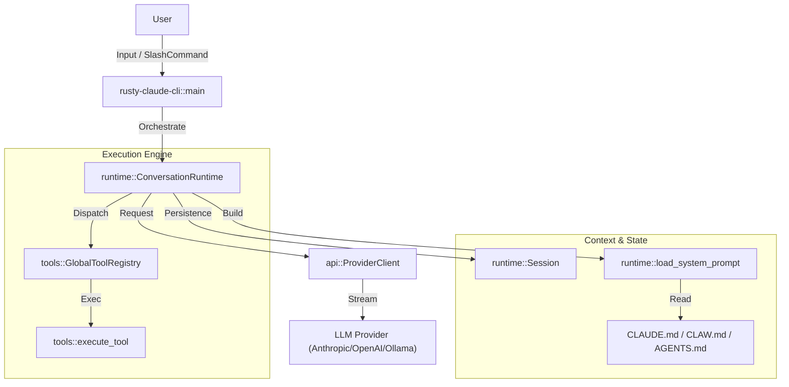
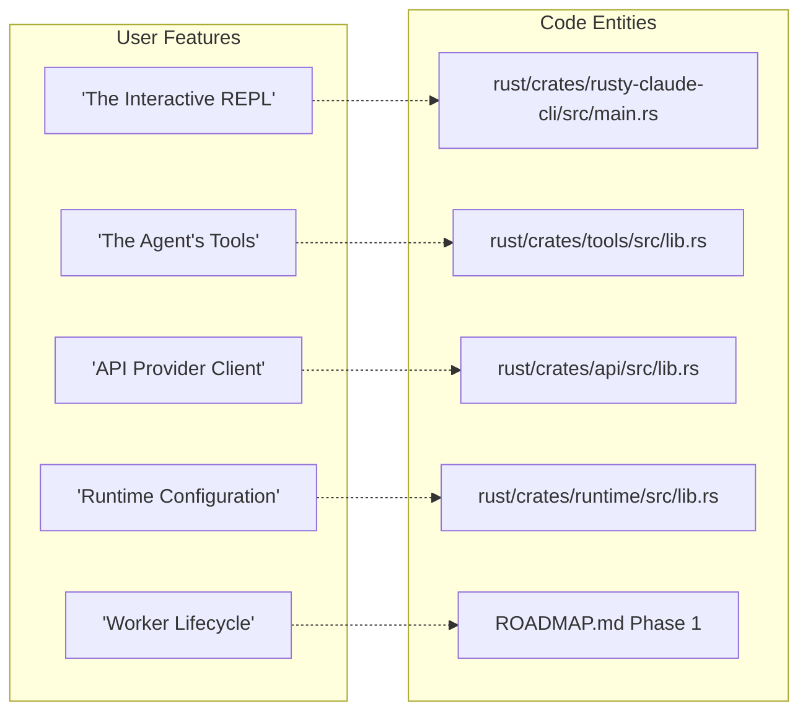

<!-- source: DeepWiki mcp.deepwiki.com · repo ultraworkers/claw-code · page 1 Overview · fetched 2026-10-26 -->

# Overview

Relevant source files

The following files were used as context for generating this wiki page:

- [PHILOSOPHY.md](PHILOSOPHY.md)
- [README.md](README.md)
- [ROADMAP.md](ROADMAP.md)
- [USAGE.md](USAGE.md)
- [docs/g011-acp-json-rpc-status-contract.md](docs/g011-acp-json-rpc-status-contract.md)
- [docs/local-openai-compatible-providers.md](docs/local-openai-compatible-providers.md)
- [docs/navigation-file-context.md](docs/navigation-file-context.md)
- [rust/README.md](rust/README.md)
- [rust/crates/commands/src/lib.rs](rust/crates/commands/src/lib.rs)
- [rust/crates/rusty-claude-cli/src/main.rs](rust/crates/rusty-claude-cli/src/main.rs)
- [rust/crates/rusty-claude-cli/tests/output_format_contract.rs](rust/crates/rusty-claude-cli/tests/output_format_contract.rs)

`claw-code` is a high-performance, local-first coding agent harness. Originally inspired by the architectural patterns of Claude Code, this project provides a robust environment for AI agents to interact with local workspaces through a suite of specialized tools, slash commands, and a sophisticated conversation runtime [README.md:96-98]().

The project is centered on a production-ready Rust implementation, supported by a "clawable" roadmap focused on deterministic state machines, machine-readable event streams, and autonomous recovery [ROADMAP.md:3-23]().

## Dual-Track Architecture

The repository maintains two distinct implementation tracks to ensure both rapid feature exploration and high-performance execution.

### 1. Production Rust Implementation (`rust/`)
The primary focus of the project is the Rust workspace. It is designed for speed, memory safety, and a native developer experience [rust/README.md:1-3](). It includes a full interactive REPL, an extensible tool system, and a multi-crate architecture that separates the API client, runtime logic, and CLI concerns [rust/README.md:84-110](). The core binary produced is `claw`, which supports both interactive turns and one-shot prompts [rust/crates/rusty-claude-cli/src/main.rs:73-90](), [USAGE.md:76-89]().

### 2. Python Porting Workspace (`src/`)
The Python track serves as a clean-room verification layer. It was used to map the original system's surface area into a manageable, testable structure before implementing high-performance equivalents in Rust [README.md:111-112](). It continues to serve as a reference for parity auditing and audit helpers [PARITY.md:1-10]().

For a detailed breakdown of these components, see **[Repository Structure](#1.2)**.

## Key Concepts

To navigate the codebase effectively, it is important to understand the following core entities:

| Concept | Description | Key Code Entities |
| :--- | :--- | :--- |
| **Conversation Runtime** | The core loop managing the interaction between the LLM, user, and tools. | `ConversationRuntime` [rust/crates/rusty-claude-cli/src/main.rs:56-65]() |
| **Tools** | Executable functions (bash, read, write, edit, grep, glob) that the agent can invoke. | `GlobalToolRegistry`, `mvp_tool_specs` [rust/crates/rusty-claude-cli/src/main.rs:68-71]() |
| **Slash Commands** | User-facing commands (e.g., `/status`, `/doctor`, `/ultraplan`) for session management and reasoning. | `SlashCommand`, `SlashCommandSpec` [rust/crates/commands/src/lib.rs:45-52](), [rust/crates/commands/src/lib.rs:60-225]() |
| **Session** | A persistent record of a conversation, including messages and tool outputs. | `Session`, `ConversationMessage` [rust/crates/rusty-claude-cli/src/main.rs:60-65]() |
| **MCP** | Model Context Protocol integration for external tool discovery. | `McpServerManager`, `McpConfigCollection` [rust/crates/rusty-claude-cli/src/main.rs:60-65]() |
| **Worker States** | Explicit lifecycle states (e.g., `spawning`, `ready_for_prompt`) for execution. | `WorkerStatus` [ROADMAP.md:75-84]() |
| **Lane Events** | Typed signals (e.g., `lane.started`, `lane.green`) for automation. | `LaneEventName` [ROADMAP.md:164-178]() |

### System Relationship Diagram
The following diagram illustrates how the user interacts with the system through the CLI and how the Runtime orchestrates internal components.

Sources: [rust/crates/rusty-claude-cli/src/main.rs:37-71](), [USAGE.md:58-65](), [ROADMAP.md:132-140](), [docs/navigation-file-context.md:20-29](), [rust/README.md:157-158]()

## Navigating the Wiki

This wiki is structured to guide you from initial setup to deep architectural understanding.

*   **[Getting Started](#1.1)**: Instructions for installing the Rust `claw` binary, configuring API keys (`ANTHROPIC_API_KEY`, `OPENAI_API_KEY`), and setting up your first workspace via `claw init` [USAGE.md:27-34](), [USAGE.md:56-72](), [docs/local-openai-compatible-providers.md:14-23]().
*   **[Repository Structure](#1.2)**: A map of the `rust/` and `src/` directories, explaining how the crates relate and how parity is tracked [README.md:104-112]().
*   **[Rust Implementation](#2)**: Deep dives into the production crates, including the `runtime`, `api`, `tools`, and `mcp` subsystems [rust/README.md:84-110](), [ROADMAP.md:73-161]().
*   **[Python Porting Workspace](#3)**: Documentation on the reference Python implementation used for architectural mapping and audit helpers [README.md:111-112]().
*   **[Configuration and Permissions](#4)**: Details on `settings.json`, OAuth flows, and permission modes such as `WorkspaceWrite` and `DangerFullAccess` [rust/crates/rusty-claude-cli/src/main.rs:116-162](), [docs/local-openai-compatible-providers.md:14-30]().
*   **[Testing and CI](#5)**: Overview of the `cargo test` suite and the mock parity harness for Anthropic-compatible service verification [rust/README.md:48-82](), [rust/crates/rusty-claude-cli/tests/output_format_contract.rs:12-34]().

### Component Map: Natural Language to Code
This map bridges high-level system features to their specific implementation points in the Rust workspace.

Sources: [rust/README.md:84-110](), [ROADMAP.md:73-85](), [rust/crates/rusty-claude-cli/src/main.rs:37-71](), [USAGE.md:3-15]()

---
Sources: [README.md:1-112](), [ROADMAP.md:1-180](), [rust/README.md:1-160](), [USAGE.md:1-140](), [docs/navigation-file-context.md:1-69](), [docs/local-openai-compatible-providers.md:1-152](), [rust/crates/commands/src/lib.rs:60-225](), [rust/crates/rusty-claude-cli/src/main.rs:73-162]()

---

