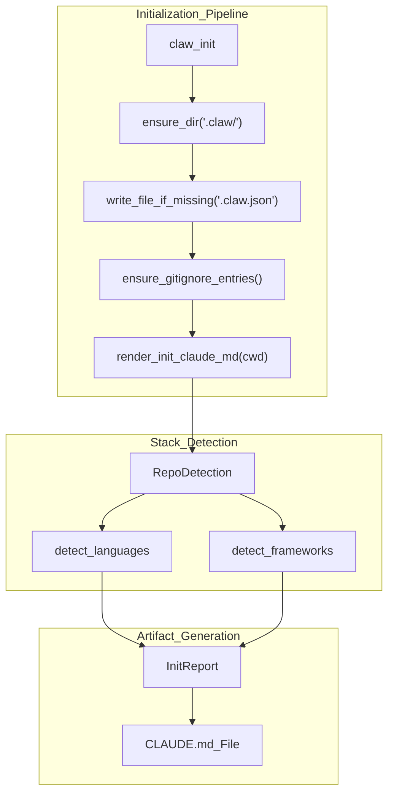
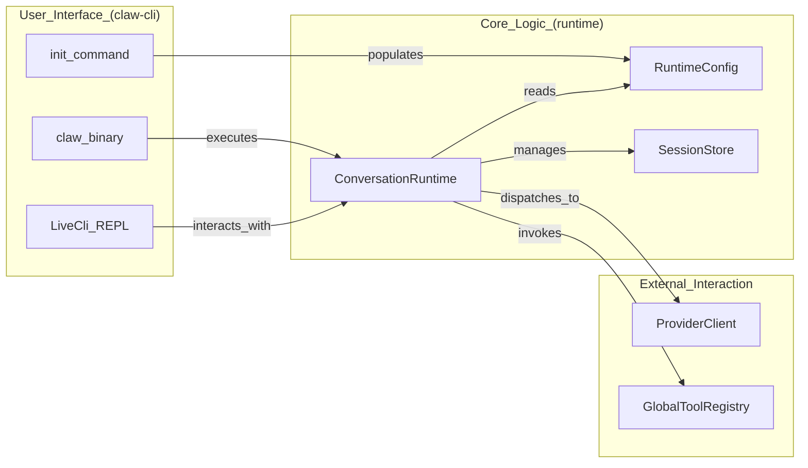

<!-- source: DeepWiki mcp.deepwiki.com · repo ultraworkers/claw-code · page 1.1 Getting Started · fetched 2026-10-26 -->

# Getting Started

<details>
<summary>Relevant source files</summary>

The following files were used as context for generating this wiki page:

- [.github/scripts/check_release_readiness.py](.github/scripts/check_release_readiness.py)
- [.github/workflows/release.yml](.github/workflows/release.yml)
- [Containerfile](Containerfile)
- [README.md](README.md)
- [USAGE.md](USAGE.md)
- [docs/container.md](docs/container.md)
- [docs/g009-windows-docs-release-verification-map.md](docs/g009-windows-docs-release-verification-map.md)
- [docs/g011-acp-json-rpc-status-contract.md](docs/g011-acp-json-rpc-status-contract.md)
- [docs/local-openai-compatible-providers.md](docs/local-openai-compatible-providers.md)
- [docs/navigation-file-context.md](docs/navigation-file-context.md)
- [docs/windows-install-release.md](docs/windows-install-release.md)
- [install.sh](install.sh)
- [rust/README.md](rust/README.md)
- [rust/scripts/install.sh](rust/scripts/install.sh)

</details>


This page provides the technical instructions for setting up, building, and initializing Claw Code. The project maintains a dual-track architecture: a **Rust production implementation** (the primary tool) and a **Python porting workspace** (used for clean-room verification and parity tracking) [README.md:35-51](), [README.md:106-111](), [rust/README.md:1-45]().

## Prerequisites

Before installation, ensure the following are available on your system:
*   **Rust Toolchain**: Required for building the production CLI and crates [USAGE.md:19-21]().
*   **Python 3.x**: Required for running the reference workspace and audit helpers [README.md:50-51]().
*   **Provider Credentials**: One of `ANTHROPIC_API_KEY` (for `sk-ant-*` keys) or `ANTHROPIC_AUTH_TOKEN` (for bearer/OAuth tokens) [USAGE.md:22-25]().

## Installation and Build

### Rust CLI (Production)
The primary entry point is the `claw` binary located in the `rust/` workspace.

**Building from Source:**
To produce a debug binary (fastest for development):
```bash
cd rust
cargo build --workspace
```
[rust/README.md:14-15](). The binary is available at `rust/target/debug/claw` (or `claw.exe` on Windows) after the build [README.md:111-123](), [USAGE.md:34-34](). For an optimized build, use `cargo build --workspace --release` [docs/windows-install-release.md:21-25]().

**Windows PowerShell Path:**
Native Windows users can build and run using PowerShell. For persistence, use `setx` to manage environment variables [docs/windows-install-release.md:102-104]().
```powershell
git clone https://github.com/ultraworkers/claw-code
Set-Location .\claw-code\rust
cargo build --workspace
.\target\debug\claw.exe --help
```
[docs/windows-install-release.md:11-17]().

**Using the Installer (Linux/macOS/WSL):**
A dedicated shell script handles environment detection and builds the workspace [install.sh:1-12]().
```bash
./install.sh
```
[docs/windows-install-release.md:70-74]().

### Python Workspace (Porting)
The Python workspace in `src/` serves as a reference for the original TypeScript surface. It includes tools for auditing parity between the implementations [README.md:50-51](), [README.md:111-111]().

## Environment Variables and Auth

Claw Code uses specific environment variables for provider authentication. Note that `ANTHROPIC_API_KEY` and `ANTHROPIC_AUTH_TOKEN` are **not** interchangeable as they result in different HTTP headers.

| Variable | Description | HTTP Header | Typical Source |
| :--- | :--- | :--- | :--- |
| `ANTHROPIC_API_KEY` | For `sk-ant-*` keys [docs/windows-install-release.md:193-193](). | `x-api-key` | Anthropic Console |
| `ANTHROPIC_AUTH_TOKEN` | For OAuth/Proxy bearer tokens [rust/README.md:40-40](). | `Authorization: Bearer` | OAuth Flow / Proxy |
| `ANTHROPIC_BASE_URL` | (Optional) Custom endpoint for proxies [USAGE.md:25-25](). | N/A | Local Proxy / Mock |
| `OPENAI_BASE_URL` | Endpoint for OpenAI-compatible local servers [docs/local-openai-compatible-providers.md:19-20](). | N/A | Ollama / vLLM / llama.cpp |
| `OLLAMA_HOST` | Preferred routing for Ollama [docs/local-openai-compatible-providers.md:60-64](). | N/A | Local Ollama Instance |

**First-Run Health Check:**
After building, run the built-in diagnostic to verify authentication and environment:
```bash
./target/debug/claw
# Inside REPL
/doctor
```
[USAGE.md:12-15](). The `/doctor` command performs setup and preflight diagnostics [USAGE.md:17-17]().

## Workspace Configuration

Claw Code is "workspace-aware," tailoring its behavior based on configuration files found in the project root.

### CLAUDE.md / CLAW.md (Project Memory)
These files provide high-level guidance, stack detection, and "working agreements" to the agent. Discovery priority is `CLAUDE.md`, then `CLAW.md`, then `AGENTS.md` [rust/README.md:157-158]().

### .claw.json
The primary configuration file for shared project settings. It defines default permission modes and project metadata.

### .claw/ Directory
Used for local-only state and overrides:
*   `.claw/settings.json`: Project-level configuration.
*   `.claw/settings.local.json`: Machine-specific overrides.
*   `.claw/sessions/`: Storage for serialized conversation history.
*   `.claw/worker-state.json`: Current worker context (ID, session, model) [USAGE.md:118-120]().

## First-Run Experience: Project Initialization

When running `claw init` or starting in a new repository, the system initializes the environment.

### Initialization Logic Flow
The initialization pipeline detects the technology stack and generates scaffolding.

**Initialization Data Flow**

Sources: [USAGE.md:56-74](), [rust/README.md:151-152]()

## Running the System

### Interactive REPL
To start an interactive session with tab completion and slash commands:
```bash
./target/debug/claw
```
[USAGE.md:77-80](). Inside the REPL, you can use commands like `/doctor`, `/status`, or `/config` [rust/README.md:155-160]().

### One-Shot Prompts
To execute a single instruction and exit:
```bash
./target/debug/claw prompt "explain this codebase"
```
[rust/README.md:20-21](). Use the `--` separator for dash-prefixed prompts [USAGE.md:103-107]().

### Container / Docker Workflow
The repository includes configuration for containerized execution, ensuring a clean and reproducible environment [README.md:100-100]().

**System Component Association**
This diagram maps high-level user interfaces to the underlying Rust implementation crates and key data structures.


Sources: [USAGE.md:5-15](), [rust/README.md:85-110](), [USAGE.md:116-120]()

---

