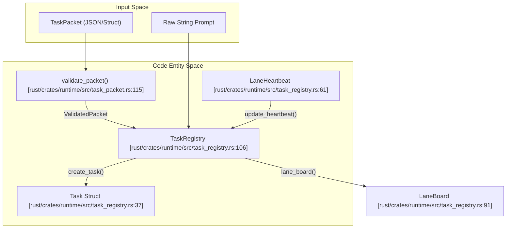
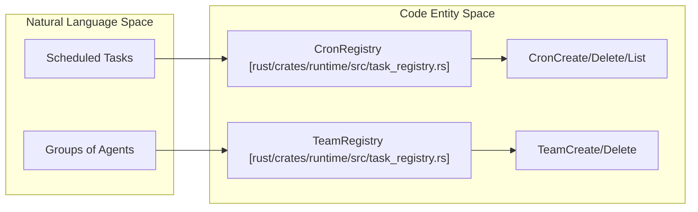

<!-- source: DeepWiki mcp.deepwiki.com · repo ultraworkers/claw-code · page 2.11 Task Packet, Task Registry, and Team/Cron System · fetched 2026-10-26 -->

# Task Packet, Task Registry, and Team/Cron System

Relevant source files

The following files were used as context for generating this wiki page:

- [docs/g005-branch-recovery-verification-map.md](docs/g005-branch-recovery-verification-map.md)
- [docs/g006-task-policy-board-verification-map.md](docs/g006-task-policy-board-verification-map.md)
- [rust/crates/runtime/src/mcp_lifecycle_hardened.rs](rust/crates/runtime/src/mcp_lifecycle_hardened.rs)
- [rust/crates/runtime/src/task_packet.rs](rust/crates/runtime/src/task_packet.rs)
- [rust/crates/runtime/src/task_registry.rs](rust/crates/runtime/src/task_registry.rs)
- [rust/crates/rusty-claude-cli/.claw/sessions/session-newer.jsonl](rust/crates/rusty-claude-cli/.claw/sessions/session-newer.jsonl)
- [rust/crates/tools/src/lane_completion.rs](rust/crates/tools/src/lane_completion.rs)

The task management subsystem provides the structured framework for defining, tracking, and automating work within the `claw-code` environment. It bridges the gap between high-level human objectives and the granular execution state of sub-agents.

## TaskPacket Schema

A `TaskPacket` is the canonical data structure used to define a unit of work. It contains the objective, constraints, and verification requirements necessary for an agent to operate autonomously.

### Core Structure
The `TaskPacket` is defined in [rust/crates/runtime/src/task_packet.rs:30-67](). Key fields include:

| Field | Type | Description |
| :--- | :--- | :--- |
| `objective` | `String` | The primary goal of the task. |
| `scope` | `TaskScope` | The granularity of work (Workspace, Module, SingleFile, or Custom) [rust/crates/runtime/src/task_packet.rs:7-16](). |
| `acceptance_criteria` | `Vec<String>` | Human-readable criteria for success [rust/crates/runtime/src/task_packet.rs:46-46](). |
| `resources` | `Vec<TaskResource>` | Allowed files, directories, or services [rust/crates/runtime/src/task_packet.rs:70-73](). |
| `verification_plan` | `Vec<String>` | Steps required to verify the work [rust/crates/runtime/src/task_packet.rs:66-66](). |
| `branch_policy` | `String` | Rules for git branch management. |
| `recovery_policy` | `Option<String>` | Instructions for automated recovery [rust/crates/runtime/src/task_packet.rs:64-64](). |
| `reporting_targets` | `Vec<String>` | Destinations for task status reports [rust/crates/runtime/src/task_packet.rs:60-60](). |

### Validation Logic
The `validate_packet` function [rust/crates/runtime/src/task_packet.rs:115-191]() enforces strict requirements:
* `objective`, `repo`, `branch_policy`, and `commit_policy` must not be empty [rust/crates/runtime/src/task_packet.rs:118-121]().
* If `scope` is `Module`, `SingleFile`, or `Custom`, a `scope_path` is mandatory [rust/crates/runtime/src/task_packet.rs:193-211]().
* Either `acceptance_tests` or `acceptance_criteria` must be provided [rust/crates/runtime/src/task_packet.rs:137-139]().
* Either `reporting_contract` or `reporting_targets` must be present [rust/crates/runtime/src/task_packet.rs:122-124]().
* `escalation_policy` or `recovery_policy` must be non-empty [rust/crates/runtime/src/task_packet.rs:125-132]().

**Sources:** [rust/crates/runtime/src/task_packet.rs:7-211]()

## TaskRegistry and Lifecycle

The `TaskRegistry` manages the in-memory state of all tasks created during a session. It uses an `Arc<Mutex<RegistryInner>>` to handle concurrent access [rust/crates/runtime/src/task_registry.rs:105-114]().

### Task Status Transitions
Tasks move through a defined lifecycle represented by the `TaskStatus` enum [rust/crates/runtime/src/task_registry.rs:14-21]():

1.  **Created**: Task initialized but not yet picked up by a worker [rust/crates/runtime/src/task_registry.rs:15-15]().
2.  **Running**: Worker is actively executing the task [rust/crates/runtime/src/task_registry.rs:16-16]().
3.  **Blocked**: Task is waiting on external input or a resource lock [rust/crates/runtime/src/task_registry.rs:17-17]().
4.  **Completed**: Objective met and verified [rust/crates/runtime/src/task_registry.rs:18-18]().
5.  **Failed**: Task terminated due to error or exhaustion of retries [rust/crates/runtime/src/task_registry.rs:19-19]().
6.  **Stopped**: Manually cancelled by the user [rust/crates/runtime/src/task_registry.rs:20-20]().

### Lane Board and Heartbeats
The registry tracks the health of active execution "lanes" via heartbeats:
* **LaneHeartbeat**: Records `observed_at` timestamps, `transport_alive` status, and a status string [rust/crates/runtime/src/task_registry.rs:61-65]().
* **LaneFreshness**: Calculated status based on the last heartbeat [rust/crates/runtime/src/task_registry.rs:53-58]().
    * `Healthy`: Recent heartbeat [rust/crates/runtime/src/task_registry.rs:76-76]().
    * `Stalled`: No heartbeat within `stalled_after_secs` [rust/crates/runtime/src/task_registry.rs:73-75]().
    * `TransportDead`: Transport layer reported failure [rust/crates/runtime/src/task_registry.rs:70-72]().
* **LaneBoard**: A point-in-time snapshot of all tasks categorized by their activity state (Active, Blocked, Finished) [rust/crates/runtime/src/task_registry.rs:91-96]().

### Task Registry Flow
Title: "Task Registry Data Flow"

**Sources:** [rust/crates/runtime/src/task_registry.rs:14-221](), [rust/crates/runtime/src/task_packet.rs:115-144]()

## Lane Completion and Reporting

The system uses automated heuristics to determine when a task is truly finished. This logic is encapsulated in `lane_completion.rs`.

### Detection Heuristics
The `detect_lane_completion` function [rust/crates/tools/src/lane_completion.rs:23-72]() evaluates an `AgentOutput` against several criteria:
1.  **Status**: Must be "completed" or "finished" (case-insensitive) [rust/crates/tools/src/lane_completion.rs:34-38]().
2.  **Errors**: `output.error` must be `None` [rust/crates/tools/src/lane_completion.rs:29-31]().
3.  **Blockers**: `output.current_blocker` must be `None` [rust/crates/tools/src/lane_completion.rs:41-43]().
4.  **Verification**: `test_green` must be `true` (indicating tests passed) [rust/crates/tools/src/lane_completion.rs:46-48]().
5.  **Persistence**: `has_pushed` must be `true` (indicating code is in the remote repository) [rust/crates/tools/src/lane_completion.rs:51-53]().

### Policy Evaluation
Once completion is detected, the `evaluate_completed_lane` function [rust/crates/tools/src/lane_completion.rs:76-96]() uses the `PolicyEngine` to trigger cleanup actions:
* `PolicyAction::CloseoutLane`: Finalizes the task state [rust/crates/tools/src/lane_completion.rs:84-84]().
* `PolicyAction::CleanupSession`: Removes ephemeral resources used by the worker [rust/crates/tools/src/lane_completion.rs:90-90]().

**Sources:** [rust/crates/tools/src/lane_completion.rs:1-96](), [docs/g006-task-policy-board-verification-map.md:28-28]()

## Team and Cron Systems

The codebase manages groups of agents and scheduled tasks through dedicated registry interfaces, ensuring organizational and temporal structure for automation.

### System Entity Mapping
Title: "Team and Cron System Mapping"

### Key Components
* **TeamRegistry**: Manages groups of agents working on shared objectives. Tasks can be associated with a `team_id` [rust/crates/runtime/src/task_registry.rs:47](). It supports `TeamCreate` and `TeamDelete` operations.
* **CronRegistry**: Handles scheduled task execution, supporting `CronCreate`, `CronDelete`, and `CronList`.
* **LaneBoard Integration**: The `LaneBoardEntry` includes `team_id` to allow filtering the dashboard by team [rust/crates/runtime/src/task_registry.rs:81-88]().
* **Session Liveness**: Heartbeats are integrated with session health state to track `SessionLiveness` [docs/g006-task-policy-board-verification-map.md:14-14]().

**Sources:** [rust/crates/runtime/src/task_registry.rs:47-88](), [docs/g006-task-policy-board-verification-map.md:3-33]()

---

