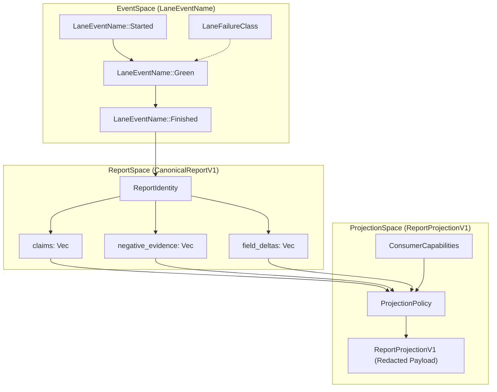
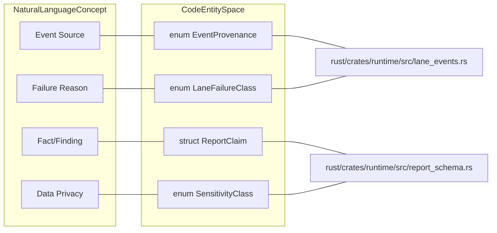

<!-- source: DeepWiki mcp.deepwiki.com · repo ultraworkers/claw-code · page 2.12 Lane Events and Report Schema · fetched 2026-10-26 -->

# Lane Events and Report Schema

Relevant source files

The following files were used as context for generating this wiki page:

- [.github/scripts/check_doc_source_of_truth.py](.github/scripts/check_doc_source_of_truth.py)
- [docs/g004-events-reports-contract.md](docs/g004-events-reports-contract.md)
- [rust/crates/api/Cargo.toml](rust/crates/api/Cargo.toml)
- [rust/crates/runtime/Cargo.toml](rust/crates/runtime/Cargo.toml)
- [rust/crates/runtime/src/branch_lock.rs](rust/crates/runtime/src/branch_lock.rs)
- [rust/crates/runtime/src/lane_events.rs](rust/crates/runtime/src/lane_events.rs)
- [rust/crates/runtime/src/mcp.rs](rust/crates/runtime/src/mcp.rs)
- [rust/crates/runtime/src/mcp_client.rs](rust/crates/runtime/src/mcp_client.rs)
- [rust/crates/runtime/src/mcp_stdio.rs](rust/crates/runtime/src/mcp_stdio.rs)
- [rust/crates/runtime/src/report_schema.rs](rust/crates/runtime/src/report_schema.rs)
- [rust/crates/runtime/tests/fixtures/report_schema_v1/README.md](rust/crates/runtime/tests/fixtures/report_schema_v1/README.md)

The structured event and report system provides a machine-readable foundation for the "clawable" coding harness. It moves the system away from log-scraping and toward a deterministic state machine where every worker transition, failure, and result is emitted as a typed event or a canonical report.

## Lane Events System

Lane events are the primary mechanism for communicating state changes across the orchestration layer. These events are designed to be consumed by automated watchers to summarize activity without human intervention [docs/g004-events-reports-contract.md:11-15]().

### LaneEventName Enum
The `LaneEventName` enum defines the canonical set of events emitted by a lane. This includes the lifecycle of the lane itself, branch status, and "ship" provenance for production deployments [rust/crates/runtime/src/lane_events.rs:6-50]().

| Event Category | Enum Variants |
| :--- | :--- |
| **Lifecycle** | `Started`, `Ready`, `Finished`, `Failed`, `Closed` |
| **Execution** | `PromptMisdelivery`, `Blocked`, `Red`, `Green` |
| **Workflow** | `CommitCreated`, `PrOpened`, `MergeReady`, `Merged`, `Superseded`, `Reconciled` |
| **Branch Health** | `BranchStaleAgainstMain`, `BranchWorkspaceMismatch` |
| **Provenance** | `ShipPrepared`, `ShipCommitsSelected`, `ShipMerged`, `ShipPushedMain` |

### LaneEventStatus and Failure Classification
Events are enriched with a `LaneEventStatus` to indicate the current phase [rust/crates/runtime/src/lane_events.rs:54-66](). When a lane fails, it is categorized using `LaneFailureClass` to allow for automated recovery recipes [rust/crates/runtime/src/lane_events.rs:70-83]().

- **Failure Classes:** `PromptDelivery`, `TrustGate`, `BranchDivergence`, `Compile`, `Test`, `PluginStartup`, `McpStartup`, `McpHandshake`, `GatewayRouting`, `ToolRuntime`, `WorkspaceMismatch`, `Infra` [rust/crates/runtime/src/lane_events.rs:70-83]().

### Event Metadata and Provenance
Every event includes `LaneEventMetadata`, which provides a monotonic sequence number (`seq`) for ordering and an `EventProvenance` to distinguish between live lanes, tests, and replays [rust/crates/runtime/src/lane_events.rs:88-99, 212-230]().

- **Provenance Types:** `LiveLane`, `Test`, `Healthcheck`, `Replay`, `Transport` [rust/crates/runtime/src/lane_events.rs:88-99]().

### Session Identity
The `SessionIdentity` struct captures the stable title, workspace path, and purpose of a session at creation time [rust/crates/runtime/src/lane_events.rs:103-113](). It supports reconciliation where placeholder reasons are cleared once real metadata is enriched via `reconcile_enriched` [rust/crates/runtime/src/lane_events.rs:151-170]().

Sources: [rust/crates/runtime/src/lane_events.rs:6-170](), [docs/g004-events-reports-contract.md:16-27]()

## Canonical Report V1 Schema

The `CanonicalReportV1` is a structured format for the final output of a lane's task. It focuses on evidence-based claims and field-level attribution rather than prose summaries [rust/crates/runtime/src/report_schema.rs:93-104]().

### Report Claims and Confidence
A report consists of multiple `ReportClaim` objects. Each claim is typed (`ObservedFact`, `Inference`, `Hypothesis`, `Recommendation`) and assigned a `ReportConfidence` level [rust/crates/runtime/src/report_schema.rs:12-26, 54-62]().

- **Confidence Levels:** `High`, `Medium`, `Low`, `Unknown` [rust/crates/runtime/src/report_schema.rs:21-26]().
- **Sensitivity Classes:** `Public`, `Internal`, `OperatorOnly`, `Secret` [rust/crates/runtime/src/report_schema.rs:30-35]().

### Negative Evidence
The schema explicitly tracks `NegativeEvidence`—searched-and-not-found findings. This includes the `checked_surfaces`, the specific `query` used, and the temporal or spatial `window` of the search [rust/crates/runtime/src/report_schema.rs:65-73]().

### Field Deltas
To support incremental updates, `FieldDelta` tracks how specific fields changed between reports, including `previous_hash`, `current_hash`, and an `attribution` string explaining the change [rust/crates/runtime/src/report_schema.rs:76-84]().

### Projection and Redaction
The system supports `ReportProjectionV1`, allowing a canonical report to be filtered based on `ConsumerCapabilities` [rust/crates/runtime/src/report_schema.rs:107-114, 139-145](). This process is governed by a `ProjectionProvenance` that tracks which fields were omitted or redacted and why [rust/crates/runtime/src/report_schema.rs:125-136]().

### Data Flow: From Event to Report
The following diagram illustrates how the system transitions from live events to a finalized, projected report.

**Event to Report Transformation**

Sources: [rust/crates/runtime/src/report_schema.rs:10-145](), [rust/crates/runtime/src/lane_events.rs:6-83]()

## Implementation Details

### Report Schema Registry
The `ReportSchemaRegistry` defines the available fields and their metadata, ensuring compatibility across different versions of the report schema [rust/crates/runtime/src/report_schema.rs:156-160](). The `REPORT_SCHEMA_V1` constant identifies the current version [rust/crates/runtime/src/report_schema.rs:7]().

### Fixtures and Validation
The report system is validated using the `report_schema_v1` fixture set [rust/crates/runtime/tests/fixtures/report_schema_v1/README.md:1-3](). These fixtures cover:
- Fact/Hypothesis/Confidence labels [rust/crates/runtime/tests/fixtures/report_schema_v1/README.md:6]()
- Negative evidence with query windows [rust/crates/runtime/tests/fixtures/report_schema_v1/README.md:7]()
- Field-level delta attribution [rust/crates/runtime/tests/fixtures/report_schema_v1/README.md:8]()
- Deterministic projection and redaction [rust/crates/runtime/tests/fixtures/report_schema_v1/README.md:10]()

### Mapping Code Entities to Concepts
The following diagram bridges the natural language concepts of the reporting system to their specific Rust implementations.

**Code Entity Mapping**

Sources: [rust/crates/runtime/src/lane_events.rs:88-99, 70-83](), [rust/crates/runtime/src/report_schema.rs:30-35, 54-62]()

### Verification and Compliance
The G004 contract guidance ensures that terminal fingerprints use stable metadata for ordering and deduplication [docs/g004-events-reports-contract.md:22-24](). Compliance requires that producers and consumers negotiate via `ConsumerCapabilities` instead of silently dropping fields [docs/g004-events-reports-contract.md:53-60]().

Sources: [docs/g004-events-reports-contract.md:1-66](), [rust/crates/runtime/src/report_schema.rs:1-213]()

---

