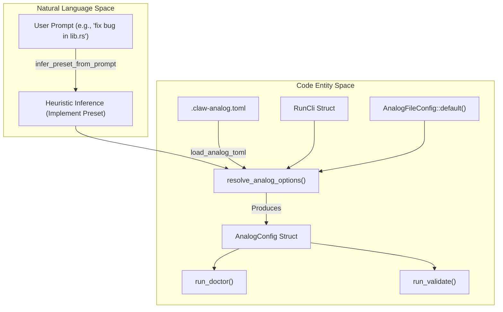
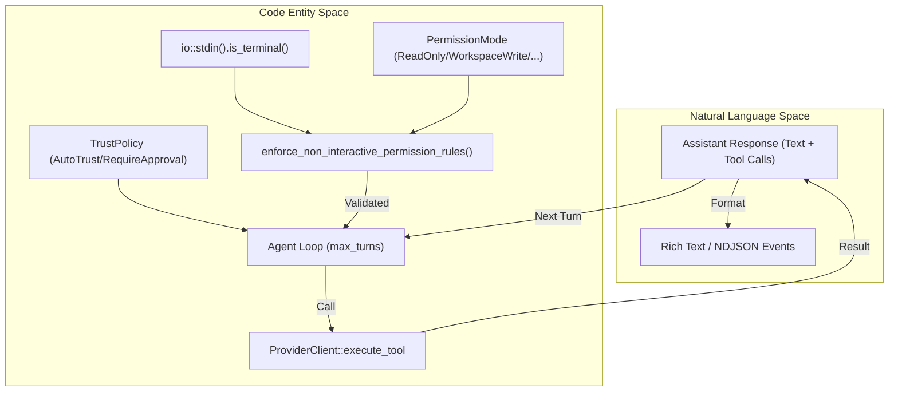

<!-- source: DeepWiki mcp.deepwiki.com · repo ultraworkers/claw-code · page 2.13 claw-analog: Lightweight Agent Harness · fetched 2026-10-26 -->

# claw-analog: Lightweight Agent Harness

<details>
<summary>Relevant source files</summary>

The following files were used as context for generating this wiki page:

- [how_to_run.md](how_to_run.md)
- [rust/crates/claw-analog/Cargo.toml](rust/crates/claw-analog/Cargo.toml)
- [rust/crates/claw-analog/src/agents.rs](rust/crates/claw-analog/src/agents.rs)
- [rust/crates/claw-analog/src/config_cmd.rs](rust/crates/claw-analog/src/config_cmd.rs)
- [rust/crates/claw-analog/src/doctor.rs](rust/crates/claw-analog/src/doctor.rs)
- [rust/crates/claw-analog/src/lib.rs](rust/crates/claw-analog/src/lib.rs)
- [rust/crates/claw-analog/src/main.rs](rust/crates/claw-analog/src/main.rs)
- [rust/crates/runtime/src/trust_resolver.rs](rust/crates/runtime/src/trust_resolver.rs)

</details>


The `claw-analog` crate is a lean, non-interactive agent harness designed for CI/CD pipelines, automation scripts, and low-overhead agent loops. It shares the same core `api` and `runtime` foundations as the full `claw` CLI but strips away the REPL and complex session management in favor of a stateless or single-session execution model [rust/crates/claw-analog/src/lib.rs:1-2]().

## Overview and Purpose

`claw-analog` serves as a "lean" alternative to the primary `claw` implementation. It is optimized for environments where a full interactive terminal is unavailable, enforcing strict permission boundaries for non-interactive runs [rust/crates/claw-analog/src/lib.rs:25-34](). It supports built-in behavior presets, NDJSON output for machine readability, and integration with the `claw-rag-service` for semantic context retrieval [how_to_run.md:141-143]().

### Key Differences from claw CLI
| Feature | `claw` (CLI) | `claw-analog` |
|:---|:---|:---|
| **Interface** | Interactive REPL / Shorthand | Command-line arguments / Stdin |
| **Output** | ANSI Rich Text / JSON | Rich Text / NDJSON (newline-delimited) |
| **Session** | Persistent `.claw/sessions/` | Optional single-file JSON session |
| **CI-Friendly** | Manual TTY required for some modes | Built-in non-interactive enforcement |
| **RAG** | Via MCP or built-in | `retrieve_context` tool integration |

Sources: [rust/crates/claw-analog/src/lib.rs:1-100](), [how_to_run.md:1-110](), [rust/crates/claw-analog/Cargo.toml:1-30]()

---

## Configuration and .claw-analog.toml

The harness uses a hierarchical configuration system. It first looks for a `.claw-analog.toml` file in the workspace root, which is then overridden by explicit CLI flags [how_to_run.md:114-116]().

### AnalogFileConfig Schema
The `AnalogFileConfig` struct defines the TOML schema [rust/crates/claw-analog/src/config_cmd.rs:8-9]().

```toml
model = "sonnet"             # Model alias or ID
stream = true                # Enable SSE streaming
output_format = "rich"       # "rich" or "json"
permission = "read-only"     # Default permission mode
language = "en"              # "en" or "ru" hint for system prompt
preset = "audit"             # Behavior preset
session = "session.json"     # Session persistence path
max_turns = 24               # Loop limit for tool use
max_read_bytes = 262144      # File read limit
rag_base_url = "http://..."  # RAG service endpoint
```

### Profile Integration
Users can specify a `profile.toml` containing a `line` field, which is injected into the system prompt to provide persistent identity or global instructions across different workspaces [rust/crates/claw-analog/src/config_cmd.rs:55-77](). The `resolve_analog_profile_path` function handles the resolution order: CLI flag > TOML field > default `~/.claw-analog/profile.toml` [rust/crates/claw-analog/src/config_cmd.rs:55-59]().

Sources: [rust/crates/claw-analog/src/config_cmd.rs:24-113](), [how_to_run.md:118-139](), [rust/crates/claw-analog/src/main.rs:146-148]()

---

## Agent Loop and Presets

`claw-analog` implements a "tool loop" that continues until the model provides a final response or the `max_turns` limit is reached [how_to_run.md:99-100]().

### Preset Modes
Presets adjust the system prompt bias and default permissions [rust/crates/claw-analog/src/lib.rs:107-114]().

*   **Audit**: Prioritizes security, correctness, and suspicious patterns. Prefers read-only investigation [rust/crates/claw-analog/src/lib.rs:140-142]().
*   **Explain**: Focuses on clarity, defining terms, and grounding claims in the repository [rust/crates/claw-analog/src/lib.rs:143-145]().
*   **Implement**: Optimized for making focused code edits and refactors [rust/crates/claw-analog/src/lib.rs:146-148]().
*   **Auto (Inference)**: The harness can heuristically infer the preset based on keywords in the user's prompt (e.g., "fix" triggers `Implement`, "secure" triggers `Audit`) using `infer_preset_from_prompt` [rust/crates/claw-analog/src/lib.rs:161-216]().

### Permission Enforcement
In non-interactive environments (where stdin is not a TTY), `claw-analog` refuses `danger-full-access` and `allow` modes unless the `--accept-danger-non-interactive` flag is explicitly provided [rust/crates/claw-analog/src/lib.rs:42-53](). The `enforce_non_interactive_permission_rules` function validates this posture before starting the loop [rust/crates/claw-analog/src/lib.rs:25-34]().

Sources: [rust/crates/claw-analog/src/lib.rs:107-160](), [rust/crates/claw-analog/src/lib.rs:25-60](), [rust/crates/claw-analog/src/main.rs:161-163]()

---

## Tooling and RAG Integration

The harness provides a standard suite of workspace tools (read, list, grep, glob, edit) with configurable safety limits [how_to_run.md:96-103]().

### retrieve_context (RAG)
If `RAG_BASE_URL` is configured, the `retrieve_context` tool is enabled [how_to_run.md:141-143](). This tool performs a semantic search against the `claw-rag-service`, allowing the agent to find relevant code snippets across large repositories. The `resolve_rag_base_url` function determines the endpoint from environment variables or config [rust/crates/claw-analog/src/main.rs:14-15]().

### Multi-Agent Workflows
The `agents` subcommand allows running multiple specialized agents sequentially [rust/crates/claw-analog/src/agents.rs:1-10]().
*   **AgentSpec**: Defines a sub-agent's name, preset, permission, and model [rust/crates/claw-analog/src/agents.rs:63-69]().
*   **Split Sessions**: Each agent can write its own session file, allowing for a "chain of thought" across different model configurations [rust/crates/claw-analog/src/agents.rs:184-186]().
*   **Sequential Execution**: The `AgentsCli` handles parsing repeatable agent specs like `--agent audit --agent name=fix,preset=implement` [rust/crates/claw-analog/src/agents.rs:179-181]().

Sources: [rust/crates/claw-analog/src/agents.rs:63-159](), [how_to_run.md:141-150](), [rust/crates/claw-analog/src/main.rs:96-97]()

---

## Preflight and Diagnostics

### The doctor Command
`claw-analog doctor` performs environment and build sanity checks [rust/crates/claw-analog/src/doctor.rs:1-6]().
*   **Config Preview**: Shows the effective configuration after merging TOML and CLI flags [rust/crates/claw-analog/src/doctor.rs:185-198]().
*   **TCP Ping**: Verifies connectivity to the API provider (e.g., Anthropic or a local mock) without making an authenticated HTTP request using `tcp_ping` [rust/crates/claw-analog/src/doctor.rs:119-121]().
*   **Build Check**: Can run `cargo check` or `cargo build --release` to ensure the environment is ready for execution [rust/crates/claw-analog/src/doctor.rs:129-133]().

### NDJSON Output Contract
For automation, `claw-analog` emits Newline-Delimited JSON (NDJSON) [rust/crates/claw-analog/src/doctor.rs:11-12](). This follows a stable schema versioned as `NDJSON_FORMAT_VERSION` [rust/crates/claw-analog/src/doctor.rs:181-183]().

Sources: [rust/crates/claw-analog/src/doctor.rs:139-200](), [how_to_run.md:20-39](), [rust/crates/claw-analog/src/main.rs:88-89]()

---

## Data Flow Diagrams

### Configuration Merging and Resolution
This diagram shows how `claw-analog` resolves its final runtime configuration from multiple sources.


Sources: [rust/crates/claw-analog/src/lib.rs:161-165](), [rust/crates/claw-analog/src/doctor.rs:179-180](), [rust/crates/claw-analog/src/config_cmd.rs:85-86](), [rust/crates/claw-analog/src/main.rs:122-177]()

### Non-Interactive Execution Loop
This diagram illustrates the agent loop and the permission gating for CI/automation runs.


Sources: [rust/crates/claw-analog/src/lib.rs:25-34](), [rust/crates/claw-analog/src/lib.rs:42-53](), [how_to_run.md:99-100](), [rust/crates/runtime/src/trust_resolver.rs:16-23]()

---

