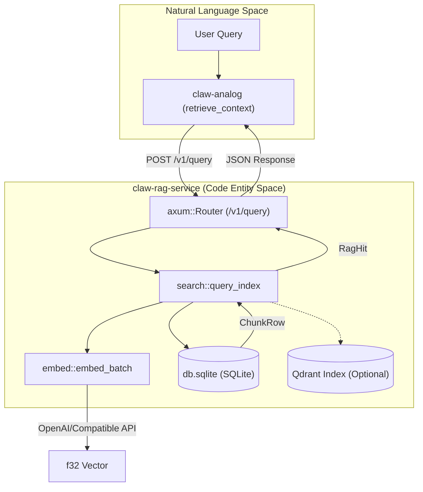
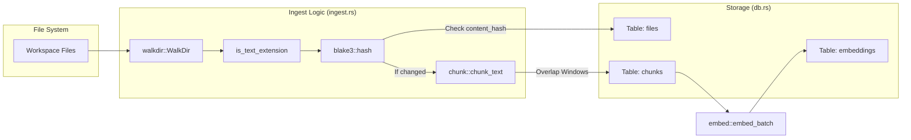

<!-- source: DeepWiki mcp.deepwiki.com · repo ultraworkers/claw-code · page 2.14 claw-rag-service: Workspace RAG and Embedding Service · fetched 2026-10-26 -->

# claw-rag-service: Workspace RAG and Embedding Service

Relevant source files

The following files were used as context for generating this wiki page:

- [concept.md](concept.md)
- [docs/personal-assistant-roadmap.md](docs/personal-assistant-roadmap.md)
- [docs/rag-web-ui.md](docs/rag-web-ui.md)
- [rust/crates/claw-rag-service/Cargo.toml](rust/crates/claw-rag-service/Cargo.toml)
- [rust/crates/claw-rag-service/Dockerfile](rust/crates/claw-rag-service/Dockerfile)
- [rust/crates/claw-rag-service/src/chunk.rs](rust/crates/claw-rag-service/src/chunk.rs)
- [rust/crates/claw-rag-service/src/db.rs](rust/crates/claw-rag-service/src/db.rs)
- [rust/crates/claw-rag-service/src/embed.rs](rust/crates/claw-rag-service/src/embed.rs)
- [rust/crates/claw-rag-service/src/ingest.rs](rust/crates/claw-rag-service/src/ingest.rs)
- [rust/crates/claw-rag-service/src/lib.rs](rust/crates/claw-rag-service/src/lib.rs)
- [rust/crates/claw-rag-service/src/main.rs](rust/crates/claw-rag-service/src/main.rs)
- [rust/crates/claw-rag-service/src/qdrant_index.rs](rust/crates/claw-rag-service/src/qdrant_index.rs)
- [rust/crates/claw-rag-service/src/search.rs](rust/crates/claw-rag-service/src/search.rs)
- [rust/crates/claw-rag-service/static/index.html](rust/crates/claw-rag-service/static/index.html)

The `claw-rag-service` crate provides a standalone Retrieval-Augmented Generation (RAG) architecture for the `claw-code` workspace. It operates as a decoupled service that handles file ingestion, chunking, embedding generation, and vector search, exposing its capabilities via an HTTP API. This allows `claw-analog` and other tools to perform semantic searches over the codebase without embedding heavy vector logic into the core agent runtime [docs/rag-web-ui.md:1-10]().

## Architecture Overview

The service follows a "RAG-as-a-service" model where indexing and retrieval are separated from the main conversation engine. It is designed to bridge the gap between raw file content and semantic context required by LLM agents [concept.md:43-57]().

### System Interaction Diagram
This diagram illustrates how the natural language query from a user is transformed into code snippets via the `claw-rag-service` components.

Sources: [rust/crates/claw-rag-service/src/main.rs:65-72](), [rust/crates/claw-rag-service/src/search.rs:11-16](), [docs/rag-web-ui.md:13-22](), [concept.md:43-57]()

## Ingestion Pipeline

The ingestion process is triggered via the `ingest` subcommand. It performs a recursive walk of the workspace, filtering for text files, chunking them, and updating a local SQLite database [rust/crates/claw-rag-service/src/ingest.rs:92-98](). The pipeline supports cross-repo RAG by accepting multiple `--workspace` arguments [rust/crates/claw-rag-service/src/main.rs:43-46]().

### Ingestion Data Flow
The pipeline uses file metadata and content hashes to ensure incremental updates, avoiding redundant embedding calls for unchanged files.

Sources: [rust/crates/claw-rag-service/src/ingest.rs:110-135](), [rust/crates/claw-rag-service/src/db.rs:7-29](), [rust/crates/claw-rag-service/src/chunk.rs:4-15](), [rust/crates/claw-rag-service/src/ingest.rs:162-165]()

### Key Ingestion Components
*   **Chunking Strategy**: Files are split into overlapping character-based windows. Default `CHUNK_CHARS` is 900 with a `CHUNK_OVERLAP` of 120 [rust/crates/claw-rag-service/src/ingest.rs:19-20]().
*   **Incremental Updates**: The `file_is_unchanged` function checks `content_hash` (calculated via `blake3`), `size_bytes`, and `mtime_ms` against the `files` table [rust/crates/claw-rag-service/src/db.rs:58-76](), [rust/crates/claw-rag-service/src/ingest.rs:162-163]().
*   **Batching**: Embeddings are requested in batches of 16 to optimize network overhead [rust/crates/claw-rag-service/src/ingest.rs:21]().
*   **File Filtering**: Only specific text extensions are indexed (e.g., `.rs`, `.md`, `.ts`, `.py`), and directories like `.git` or `node_modules` are skipped [rust/crates/claw-rag-service/src/ingest.rs:23-28]().

## Embedding and Search

The service supports OpenAI-compatible embedding endpoints. It calculates semantic similarity to find the most relevant code fragments for a given query.

### EmbedConfig
Configuration is loaded from environment variables, allowing flexibility for local models (e.g., Ollama) or cloud providers.
*   `CLAW_RAG_OPENAI_API_KEY`: Authentication for the provider [rust/crates/claw-rag-service/src/embed.rs:15-19]().
*   `CLAW_RAG_EMBEDDING_BASE_URL`: The endpoint (defaults to OpenAI V1) [rust/crates/claw-rag-service/src/embed.rs:20-21]().
*   `CLAW_RAG_EMBEDDING_MODEL`: The model name (defaults to `text-embedding-3-small`) [rust/crates/claw-rag-service/src/embed.rs:22-23]().
*   **Mocking**: For testing or dry-runs, a mock provider can be enabled via `CLAW_RAG_MOCK_PROVIDERS=1`, generating deterministic fake vectors [rust/crates/claw-rag-service/src/embed.rs:34-43]().

### Search Execution
The `query_index` function performs the following steps:
1.  Embeds the incoming query string using `embed_batch` [rust/crates/claw-rag-service/src/search.rs:25-29]().
2.  Loads all indexed vectors from SQLite via `load_all_indexed` (or queries Qdrant if enabled) [rust/crates/claw-rag-service/src/search.rs:31-36]().
3.  Calculates `cosine_similarity` between the query vector and every chunk vector [rust/crates/claw-rag-service/src/search.rs:54-58]().
4.  Returns a `QueryResponse` containing `RagHit` objects sorted by score, including a `phase` identifier (e.g., `1-sqlite`) [rust/crates/claw-rag-service/src/search.rs:62-79]().

## Storage Backends

### SQLite + sqlite-vec (Default)
The service uses a standard SQLite database for metadata and a BLOB-based storage for vectors in the `embeddings` table [rust/crates/claw-rag-service/src/db.rs:15-20](). Vectors are stored as little-endian `f32` byte arrays [rust/crates/claw-rag-service/src/db.rs:156-162](). The database schema includes:
*   `chunks`: Stores the raw text and ordinal position [rust/crates/claw-rag-service/src/db.rs:8-14]().
*   `embeddings`: Stores the vector dimension and BLOB data [rust/crates/claw-rag-service/src/db.rs:15-20]().
*   `files`: Tracks metadata for incremental indexing [rust/crates/claw-rag-service/src/db.rs:21-27]().

### Qdrant (Optional)
When the `qdrant-index` feature is enabled, the service can upsert and query points in a Qdrant collection.
*   **Configuration**: Managed via `QdrantConfig` using `CLAW_RAG_QDRANT_URL` and `CLAW_RAG_QDRANT_COLLECTION` [rust/crates/claw-rag-service/src/qdrant_index.rs:38-57]().
*   **Upsert**: Chunks are converted to `PointStruct` with `path` and `text` as payload [rust/crates/claw-rag-service/src/qdrant_index.rs:145-158]().
*   **Query**: Uses `QueryPointsBuilder` with cosine distance [rust/crates/claw-rag-service/src/qdrant_index.rs:81-89]().

## HTTP API and Web UI

The service runs an `axum` server providing a JSON API and a diagnostic Web UI.

### API Endpoints
| Method | Path | Description |
| :--- | :--- | :--- |
| `GET` | `/` | Serves the single-page manual inspection UI [rust/crates/claw-rag-service/src/main.rs:67](). |
| `GET` | `/health` | Basic health check returning "ok" [rust/crates/claw-rag-service/src/main.rs:68](). |
| `GET` | `/v1/stats` | Returns chunk count and current status phase [rust/crates/claw-rag-service/src/main.rs:135-154](). |
| `POST` | `/v1/query` | Executes a semantic search. Accepts `QueryRequest` [rust/crates/claw-rag-service/src/main.rs:156-164](). |

### Manual Index Inspection
The `static/index.html` file is embedded into the binary. It allows developers to:
1.  View index statistics (total chunks, database phase) [rust/crates/claw-rag-service/static/index.html:123-127]().
2.  Test queries directly in the browser [rust/crates/claw-rag-service/static/index.html:129-141]().
3.  Inspect the `path`, `score`, and `snippet` of returned `RagHit` results [rust/crates/claw-rag-service/static/index.html:180-199]().

Sources: [rust/crates/claw-rag-service/src/lib.rs:21-44](), [rust/crates/claw-rag-service/src/main.rs:6-12](), [docs/rag-web-ui.md:32-40](), [rust/crates/claw-rag-service/src/main.rs:59-63]()

---

