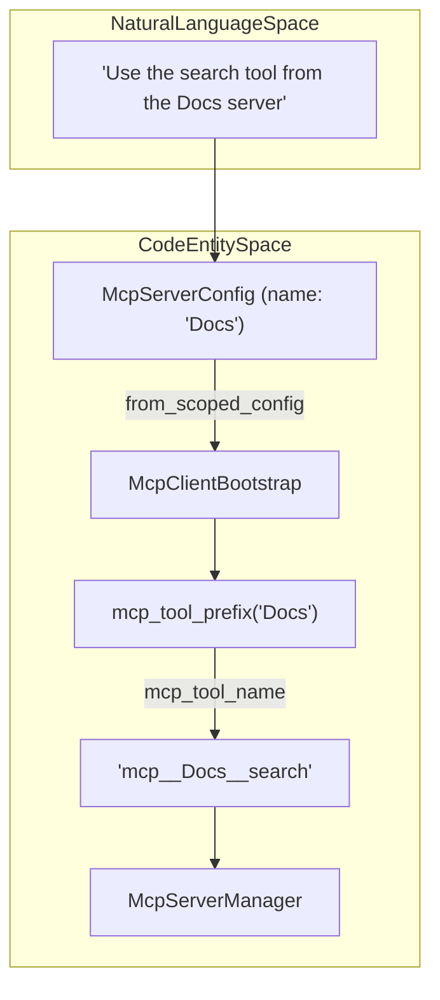
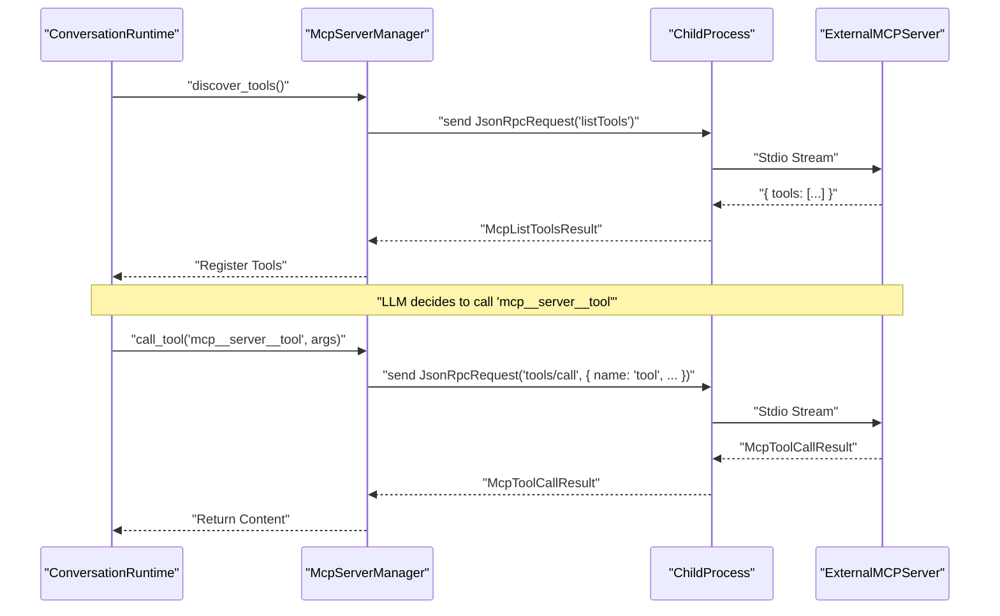

<!-- source: DeepWiki mcp.deepwiki.com · repo ultraworkers/claw-code · page 2.5 MCP Integration · fetched 2026-10-26 -->

# MCP Integration

Relevant source files

The following files were used as context for generating this wiki page:

- [.github/scripts/check_doc_source_of_truth.py](.github/scripts/check_doc_source_of_truth.py)
- [docs/g007-mcp-lifecycle-mapping.md](docs/g007-mcp-lifecycle-mapping.md)
- [rust/crates/api/Cargo.toml](rust/crates/api/Cargo.toml)
- [rust/crates/runtime/Cargo.toml](rust/crates/runtime/Cargo.toml)
- [rust/crates/runtime/src/branch_lock.rs](rust/crates/runtime/src/branch_lock.rs)
- [rust/crates/runtime/src/lane_events.rs](rust/crates/runtime/src/lane_events.rs)
- [rust/crates/runtime/src/lsp_client.rs](rust/crates/runtime/src/lsp_client.rs)
- [rust/crates/runtime/src/mcp.rs](rust/crates/runtime/src/mcp.rs)
- [rust/crates/runtime/src/mcp_client.rs](rust/crates/runtime/src/mcp_client.rs)
- [rust/crates/runtime/src/mcp_server.rs](rust/crates/runtime/src/mcp_server.rs)
- [rust/crates/runtime/src/mcp_stdio.rs](rust/crates/runtime/src/mcp_stdio.rs)
- [rust/crates/runtime/src/mcp_tool_bridge.rs](rust/crates/runtime/src/mcp_tool_bridge.rs)
- [rust/crates/runtime/src/permission_enforcer.rs](rust/crates/runtime/src/permission_enforcer.rs)
- [rust/crates/runtime/src/plugin_lifecycle.rs](rust/crates/runtime/src/plugin_lifecycle.rs)
- [rust/crates/runtime/src/stale_branch.rs](rust/crates/runtime/src/stale_branch.rs)
- [rust/crates/runtime/src/team_cron_registry.rs](rust/crates/runtime/src/team_cron_registry.rs)

The Model Context Protocol (MCP) integration in `claw-code` allows the runtime to connect to external tool providers and resource servers. This implementation handles the lifecycle of MCP servers, provides a robust JSON-RPC framing layer for various transports, and maps remote tools into the local execution environment with qualified namespacing and hardened error handling.

## MCP Lifecycle and Management

The `McpServerManager` is the central coordinator for all MCP interactions. It is responsible for initializing connections, discovering available tools and resources, and routing tool execution requests to the appropriate server process [rust/crates/runtime/src/mcp_stdio.rs:19-25]().

### Hardened Lifecycle Phases
To ensure reliability, the system tracks MCP servers through a set of explicit, hardened lifecycle phases defined in `McpLifecyclePhase`. This allows the runtime to report precisely where a failure occurred (e.g., during `InitializeHandshake` vs. `ToolDiscovery`).

| Phase | Description |
| :--- | :--- |
| `ConfigLoad` | Loading server definitions from `RuntimeConfig`. |
| `SpawnConnect` | Establishing the physical transport (process spawn or socket). |
| `InitializeHandshake` | Exchanging capabilities and protocol versions [rust/crates/runtime/src/mcp_stdio.rs:80-91](). |
| `ToolDiscovery` | Populating the registry via `listTools` [rust/crates/runtime/src/mcp_stdio.rs:110-134](). |
| `Ready` | Server is fully operational and available for tool calls. |

### Connection and Initialization
When the `ConversationRuntime` starts, it uses the `McpServerManager` to bootstrap servers defined in the `RuntimeConfig`. The initialization follows the standard MCP handshake:
1.  **Transport Setup**: Spawning a process (Stdio) or establishing a network connection (SSE/HTTP/WS) [rust/crates/runtime/src/mcp_client.rs:9-16]().
2.  **Initialize Request**: Sending `McpInitializeParams` including client info and protocol version [rust/crates/runtime/src/mcp_stdio.rs:80-91]().
3.  **Discovery**: Calling `McpListToolsParams` and `McpListResourcesParams` to populate the local registry [rust/crates/runtime/src/mcp_stdio.rs:110-134](), [rust/crates/runtime/src/mcp_stdio.rs:169-195]().

Sources: [rust/crates/runtime/src/mcp_stdio.rs:19-195](), [rust/crates/runtime/src/mcp_client.rs:9-16](), [rust/crates/runtime/src/mcp_tool_bridge.rs:22-43]()

## Transports and Framing

`claw-code` supports multiple transport layers through the `McpClientTransport` abstraction [rust/crates/runtime/src/mcp_client.rs:9-16]().

### Supported Transport Types
| Transport Type | Code Entity | Description |
| :--- | :--- | :--- |
| **Stdio** | `McpStdioTransport` | Local child processes using `stdin`/`stdout` [rust/crates/runtime/src/mcp_client.rs:19-24](). |
| **SSE** | `McpRemoteTransport` | Server-Sent Events for remote streaming [rust/crates/runtime/src/mcp_client.rs:27-32](). |
| **HTTP** | `McpRemoteTransport` | Standard REST-based JSON-RPC [rust/crates/runtime/src/mcp_client.rs:27-32](). |
| **WebSocket** | `McpRemoteTransport` | Full-duplex persistent connections [rust/crates/runtime/src/mcp_client.rs:27-32](). |
| **Managed Proxy** | `McpManagedProxyTransport` | Connections via a managed gateway/proxy [rust/crates/runtime/src/mcp_client.rs:40-43](). |

### JSON-RPC Framing
For Stdio-based servers, the system manages low-level communication using JSON-RPC 2.0 framing. Every message has a unique `JsonRpcId` [rust/crates/runtime/src/mcp_stdio.rs:33-37]() and follows the `JsonRpcRequest` [rust/crates/runtime/src/mcp_stdio.rs:40-46]() and `JsonRpcResponse` [rust/crates/runtime/src/mcp_stdio.rs:69-76]() structures.

Sources: [rust/crates/runtime/src/mcp_client.rs:9-43](), [rust/crates/runtime/src/mcp_stdio.rs:33-76]()

## Tool Discovery and Routing

To prevent naming collisions between different MCP servers, `claw-code` uses a qualified naming scheme.

### Naming Conventions
- **Prefixing**: Every tool from an MCP server is prefixed with `mcp__[server_name]__` via `mcp_tool_prefix` [rust/crates/runtime/src/mcp.rs:26-28]().
- **Normalization**: Server names and tool names are normalized via `normalize_name_for_mcp` to ensure they are valid identifiers (alphanumeric, underscores, or hyphens) [rust/crates/runtime/src/mcp.rs:7-23]().
- **Tool Namespacing**: The function `mcp_tool_name` combines the prefix and normalized tool name to create a unique identifier for the LLM [rust/crates/runtime/src/mcp.rs:31-37]().

**Entity Mapping: Natural Language to Code**

Sources: [rust/crates/runtime/src/mcp.rs:7-37](), [rust/crates/runtime/src/mcp_client.rs:52-71]()

## Tool Execution Bridge

The MCP integration provides a stateful bridge that routes LLM tool calls to the appropriate transport. The `McpToolRegistry` tracks the connection status and capabilities of managed servers [rust/crates/runtime/src/mcp_tool_bridge.rs:74-77]().

### Timeouts and Handshakes
- **Timeouts**: Tool calls default to a 60-second timeout (`DEFAULT_MCP_TOOL_CALL_TIMEOUT_MS`) [rust/crates/runtime/src/mcp_client.rs:6](). Stdio initialization has a 10-second timeout, while tool listing has a 30-second timeout [rust/crates/runtime/src/mcp_stdio.rs:24-29]().
- **Bootstrap**: The `McpClientBootstrap` struct encapsulates the necessary metadata (name, prefix, signature, and transport) to start a server session [rust/crates/runtime/src/mcp_client.rs:52-58]().

**MCP Tool Routing and Execution**

Sources: [rust/crates/runtime/src/mcp_stdio.rs:24-165](), [rust/crates/runtime/src/mcp_client.rs:6-71](), [rust/crates/runtime/src/mcp_tool_bridge.rs:74-112]()

## Configuration and Permissions

MCP servers are configured within the `RuntimeConfig` under the `mcp` feature collection.

### Scoped Configuration and Hashing
- **Hashing**: Every server configuration is uniquely identified by a `scoped_mcp_config_hash`, which incorporates the command, arguments, environment variables, and the `required` flag [rust/crates/runtime/src/mcp.rs:84-121]().
- **Signatures**: The `mcp_server_signature` provides a human-readable representation of the server's connection target (e.g., `stdio:[uvx|mcp-server]`) [rust/crates/runtime/src/mcp.rs:65-81]().

### Permission Enforcement
The `PermissionEnforcer` gates tool execution, including MCP tools, based on the active `PermissionMode` [rust/crates/runtime/src/permission_enforcer.rs:27-39](). If a tool requires `WorkspaceWrite` but the active mode is `ReadOnly`, the `EnforcementResult::Denied` is returned [rust/crates/runtime/src/permission_enforcer.rs:112-117]().

Sources: [rust/crates/runtime/src/mcp.rs:65-121](), [rust/crates/runtime/src/mcp_client.rs:62-71](), [rust/crates/runtime/src/permission_enforcer.rs:27-61](), [rust/crates/runtime/src/lane_events.rs:70-83]()

---

