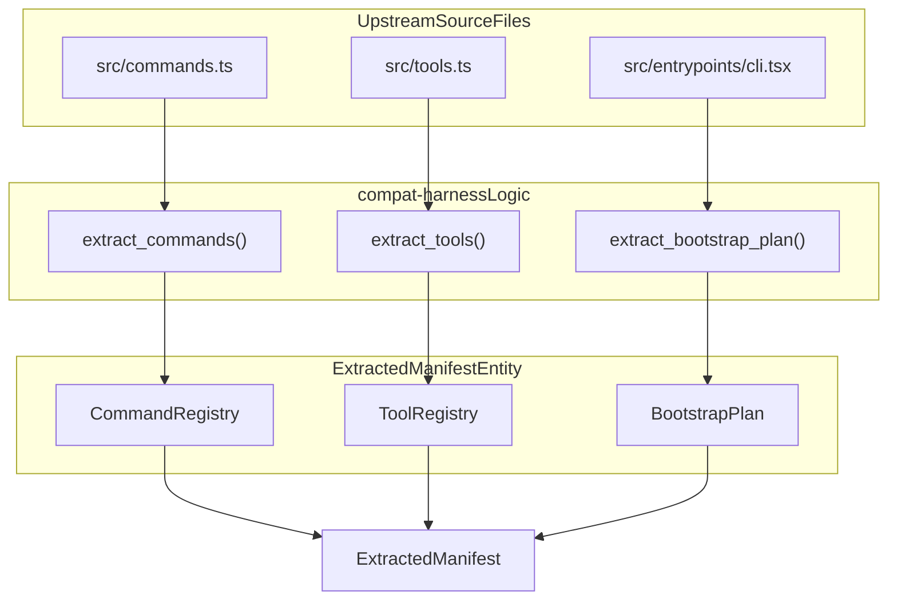
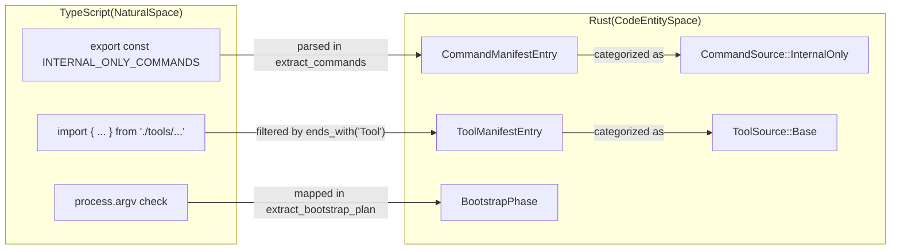

<!-- source: DeepWiki mcp.deepwiki.com · repo ultraworkers/claw-code · page 2.9 Compat Harness · fetched 2026-10-26 -->

# Compat Harness

Relevant source files

The following files were used as context for generating this wiki page:

- [PARITY.md](PARITY.md)
- [docs/g007-plugin-mcp-verification-map.md](docs/g007-plugin-mcp-verification-map.md)
- [rust/MOCK_PARITY_HARNESS.md](rust/MOCK_PARITY_HARNESS.md)
- [rust/crates/compat-harness/src/lib.rs](rust/crates/compat-harness/src/lib.rs)
- [rust/crates/mock-anthropic-service/src/lib.rs](rust/crates/mock-anthropic-service/src/lib.rs)
- [rust/crates/runtime/src/file_ops.rs](rust/crates/runtime/src/file_ops.rs)
- [rust/crates/runtime/src/usage.rs](rust/crates/runtime/src/usage.rs)
- [rust/crates/rusty-claude-cli/tests/mock_parity_harness.rs](rust/crates/rusty-claude-cli/tests/mock_parity_harness.rs)
- [rust/mock_parity_scenarios.json](rust/mock_parity_scenarios.json)
- [rust/scripts/run_mock_parity_diff.py](rust/scripts/run_mock_parity_diff.py)

The `compat-harness` crate provides the static analysis infrastructure required to extract operational manifests from the upstream TypeScript source code. It serves as the bridge between the original reference implementation and the Rust clean-room rewrite, allowing the system to verify parity and understand the structure of the upstream `CommandRegistry`, `ToolRegistry`, and `BootstrapPlan` without executing JavaScript.

## Upstream Path Resolution

The harness identifies the location of the upstream source code through a prioritized search strategy implemented in `UpstreamPaths` [rust/crates/compat-harness/src/lib.rs:9-11](). This resolution is critical for locating the `commands.ts`, `tools.ts`, and `cli.tsx` files required for extraction.

### Resolution Heuristics
The function `upstream_repo_candidates` [rust/crates/compat-harness/src/lib.rs:71-93]() generates a list of potential directories:
1.  **Primary Repo Root**: The initial path provided to the resolver [rust/crates/compat-harness/src/lib.rs:72]().
2.  **Explicit Environment Variable**: The value of `CLAUDE_CODE_UPSTREAM` if set [rust/crates/compat-harness/src/lib.rs:74-76]().
3.  **Ancestor Search**: Traverses up to 4 levels from the current workspace looking for a `claw-code` or `clawd-code` directory [rust/crates/compat-harness/src/lib.rs:78-81]().
4.  **Standard Subdirectories**: Checks `reference-source/claw-code` and `vendor/claw-code` relative to the workspace [rust/crates/compat-harness/src/lib.rs:83-84]().

The final path is confirmed by `resolve_upstream_repo_root` which verifies the existence of `src/commands.ts` [rust/crates/compat-harness/src/lib.rs:63-69]().

**Sources:**
* [rust/crates/compat-harness/src/lib.rs:9-93]()

## Extraction Engine

The core of the crate is the `extract_manifest` function [rust/crates/compat-harness/src/lib.rs:95-105](), which orchestrates the parsing of three primary upstream files to produce an `ExtractedManifest` [rust/crates/compat-harness/src/lib.rs:56-61]().

### Command Extraction
The `extract_commands` function [rust/crates/compat-harness/src/lib.rs:108-154]() parses `src/commands.ts` to categorize commands into three types:
*   **InternalOnly**: Extracted from the `INTERNAL_ONLY_COMMANDS` array block [rust/crates/compat-harness/src/lib.rs:115-131]().
*   **Builtin**: Identified via standard `import` statements at the top of the file [rust/crates/compat-harness/src/lib.rs:134-141]().
*   **FeatureGated**: Identified by lines containing both `feature('` and a path to `./commands/` [rust/crates/compat-harness/src/lib.rs:143-150]().

### Tool Extraction
The `extract_tools` function [rust/crates/compat-harness/src/lib.rs:157-186]() scans `src/tools.ts` for tool definitions:
*   **Base Tools**: Standard imports from the `./tools/` directory where the symbol ends in `Tool` [rust/crates/compat-harness/src/lib.rs:162-171]().
*   **Conditional Tools**: Tools wrapped in `feature()` toggles [rust/crates/compat-harness/src/lib.rs:173-182]().

### Bootstrap Plan Extraction
The `extract_bootstrap_plan` function [rust/crates/compat-harness/src/lib.rs:189-232]() performs keyword analysis on `src/entrypoints/cli.tsx` to determine the sequence of initialization phases. It maps specific string patterns in the TypeScript source to `BootstrapPhase` variants [rust/crates/compat-harness/src/lib.rs:190]().

| TypeScript Pattern | BootstrapPhase Variant |
| :--- | :--- |
| `--version` | `FastPathVersion` [rust/crates/compat-harness/src/lib.rs:193]() |
| `startupProfiler` | `StartupProfiler` [rust/crates/compat-harness/src/lib.rs:196]() |
| `--dump-system-prompt` | `SystemPromptFastPath` [rust/crates/compat-harness/src/lib.rs:199]() |
| `--claude-in-chrome-mcp` | `ChromeMcpFastPath` [rust/crates/compat-harness/src/lib.rs:202]() |
| `--daemon-worker` | `DaemonWorkerFastPath` [rust/crates/compat-harness/src/lib.rs:205]() |
| `args[0] === 'daemon'` | `DaemonFastPath` [rust/crates/compat-harness/src/lib.rs:210]() |
| `remote-control` | `BridgeFastPath` [rust/crates/compat-harness/src/lib.rs:208]() |

**Sources:**
* [rust/crates/compat-harness/src/lib.rs:95-232]()

---

## Data Flow: Source to Manifest

This diagram illustrates how raw TypeScript source files are transformed into structured Rust registries used by the runtime.

### Extraction Pipeline

**Sources:**
* [rust/crates/compat-harness/src/lib.rs:57-61]()
* [rust/crates/compat-harness/src/lib.rs:95-105]()

---

## Entity Mapping: TypeScript to Rust

The following diagram maps the conceptual structures in the original TypeScript codebase to the specific Rust structs and enums used in the `compat-harness`.

### System Entity Mapping

**Sources:**
* [rust/crates/compat-harness/src/lib.rs:115-131]()
* [rust/crates/compat-harness/src/lib.rs:162-171]()
* [rust/crates/compat-harness/src/lib.rs:189-232]()

## Implementation Details

### Heuristic Parsers
The harness does not use a full TypeScript AST parser. Instead, it relies on high-performance string heuristics:
*   `first_identifier(line)`: Extracts the first word-like sequence from a line, used for array elements [rust/crates/compat-harness/src/lib.rs:125]().
*   `first_assignment_identifier(line)`: Extracts the variable name from a `const X = ...` or `let X = ...` statement [rust/crates/compat-harness/src/lib.rs:144]().
*   `imported_symbols(line)`: Parses `import { A, B } from ...` lines to extract individual symbol names [rust/crates/compat-harness/src/lib.rs:135]().

### Manifest Deduplication
Because the upstream source may reference the same command or tool in multiple places (e.g., an import and a feature gate), the harness performs post-extraction deduplication.
*   `dedupe_commands(entries)`: Ensures unique command names, preferring specific sources over generic ones [rust/crates/compat-harness/src/lib.rs:153]().
*   `dedupe_tools(entries)`: Ensures unique tool names in the final `ToolRegistry` [rust/crates/compat-harness/src/lib.rs:185]().

### Integration with Parity Audits
The `compat-harness` provides the underlying data used by the `DumpManifests` CLI subcommand to export the extracted registries to JSON. These JSON files are then used by the Python porting workspace's `parity_audit.py` to validate that the Rust and Python implementations match the original TypeScript surface area [PARITY.md:25-26](). 

This extraction is verified by the `mock_parity_harness.rs` which exercises scenarios like `auto_compact_triggered` [rust/crates/rusty-claude-cli/tests/mock_parity_harness.rs:132-140]() and `token_cost_reporting` [rust/crates/rusty-claude-cli/tests/mock_parity_harness.rs:142-150]() to ensure the Rust runtime's behavior aligns with the manifests extracted from the reference implementation. The `auto_compact_triggered` scenario specifically verifies that the session compaction logic triggers correctly based on thresholds [rust/mock_parity_scenarios.json:93-100](). The `token_cost_reporting` scenario confirms that token counts and estimated costs are correctly reported in JSON output [rust/mock_parity_scenarios.json:101-108](), which relies on the `TokenUsage` and `UsageCostEstimate` structs in `runtime/src/usage.rs` [rust/crates/runtime/src/usage.rs:30-45]().

**Sources:**
* [rust/crates/compat-harness/src/lib.rs:108-186]()
* [PARITY.md:25-26]()
* [rust/crates/rusty-claude-cli/tests/mock_parity_harness.rs:132-150]()
* [rust/mock_parity_scenarios.json:93-108]()
* [rust/crates/runtime/src/usage.rs:30-45]()

---

