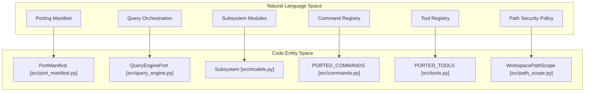
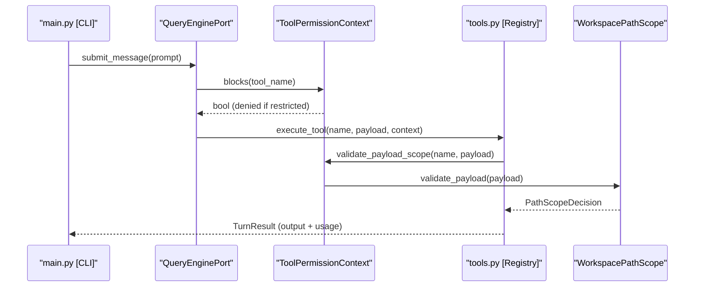

<!-- source: DeepWiki mcp.deepwiki.com · repo ultraworkers/claw-code · page 3 Python Porting Workspace · fetched 2026-10-26 -->

# Python Porting Workspace

Relevant source files

The following files were used as context for generating this wiki page:

- [src/__init__.py](src/__init__.py)
- [src/commands.py](src/commands.py)
- [src/context.py](src/context.py)
- [src/history.py](src/history.py)
- [src/main.py](src/main.py)
- [src/models.py](src/models.py)
- [src/path_scope.py](src/path_scope.py)
- [src/permissions.py](src/permissions.py)
- [src/query_engine.py](src/query_engine.py)
- [src/runtime.py](src/runtime.py)
- [src/setup.py](src/setup.py)
- [src/tools.py](src/tools.py)
- [tests/test_porting_workspace.py](tests/test_porting_workspace.py)
- [tests/test_security_scope.py](tests/test_security_scope.py)

The Python porting workspace, located in the `src/` directory, serves as a clean-room rewrite and verification layer for the Claude Code rewrite effort. It captures the architectural patterns and subsystem surface of the original TypeScript implementation without including proprietary source code. This workspace acts as a functional prototype and a parity reference for the production Rust implementation.

## Architecture and Role

The workspace is designed to mirror the original system's modular structure. It provides a high-level orchestration layer that simulates the agent's behavior, tool execution, and command routing. While the Rust implementation in `rust/` is the performance-oriented production target, the Python workspace remains the primary site for architectural exploration and parity tracking against upstream snapshots.

### System Mapping: Logic to Code

The following diagram illustrates how high-level system concepts map to specific Python entities within the `src/` directory.

**Entity Mapping: Porting Workspace**

Sources: [src/port_manifest.py:9-12](), [src/query_engine.py:36-43](), [src/models.py:7-13](), [src/commands.py:36-36](), [src/tools.py:37-37](), [src/path_scope.py:26-34]()

## CLI and Query Engine

The entrypoint for the porting workspace is `src/main.py`, which provides a comprehensive CLI for inspecting the ported state and running simulated turns [src/main.py:21-91](). The core orchestration is handled by the `QueryEnginePort` class, which manages session state, message transcripts, and token usage budgets [src/query_engine.py:36-43]().

Key features include:
*   **Turn Management**: `QueryEnginePort.submit_message` handles the interaction lifecycle, including command/tool matching and usage tracking [src/query_engine.py:61-105]().
*   **Session Persistence**: Sessions can be saved and loaded via `StoredSession` objects in the `session_store.py` module [src/query_engine.py:147-157]().
*   **Transcript Compaction**: Automatic truncation of history via `compact_messages_if_needed` to stay within context window limits [src/query_engine.py:136-139]().

For details, see [Python CLI and Query Engine](#3.1).

Sources: [src/main.py:21-91](), [src/query_engine.py:36-105](), [src/query_engine.py:136-157]()

## Runtime and Subsystem Modules

The workspace defines a `PortRuntime` that coordinates prompt routing across mirrored inventories [src/runtime.py:89-118](). It coordinates a `RuntimeSession` which aggregates the `PortContext`, `WorkspaceSetup`, and `TurnResult` into a single state object [src/runtime.py:25-37](). The module structure mirrors the original TypeScript subsystems (e.g., `assistant`, `bridge`, `buddy`, `cli`, etc.), where each is represented as a `Subsystem` dataclass [src/models.py:7-11]().

For details, see [Python Runtime and Subsystem Modules](#3.2).

Sources: [src/runtime.py:25-118](), [src/models.py:7-11]()

## Parity Audit and Reference Data

To ensure the rewrite remains faithful to the original architecture, the workspace includes a parity auditing system. The `parity_audit.py` module compares the current Python implementation against JSON snapshots of the original codebase's surface.

The audit process tracks:
*   **Command Parity**: Matching `PORTED_COMMANDS` against `commands_snapshot.json` [src/commands.py:10-36]().
*   **Tool Parity**: Matching `PORTED_TOOLS` against `tools_snapshot.json` [src/tools.py:11-37]().
*   **Bootstrap Graph**: Mirrored stages of the system initialization process are tracked via `build_bootstrap_graph` [src/main.py:116-118]().

For details, see [Parity Audit and Reference Data](#3.3).

Sources: [src/main.py:104-106](), [src/commands.py:10-36](), [src/tools.py:11-37]()

## Commands and Tools Registries

The workspace maintains registries of "ported" commands and tools. These are metadata-rich shims that describe the expected inputs, outputs, and source hints of each entity.

*   **Dispatch Logic**: The `execute_command` and `execute_tool` functions provide a shim layer for simulating the execution of mirrored logic [src/commands.py:88-94](), [src/tools.py:81-101]().
*   **Permission Gating**: `ToolPermissionContext` allows for filtering tools based on denial lists, prefix restrictions, or workspace path scope [src/permissions.py:10-44]().
*   **Path Scoping**: The `WorkspacePathScope` enforces conservative path validation, ensuring tools do not access files outside defined roots, even through symlinks or glob expansion [src/path_scope.py:26-34]().

For details, see [Python Commands and Tools Registries](#3.4).

### Data Flow: Request Execution
The diagram below shows the flow from a CLI request to the execution of a mirrored tool shim, including the `WorkspacePathScope` check.

**Logic Flow: Tool Execution Shim**

Sources: [src/main.py:123-133](), [src/query_engine.py:61-105](), [src/tools.py:81-101](), [src/permissions.py:41-44](), [src/path_scope.py:26-36]()

## Workspace Summary

The current state of the port can be visualized using the `summary` command, which aggregates data from the `PortManifest` and backlogs.

| Component | Responsibility | Source Entity |
| :--- | :--- | :--- |
| **Manifest** | Tracks file counts and module notes | `PortManifest` [src/port_manifest.py:9-12]() |
| **Backlog** | Inventories of commands/tools to be ported | `PortingBacklog` [src/models.py:42-50]() |
| **Session** | Persistent storage of interaction history | `StoredSession` [src/session_store.py:10-20]() |
| **Audit** | Parity checking against TS snapshots | `run_parity_audit` [src/main.py:9-9]() |
| **Setup** | Environment and prefetch initialization | `WorkspaceSetup` [src/setup.py:13-27]() |

Sources: [src/query_engine.py:46-48](), [src/models.py:42-50](), [src/port_manifest.py:9-12](), [src/session_store.py:10-20](), [src/setup.py:13-27]()

---

