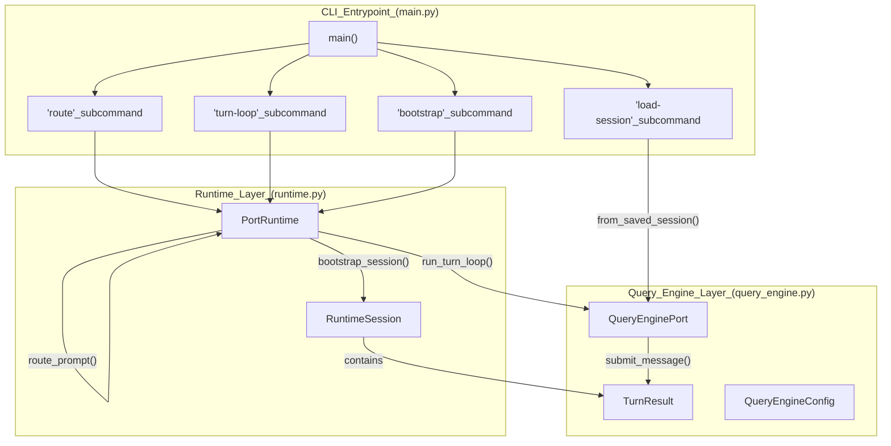
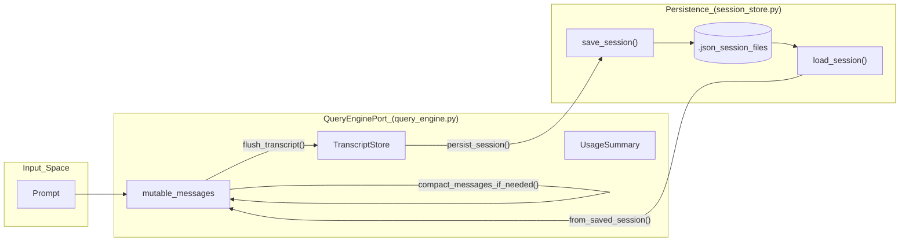
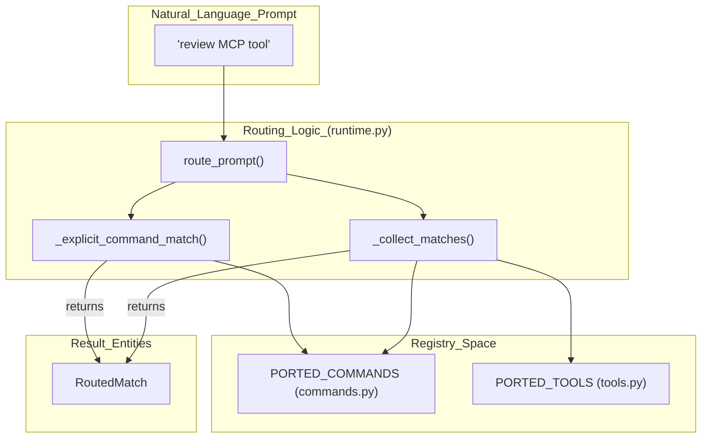

<!-- source: DeepWiki mcp.deepwiki.com · repo ultraworkers/claw-code · page 3.1 Python CLI and Query Engine · fetched 2026-10-26 -->

# Python CLI and Query Engine

Relevant source files

The following files were used as context for generating this wiki page:

- [assets/omx/omx-readme-review-1.png](assets/omx/omx-readme-review-1.png)
- [assets/omx/omx-readme-review-2.png](assets/omx/omx-readme-review-2.png)
- [src/QueryEngine.py](src/QueryEngine.py)
- [src/Tool.py](src/Tool.py)
- [src/__init__.py](src/__init__.py)
- [src/commands.py](src/commands.py)
- [src/context.py](src/context.py)
- [src/history.py](src/history.py)
- [src/main.py](src/main.py)
- [src/runtime.py](src/runtime.py)
- [src/setup.py](src/setup.py)
- [tests/test_porting_workspace.py](tests/test_porting_workspace.py)

The Python porting workspace serves as a clean-room verification layer for the Claude Code rewrite effort. It provides a CLI and a functional query engine that mirrors the behavior of the original TypeScript implementation, facilitating parity auditing and architectural validation.

## CLI Entrypoint and Subcommands

The `src/main.py` file defines the CLI entrypoint. It uses `argparse` to provide subcommands for inspecting the workspace, auditing parity, and simulating runtime behavior [src/main.py:21-23]().

### Primary Subcommands

| Subcommand | Purpose | Implementation Reference |
| :--- | :--- | :--- |
| `summary` | Renders a Markdown summary of the porting workspace. | [src/main.py:98-100]() |
| `manifest` | Prints the current Python workspace manifest. | [src/main.py:101-103]() |
| `parity-audit` | Compares Python code against archived TypeScript snapshots. | [src/main.py:104-106]() |
| `commands` | Lists mirrored command entries from snapshots. | [src/main.py:123-131]() |
| `tools` | Lists mirrored tool entries from snapshots. | [src/main.py:132-137]() |
| `route` | Routes a prompt across mirrored command/tool inventories. | [src/main.py:48-51]() |
| `bootstrap` | Builds a runtime-style session report from mirrored inventories. | [src/main.py:52-54]() |
| `turn-loop` | Runs a small stateful turn loop for the mirrored runtime. | [src/main.py:56-61]() |
| `exec-command` | Executes a mirrored command shim by exact name. | [src/main.py:84-87]() |
| `exec-tool` | Executes a mirrored tool shim by exact name. | [src/main.py:88-91]() |
| `load-session` | Loads a previously persisted session by ID. | [src/main.py:65-67]() |
| `flush-transcript` | Persists and flushes a temporary session transcript. | [src/main.py:62-64]() |
| `setup-report` | Renders the startup/prefetch setup report. | [src/main.py:107-109]() |

### Command Logic Flow
The CLI builds a `PortManifest` via `build_port_manifest()` to understand the state of the `src/` directory [src/main.py:97](). Subcommands interact with `QueryEnginePort` or specific registries in `src/commands.py` and `src/tools.py`. The `bootstrap` command utilizes `PortRuntime.bootstrap_session()` to simulate environment initialization, including `run_setup()` and `build_port_context()` [src/runtime.py:136-160]().

**Sources:**
- [src/main.py:21-91]() (Parser definition)
- [src/main.py:94-137]() (Main execution logic)
- [src/runtime.py:136-160]() (Bootstrap session logic)

---

## Query Engine Orchestration

The `QueryEnginePort` class in `src/query_engine.py` is the central orchestration layer for simulating a conversation session.

### Key Classes and Data Structures

- **`QueryEnginePort`**: The main stateful engine holding the `PortManifest`, `QueryEngineConfig`, and `TranscriptStore` [src/query_engine.py:36-43]().
- **`QueryEngineConfig`**: Defines limits like `max_turns` (default 8) and `max_budget_tokens` (default 2000) [src/query_engine.py:16-21]().
- **`TurnResult`**: A frozen dataclass representing the outcome of a single interaction, including matched commands and usage statistics [src/query_engine.py:25-33]().
- **`UsageSummary`**: Tracks `input_tokens` and `output_tokens` based on word counts [src/models.py:29-37]().

### Message Submission Pipeline
When a message is submitted via `submit_message`, the engine:
1. **Turn Limit Check**: Validates turn count against `max_turns` [src/query_engine.py:68-78]().
2. **Output Generation**: Generates a response summarizing matches [src/query_engine.py:80-86]().
3. **Usage Projection**: Updates token counts using `UsageSummary.add_turn()` [src/query_engine.py:87-88]().
4. **Budget Validation**: Sets `stop_reason` to `max_budget_reached` if limits are exceeded [src/query_engine.py:89-91]().
5. **State Update**: Appends the prompt to `mutable_messages` and `TranscriptStore` [src/query_engine.py:92-93]().
6. **Compaction**: Triggers `compact_messages_if_needed()` if thresholds are met [src/query_engine.py:96]().

### CLI to Query Engine Mapping
The following diagram illustrates how CLI subcommands map to engine and runtime entities.

**CLI to Code Entity Space**

**Sources:**
- [src/query_engine.py:36-104]() (QueryEnginePort implementation)
- [src/runtime.py:89-134]() (PortRuntime routing)
- [src/main.py:138-150]() (CLI integration)

---

## Session Persistence and Transcript Compaction

The engine provides mechanisms for saving sessions and managing memory via compaction.

### Session Persistence
Sessions are persisted via `persist_session()`, which flushes the transcript and saves a `StoredSession` object via `save_session()` [src/query_engine.py:147-157](). Resumption is handled by `from_saved_session(session_id)`, which reloads messages and usage [src/query_engine.py:50-59]().

### Transcript Compaction
To prevent context overflow, the engine implements a sliding window:
- **`compact_messages_if_needed()`**: If messages exceed `compact_after_turns` (default 12), the `mutable_messages` list and `TranscriptStore` are truncated to retain recent turns [src/query_engine.py:136-139]().

**Data Flow: Session Lifecycle**

**Sources:**
- [src/query_engine.py:136-139]() (Compaction logic)
- [src/query_engine.py:147-157]() (Persistence logic)
- [src/session_store.py:1-25]() (Session storage interface)

---

## Workspace Setup and Runtime Session

The workspace includes an initialization sequence handled by `src/setup.py`.

### Workspace Setup Sequence
`WorkspaceSetup` defines the platform and version context [src/setup.py:12-17](). `run_setup()` initiates parallel prefetches to simulate startup:
- **`start_mdm_raw_read()`**: Simulates MDM configuration reading [src/setup.py:67]().
- **`start_keychain_prefetch()`**: Simulates credential retrieval [src/setup.py:68]().
- **`start_project_scan(root)`**: Scans the filesystem for context [src/setup.py:69]().

### Runtime Session Reports
`RuntimeSession` aggregates the state of a simulated interaction, including `SetupReport`, `PortContext`, and routing results [src/runtime.py:25-37](). It renders a Markdown report via `as_markdown()`, documenting "Startup Steps" through "Turn Result" [src/runtime.py:39-86]().

### Command and Tool Routing
`PortRuntime.route_prompt` performs heuristic matching against `PORTED_COMMANDS` and `PORTED_TOOLS` [src/runtime.py:90-118](). It supports explicit command matching (e.g., `/review`) with a high score (100) [src/runtime.py:121-134]().

**Natural Language Space to Code Entity Space**

**Sources:**
- [src/setup.py:12-77]() (WorkspaceSetup and run_setup)
- [src/runtime.py:25-86]() (RuntimeSession implementation)
- [src/runtime.py:89-134]() (PortRuntime routing and explicit matching)
- [src/context.py:19-34]() (build_port_context)
- [src/commands.py:23-36]() (PORTED_COMMANDS loading)
- [src/tools.py:23-36]() (PORTED_TOOLS loading)

---

