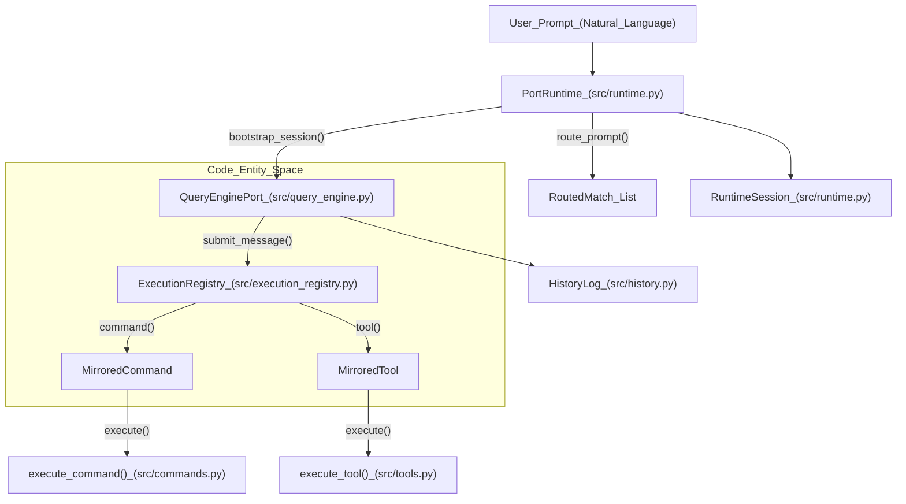
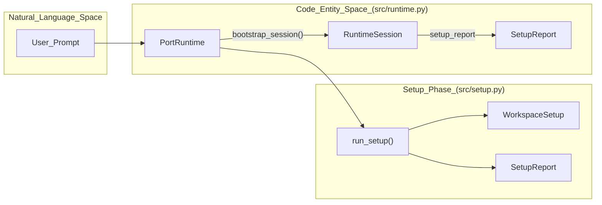

<!-- source: DeepWiki mcp.deepwiki.com · repo ultraworkers/claw-code · page 3.2 Python Runtime and Subsystem Modules · fetched 2026-10-26 -->

# Python Runtime and Subsystem Modules

<details>
<summary>Relevant source files</summary>

The following files were used as context for generating this wiki page:

- [src/assistant/__init__.py](src/assistant/__init__.py)
- [src/bootstrap/__init__.py](src/bootstrap/__init__.py)
- [src/bridge/__init__.py](src/bridge/__init__.py)
- [src/buddy/__init__.py](src/buddy/__init__.py)
- [src/cli/__init__.py](src/cli/__init__.py)
- [src/commands.py](src/commands.py)
- [src/components/__init__.py](src/components/__init__.py)
- [src/constants/__init__.py](src/constants/__init__.py)
- [src/coordinator/__init__.py](src/coordinator/__init__.py)
- [src/entrypoints/__init__.py](src/entrypoints/__init__.py)
- [src/hooks/__init__.py](src/hooks/__init__.py)
- [src/keybindings/__init__.py](src/keybindings/__init__.py)
- [src/models.py](src/models.py)
- [src/path_scope.py](src/path_scope.py)
- [src/permissions.py](src/permissions.py)
- [src/query_engine.py](src/query_engine.py)
- [src/runtime.py](src/runtime.py)
- [src/tools.py](src/tools.py)
- [tests/test_porting_workspace.py](tests/test_porting_workspace.py)
- [tests/test_security_scope.py](tests/test_security_scope.py)

</details>


The Python porting workspace serves as a structural mirror of the original TypeScript implementation. While the production logic resides in the Rust workspace, the Python `src/` directory maintains a high-fidelity representation of the system's subsystems, command registries, and runtime flow. This allows for clean-room verification of architectural patterns before they are finalized in Rust.

## The PortRuntime and Session Management

The Python workspace implements a simulated runtime environment that orchestrates interactions between the user, the "Natural Language Space," and the underlying "Code Entity Space" (commands and tools).

### PortRuntime and RuntimeSession
The `PortRuntime` class is the primary orchestrator for prompt routing and session lifecycle management [src/runtime.py:89-136](). It produces a `RuntimeSession` which captures the full state of a turn, including setup reports, system initialization, and execution results [src/runtime.py:25-37]().

- **Prompt Routing**: `PortRuntime.route_prompt` uses token matching to find relevant `PORTED_COMMANDS` and `PORTED_TOOLS`, returning a ranked list of `RoutedMatch` objects [src/runtime.py:90-118]().
- **Explicit Command Matching**: Supports slash-command style routing (e.g., `/review`) by checking the first token of a prompt against the command registry via `_explicit_command_match` [src/runtime.py:121-134]().
- **Session Bootstrapping**: `PortRuntime.bootstrap_session` initializes the environment by running `run_setup`, building the execution registry via `build_execution_registry`, and submitting the prompt to the query engine [src/runtime.py:136-166]().

### QueryEnginePort and Persistence
The `QueryEnginePort` (orchestrated by the runtime) handles the mechanics of message submission, token usage tracking, and transcript management [src/runtime.py:9]().

- **Turn Result**: The `TurnResult` captures the output of a prompt, matched commands, and permission denials [src/runtime.py:155-160]().
- **Session Store**: Sessions are persisted to disk using `engine.persist_session()`, with the path tracked in the `RuntimeSession` [src/runtime.py:161-178]().
- **History Tracking**: The `HistoryLog` records significant events such as routing matches and execution counts [src/runtime.py:162-165]().

### Data Flow: Prompt to Execution
The following diagram illustrates how a natural language request is routed through the Python runtime entities.

**Diagram: Python Runtime Routing Flow**

**Sources:** [src/runtime.py:89-178](), [src/commands.py:80-85](), [src/runtime.py:145-147]().

---

## Subsystem Modules (The "Mirror" Packages)

The Python workspace contains a set of packages that mirror the original TypeScript subsystems. These are implemented as "placeholder" packages that load metadata from the archived snapshots via `load_archive_metadata`.

### Structure of a Subsystem Stub
Each subsystem follows a standardized structure in its `__init__.py`. This allows the parity-audit tools to verify that the Python workspace accounts for every module in the original source [tests/test_porting_workspace.py:73-80]().

| Subsystem | Role in Architecture | Metadata Source |
| :--- | :--- | :--- |
| `assistant` | Core AI interaction logic | `assistant` [src/assistant/__init__.py:7]() |
| `bootstrap` | Initial system startup and wiring | `bootstrap` [src/bootstrap/__init__.py:7]() |
| `bridge` | Cross-process communication | `bridge` [src/bridge/__init__.py:7]() |
| `buddy` | Collaborative features | `buddy` [src/buddy/__init__.py:7]() |
| `cli` | Command-line interface handling | `cli` [src/cli/__init__.py:7]() |
| `coordinator` | Task orchestration | `coordinator` [src/coordinator/__init__.py:7]() |
| `hooks` | Event lifecycle points | `hooks` [src/hooks/__init__.py:7]() |
| `keybindings` | Input mapping | `keybindings` [src/keybindings/__init__.py:7]() |
| `components` | UI and logic components | `components` [src/components/__init__.py:7]() |
| `constants` | System-wide static values | `constants` [src/constants/__init__.py:7]() |
| `entrypoints` | Execution entry points | `entrypoints` [src/entrypoints/__init__.py:7]() |

Each package exports:
- `ARCHIVE_NAME`: The original TypeScript directory name [src/keybindings/__init__.py:9]().
- `MODULE_COUNT`: Number of modules identified in the upstream snapshot [src/keybindings/__init__.py:10]().
- `SAMPLE_FILES`: A subset of file paths used for parity verification [src/keybindings/__init__.py:11]().

**Sources:** [src/keybindings/__init__.py:1-14](), [src/coordinator/__init__.py:1-14](), [src/constants/__init__.py:1-14](), [tests/test_porting_workspace.py:73-80]().

---

## Workspace Setup and Prefetching

The Python runtime mimics the production "Worker Boot" sequence through the `setup.py` module, which handles environment discovery and side effects.

### Setup and Prefetching
- **`WorkspaceSetup`**: Captures the environment state, including Python version and platform [src/runtime.py:28]().
- **`SetupReport`**: Provides a detailed log of the initialization process [src/runtime.py:29]().
- **`run_setup`**: Orchestrates the startup sequence, returning a report used to populate the session [src/runtime.py:138-139]().

**Diagram: System Initialization and Entity Mapping**

**Sources:** [src/runtime.py:136-172](), [tests/test_porting_workspace.py:140-158]().

---

## Runtime Context and Environment

The `PortContext` class provides the runtime with awareness of its physical location and the status of the porting archive.

- **Path Resolution**: Automatically calculates workspace roots via `build_port_context` [src/runtime.py:137]().
- **Archive Detection**: Checks for the presence of snapshots to determine if parity-auditing features should be enabled via `context.archive_available` [src/runtime.py:142]().
- **Metrics**: Tracks file counts across Python modules and assets, verified by `test_manifest_counts_python_files` [tests/test_porting_workspace.py:16-19]().
- **Execution Registry**: Maps routed matches to executable shims for commands and tools via `build_execution_registry` [src/runtime.py:145-147]().

### Path Scope Validation

The `WorkspacePathScope` class [src/path_scope.py:26-38]() is crucial for security, ensuring that file system operations initiated by tools or shell commands remain within defined workspace boundaries. This prevents agents from accessing or modifying files outside the intended project scope.

- **`WorkspacePathScope.from_roots`**: Initializes the scope with one or more root directories, resolving them to absolute paths [src/path_scope.py:42-46]().
- **`validate_payload`**: Analyzes a given payload (e.g., a shell command string) to extract potential file paths and validates each against the configured workspace roots [src/path_scope.py:49-58]().
- **`validate_path`**: Performs the core validation for a single path, handling absolute/relative paths, environment variable expansion, and glob patterns [src/path_scope.py:60-78]().
- **Symlink and Glob Expansion**: Explicitly denies paths that resolve outside the workspace, even if accessed via symlinks or glob expansion [src/path_scope.py:30-33](), [src/path_scope.py:68-71]().
- **Windows Path Handling**: Includes specific logic for validating Windows-style absolute paths (drive letters, UNC paths) against Windows-style roots [src/path_scope.py:62-63](), [src/path_scope.py:96-107]().
- **`extract_path_candidates`**: A utility function that conservatively extracts path-like operands from a shell/tool payload, including redirection targets [src/path_scope.py:110-128]().

This path scope validation is integrated into tool execution via `ToolPermissionContext` [src/permissions.py:41-44](), ensuring that tools like `BashTool`, `FileReadTool`, `FileWriteTool`, and `FileEditTool` respect the defined boundaries [src/permissions.py:47-49]().

**Diagram: Workspace Path Scope Validation**
```mermaid
graph TD
    A[Tool_Execution_Request] --> B{ToolPermissionContext.validate_payload_scope()}
    B --> C{Is_Scope_Checked_Tool?}
    C -- Yes --> D[WorkspacePathScope.validate_payload()]
    C -- No --> E[PathScopeDecision: Allowed]

    D --> F{Extract_Path_Candidates}
    F --> G[For_each_Candidate_Path]
    G --> H[Expand_Vars/User]
    H --> I[Resolve_Path]
    I --> J{Is_Path_Relative_To_Any_Root?}
    J -- Yes --> K[PathScopeDecision: Allowed]
    J -- No --> L[PathScopeDecision: Denied]

    L --> M[Permission_Denied_Message]
    K --> N[Tool_Execution_Proceeds]
```
**Sources:** [src/runtime.py:137-147](), [src/commands.py:23-33](), [tests/test_porting_workspace.py:16-19](), [src/path_scope.py:26-107](), [src/path_scope.py:110-128](), [src/permissions.py:41-49](), [tests/test_security_scope.py:15-141]().

---

