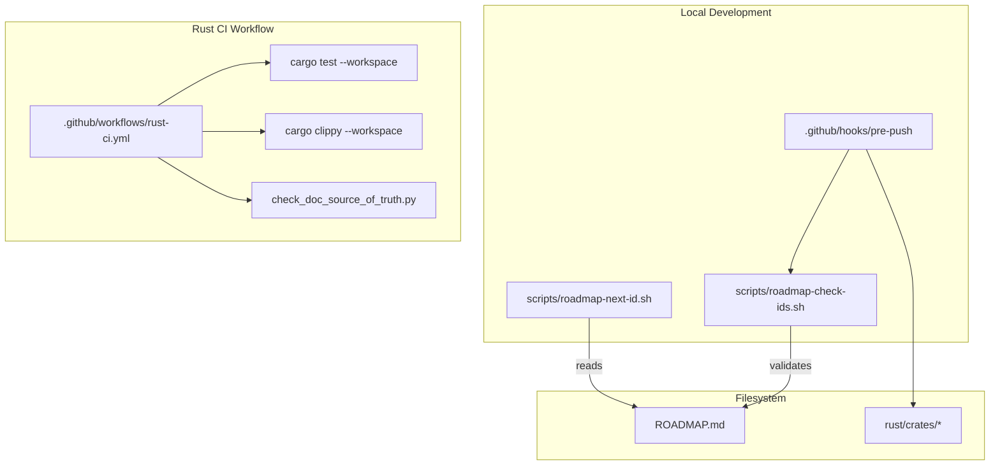
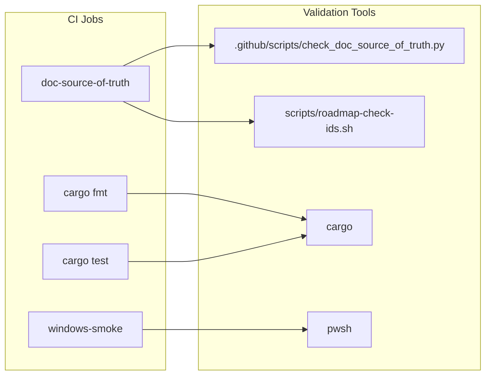

<!-- source: DeepWiki mcp.deepwiki.com · repo ultraworkers/claw-code · page 5.2 Python Test Suite and CI Pipeline · fetched 2026-10-26 -->

# Python Test Suite and CI Pipeline

Relevant source files

The following files were used as context for generating this wiki page:

- [.github/hooks/pre-push](.github/hooks/pre-push)
- [.github/workflows/rust-ci.yml](.github/workflows/rust-ci.yml)
- [.omx/cc2/board.json](.omx/cc2/board.json)
- [.omx/cc2/board.md](.omx/cc2/board.md)
- [.omx/cc2/render_board_md.py](.omx/cc2/render_board_md.py)
- [CONTRIBUTING.md](CONTRIBUTING.md)
- [docs/g013-roadmap-pinpoints-693-695-verification-map.md](docs/g013-roadmap-pinpoints-693-695-verification-map.md)
- [scripts/cc2_board.py](scripts/cc2_board.py)
- [scripts/dogfood-probe.py](scripts/dogfood-probe.py)
- [scripts/generate_cc2_board.py](scripts/generate_cc2_board.py)
- [scripts/roadmap-check-ids.sh](scripts/roadmap-check-ids.sh)
- [scripts/roadmap-next-id.sh](scripts/roadmap-next-id.sh)
- [scripts/validate_cc2_board.py](scripts/validate_cc2_board.py)
- [src/commands.py](src/commands.py)
- [src/runtime.py](src/runtime.py)
- [tests/__init__.py](tests/__init__.py)
- [tests/test_porting_workspace.py](tests/test_porting_workspace.py)
- [tests/test_pre_push_hook_contract.py](tests/test_pre_push_hook_contract.py)
- [tests/test_roadmap_helpers.py](tests/test_roadmap_helpers.py)

This page describes the automated validation framework for the `claw-code` repository. The testing strategy encompasses a Python-based suite for verifying the porting workspace's structural integrity, a suite of Rust workspace tests, and a GitHub Actions CI pipeline for production-grade builds and cross-platform validation.

## Python Porting Workspace Test Suite

The Python test suite, located in `tests/test_porting_workspace.py`, serves as a validation layer for the clean-room rewrite process. It ensures that the Python stubs and metadata accurately reflect the upstream TypeScript surface area.

### Manifest and Subsystem Validation
The suite utilizes `src/port_manifest.py` to perform structural assertions on the `src/` directory. It validates that all required subsystems are present and that file counts align with the expected porting progress.

*   **`PortManifest`**: A dataclass that aggregates the state of the Python workspace, including total file counts and per-module statistics [src/port_manifest.py:12-17]().
*   **`build_port_manifest()`**: Scans the `src/` root to generate a `PortManifest` by counting `.py` files and mapping them to their respective subsystems [src/port_manifest.py:30-52]().
*   **Subsystem Metadata Check**: The test `test_subsystem_packages_expose_archive_metadata` verifies that mirrored packages like `assistant`, `bridge`, and `utils` expose their internal `MODULE_COUNT` and metadata [tests/test_porting_workspace.py:73-80]().

### Parity Audit Validation
The `src/parity_audit.py` module provides the logic for comparing the current Python implementation against reference snapshots of the original codebase.

*   **`run_parity_audit()`**: Calculates coverage ratios for root files, directories, command entries, and tool entries [src/parity_audit.py:121-138]().
*   **Snapshot Comparison**: The test `test_command_and_tool_snapshots_are_nontrivial` ensures that the loaded snapshots for `PORTED_COMMANDS` and `PORTED_TOOLS` contain the expected volume of entries (e.g., >= 150 commands, >= 100 tools) [tests/test_porting_workspace.py:53-56]().
*   **CLI Integration**: The suite verifies that the `parity-audit` subcommand runs successfully via subprocess and outputs the correct report header [tests/test_porting_workspace.py:36-44]().

### Subprocess and CLI Tests
The test suite performs end-to-end checks on the Python CLI entrypoint (`src/main.py`) to ensure command routing and execution shims are functional.

*   **Command Execution**: `test_exec_command_and_tool_cli_run` verifies that the `exec-command` and `exec-tool` subcommands correctly simulate execution of mirrored modules [tests/test_porting_workspace.py:123-138]().
*   **Routing Logic**: `test_route_and_show_entry_cli_run` validates the `QueryEnginePort` routing logic by checking if specific prompts correctly resolve to the expected commands or tools [tests/test_porting_workspace.py:81-103]().

Sources: [tests/test_porting_workspace.py:15-180](), [src/parity_audit.py:10-138](), [src/port_manifest.py:12-52]()

## Rust CI and Development Gates

The Rust implementation is protected by a multi-stage CI pipeline and local pre-push hooks to ensure workspace integrity and adherence to the development roadmap.

### Local Pre-Push Hook
The repository includes a local safety gate in `.github/hooks/pre-push` that developers are encouraged to install via `git config core.hooksPath .github/hooks` [.github/hooks/pre-push:1-5]().

*   **ROADMAP Guard**: Runs `scripts/roadmap-check-ids.sh` to ensure no duplicate IDs exist in `ROADMAP.md` [.github/hooks/pre-push:14-17]().
*   **Build Gate**: Executes `cargo build --workspace --locked` to catch stale field or enum references before they are pushed to the remote [.github/hooks/pre-push:29-31]().
*   **Escape Hatch**: Setting `SKIP_CLAW_PRE_PUSH_BUILD=1` allows bypassing the cargo build for documentation-only changes [.github/hooks/pre-push:19-22]().

### ROADMAP ID Management
To prevent ID collisions in the `ROADMAP.md` file during concurrent development, the repository provides helper scripts:

*   **`scripts/roadmap-next-id.sh`**: Calculates the next available numeric ID by reading the highest prefix in `ROADMAP.md` [scripts/roadmap-next-id.sh:65-81](). It refuses to run if the ID checker is missing or finds existing duplicates [scripts/roadmap-next-id.sh:53-62]().
*   **`scripts/roadmap-check-ids.sh`**: Validates that all IDs (defaulting to "helper-era" IDs >= 723) are unique [scripts/roadmap-check-ids.sh:12-13]().

**ROADMAP Validation and CI Flow**

Sources: [.github/hooks/pre-push:1-31](), [scripts/roadmap-next-id.sh:1-81](), [scripts/roadmap-check-ids.sh:1-78](), [.github/workflows/rust-ci.yml:1-123]()

## GitHub Actions CI Pipeline

The `rust-ci.yml` workflow automates the validation of every push and pull request targeting the `main` branch [.github/workflows/rust-ci.yml:1-30]().

### Documentation and Metadata Gates
The `doc-source-of-truth` job performs static analysis on the repository's non-code assets:
*   **Branding Check**: `check_doc_source_of_truth.py` verifies metadata and documentation for stale branding [.github/workflows/rust-ci.yml:75-76]().
*   **Release Readiness**: `check_release_readiness.py` validates release policy docs and local links [.github/workflows/rust-ci.yml:77-78]().
*   **Roadmap Tests**: Executes `tests/test_roadmap_helpers.py` to ensure the ID allocation scripts behave correctly under various conditions, such as missing files or duplicate IDs [.github/workflows/rust-ci.yml:81-82](), [tests/test_roadmap_helpers.py:38-88]().

### Windows Smoke Testing
A specialized `windows-smoke` job ensures the CLI remains functional in PowerShell environments:
*   **Build**: Compiles the `rusty-claude-cli` on `windows-latest` [.github/workflows/rust-ci.yml:126-138]().
*   **Credential-Free Execution**: Runs `help`, `status`, `config env`, and `doctor` subcommands with empty API keys to verify the binary starts and handles basic commands without live network access [.github/workflows/rust-ci.yml:140-161]().

### PR and Issue Resolution Gate
The repository enforces a strict resolution gate (G012) for the 2.0 goal. Every PR and issue must be triaged using anti-slop templates before the project is marked complete [docs/g013-roadmap-pinpoints-693-695-verification-map.md:1-51]().
*   **Classification**: PRs are classified as `actionable-fix`, `docs-only`, `duplicate`, etc. [CONTRIBUTING.md:1-100]().
*   **Verification**: The PR template requires confirmation that targeted tests ran and no secrets were included [CONTRIBUTING.md:1-100]().

**CI Pipeline Entity Mapping**

Sources: [.github/workflows/rust-ci.yml:64-161](), [docs/g013-roadmap-pinpoints-693-695-verification-map.md:1-51](), [CONTRIBUTING.md:1-100]()

## Summary of Test Coverage

| Component | Test Type | Implementation |
| :--- | :--- | :--- |
| **Python Port** | Unit / Integration | `unittest` suite in `tests/test_porting_workspace.py` checking manifest and parity [tests/test_porting_workspace.py:15-180](). |
| **Rust Workspace** | Unit / Integration | `cargo test --workspace` covering all crates in the `rust/` directory [.github/workflows/rust-ci.yml:107-108](). |
| **Windows Support** | Smoke Test | PowerShell-based execution of core CLI commands in CI [.github/workflows/rust-ci.yml:124-161](). |
| **Roadmap Integrity**| ID Guard | Bash scripts and Python tests ensuring unique sequential IDs [scripts/roadmap-check-ids.sh:1-78](), [tests/test_roadmap_helpers.py:38-88](). |
| **Release Readiness**| Static Analysis | `check_release_readiness.py` and `check_doc_source_of_truth.py` [.github/workflows/rust-ci.yml:75-78](). |

Sources: [.github/workflows/rust-ci.yml:1-161](), [tests/test_porting_workspace.py:1-180](), [.github/hooks/pre-push:1-31](), [docs/g013-roadmap-pinpoints-693-695-verification-map.md:1-51]()

---

