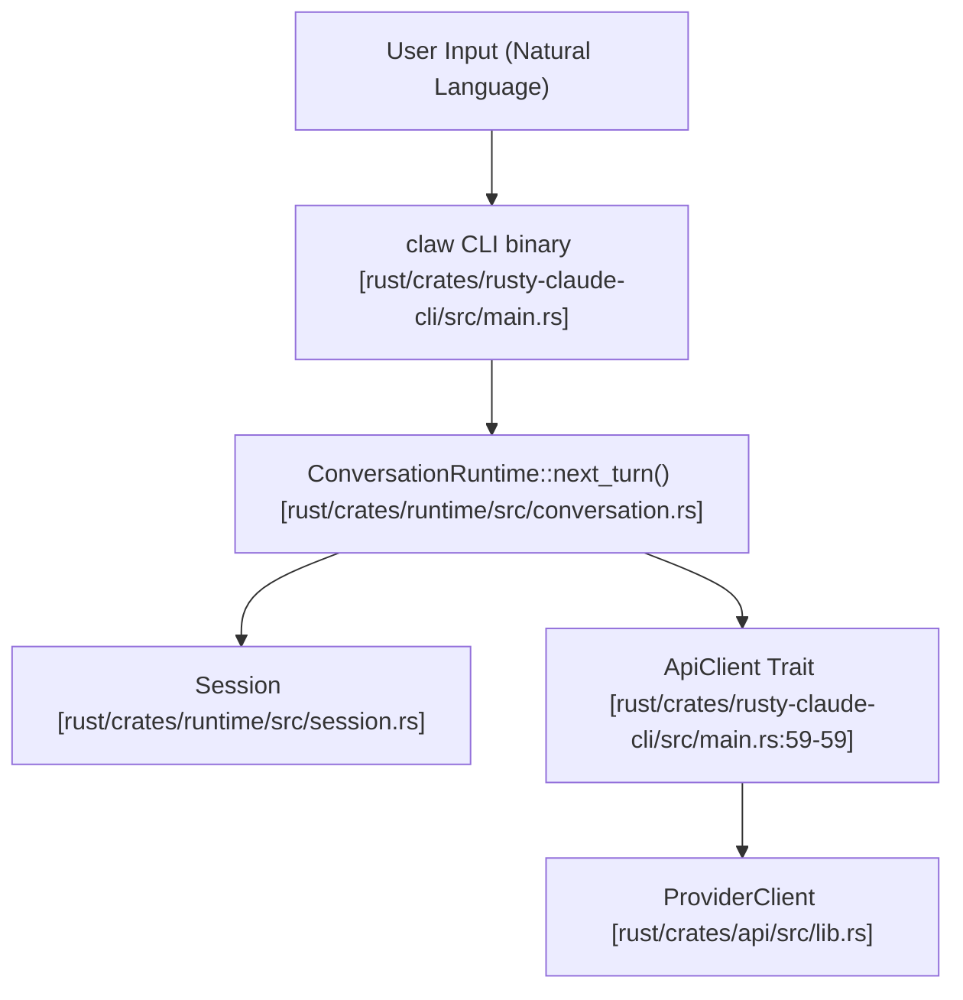
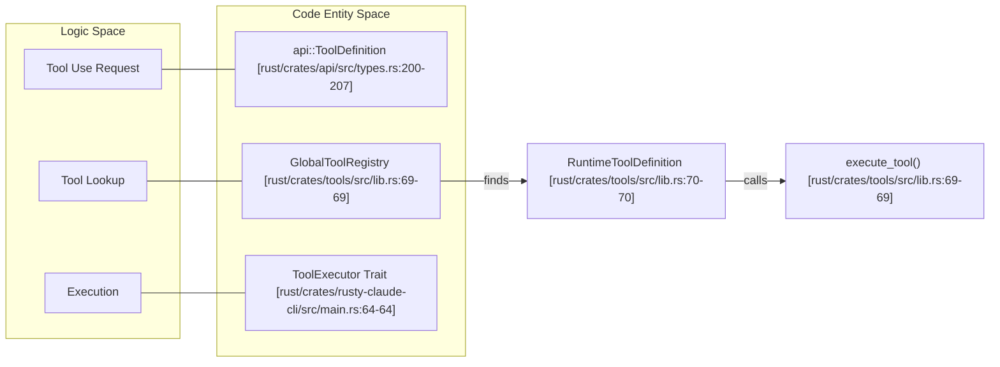

<!-- source: DeepWiki mcp.deepwiki.com · repo ultraworkers/claw-code · page 6 Glossary · fetched 2026-10-26 -->

# Glossary

Relevant source files

The following files were used as context for generating this wiki page:

- [.github/scripts/check_doc_source_of_truth.py](.github/scripts/check_doc_source_of_truth.py)
- [README.md](README.md)
- [ROADMAP.md](ROADMAP.md)
- [USAGE.md](USAGE.md)
- [docs/g011-acp-json-rpc-status-contract.md](docs/g011-acp-json-rpc-status-contract.md)
- [docs/local-openai-compatible-providers.md](docs/local-openai-compatible-providers.md)
- [docs/navigation-file-context.md](docs/navigation-file-context.md)
- [rust/README.md](rust/README.md)
- [rust/crates/api/Cargo.toml](rust/crates/api/Cargo.toml)
- [rust/crates/api/src/error.rs](rust/crates/api/src/error.rs)
- [rust/crates/api/src/providers/anthropic.rs](rust/crates/api/src/providers/anthropic.rs)
- [rust/crates/api/src/providers/mod.rs](rust/crates/api/src/providers/mod.rs)
- [rust/crates/api/src/providers/openai_compat.rs](rust/crates/api/src/providers/openai_compat.rs)
- [rust/crates/api/tests/openai_compat_integration.rs](rust/crates/api/tests/openai_compat_integration.rs)
- [rust/crates/commands/src/lib.rs](rust/crates/commands/src/lib.rs)
- [rust/crates/runtime/Cargo.toml](rust/crates/runtime/Cargo.toml)
- [rust/crates/runtime/src/bash.rs](rust/crates/runtime/src/bash.rs)
- [rust/crates/runtime/src/bash_validation.rs](rust/crates/runtime/src/bash_validation.rs)
- [rust/crates/runtime/src/branch_lock.rs](rust/crates/runtime/src/branch_lock.rs)
- [rust/crates/runtime/src/green_contract.rs](rust/crates/runtime/src/green_contract.rs)
- [rust/crates/runtime/src/lane_events.rs](rust/crates/runtime/src/lane_events.rs)
- [rust/crates/runtime/src/mcp.rs](rust/crates/runtime/src/mcp.rs)
- [rust/crates/runtime/src/mcp_client.rs](rust/crates/runtime/src/mcp_client.rs)
- [rust/crates/runtime/src/mcp_stdio.rs](rust/crates/runtime/src/mcp_stdio.rs)
- [rust/crates/runtime/src/policy_engine.rs](rust/crates/runtime/src/policy_engine.rs)
- [rust/crates/runtime/src/recovery_recipes.rs](rust/crates/runtime/src/recovery_recipes.rs)
- [rust/crates/runtime/src/session_control.rs](rust/crates/runtime/src/session_control.rs)
- [rust/crates/runtime/src/trident.rs](rust/crates/runtime/src/trident.rs)
- [rust/crates/runtime/src/worker_boot.rs](rust/crates/runtime/src/worker_boot.rs)
- [rust/crates/runtime/tests/integration_tests.rs](rust/crates/runtime/tests/integration_tests.rs)
- [rust/crates/rusty-claude-cli/src/main.rs](rust/crates/rusty-claude-cli/src/main.rs)
- [rust/crates/rusty-claude-cli/tests/output_format_contract.rs](rust/crates/rusty-claude-cli/tests/output_format_contract.rs)

This page provides definitions for codebase-specific terms, jargon, and domain concepts used throughout the `claw-code` repository. It bridges the gap between high-level architectural concepts and their specific implementations in Rust and Python.

## Core Domain Concepts

### Harness
The "Harness" refers to the overall orchestration layer that wraps a Large Language Model (LLM) to provide it with capabilities like tool execution, file system access, and long-term memory.
*   **Implementation**: In Rust, this is primarily managed by the `ConversationRuntime` [rust/crates/rusty-claude-cli/src/main.rs:56-65](). In the Python port, it is represented by the `PortRuntime`.
*   **Goal**: To make the environment "clawable"—meaning machine-readable, recoverable without human intervention, and state-machine driven [ROADMAP.md:14-24]().

### Session
A stateful container for a single continuous conversation. It includes the message history, token usage statistics, and metadata.
*   **Data Structure**: `Session` [rust/crates/runtime/src/session.rs:117-133]().
*   **Persistence**: Sessions are serialized to JSONL and can be resumed using the `--resume` flag in the CLI [rust/crates/rusty-claude-cli/src/main.rs:118-123]().
*   **Management**: The `SessionStore` handles workspace isolation and session lifecycle persistence by namespacing on-disk session files by workspace fingerprint [rust/crates/runtime/src/session_control.rs:19-26]().

### Compaction
The process of reducing the size of a session's message history to stay within the model's context window limits (token budget).
*   **Logic**: `compact_session` [rust/crates/commands/src/lib.rs:8-12]().
*   **Configuration**: Controlled by `CompactionConfig` [rust/crates/rusty-claude-cli/src/main.rs:60-60]().

## Technical Jargon & Abbreviations

| Term | Definition | Code Pointer |
| :--- | :--- | :--- |
| **MCP** | Model Context Protocol. A standard for connecting AI models to external data sources and tools. | [rust/crates/runtime/src/mcp_stdio.rs:17-19]() |
| **PKCE** | Proof Key for Code Exchange. Used in the OAuth2 flow for secure CLI authentication. | [rust/crates/runtime/src/oauth.rs:123-128]() |
| **LSP** | Language Server Protocol. Used to provide code intelligence (definitions, diagnostics) to the agent. | [rust/crates/runtime/src/lsp_client.rs:23-23]() |
| **Lane** | A structured task execution pipeline with associated events (e.g., `lane.started`, `lane.green`). | [rust/crates/runtime/src/lane_events.rs:93-99]() |
| **G004** | Conformance harness for validating event/report/approval-token contract bundles. | [rust/crates/runtime/src/lib.rs:17-17]() |

**Sources:** [rust/crates/rusty-claude-cli/src/main.rs:56-65](), [rust/crates/runtime/src/session_control.rs:10-26](), [ROADMAP.md:164-178]()

## System Architecture Diagrams

### Natural Language to Code Entity Mapping: Input Flow
This diagram shows how a user's natural language input travels through the system's code entities.

**Sources:** [rust/crates/rusty-claude-cli/src/main.rs:1-90](), [rust/crates/runtime/src/session.rs:117-133](), [rust/crates/api/src/lib.rs:37-43]()

### Code Entity Mapping: Tool Execution Pipeline
This diagram maps the conceptual "Tool Use" to specific Rust structs and traits.

**Sources:** [rust/crates/tools/src/lib.rs:68-71](), [rust/crates/rusty-claude-cli/src/main.rs:56-71](), [rust/crates/api/src/types.rs:200-207]()

## Recovery & Reliability Terms

### Recovery Recipe
Encoded sequence of steps to attempt for a given failure scenario before escalating to a human.
*   **Structure**: `RecoveryRecipe` [rust/crates/runtime/src/recovery_recipes.rs:101-106]().
*   **Execution**: Automated recovery for canonical failure scenarios like `StaleBranch` or `McpHandshakeFailure` [ROADMAP.md:43-50]().

### Failure Scenario
The six canonical failure scenarios that have known recovery recipes, such as `TrustPromptUnresolved` or `PromptMisdelivery`.
*   **Enum**: `FailureScenario` [rust/crates/runtime/src/recovery_recipes.rs:18-26]().

### Worker Status
The explicit lifecycle states of a coding worker as defined in the "Reliable Worker Boot" phase.
*   **States**: `spawning`, `trust_required`, `ready_for_prompt`, `running`, `finished`, `failed`. [ROADMAP.md:76-84]()
*   **Implementation**: Tracked via `WorkerStatus` enum [rust/crates/runtime/src/worker_boot.rs:31-39]().

### Permission Modes
Security tiers that restrict what tools the LLM can execute.
*   **Variants**: `ReadOnly`, `WorkspaceWrite`, and `DangerFullAccess` [rust/crates/runtime/src/permissions.rs:129-132]().
*   **Enforcement**: Handled via `PermissionModeProvenance` to track if a mode was set by flag, env, or config [rust/crates/rusty-claude-cli/src/main.rs:139-144]().

### Startup Evidence Bundle
Evidence collected when worker startup times out without clear evidence, used for machine-readable diagnosis.
*   **Data Structure**: `StartupEvidenceBundle` [rust/crates/runtime/src/worker_boot.rs:161-198]().
*   **Classification**: Attempts to down-rank vague timeouts into specific causes like `TransportDead` or `PromptMisdelivery` [ROADMAP.md:111-117]().

### Plugin Hooks
Intercept points for external logic to run during the tool execution lifecycle.
*   **Events**: `PreToolUse`, `PostToolUse`, and `PostToolUseFailure` [rust/crates/plugins/src/lib.rs:68-75]().
*   **Runner**: `HookRunner` executes commands associated with these events [rust/crates/runtime/src/hooks.rs:155-163]().

**Sources:** [rust/crates/runtime/src/recovery_recipes.rs:1-106](), [rust/crates/runtime/src/worker_boot.rs:1-198](), [ROADMAP.md:73-123](), [rust/crates/runtime/src/hooks.rs:22-37](), [rust/crates/plugins/src/lib.rs:68-75]()