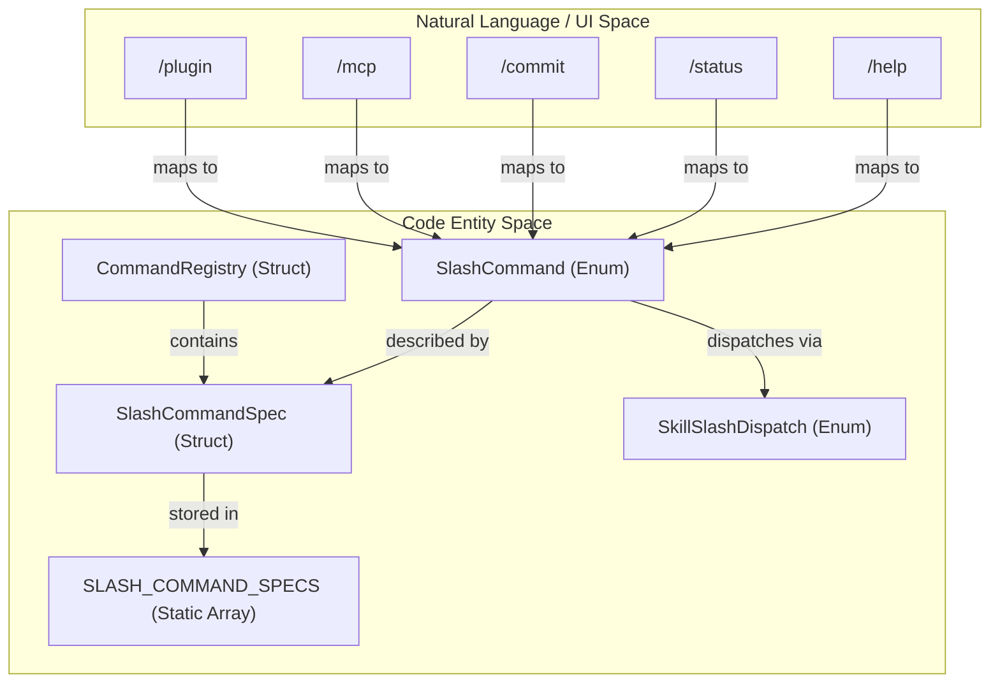
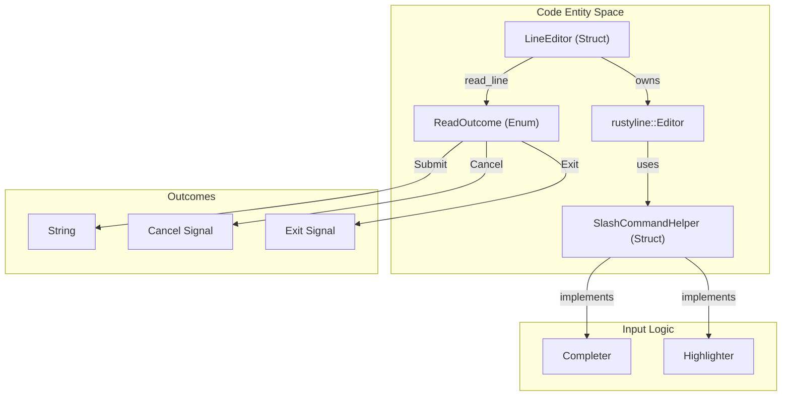
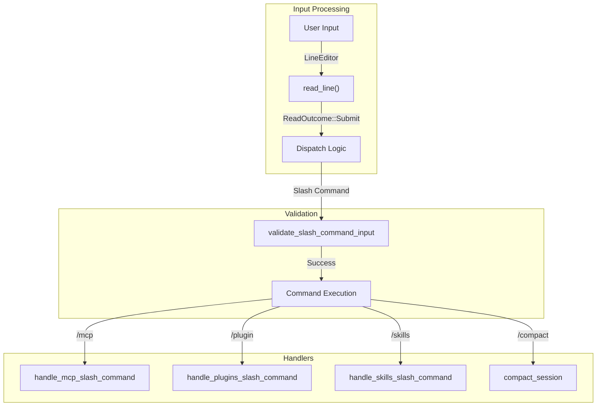

<!-- source: DeepWiki mcp.deepwiki.com · repo ultraworkers/claw-code · extra page Slash Commands and Input Handling · fetched 2026-10-26 -->

# Slash Commands and Input Handling

Relevant source files

The following files were used as context for generating this wiki page:

- [.claude/sessions/session-1775007846522.json](.claude/sessions/session-1775007846522.json)
- [ROADMAP.md](ROADMAP.md)
- [rust/Cargo.lock](rust/Cargo.lock)
- [rust/crates/commands/Cargo.toml](rust/crates/commands/Cargo.toml)
- [rust/crates/commands/src/lib.rs](rust/crates/commands/src/lib.rs)
- [rust/crates/rusty-claude-cli/Cargo.toml](rust/crates/rusty-claude-cli/Cargo.toml)
- [rust/crates/rusty-claude-cli/src/input.rs](rust/crates/rusty-claude-cli/src/input.rs)
- [rust/crates/rusty-claude-cli/src/main.rs](rust/crates/rusty-claude-cli/src/main.rs)
- [rust/crates/rusty-claude-cli/tests/cli_flags_and_config_defaults.rs](rust/crates/rusty-claude-cli/tests/cli_flags_and_config_defaults.rs)
- [rust/crates/rusty-claude-cli/tests/compact_output.rs](rust/crates/rusty-claude-cli/tests/compact_output.rs)
- [rust/crates/rusty-claude-cli/tests/output_format_contract.rs](rust/crates/rusty-claude-cli/tests/output_format_contract.rs)
- [rust/crates/rusty-claude-cli/tests/resume_slash_commands.rs](rust/crates/rusty-claude-cli/tests/resume_slash_commands.rs)
- [rust/crates/tools/Cargo.toml](rust/crates/tools/Cargo.toml)
- [rust/crates/tools/src/lib.rs](rust/crates/tools/src/lib.rs)

Slash commands provide a structured way for users to interact with the Claw CLI environment, manage session state, and trigger specialized workflows without entering a natural language prompt. Input handling is managed by a sophisticated line editor that supports multi-line input, modal editing, and tab completion.

## Slash Command Architecture

Slash commands are defined as a set of specifications in the `commands` crate and dispatched by the `LiveCli` REPL in the `rusty-claude-cli` crate.

### Command Definition and Categories
Commands are defined by a `SlashCommandSpec` struct which includes the command name, aliases, a summary, and whether the command is supported when resuming a session.

| Field | Type | Description |
| :--- | :--- | :--- |
| `name` | `&'static str` | The primary trigger (e.g., `help`). |
| `aliases` | `&'static [&'static str]` | Alternative triggers (e.g., `plugins` for `plugin`). |
| `summary` | `&'static str` | Short description shown in `/help`. |
| `argument_hint` | `Option<&'static str>` | UI hint for required/optional arguments. |
| `resume_supported` | `bool` | If true, the command can be used with the `--resume` CLI flag. |

Sources: [rust/crates/commands/src/lib.rs:45-52](), [rust/crates/commands/src/lib.rs:60-238]()

### The SlashCommand Enum
The system uses a `SlashCommand` enum to represent parsed commands. While `rusty-claude-cli` handles the top-level dispatch, the `commands` crate provides the full registry of available specs and specialized handlers.

Title: Slash Command Mapping Architecture

Sources: [rust/crates/commands/src/lib.rs:28-31](), [rust/crates/commands/src/lib.rs:45-52](), [rust/crates/commands/src/lib.rs:54-58](), [rust/crates/rusty-claude-cli/src/main.rs:45-52]()

## Input Handling and Line Editing

The CLI provides an interactive REPL (Read-Eval-Print Loop) via the `LineEditor` struct, which wraps `rustyline` to provide a rich terminal experience.

### LineEditor and SlashCommandHelper
The `LineEditor` manages the lifecycle of terminal input, including history management and helper integration for completions and highlighting.

Title: Input Processing and ReadOutcome Flow

Sources: [rust/crates/rusty-claude-cli/src/input.rs:16-21](), [rust/crates/rusty-claude-cli/src/input.rs:23-26](), [rust/crates/rusty-claude-cli/src/input.rs:101-104](), [rust/crates/rusty-claude-cli/src/input.rs:140-166]()

### Multi-line Input and Tab Completion
*   **Multi-line Input**: Users can insert newlines without submitting by using `Shift+Enter` or `Ctrl+J`. This is implemented via `editor.bind_sequence` calls. [rust/crates/rusty-claude-cli/src/input.rs:116-118]()
*   **Tab Completion**: The `SlashCommandHelper` filters the `completions` vector based on the current cursor position and prefix. It specifically handles prefixes starting with `/` via `slash_command_prefix`. [rust/crates/rusty-claude-cli/src/input.rs:58-80](), [rust/crates/rusty-claude-cli/src/input.rs:200-211]()
*   **Fallback Mode**: If the terminal is not interactive (e.g., piped input), `LineEditor` falls back to a basic `stdin().read_line()` implementation in `read_line_fallback`. [rust/crates/rusty-claude-cli/src/input.rs:141-143](), [rust/crates/rusty-claude-cli/src/input.rs:182-198]()
*   **Vim Modal Editing**: While the default `edit_mode` is set to `Emacs` in the `LineEditor::new` constructor, the `rustyline` integration supports standard terminal line editing features. [rust/crates/rusty-claude-cli/src/input.rs:111]()

## Command Execution Data Flow

When a command is issued, it is validated against the `SLASH_COMMAND_SPECS` before being dispatched to specific logic handlers.

Title: Command Dispatch Pipeline

Sources: [rust/crates/rusty-claude-cli/src/main.rs:45-52](), [rust/crates/rusty-claude-cli/src/input.rs:140-150](), [rust/crates/commands/src/lib.rs:83-88]()

## Specialized Handlers and Helpers

### Plugin and MCP Management
The `commands` crate integrates with the `plugins` and `runtime` crates to manage external capabilities:
*   **`/plugin`**: Uses `PluginManager` to list, install, and toggle plugins via `handle_plugins_slash_command`. [rust/crates/commands/src/lib.rs:7-12](), [rust/crates/commands/src/lib.rs:232-238](), [rust/crates/rusty-claude-cli/src/main.rs:45-48]()
*   **`/mcp`**: Interfaces with `McpServerManager` to inspect JSON-RPC tool servers via `handle_mcp_slash_command`. [rust/crates/commands/src/lib.rs:132-137](), [rust/crates/rusty-claude-cli/src/main.rs:45-48]()

### Git and Workspace Workflow
Specific slash commands automate common developer tasks by interacting with the underlying repository:
*   **`/diff`**: Shows current workspace changes using git status/diff. [rust/crates/commands/src/lib.rs:153-158]()
*   **`/commit`**: Generates a commit message based on the conversation and executes a git commit. [rust/crates/commands/src/lib.rs:174-179]()
*   **`/pr` / `/issue`**: Drafts GitHub-specific entities using conversation context. [rust/crates/commands/src/lib.rs:181-193]()
*   **`/init`**: Creates a starter `CLAUDE.md` for the repository via `initialize_repo`. [rust/crates/commands/src/lib.rs:146-151](), [rust/crates/rusty-claude-cli/src/main.rs:53]()

### Session Control and Compaction
The system allows for fine-grained control over the conversation lifecycle:
*   **`/compact`**: Triggers `compact_session` from the `runtime` crate to summarize history and save tokens. [rust/crates/commands/src/lib.rs:8-12](), [rust/crates/commands/src/lib.rs:83-88]()
*   **`/clear`**: Resets the local session, creating a fresh start and backing up the previous session. [rust/crates/commands/src/lib.rs:104-109](), [rust/crates/rusty-claude-cli/tests/resume_slash_commands.rs:56-62]()
*   **`/resume`**: Loads a specific session file back into the REPL. [rust/crates/commands/src/lib.rs:118-123]()

### JSON Output for Automation
For "clawable" automation, commands can emit structured JSON instead of human-readable text when requested via the `--output-format json` flag. This is strictly enforced for integration tests to ensure machine-readability.

| Command | JSON Handler | Logic |
| :--- | :--- | :--- |
| `/mcp` | `handle_mcp_slash_command_json` | Returns server list and status. |
| `/skills` | `handle_skills_slash_command_json` | Returns registered tool skills. |
| `/agents` | `handle_agents_slash_command_json` | Returns sub-agent status. |

Sources: [rust/crates/rusty-claude-cli/tests/output_format_contract.rs:13-34](), [rust/crates/rusty-claude-cli/src/main.rs:46-52]()

Sources:
- `rust/crates/commands/src/lib.rs`
- `rust/crates/rusty-claude-cli/src/main.rs`
- `rust/crates/rusty-claude-cli/src/input.rs`
- `rust/crates/rusty-claude-cli/tests/output_format_contract.rs`
- `rust/crates/rusty-claude-cli/tests/resume_slash_commands.rs`
- `rust/crates/tools/src/lib.rs`

---

