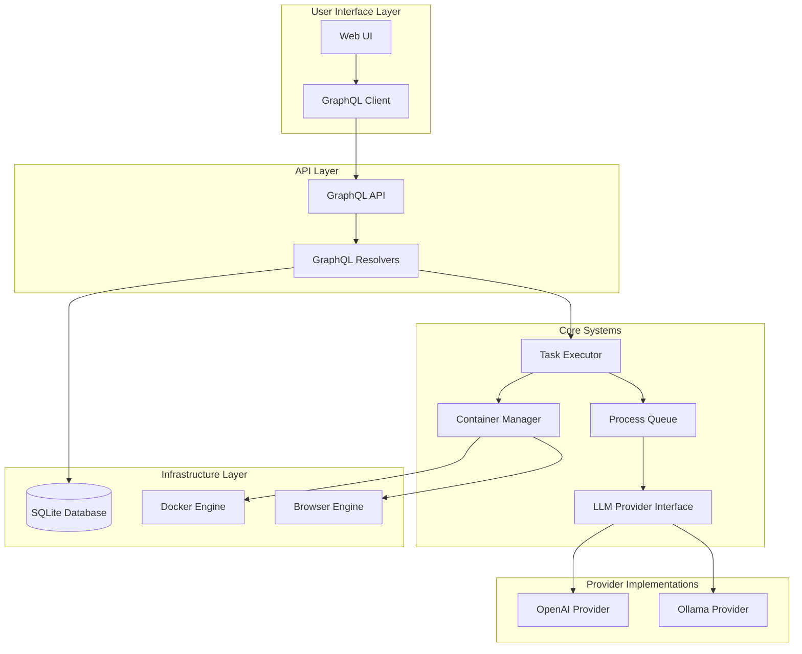
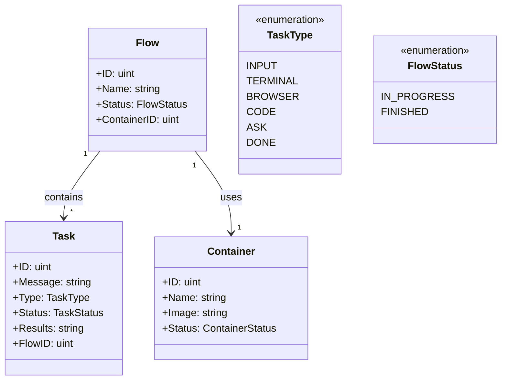
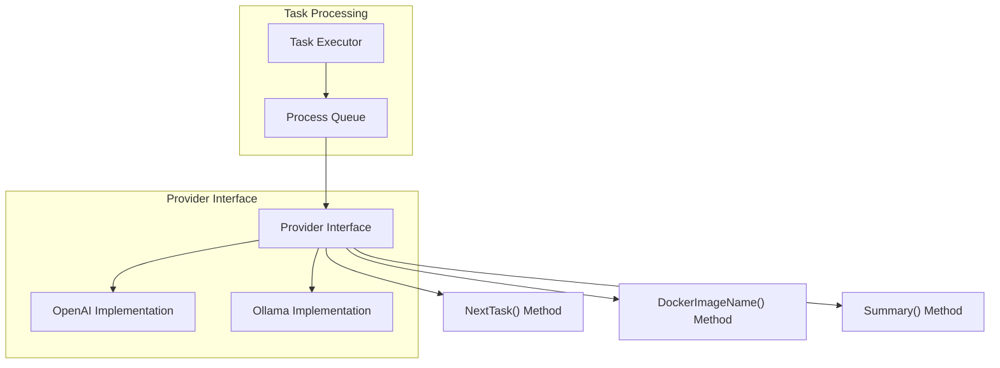
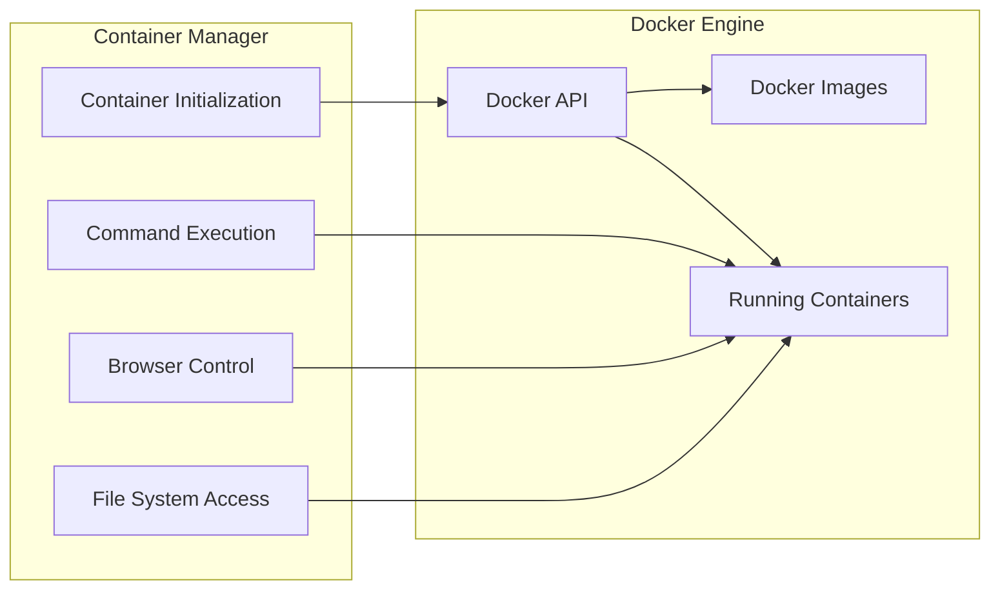
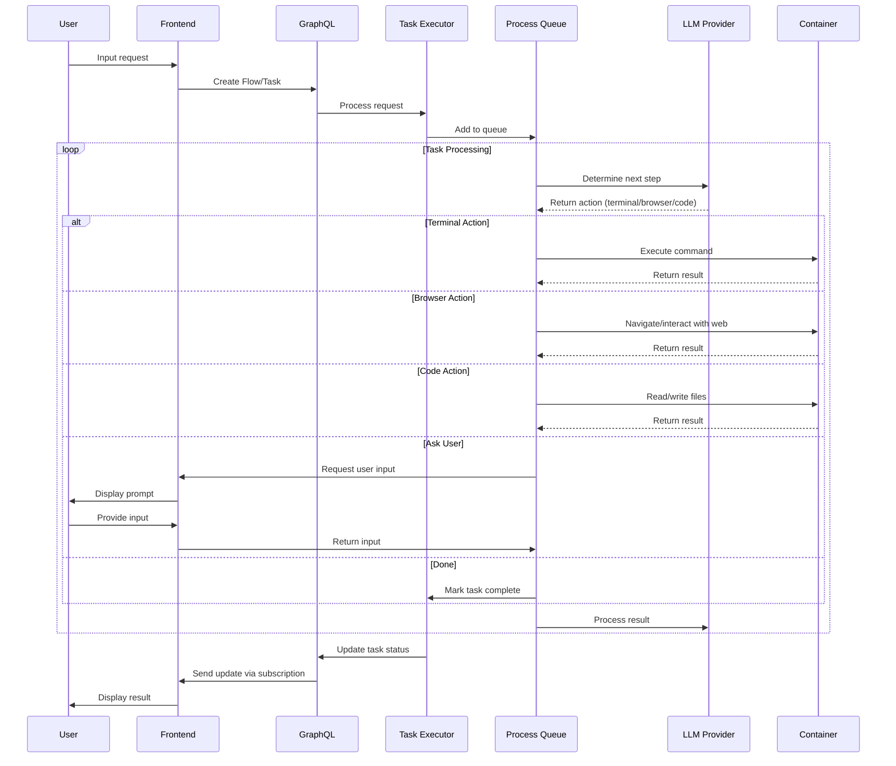

<!-- source: DeepWiki mcp.deepwiki.com · repo semanser/codel · page 1 Overview · fetched 2026-10-26 -->

# Overview

<details>
<summary>Relevant source files</summary>

The following files were used as context for generating this wiki page:

- [.github/logo.png](.github/logo.png)
- [DEVELOPMENT.md](DEVELOPMENT.md)
- [README.md](README.md)
- [backend/.env.example](backend/.env.example)
- [backend/go.mod](backend/go.mod)
- [backend/go.sum](backend/go.sum)
- [backend/main.go](backend/main.go)
- [backend/models/models.go](backend/models/models.go)
- [frontend/.env.example](frontend/.env.example)

</details>


Codel is an autonomous AI agent system designed to perform complex tasks using terminal, browser, and editor functionalities. This document provides a high-level introduction to Codel's architecture, components, and capabilities.

## What is Codel?

Codel is a fully autonomous AI agent that can understand user requests, break them down into actionable steps, and execute these steps using various tools like terminal commands, web browsing, and code editing. All operations run in a sandboxed Docker environment for security, with a modern web-based UI for interaction.

Key features include:
- 🔓 Secure sandboxed Docker environment for all operations
- 🤖 Autonomous task planning and execution using language models
- 🔍 Built-in browser for web access and information gathering
- 📙 Integrated text editor for code viewing and modification
- 🧠 Task history and context preservation in a database
- 📦 Automatic Docker image selection based on task requirements
- 🤳 Self-hosted deployment

Sources: [README.md:1-16]()

## System Architecture

Codel follows a client-server architecture with several key systems working together:



Sources: [backend/main.go:1-86](), [README.md:7-15]()

## Core Components

### 1. Task Processing System

The Task Processing System manages the execution flow of tasks. It consists of:

- **Task Executor**: Orchestrates task execution and manages the process queue
- **Process Queue**: Maintains the sequence of tasks to be executed
- **LLM Provider Interface**: Abstract interface for language model integration

Tasks in Codel follow a defined lifecycle, progressing from creation through execution to completion:

```mermaid
stateDiagram-v2
    [*] --> "Task Created"
    "Task Created" --> "In Progress": Added to Queue
    "In Progress" --> "LLM Processing": Planning next steps
    "LLM Processing" --> "Execution": Terminal/Browser/Code
    "Execution" --> "Result Capture": Collect output
    "Result Capture" --> "In Progress": Continue processing
    "In Progress" --> "Finished": Task complete
    "In Progress" --> "Failed": Error occurred
    "Finished" --> [*]
    "Failed" --> [*]
```

Sources: [backend/models/models.go:19-47]()

### 2. Data Model

Codel's core data model consists of several key entities:



The data model defines several key types:

| Entity | Description | Possible States |
|--------|-------------|----------------|
| Flow | A user session containing tasks | `in_progress`, `finished` |
| Task | A single step within a flow | `in_progress`, `finished`, `stopped`, `failed` |
| Container | Docker container for task execution | `starting`, `running`, `stopped`, `failed` |
| TaskType | The type of operation to perform | `input`, `terminal`, `browser`, `code`, `ask`, `done` |

Sources: [backend/models/models.go:1-64]()

### 3. Language Model Integration

Codel integrates with language models through a provider interface that abstracts the specific implementation details:



Language models in Codel are primarily used for:
1. Determining the next steps based on the context
2. Selecting appropriate Docker images for specific tasks
3. Generating summaries of task results

Codel supports multiple LLM providers:

| Provider | Configuration | Default Model |
|----------|---------------|---------------|
| OpenAI | `OPEN_AI_KEY`, `OPEN_AI_MODEL`, `OPEN_AI_SERVER_URL` | gpt-4-0125-preview |
| Ollama | `OLLAMA_MODEL`, `OLLAMA_SERVER_URL` | llama2 |

Sources: [README.md:41-47](), [backend/.env.example:6-13]()

### 4. Container Execution System

Codel executes tasks in isolated Docker containers, providing a secure environment for terminal commands, browser interactions, and code operations:



The Container Execution System features:
- Automatic Docker image selection based on task requirements
- Terminal command execution with output capture
- Browser interaction through a headless browser
- File system access for code operations
- Container lifecycle management (creation, execution, cleanup)

Sources: [backend/main.go:58-66](), [backend/main.go:80-83]()

## System Workflow

The following diagram illustrates how a typical task flows through Codel's components:



Sources: [backend/models/models.go:19-47]()

## Configuration and Deployment

Codel can be deployed using Docker with various configuration options:

```
docker run \
  -e OPEN_AI_KEY=your_open_ai_key \
  -e OPEN_AI_MODEL=gpt-4-0125-preview \
  -e OLLAMA_MODEL=llama2 \
  -p 3000:8080 \
  -v /var/run/docker.sock:/var/run/docker.sock \
  ghcr.io/semanser/codel:latest
```

The Docker container needs access to the host's Docker socket to create and manage containers for tasks.

Key environment variables include:

| Variable | Purpose | Default |
|----------|---------|---------|
| OPEN_AI_KEY | OpenAI API key | - |
| OPEN_AI_MODEL | OpenAI model to use | gpt-4-0125-preview |
| OPEN_AI_SERVER_URL | Custom OpenAI-compatible server | https://api.openai.com/v1 |
| OLLAMA_MODEL | Ollama model to use | llama2 |
| OLLAMA_SERVER_URL | Ollama server URL | https://host.docker.internal:11434 |
| PORT | Server port | 8080 |

For more detailed information about specific subsystems, see:
- [Task Processing System](#3.1)
- [Language Model Integration](#3.2)
- [Container Execution System](#3.3)
- [Getting Started](#2)

Sources: [README.md:17-47](), [DEVELOPMENT.md:9-24]()

---

