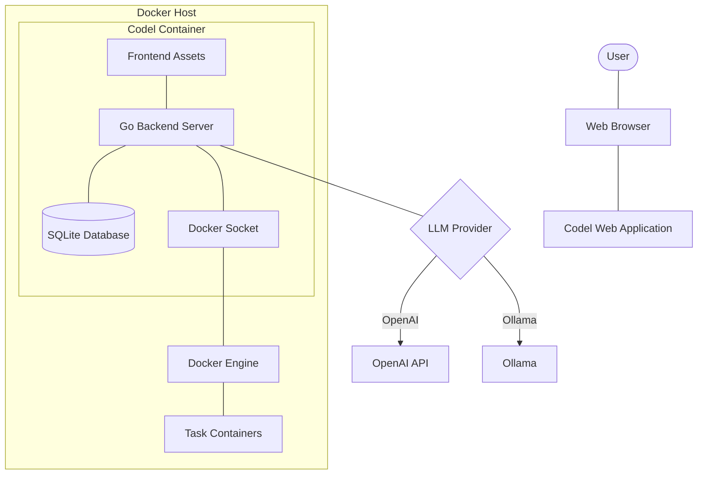
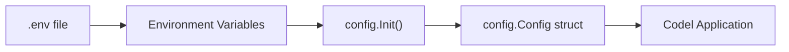
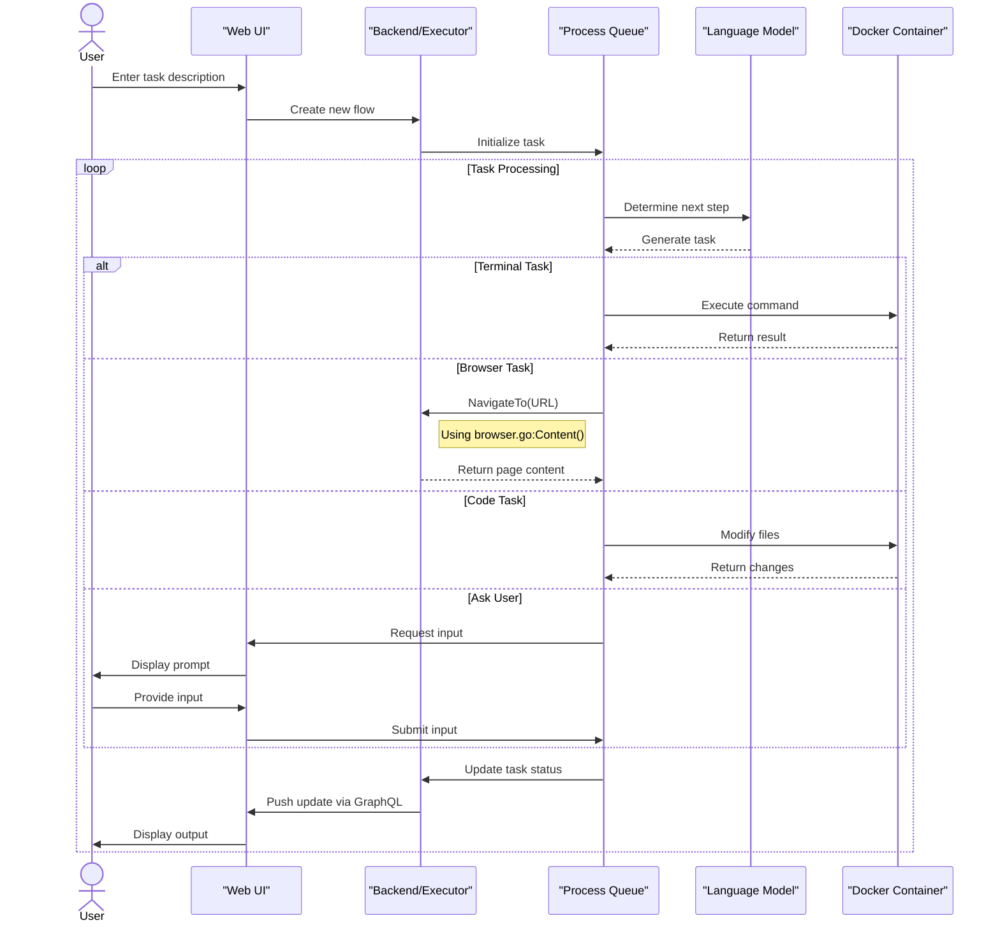
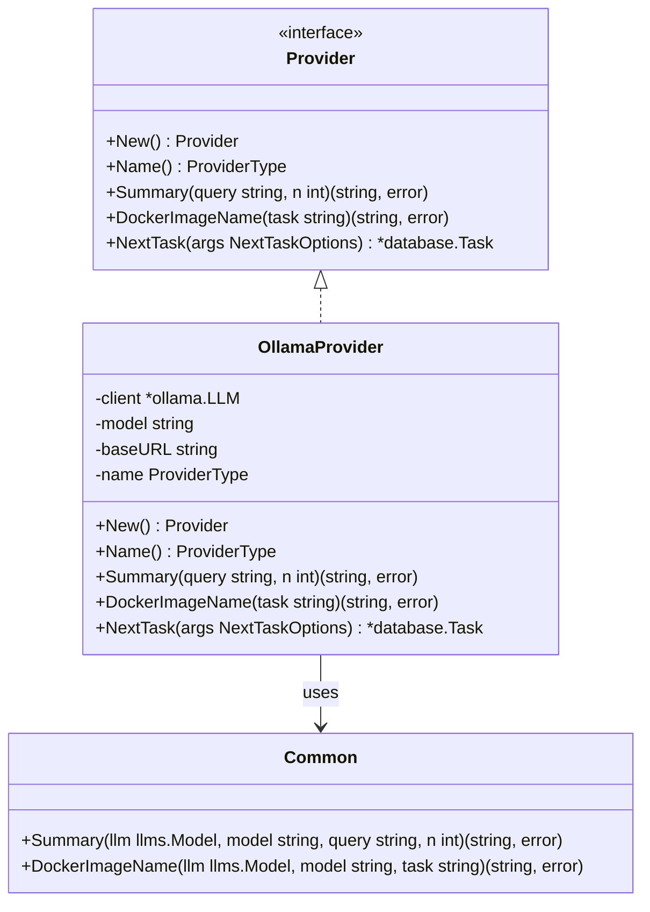

<!-- source: DeepWiki mcp.deepwiki.com · repo semanser/codel · page 2 Getting Started · fetched 2026-10-26 -->

# Getting Started

<details>
<summary>Relevant source files</summary>

The following files were used as context for generating this wiki page:

- [.dockerignore](.dockerignore)
- [.github/logo.png](.github/logo.png)
- [.gitignore](.gitignore)
- [DEVELOPMENT.md](DEVELOPMENT.md)
- [Dockerfile](Dockerfile)
- [README.md](README.md)
- [backend/.env.example](backend/.env.example)
- [backend/.gitignore](backend/.gitignore)
- [backend/config/config.go](backend/config/config.go)
- [backend/executor/browser.go](backend/executor/browser.go)
- [backend/providers/common.go](backend/providers/common.go)
- [backend/providers/ollama.go](backend/providers/ollama.go)
- [frontend/.env.example](frontend/.env.example)

</details>


This guide explains how to install, configure, and start using Codel - an autonomous AI agent system capable of performing complex tasks using terminal, browser, and editor functionalities in a secure, sandboxed environment.

For details about Codel's internal architecture, see [Core Systems](#3).

## Prerequisites

Before you can use Codel, you'll need:

- Docker installed and running
- One of the following language model providers:
  - OpenAI API key (requires account at [platform.openai.com](https://platform.openai.com))
  - Running Ollama instance (for open-source model support)
- Docker socket access for container creation

Sources: [README.md:17-37](), [DEVELOPMENT.md:3-8]()

## Installation

The simplest way to run Codel is using the pre-built Docker image available from the GitHub Container Registry.

```bash
docker run \
  -e OPEN_AI_KEY=your_open_ai_key \
  -e OPEN_AI_MODEL=gpt-4-0125-preview \
  -p 3000:8080 \
  -v /var/run/docker.sock:/var/run/docker.sock \
  ghcr.io/semanser/codel:latest
```

This command:
1. Runs the Codel container with your OpenAI API key
2. Specifies the OpenAI model to use
3. Maps port 3000 on your host to port 8080 in the container
4. Mounts the Docker socket to allow Codel to create containers

After running this command, access Codel at http://localhost:3000 in your browser.

### Codel Deployment Architecture



Sources: [README.md:17-37](), [Dockerfile:1-43]()

## Configuration Options

### Environment Variables

Codel is configured through environment variables loaded by the `config.Init()` function:

| Variable | Description | Default |
|----------|-------------|---------|
| `OPEN_AI_KEY` | OpenAI API key | None |
| `OPEN_AI_MODEL` | OpenAI model to use | gpt-4-0125-preview |
| `OPEN_AI_SERVER_URL` | OpenAI API endpoint | https://api.openai.com/v1 |
| `OLLAMA_MODEL` | Ollama model name | None |
| `OLLAMA_SERVER_URL` | Ollama server URL | http://host.docker.internal:11434 |
| `DATABASE_URL` | Database path | database.db |
| `PORT` | Server port | 8080 |

You can provide these variables using the `-e` flag with Docker run or using an environment file:

```bash
docker run \
  --env-file ./my-env-file \
  -p 3000:8080 \
  -v /var/run/docker.sock:/var/run/docker.sock \
  ghcr.io/semanser/codel:latest
```

Example environment file content:
```
OPEN_AI_KEY=your_open_ai_key
OPEN_AI_MODEL=gpt-4-0125-preview
```

### Configuration System Flow



Sources: [backend/config/config.go:10-35](), [backend/.env.example:1-17](), [README.md:38-49]()

## Using Codel

After starting the Codel container, access the web interface at http://localhost:3000.

### Creating Your First Task

1. Open the Codel web interface
2. Click "New Task" in the sidebar
3. Enter a natural language description of your task (e.g., "Create a simple Node.js web server")
4. Codel will automatically:
   - Analyze your request using the configured language model
   - Select an appropriate Docker image based on the task requirements
   - Create a sandboxed container environment
   - Execute the necessary commands to complete your task
   - Show results and progress in real-time

### Task Execution Flow



Sources: [README.md:7-15](), [backend/executor/browser.go:26-52]()

## Language Model Configuration

Codel supports two language model providers that implement the common `Provider` interface:

### OpenAI

To use OpenAI models, provide your API key through the `OPEN_AI_KEY` environment variable. You can also specify:

- `OPEN_AI_MODEL`: The model to use (default: gpt-4-0125-preview)
- `OPEN_AI_SERVER_URL`: The API endpoint (default: https://api.openai.com/v1)

### Ollama

To use locally hosted Ollama models, set:

- `OLLAMA_MODEL`: The name of the model (e.g., "llama2")
- `OLLAMA_SERVER_URL`: The Ollama server URL (default: http://host.docker.internal:11434)

### Provider System Architecture



Sources: [backend/providers/common.go:1-53](), [backend/providers/ollama.go:1-163]()

## Docker Integration

Codel uses Docker to create isolated environments for executing tasks. The Docker socket must be mounted to allow Codel to create and manage containers:

```bash
-v /var/run/docker.sock:/var/run/docker.sock
```

The system automatically determines the appropriate Docker image based on the task using the language model. For browser-related tasks, it uses the `BrowserName()` function to create a browser container named "codel-browser".

Sources: [backend/executor/browser.go:166-168](), [README.md:17-37]()

## Next Steps

After getting started with Codel, you might want to explore:

- [Core Systems](#3) - Detailed explanations of Codel's internal architecture
- [Task Processing System](#3.1) - How tasks are sequentially processed and executed
- [Language Model Integration](#3.2) - More details on language model integration
- [Container Execution System](#3.3) - Details on container creation and management

For development setup and contributing to Codel, refer to the DEVELOPMENT.md file in the repository.

---

