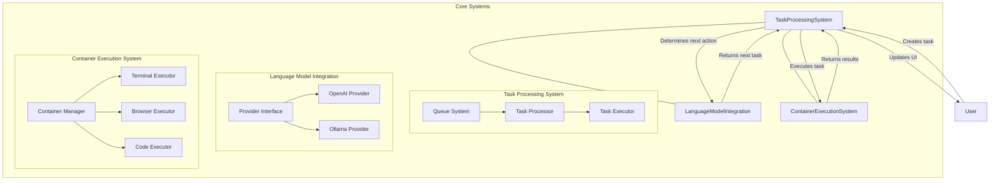
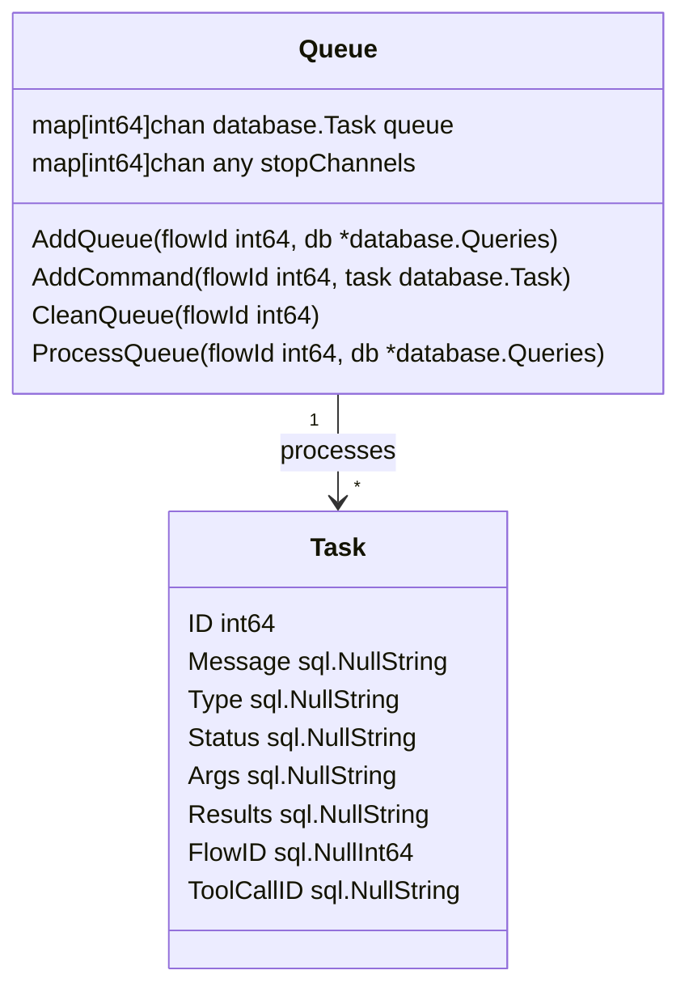
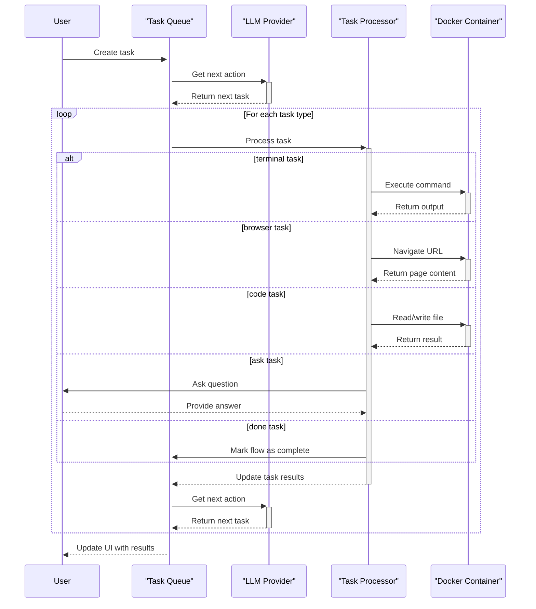
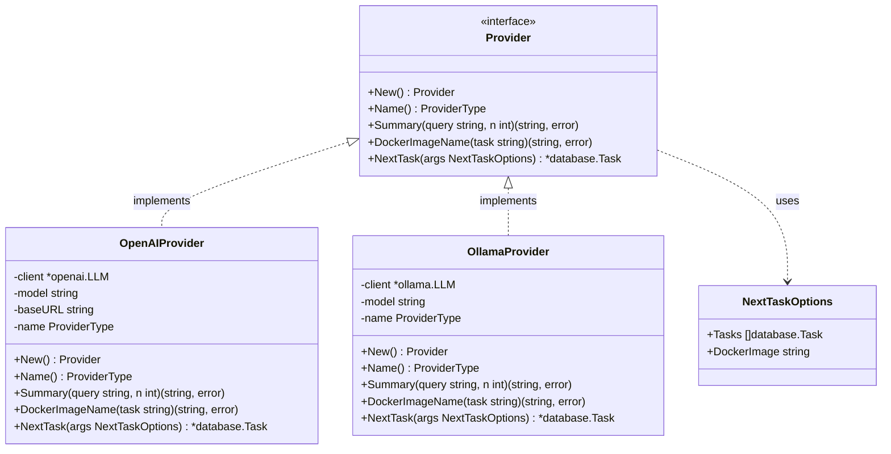
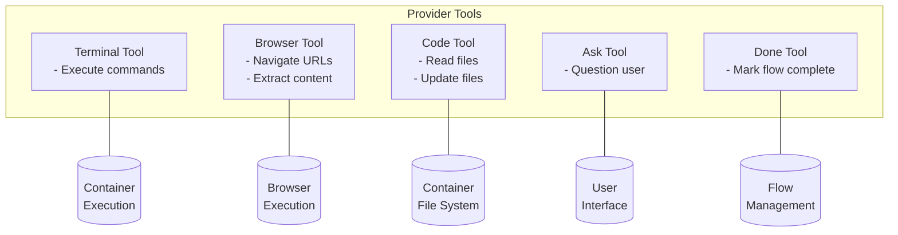
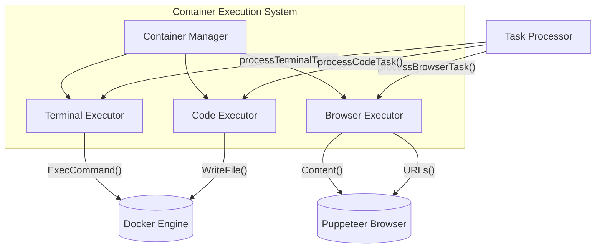
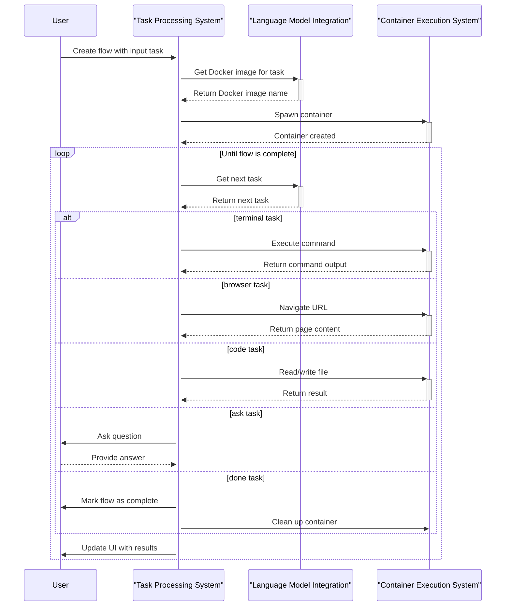

<!-- source: DeepWiki mcp.deepwiki.com · repo semanser/codel · page 3 Core Systems · fetched 2026-10-26 -->

# Core Systems

<details>
<summary>Relevant source files</summary>

The following files were used as context for generating this wiki page:

- [backend/executor/processor.go](backend/executor/processor.go)
- [backend/executor/queue.go](backend/executor/queue.go)
- [backend/providers/openai.go](backend/providers/openai.go)
- [backend/providers/providers.go](backend/providers/providers.go)
- [backend/providers/types.go](backend/providers/types.go)
- [backend/templates/prompts/agent.tmpl](backend/templates/prompts/agent.tmpl)

</details>


This page provides a detailed overview of the key systems that power Codel's autonomous capabilities. These core systems work together to enable Codel to understand user tasks, execute them step by step, and provide real-time feedback.

For information about installation and configuration, see [Getting Started](#2). For details about the data architecture and models, see [Data Architecture](#4).

## Overview of Core Systems

Codel's core functionality is built around three primary systems:

1. **Task Processing System** - Manages the sequential processing of tasks through a queue
2. **Language Model Integration** - Provides AI decision-making capabilities via OpenAI or Ollama
3. **Container Execution System** - Executes commands in isolated Docker environments

These systems work together to create an autonomous agent that can understand complex instructions and execute them across different environments.



Sources: [backend/executor/queue.go](backend/executor/queue.go), [backend/providers/providers.go](backend/providers/providers.go), [backend/executor/processor.go](backend/executor/processor.go)

## Task Processing System

The Task Processing System is responsible for managing the flow of tasks in Codel. It maintains a queue of tasks, processes them sequentially, and determines the next steps using language models.

### Queue Architecture



Sources: [backend/executor/queue.go:15-46](backend/executor/queue.go:15-46)

The queue system is implemented as a map of Go channels, where each flow has its own channel for tasks. This allows for concurrent processing of tasks from different flows.

```go
var queue = make(map[int64]chan database.Task)
var stopChannels = make(map[int64]chan any)
```

The primary functions of the queue system are:

1. **AddQueue** - Creates a new queue for a flow and starts processing it
2. **AddCommand** - Adds a new task to a flow's queue
3. **CleanQueue** - Removes a queue when a flow is finished
4. **ProcessQueue** - Processes tasks in a queue

Sources: [backend/executor/queue.go:18-46](backend/executor/queue.go:18-46)

### Task Processing Flow



Sources: [backend/executor/queue.go:48-243](backend/executor/queue.go:48-243), [backend/executor/processor.go:18-288](backend/executor/processor.go:18-288)

The task processing flow starts when a user adds a task to a flow. The task is added to the queue and processed according to its type. After processing, the results are used to determine the next action through the language model provider.

Key task types include:

| Task Type | Description | Handler |
|-----------|-------------|---------|
| `input` | User input that starts a flow | `processInputTask()` |
| `terminal` | Command to be executed in the terminal | `processTerminalTask()` |
| `browser` | Action to be performed in a browser | `processBrowserTask()` |
| `code` | Operation on code files | `processCodeTask()` |
| `ask` | Question to be asked to the user | `processAskTask()` |
| `done` | Marks a flow as complete | `processDoneTask()` |

Sources: [backend/executor/processor.go:18-288](backend/executor/processor.go:18-288)

## Language Model Integration

The Language Model Integration system provides the AI capabilities that drive Codel's autonomous decision-making. It determines what actions to take based on the current state of a flow and the results of previous tasks.

### Provider Architecture



Sources: [backend/providers/providers.go:16-35](backend/providers/providers.go:16-35), [backend/providers/openai.go:16-43](backend/providers/openai.go:16-43)

The Provider interface defines the methods that all language model providers must implement:

```go
type Provider interface {
    New() Provider
    Name() ProviderType
    Summary(query string, n int) (string, error)
    DockerImageName(task string) (string, error)
    NextTask(args NextTaskOptions) *database.Task
}
```

Sources: [backend/providers/providers.go:23-29](backend/providers/providers.go:23-29)

Currently, Codel supports two provider implementations:

1. **OpenAIProvider** - Uses OpenAI's models (like GPT-4)
2. **OllamaProvider** - Uses locally hosted Ollama models

The `ProviderFactory` function creates the appropriate provider based on the provider type:

```go
func ProviderFactory(provider ProviderType) (Provider, error) {
    switch provider {
    case ProviderOpenAI:
        return OpenAIProvider{}.New(), nil
    case ProviderOllama:
        return OllamaProvider{}.New(), nil
    default:
        return nil, fmt.Errorf("unknown provider: %s", provider)
    }
}
```

Sources: [backend/providers/providers.go:79-88](backend/providers/providers.go:79-88)

### Tool Definitions

The language models use a set of predefined tools to interact with Codel:



Sources: [backend/providers/providers.go:36-76](backend/providers/providers.go:36-76), [backend/providers/types.go:1-76](backend/providers/types.go:1-76)

Each tool is defined with a name, description, and parameters schema:

| Tool | Description | Parameters |
|------|-------------|------------|
| `terminal` | Executes a command in the terminal | `input`: Command to run |
| `browser` | Performs browser actions | `url`: URL to navigate to<br>`action`: `read` or `url` |
| `code` | Manipulates code files | `action`: `read_file` or `update_file`<br>`path`: File path<br>`content`: File content |
| `ask` | Asks a question to the user | `input`: Question text |
| `done` | Marks a flow as complete | None |

Sources: [backend/providers/providers.go:36-76](backend/providers/providers.go:36-76), [backend/providers/types.go:8-76](backend/providers/types.go:8-76)

### Agent Prompt and Task Generation

The language model's decisions are guided by a system prompt defined in the template file. This prompt provides context and instructions for the agent:

```
You're a robot that performs engineering work to successfully finish a user-defined task.
You have access to the terminal, browser, and text editor.
You have to perform step-by-step work execution to achieve the end goal that is determined by the user.
You will be provided with a list of previous commands (generated by LLM) and inputs (generated by the user).
Your goal is to give the next best step in this flow.
...
```

Sources: [backend/templates/prompts/agent.tmpl:1-18](backend/templates/prompts/agent.tmpl:1-18)

The `NextTask` method of the provider is responsible for generating the next task in a flow. It:

1. Builds a prompt using the agent template
2. Converts previous tasks to a message format
3. Sends the message to the language model
4. Converts the model's response to a task

Sources: [backend/providers/openai.go:57-104](backend/providers/openai.go:57-104)

## Container Execution System

The Container Execution System manages Docker containers used to execute tasks. It provides isolated environments for running terminal commands, browsing the web, and manipulating code files.

### Container Management Architecture



Sources: [backend/executor/processor.go:18-288](backend/executor/processor.go:18-288)

### Terminal Execution

Terminal tasks are executed in Docker containers. The `processTerminalTask` function:

1. Unmarshals the task arguments
2. Calls `ExecCommand` to execute the command in the container
3. Updates the task results with the command output

```go
func processTerminalTask(db *database.Queries, task database.Task) error {
    var args = providers.TerminalArgs{}
    err := json.Unmarshal([]byte(task.Args.String), &args)
    if err != nil {
        return fmt.Errorf("failed to unmarshal args: %v", err)
    }

    results, err := ExecCommand(task.FlowID.Int64, args.Input, db)

    if err != nil {
        return fmt.Errorf("failed to execute command: %w", err)
    }

    _, err = db.UpdateTaskResults(context.Background(), database.UpdateTaskResultsParams{
        ID:      task.ID,
        Results: database.StringToNullString(results),
    })

    if err != nil {
        return fmt.Errorf("failed to update task results: %w", err)
    }

    return nil
}
```

Sources: [backend/executor/processor.go:219-242](backend/executor/processor.go:219-242)

### Browser Execution

Browser tasks are executed using Puppeteer. The `processBrowserTask` function:

1. Unmarshals the task arguments
2. Calls either `Content` or `URLs` based on the action
3. Updates the task results with the content
4. Broadcasts browser updates to the frontend

```go
func processBrowserTask(db *database.Queries, task database.Task) error {
    var args = providers.BrowserArgs{}
    err := json.Unmarshal([]byte(task.Args.String), &args)
    if err != nil {
        return fmt.Errorf("failed to unmarshal args: %v", err)
    }

    var url = args.Url
    var screenshotName string

    if args.Action == providers.Read {
        content, screenshot, err := Content(url)
        // ...
    }

    if args.Action == providers.Url {
        content, screenshot, err := URLs(url)
        // ...
    }

    subscriptions.BroadcastBrowserUpdated(task.FlowID.Int64, &gmodel.Browser{
        URL: url,
        ScreenshotURL: "http://localhost:8080/browser/" + screenshotName,
    })

    return nil
}
```

Sources: [backend/executor/processor.go:18-74](backend/executor/processor.go:18-74)

### Code Execution

Code tasks manipulate files in Docker containers. The `processCodeTask` function:

1. Unmarshals the task arguments
2. Performs the action (read or update) on the file
3. Updates the task results

```go
func processCodeTask(db *database.Queries, task database.Task) error {
    var args = providers.CodeArgs{}
    err := json.Unmarshal([]byte(task.Args.String), &args)
    if err != nil {
        return fmt.Errorf("failed to unmarshal args: %v", err)
    }

    var cmd = ""
    var results = ""

    if args.Action == providers.ReadFile {
        cmd = fmt.Sprintf("cat %s", args.Path)
        results, err = ExecCommand(task.FlowID.Int64, cmd, db)
        // ...
    }

    if args.Action == providers.UpdateFile {
        err = WriteFile(task.FlowID.Int64, args.Content, args.Path, db)
        // ...
        results = "File updated"
    }

    _, err = db.UpdateTaskResults(context.Background(), database.UpdateTaskResultsParams{
        ID:      task.ID,
        Results: database.StringToNullString(results),
    })
    // ...

    return nil
}
```

Sources: [backend/executor/processor.go:244-288](backend/executor/processor.go:244-288)

## Integration Between Core Systems

The three core systems work together to provide Codel's autonomous capabilities:



Sources: [backend/executor/queue.go:48-243](backend/executor/queue.go:48-243), [backend/executor/processor.go:18-288](backend/executor/processor.go:18-288), [backend/providers/openai.go:57-104](backend/providers/openai.go:57-104)

The task processing flow typically follows these steps:

1. User creates a flow with an input task
2. Task system gets Docker image from language model
3. Container system creates Docker container
4. Task system gets next task from language model
5. Task system executes task using container system
6. Results are returned to task system
7. Task system gets next task from language model
8. Process repeats until flow is complete

For more detailed information about specific aspects of the core systems, see:
- [Task Processing System](#3.1) for details on the task queue
- [Language Model Integration](#3.2) for details on the provider interface
- [Container Execution System](#3.3) for details on container management

---

