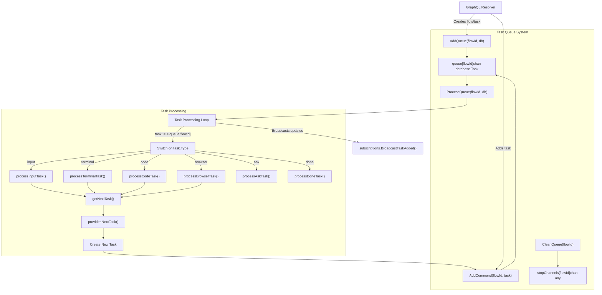
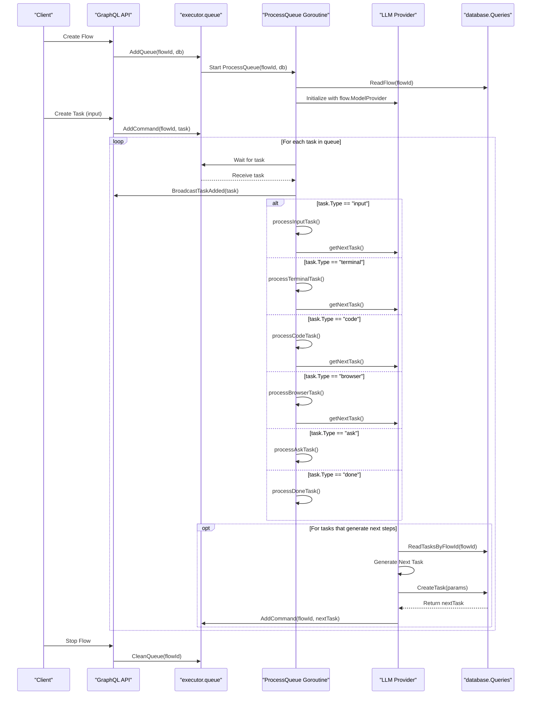
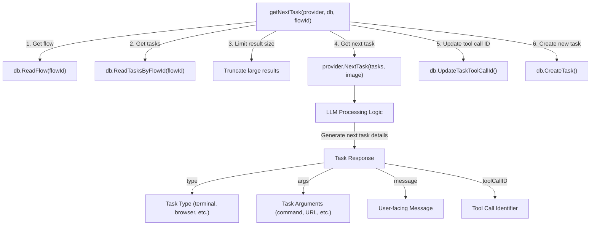

<!-- source: DeepWiki mcp.deepwiki.com · repo semanser/codel · page 3.1 Task Processing System · fetched 2026-10-26 -->

# Task Processing System

<details>
<summary>Relevant source files</summary>

The following files were used as context for generating this wiki page:

- [backend/executor/queue.go](backend/executor/queue.go)
- [backend/templates/prompts/agent.tmpl](backend/templates/prompts/agent.tmpl)

</details>


The Task Processing System is a core component of Codel that manages the sequential execution of tasks within autonomous flows. This system is responsible for managing queues of tasks, processing different task types, determining the next actions using language models, and coordinating with other components like the container execution system and browser interface.

For information about how language models are integrated into the system, see [Language Model Integration](#3.2). For details on how tasks are executed in containers, see [Container Execution System](#3.3).

## System Architecture

The Task Processing System uses a queue-based architecture to manage and process tasks. Each flow has its own dedicated queue that handles tasks sequentially.



Sources: [backend/executor/queue.go:15-46](), [backend/executor/queue.go:48-185]()

## Queue Management

The system maintains two global maps that store the task channels and stop signals for each flow:

```go
var queue = make(map[int64]chan database.Task)
var stopChannels = make(map[int64]chan any)
```

The queue management functions include:

| Function | Purpose | Implementation |
|----------|---------|----------------|
| `AddQueue` | Creates a new queue for a flow and starts processing | [queue.go:18-26]() |
| `AddCommand` | Adds a task to a flow's queue | [queue.go:28-33]() |
| `CleanQueue` | Cleans up resources when a flow ends | [queue.go:35-46]() |
| `ProcessQueue` | Processes tasks in a queue | [queue.go:48-185]() |

Sources: [backend/executor/queue.go:15-46]()

## Task Types and Processing Flow

The system supports different task types, each handled by specific processing logic:



Sources: [backend/executor/queue.go:69-184]()

The task types supported by the system include:

| Task Type | Description | Function | Generates Next Task |
|-----------|-------------|----------|---------------------|
| `input` | Tasks created from user input | `processInputTask` | Yes |
| `terminal` | Executes commands in the container | `processTerminalTask` | Yes |
| `code` | Reads or modifies files | `processCodeTask` | Yes |
| `browser` | Interacts with web pages | `processBrowserTask` | Yes |
| `ask` | Requests information from the user | `processAskTask` | No |
| `done` | Marks the flow as complete | `processDoneTask` | No |

Sources: [backend/executor/queue.go:94-181]()

## Next Task Determination

A key function of the Task Processing System is determining the next task to execute after completing certain task types. This is handled by the `getNextTask` function:



Sources: [backend/executor/queue.go:187-243]()

## Language Model Prompt Template

The Task Processing System uses language models to determine the next tasks to execute. The system passes previous tasks to the language model along with a prompt template that guides the model's response format.

The prompt template (`agent.tmpl`) defines:

1. The agent's role as an engineering assistant
2. Available task types and their functionality
3. Required argument formats for each task type
4. History of all previous tasks in the flow

The language model processes this information and returns a structured response that the system uses to create the next task.

Sources: [backend/templates/prompts/agent.tmpl:1-53]()

## Integration with Other Systems

The Task Processing System integrates with several other components of Codel:

1. **Database Integration**: Uses `database.Queries` to read and write task data
2. **GraphQL API**: Receives task creation requests and broadcasts updates via subscriptions
3. **Language Model Providers**: Uses providers like OpenAI or Ollama to determine next tasks
4. **Container Execution System**: Executes terminal, code, and browser tasks in containers

When processing tasks that interact with the container environment (terminal, code, browser), the system calls specialized handler functions that communicate with the Container Execution System to execute the commands in the appropriate environment.

## Implementation Details

The Task Processing System uses Go's concurrency features extensively:

1. Each flow has its own goroutine that processes tasks sequentially
2. Channels are used for task queuing and stopping processing
3. Broadcasts task updates using GraphQL subscriptions
4. Limits result sizes to avoid overwhelming the language model

This design ensures that:

- Tasks for a flow are processed in order
- Multiple flows can be processed concurrently
- Resources are cleaned up properly when flows end
- Real-time updates are provided to clients

Sources: [backend/executor/queue.go:15-243]()

---

